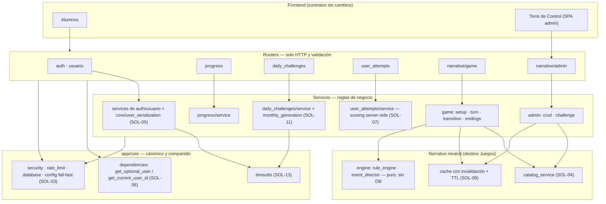
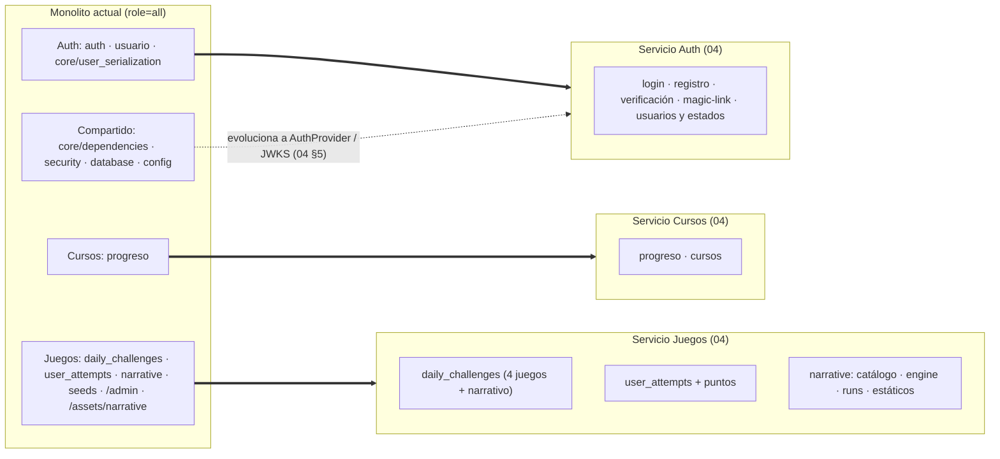
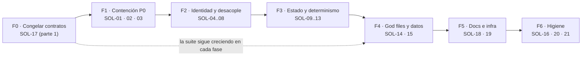

# Auditoría 01 — Plan de solución: Arquitectura y Modularidad

| Campo | Valor |
| :--- | :--- |
| **Proyecto** | Mayores Actualizaciones — SIPI-BACK (FastAPI + Motor/MongoDB) |
| **Ruta del repo** | `C:\Users\nmonti\Desktop\proyectos\backend\mayores_actualizacionesSIPI-BACK` |
| **Documento base** | `auditorias/01-arquitectura-y-modularidad.md` |
| **Insumos secundarios** | `auditorias/00-informe-consolidado.md`, `auditorias/04-desacoplamiento-microservicios.md` |
| **Fecha** | 19/10/2026 |
| **Tipo** | Plan de solución en formato documentación — **nada de lo aquí propuesto está implementado** |
| **Regla de esta etapa** | Solo lectura/planificación: no se ejecutó la app ni tests, no se tocó la base de datos y no se modificó ningún archivo de código. El único artefacto escrito es este documento. |

> **Nota importante**: todo el contenido de este documento es una **propuesta**. Los snippets de código están marcados como `PROPUESTA (no implementada)` y son ilustrativos: sirven para dimensionar el cambio, no para copiarlos literalmente sin pasar por los pasos y verificaciones descritos.
>
> **Alcance**: el informe 01 declara "21 hallazgos" en su encabezado, pero su tabla §1.1 enumera **25 IDs** (C-01…C-04, A-01…A-09, M-01…M-07, B-01…B-05). Este plan cubre **los 25 IDs** para no dejar ningún hallazgo afuera.

---

## 1. Resumen ejecutivo del plan y estrategia general

La auditoría 01 concluyó que el backend tiene una base modular razonable (`core/` limpio, patrón router→service en auth/usuario/progreso) pero con tres focos de deuda: **(a)** una "caja negra" de comportamiento no intencional (endpoints admin sin auth, triggers ECA muertos, caché que no se invalida), **(b)** duplicación estructural (generaciones mensuales x4, Sopa de Letras en 2 copias ya divergentes, capa `game→admin` invertida, `usuario→auth` acoplado) y **(c)** god files y efectos secundarios de proceso (`random.seed` global, seeds pesados en el lifespan).

Este plan convierte esos hallazgos en **21 bloques de solución** (SOL-01…SOL-21) con enfoque, archivos, pasos, verificación, riesgos, rollback, dependencias y esfuerzo. La estrategia general es:

1. **Primero contención** (P0: cerrar superficie admin, CORS, secretos, IDOR de attempts) porque son riesgos activos y no requieren refactor.
2. **Segundo identidad y desacople de features** (una sola dependencia de token en `core/`, romper `game→admin` y `usuario→auth`, definir invitados) porque cada pieza extraída se reutiliza tal cual en la futura topología de servicios.
3. **Tercero estado global y duplicación** (caché + TTL, `Random` local, registro único de juegos, ECA decidido, TZ única).
4. **Cuarto god files y datos** (seed narrativo y plantillas de crucigrama a JSON; seeds check-first y fuera del camino crítico del arranque).
5. **Quinto documentación e infra** (sincronizar `docs_interna`/README; decidir ruteo de `/admin` y `/assets/narrative` en Caddy).
6. **Transversal**: red mínima de tests de contrato antes de tocar nada (Fase 0), y regla "1 cambio = 1 PR con su hito de verificación".

**Alineación con la separación Cursos / Juegos / Auth (informe 04)** — regla de oro: *no crear ningún módulo nuevo en un lugar que luego haya que mover de servicio*. Los módulos que este plan introduce ya se ubican en su bounded context destino:

| Módulo nuevo propuesto | Ubicación | Servicio destino (informe 04) |
| :--- | :--- | :--- |
| `core/user_serialization.py` (`format_user_response`) | `app/core/` (temporal) | Auth |
| `usuario/service.generar_magic_link()` | `features/usuario/` | Auth |
| `core/dependencies.get_optional_user/get_current_user_id` | `app/core/` (evoluciona a `AuthProvider`) | Compartido → JWKS/introspección |
| `narrative/catalog_service.py` (catálogo neutral) | `features/narrative/` | Juegos |
| `narrative/cache.py` o caché neutral con invalidación | `features/narrative/` | Juegos |
| `daily_challenges/monthly_generation.py` + registro de generadores | `features/daily_challenges/` | Juegos |
| `scripts/startup_seeds.py` (`run_auth_seeds` / `run_game_seeds`) | `app/scripts/` | Auth / Juegos (split en Fase 2 del 04) |
| Datos JSON (`app/data/narrative/…`, `app/data/crucigrama_*.json`) | `app/data/` | Juegos |

El orden de fases de este plan es compatible con el Strangler Fig del informe 04: las fases 1–4 se ejecutan **dentro del monolito actual** ("role=all") y sobreviven sin retrabajo cuando el informe 04 parta despliegues y bases.

---

## 2. Principios y restricciones

1. **100% compatibilidad de contratos con el frontend**: no cambian rutas, métodos, payloads, status codes ni nombres de campos JSON (`dateStart`, `codigoAcceso`, `tipoUsuario`, `_id`/`id`, camelCase de respuestas). Todo cambio es interno o endurecimiento con los códigos de error ya estandarizados (401/403 de FastAPI).
2. **Incremental y no-breaking**: cada bloque es un PR independiente, mergeable y reversible; se prohíbe el "big bang".
3. **Refactor con red de seguridad**: antes de tocar un módulo se congela su contrato (snapshot OpenAPI + tests de humo). Este plan incluye la porción mínima de SOL-17 (tests) necesaria para sus fases; el plan 06 sigue siendo el dueño de la estrategia completa de testing.
4. **Una sola forma canónica por responsabilidad**: un parser de token (`core/dependencies`), una serialización de usuario, un registro de generación mensual, una fuente de datos de Sopa, una caché con invalidación, una noción de "hoy".
5. **Shims y re-exports en lugar de borrados**: cuando algo se mueve, el módulo viejo mantiene un re-export temporal (marcado `DEPRECATED`) y se elimina recién cuando un grep global confirma cero importadores.
6. **Alineación con microservicios (informe 04)**: ningún refactor debe crear dependencias que después crucen servicios (p. ej. Juegos no importa módulos de Auth; Cursos no importa Juegos). Durante la transición se admite la dirección actual solo con `TODO` de fase 4.
7. **No tocar sin autorización explícita** `Dockerfile`, `docker-compose.yml` y `Caddyfile` (la doc interna los declara "intocables"); los bloques de infra (SOL-19) y secretos (SOL-03) quedan explícitamente sujetos a esa autorización.
8. **Decisiones de producto primero**: TZ del juego (SOL-13), ECA (SOL-12), invitados (SOL-08) y contrato de attempts (SOL-07) requieren respuesta del equipo antes de codificar; hasta entonces, documentar el comportamiento actual en README (ver SOL-18).
9. **No regenerar datos existentes**: ningún cambio de generador (Sopa, crucigrama, mensuales) puede reescribir meses ya jugados; la unificación aplica a generación futura (ver SOL-10/SOL-11).

---

## 3. Tabla resumen de soluciones

| ID informe | Hallazgo (resumen) | Solución | Prioridad | Esfuerzo | Riesgo si se aplica | Fase |
| :--- | :--- | :--- | :--- | :--- | :--- | :--- |
| C-01 | Admin narrativo sin auth | SOL-01 | P0 | S | Bajo si la SPA admin envía Bearer; nulo si no (coordinar) | F1 |
| C-02 | daily_challenges upsert/admin sin auth | SOL-01 | P0 | S | Bajo (mismos 401/403) | F1 |
| C-03 | CORS universal con credenciales | SOL-02 | P0 | S | Bajo (requiere conocer dominios productivos) | F1 |
| C-04 | Secretos default hardcodeados | SOL-03 | P0 | S-M | Bajo en código; operacional (rotación) | F1 |
| A-09 | `.env` dentro de la imagen Docker | SOL-03 | P0 | S | Bajo | F1 |
| A-01 | Capa invertida `game→admin`; catálogo sin auth | SOL-04 | P1 | M | Bajo (comportamiento idéntico) | F2 |
| A-02 | `usuario↔auth` acoplados; magic-link inline; doble update | SOL-05 | P1 | M | Bajo-medio (contrato magic-link) | F2 |
| A-03 | 3 parsers de token divergentes | SOL-06 | P1 | S-M | Bajo (cubrir tokens inválidos) | F2 |
| A-04 | IDOR en `user_attempts` (`or 1`, identidad de body/query) | SOL-07 | P0 | M | Medio (contrato con FE juegos) | F2 |
| A-05 | ECA anunciado y no ejecutado (`AMORTIGUAR_DANIO`, `EN_EVENTO_*`, `AL_FINAL_PARTIDA`) | SOL-12 | P2 | S (retirar) / M (implementar) | Medio si se implementa (balance) | F3 |
| A-06 | Caché de recursos sin invalidación | SOL-09 | P2 | S | Bajo | F3 |
| A-07 | Sopa duplicada + `random.seed` global | SOL-10 | P2 | M | Bajo-medio (no regenerar) | F3 |
| A-08 | 4 generaciones mensuales + dispatch duplicados | SOL-11 | P2 | M | Bajo-medio (comparar outputs) | F3 |
| M-01 | God files (`seed_narrative`, `crucigrama_generator`, `daily service`, `auth service`) | SOL-14 | P2 | L | Bajo (respetar IDs/contenidos) | F4 |
| M-02 | Tests solo de integración contra DB real | SOL-17 | P2 | M-L | Bajo (es la red de seguridad) | F0 y continuo |
| M-03 | Docs internas desactualizadas | SOL-18 | P2 | M | Nulo | F5 |
| M-04 | `datetime.now()` naive mezclado con UTC | SOL-13 | P1 | M | Medio (decidir TZ primero) | F3 |
| M-05 | Seeds con fechas hardcodeadas; cobertura agotándose | SOL-15 | P1 | M + S | Bajo | F4 |
| M-06 | Invitados comparten `user_id=0` | SOL-08 | P1 | M | Alto de contrato si se exige login | F2 |
| M-07 | Caddy no enruta `/admin` ni `/assets/narrative`; `./dist` ausente | SOL-19 | P2 | S | Bajo (validar en despliegue) | F5 |
| B-01 | `.pyc` residuales pre-refactor (incluye `rule_engine`/`event_director` legacy) | SOL-16 + SOL-20 | P3 | S | Nulo | F6 |
| B-02 | `.gitignore` con residuos Java | SOL-20 | P3 | S | Nulo | F6 |
| B-03 | Dependencias sin pin | SOL-20 | P3 | S | Bajo (build) | F6 |
| B-04 | Rate limiting en memoria, solo auth, parseo duplicado | SOL-06 (+ nota gateway) | P3 | S | Bajo | F2/F6 |
| B-05 | Aliases mixtos `_id`/`id` en schemas | SOL-21 (no tocar; congelar) | P3 | S | Nulo | F6 |

**Leyenda de esfuerzo**: S ≈ 0,5–1,5 jornadas · M ≈ 2–4 jornadas · L ≈ 5–10 jornadas (por 1 dev; no incluye producción de contenido nuevo de SOL-15 ni la estrategia completa de tests del plan 06).

---

## 4. Soluciones detalladas

### SOL-01 — Cerrar con autenticación los routers de administración (C-01, C-02)

**Objetivo**: que ningún tercero pueda leer/modificar/borrar contenido de juego ni regenerar meses. Es el hallazgo más grave y el de menor costo.

**Enfoque**
- Aplicar `dependencies=[Depends(get_current_admin)]` a nivel de router (una línea por router) reutilizando `app/core/dependencies.py:63-74`. FastAPI ya devuelve 401 sin token y 403 sin rol con el formato de error global de `main.py:104-114`.
- **Requisito bloqueante**: verificar antes si la SPA de Torre de Control (`app/static/admin`) envía `Authorization: Bearer` en las llamadas a `/api/narrative/admin/*` y `/api/challenges/admin/*`. El informe 04 verificó que **hoy no lo envía**; el cambio debe ir en la misma ventana que la actualización mínima de la SPA (agregar header). Plan de contingencia si no se puede coordinar de inmediato: desplegar con una variable `ADMIN_ROUTES_ENFORCE_AUTH` (default `true`; `false` = modo log-only que registra el intento sin bloquear) durante un período corto, y luego retirar el flag.
- Endurecimiento complementario (sin cambiar contratos): validar en `POST /api/challenges` que `game_id` pertenezca al catálogo (`wordle|sudoku|sopa_letras|crucigrama|narrativo`) y que `date` esté en un rango razonable (± N días), con 400 si no.

**Cambios propuestos por archivo**
- `app/features/narrative/admin/router.py:64` → `APIRouter(prefix=..., dependencies=[Depends(get_current_admin)])` + import de `get_current_admin`.
- `app/features/daily_challenges/router.py` → mismo patrón; alternativamente `dependencies=[Depends(get_current_admin)]` en los endpoints `POST ""` (77), `GET /admin/status` (85) y `POST /admin/generate-month` (95) si se prefiere no blindar los GET públicos de lectura (no hacerlo: el router protege solo lo admin).
- `app/features/daily_challenges/service.py upsert_challenge` → validación de `game_id` contra catálogo (propuesta).
- SPA admin (repo aparte): agregar header Bearer a los `fetch` de admin narrativo/challenges.

**Pasos**
1. Confirmar con el front cómo autentica la SPA y si puede enviarse el header en esta iteración.
2. Agregar dependencia a los 2 routers (narrativo admin y daily admin/upsert).
3. Actualizar los tests existentes que llaman admin sin token (`tests/test_narrative_game.py:37,46`) para inyectar un token admin (fixture) — ver SOL-17.
4. Smoke test manual: sin token → 401; token alumno → 403; token admin → 200 como hoy.

**Verificación / criterios de aceptación**
- `grep -n "Depends" src/features/narrative/admin/router.py` devuelve ≥1 coincidencia.
- Los 32 endpoints de `/api/narrative/admin/*` y los 3 admin de `/api/challenges` responden 401/403 sin credenciales/admin, y su comportamiento con admin es idéntico al actual (mismos payloads).
- La SPA admin sigue operativa (ventana coordinada).

**Riesgos y mitigación**: (a) SPA admin sin Bearer → rompería la Torre de Control: mitigar con la verificación previa, la ventana coordinada o el flag log-only. (b) Tests que fijan la ausencia de auth → actualizar en el mismo PR.

**Rollback**: revertir el PR (segundos); alternativa operativa: `ADMIN_ROUTES_ENFORCE_AUTH=false` mientras se corrige el front.

**Dependencias y solapamientos**: informe 03 (seguridad) tiene este mismo hallazgo como P0; ejecutar una sola vez (este bloque es el dueño técnico). Informe 04, Fase 5 lo asume como "hardening"; adelantarlo aquí no rompe el Strangler (el gateway no cambia rutas). **Esfuero: S**. Destino microservicios: Juegos (ambos routers viajan enteros).

---

### SOL-02 — CORS por allowlist configurable (C-03)

**Objetivo**: eliminar el `allow_origin_regex=r"^https?://.*$"` con `allow_credentials=True` que anula la allowlist.

**Enfoque**
- Nueva setting `CORS_ORIGINS: str = ""` (lista separada por comas) en `core/config.py`, con default local (`http://localhost:5173,http://127.0.0.1:5173,http://localhost:3000,…`) y merge con `settings.FRONTEND_URL`.
- En producción: regex cerrado solo para desarrollo (`^https?://(localhost|127\.0\.0\.1)(:\d+)?$`) activado por `ENV=dev` (o simplemente no pasar regex cuando hay lista explícita). Nunca lista + regex abierto a la vez.

**PROPUESTA (no implementada)**
```python
origins = [o.strip() for o in settings.CORS_ORIGINS.split(",") if o.strip()]
if settings.FRONTEND_URL: origins.append(settings.FRONTEND_URL.rstrip("/"))
app.add_middleware(CORSMiddleware, allow_origins=sorted(set(origins)),
                   allow_credentials=True, allow_methods=["*"], allow_headers=["*"])
```

**Archivos**: `app/core/config.py`, `app/main.py:80-98`, `.env.example` (documentar `CORS_ORIGINS`).

**Pasos**: definir dominios reales con el equipo → setting + parseo → quitar regex abierto → verificar preflight desde cada origen permitido y rechazo desde un origen ajeno.

**Verificación**: `OPTIONS` desde `https://dominio-real` → 200 con `Access-Control-Allow-Origin` exacto; desde `https://evil.example` → sin header CORS. Login y flujos actuales del FE alumnos y SPA admin funcionan.

**Riesgos/mitigación**: olvidar un dominio productivo rompe el FE → obtener la lista completa antes del deploy; mantener la lista en variable de entorno editable sin recompilar.

**Rollback**: restaurar regex por ENV var (temporal, no recomendado) o revertir el PR.

**Dependencias**: informe 03/06 corroboran; informe 04 recomienda CORS en gateway en Fase 2 (Caddy) — este cambio es compatible y se complementa. **Esfuerzo: S**.

---

### SOL-03 — Secretos: fail-fast, `.env` fuera de la imagen, rotación y placeholders (C-04, A-09)

**Objetivo**: eliminar secretos utilizables por defecto y el `.env` real horneado en la imagen.

**Enfoque**
- `JWT_SECRET: str` **sin default** + `model_validator` que falle al arrancar si está vacío o es el valor histórico hardcodeado. Igual tratamiento para `ADMIN_DEFAULT_PASSWORD` (no sembrar admin con password conocida) y `MYSQL_PASSWORD` (solo script ETL; warning).
- `.dockerignore`: agregar `.env` y `*.env` (mantener `.env.example` excluido o incluirlo como placeholder, decisión).
- `.env.example`: reemplazar valores reales por placeholders (`CHANGE_ME`, secreto vacío).
- README: quitar credenciales reales (`admin@sistemas.com/admin123`) y PIN fijo; documentar proceso de bootstrap del admin.
- Operacional (fuera de código): rotar JWT_SECRET, password del admin y `codigo_acceso` 999999 del admin (`init_db.py:64-93`); idealmente hacer que el admin sembrado requiera cambio de PIN.

**Archivos**: `app/core/config.py:14,28,38`, `.dockerignore`, `.env.example`, `README.md`, `app/scripts/init_db.py` (opcional), `docker-compose.yml` (revisar `env_file`, sujeto a SOL-19/autorización).

**Pasos**: 1) fail-fast en `Settings`. 2) `.env` a `.dockerignore` + rebuild. 3) placeholders en example/README. 4) rotación coordinada y redeploy (los JWT viejos firmados con el secreto anterior dejan de validar: coordinar con FE; TTL actual 180 días, ver SOL-06/07 nota de TTL en informe 04). 5) verificar que `docker image inspect` / `docker run --rm … cat /app/.env` ya no encuentra el archivo.

**Verificación**: arranque sin `JWT_SECRET` → error explícito; con secreto válido → OK; la imagen no contiene `.env`; grep del valor histórico en el repo → 0 coincidencias.

**Riesgos/mitigación**: la rotación desloguea a todos → ventana de mantenimiento/acuerdo; si se distribuyó la imagen, asumir exposición ya ocurrida y rotar todo.

**Rollback**: revertir config (pero los secretos rotados no se restauran hacia atrás: planificar doble aceptación de firmas durante la ventana si se quiere transición suave en `security.decode_access_token`).

**Dependencias**: informe 03 (P0) es co-dueño; informe 04 supone secreto "gestionado por infra". **Esfuerzo: S-M** (código S, operación M).

---

### SOL-04 — Capa de catálogo neutral para el módulo narrativo: romper `game → admin` (A-01)

**Objetivo**: eliminar la dependencia invertida y la exposición pública de consultas de catálogo, dejando el router de jugador independiente de la capa de administración.

**Enfoque**
- Extraer `obtener_conversaciones_posibles_por_personajes` de `admin/crud_service.py:178-198` a un módulo neutral **`app/features/narrative/catalog_service.py`** (destino Juegos), junto con (opcional, misma iteración) el CRUD genérico de lectura de catálogo que usan tanto game como admin.
- `admin/crud_service.py` mantiene un **re-export** con marca `DEPRECATED` para no romper imports actuales (el router admin puede seguir importándolo de donde está hoy; el juego importa del módulo neutral).
- Los dos endpoints del jugador `POST/GET /conversaciones-posibles` (`game/router.py:185-211`) pasan a `catalog_service`. Se mantiene su carácter público de lectura (decisión: son catálogo de juego; no exponen datos de usuarios) — si negocio quiere cerrarlos, es un cambio de contrato que debe decidirse aparte (no en este bloque).

**Archivos**: `app/features/narrative/catalog_service.py` (nuevo), `admin/crud_service.py` (mover + re-export), `game/router.py:60-62` (cambiar import), `game/__init__.py` si se exporta.

**Pasos**: 1) crear módulo neutral con la función movida (misma firma y retorno `List[ConversacionResponse]`). 2) re-export en crud_service. 3) cambiar import en game/router. 4) `grep -rn "obtener_conversaciones_posibles_por_personajes"` para confirmar los puntos de import. 5) smoke de los 2 endpoints.

**Verificación**: los 2 endpoints devuelven exactamente la misma lista para el mismo universo/personajes; `game/*` no importa nada de `admin/*` (`grep` = 0); tests existentes pasan.

**Riesgos/mitigación**: bajo; el riesgo es dejar dos implementaciones → el re-export debe ser una línea (`from ...catalog_service import ...`), nunca una copia.

**Rollback**: revertir el PR; no hay datos involucrados.

**Dependencias**: prepara el terreno del informe 04 (Juegos como bounded context autocontenido). Relacionado con SOL-09 (la caché neutral puede vivir en el mismo módulo o en `narrative/cache.py`). **Esfuerzo: M**.

---

### SOL-05 — Desacoplar `usuario` de `auth`: serialización canónica, magic-link a service y `toggle_activo` atómico (A-02)

**Objetivo**: quitar el ciclo conceptual `usuario↔auth`, sacar la lógica de negocio del router y eliminar la ventana de inconsistencia del doble update.

**Enfoque**
- Mover `format_user_response` (`auth/service.py:14-52`) a **`app/core/user_serialization.py`** (destino Auth en el 04) y dejar en `auth/service.py` un import re-export (`from app.core.user_serialization import format_user_response  # DEPRECATED re-export`). `usuario/service.py:6` importa del nuevo módulo.
- Extraer el endpoint `POST /usuario/{user_id}/magic-link` (`usuario/router.py:119-143`) a `usuario/service.generar_magic_link(user_id)` manteniendo **idéntica** la respuesta (`success, token, accessUrl, codigoAcceso, activo, message`). Donde hoy re-arma URL y token inline, el nuevo service puede reutilizar el helper de `auth/service.enviar_acceso_correo` solo si el contrato resultante es el mismo (hoy difieren: `/acceso?token=` vs `/{redirect}?token=`); si no, mantener la construcción actual encapsulada y documentar la divergencia como decisión de producto.
- Mover los imports al final del archivo (`usuario/router.py:115-117`) arriba, tras la extracción (anti-patrón que desaparece).
- `toggle_activo` (`usuario/service.py:79-115`): un único `update_one` con `$set` de `{activo, estado_id, estado_codigo}` (misma semántica 2=ACTIVO / 3=SUSPENDIDO), eliminando la escritura intermedia.

**Archivos**: `app/core/user_serialization.py` (nuevo), `auth/service.py`, `usuario/service.py`, `usuario/router.py`.

**Pasos**: 1) crear `core/user_serialization.py` con la función idéntica. 2) re-export en auth + migrar import en usuario. 3) extraer magic-link a service. 4) unificar `toggle_activo`. 5) `grep -rn "format_user_response"` para verificar 1 sola definición.

**Verificación**: contrato de usuario idéntico (comparar JSON de `GET /usuario/{id}`, login, registro admin contra la respuesta previa: mismos campos y formatos de fecha); magic-link devuelve el mismo shape y un token válido; toggle-activo deja los 3 campos consistentes (test unitario con doble de DB).

**Riesgos/mitigación**: (a) algún import externo de `format_user_response` → el re-export lo cubre y el grep lo verifica antes de borrar. (b) El front usa campos de la respuesta magic-link → no cambiarlos.

**Rollback**: revertir el PR (los re-exports hacen la vuelta trivial).

**Dependencias**: informe 04 Fase 1 (`usuario` viaja a Auth); anteponer contratos congelados (SOL-17). **Esfuerzo: M**.

---

### SOL-06 — Dependencias únicas de identidad en `core/dependencies.py` (A-03, B-04)

**Objetivo**: una sola implementación de parseo/validación de token; eliminar los 3 parsers manuales divergentes y el parseo inline del rate limiter.

**Enfoque**
- Agregar en `core/dependencies.py`:
  - `get_optional_user()` → `None` si no hay token; 401 si hay token inválido/expirado (sin fallback silencioso).
  - `get_current_user_id()` → int, con variante `get_current_user_id_or_guest(default=0)` **solo** para el contrato narrativo vigente (ver SOL-08 para su reemplazo).
- Migrar:
  - `user_attempts/router.py:17-28` → dependencia (y su endurecimiento de identidad va en SOL-07).
  - `narrative/game/router.py:64-76` → dependencia (fallback invitado documentado hasta SOL-08).
  - `core/rate_limit.py:41-46` → reutilizar `decode_access_token` vía helper de `core/security.py` (sin duplicar decodificación manual); mantener el bypass admin local hasta que Auth externo lo absorba (informe 04).
- Documentar en el docstring de cada dependencia el código de respuesta ante token ausente/inválido/expirado (coherente con el comportamiento actual del canónico: 401).

**PROPUESTA (no implementada)**
```python
async def get_optional_user(creds=Depends(security_bearer)):
    if not creds: return None
    payload = decode_access_token(creds.credentials)
    if not payload: raise HTTPException(401, "Token de autenticación inválido o expirado.", headers={"WWW-Authenticate": "Bearer"})
    user = await get_database()["usuarios"].find_one({"id": int(payload["id"])})
    if not user: raise HTTPException(404, "El usuario asociado a este token no existe.")
    if user.get("activo") is False: raise HTTPException(403, "Tu cuenta de usuario se encuentra inactiva. Contacta al administrador.")
    return user
```

**Archivos**: `core/dependencies.py`, `features/user_attempts/router.py`, `features/narrative/game/router.py`, `core/rate_limit.py`.

**Pasos**: 1) agregar dependencias sin tocar consumidores. 2) migrar un consumidor por PR (primero narrative, luego user_attempts, luego rate_limit). 3) tests de token ausente/inválido/expirado por endpoint.

**Verificación**: `grep -rn "decode_access_token" app/features` y `app/core/rate_limit.py` → solo a través de las dependencias/helper; comportamiento de status codes documentado y testeado. Nota: `user_attempts` mantiene hoy "sin token → continúa con body", que SOL-07 corrige; el orden es SOL-06 primero (plumbing), SOL-07 después (contrato).

**Riesgos/mitigación**: diferencias sutiles de respuesta en clientes que dependen del fallback → test de contrato previo (SOL-17) y feature de rollback re-evaluada con el equipo del FE juegos.

**Rollback**: revertir PR puntual por consumidor.

**Dependencias**: informe 04 §5 (estas dependencias evolucionan a `AuthProvider`/JWKS sin cambiar firmas). B-04 se atiende aquí en la parte de parseo; la limitación "en memoria por proceso" se documenta y se deriva al gateway (informe 04) — sin cambio funcional ahora. **Esfuerzo: S-M**.

---

### SOL-07 — `user_attempts`: fin del IDOR y del scoring client-trusted (A-04)

**Objetivo**: que la identidad de escritura/lectura nunca provenga del body/query y que el último fallback (`or 1`) desaparezca; el puntaje no puede ser un valor arbitrario del cliente.

**Enfoque (en 2 sub-fases para no romper el FE juegos)**
- **Fase 7a (sin cambio de contrato observable para usuarios legítimos)**: eliminar `or 1` (`service.py:46`); si no hay identidad → 401. En `POST`, exigir token (o identidad anónima válida de SOL-08 si el FE la define); ignorar `req.user_id` como fuente de identidad. En `GET`, permitir `user_id` query **solo** si coincide con el token; si no coincide → 403 (o eliminar el query param si el FE ya manda Bearer).
- **Fase 7b (integridad del juego)**: calcular `score`/`stars` en servidor a partir de `game_data`/estado (p. ej. intentos y palabra para wordle) en lugar de confiar en `req.score` (`service.py:62-63,85-95`); aplicar los puntos con operación atómica `$inc` (ya lo es) y con la lógica de "solo si es victoria nueva" (ya existe) fuera del camino del score del cliente. Coordinar con informe 04 (puntos → Juegos, `usuarios.puntos` migra a `juegos_db` en Fase 4).
- Validar en schemas que `attempts`, `stars`, `score` estén en rangos razonables (`stars` 0-3, `score` 0-1000) como red mínima si 7b se difiere.

**Archivos**: `features/user_attempts/router.py`, `features/user_attempts/service.py`, `features/user_attempts/schemas.py`.

**Pasos**: 1) congelar contrato actual con tests (SOL-17). 2) 7a con feature-check final de identidad. 3) avisar al FE juegos del cambio (401/403 ante request sin identidad). 4) 7b con el contrato de scoring acordado.

**Verificación**: `POST` sin token con `user_id` en body → 401 y **no** escribe sobre ningún usuario; `GET` con `user_id` ajeno → 403; tests unitarios con doble de DB verifican que no se toca `usuarios.puntos` de terceros; el flujo legítimo del FE (con token) sigue idéntico.

**Riesgos/mitigación**: el riesgo medio es de contrato (el FE podría depender de guardar sin token) → preguntas abiertas §6; mitigar con fase 7a observando logs/uso real antes de 7b.

**Rollback**: revertir PR (7a) — pero no volver a dejar `or 1` sin decisión explícita.

**Dependencias**: SOL-06 (dependencias), SOL-08 (identidad anónima si aplica), informe 03 P0 #3 y 04 Fase 5. **Esfuerzo: M**.

---

### SOL-08 — Identidad de invitados en el narrativo (adiós al `user_id=0` compartido) (M-06)

**Objetivo**: que dos invitados no compartan partida/día y que no se pisen drafts, eventos ni finalizaciones.

**Enfoque (elegir UNA opción con producto)**
- **Opción A (recomendada si el narrativo puede exigir login)**: 401 cuando no hay token. Cambio de contrato grande: confirmar que el FE narrativo tiene sesión de alumno en todos los accesos (hoy algunos flujos usan invitado).
- **Opción B (si se quiere preservar invitados)**: identidad anónima real por cliente: cookie firmada/`X-Guest-Id` emitido por un endpoint liviano (o UUID generado por el FE y persistido en localStorage), y usar `user_id = f"guest:{uuid}"`… **no**: `user_id` es numérico y la colección tiene índice único `(user_id, date, game_id)` con `user_id` int. Alternativa compatible: mantener `user_id: int` y crear un usuario invitado real por dispositivo (registro ligero con `tipo_usuario=3` reservado o tabla de invitados), o cambiar el índice/documento a `user_key: str` **solo interno** manteniendo la API igual.
- **Opción C (mínima, interim)**: documentar en README que el modo invitado narrativo es single-player demo compartido y prohibirlo operativamente (riesgo aceptado y explicitado), mientras se decide A/B.
- Recomendación del plan: **B con identificador anónimo por dispositivo** (no rompe la promesa de poder jugar sin cuenta y elimina la colisión); requiere decisión de datos (nuevo campo interno). Mientras no se decida: C + `TODO` visible.

**Archivos**: `features/narrative/game/router.py:64-76` (fuente de identidad), `game/setup_service.py:103,139` y `coll narrative_runs` (clave de run), `tests/test_narrative_v2_game.py:42,56` (contrato a actualizar), README.

**Pasos**: 1) decidir A/B/C con producto. 2) si B: diseñar `guest_id` (emisión + validación + índice), migración no requerida (las runs viejas quedan con 0). 3) implementar y actualizar tests. 4) si C: documentar y mantener.

**Verificación**: dos clientes anónimos distintos no comparten run (test de integración con 2 guest ids); un invitado no puede leer el estado de otro (no hay endpoint que reciba guest ajeno); contrato del FE (campos, rutas) sin cambios para el caso logueado.

**Riesgos/mitigación**: opción A rompe invitados (riesgo alto de contrato) → no elegirla sin confirmación del FE; opción B toca el modelo de datos de runs → hacerlo junto con SOL-17 y sin exponer el campo nuevo en las respuestas (o exponerlo solo si el FE lo pide).

**Rollback**: revertir a `user_id=0` (deja runs nuevas huérfanas; limpiar si ocurre).

**Dependencias**: informe 02 P1 #8 (datos duplicados/desincronizados), informe 04 (identidad en Juegos); SOL-06/07 comparten el plumbing de identidad. **Esfuerzo: M**.

---

### SOL-09 — Caché de recursos de universo con invalidación (y TTL) (A-06)

**Objetivo**: que un cambio de `min`/`max`/recursos de un universo impacte de inmediato en las partidas y no quede pegado "hasta reiniciar el proceso" (peor aún con varios workers).

**Enfoque**
- Llamar `invalidar_cache_recursos_universo(universo_id)` desde las mutaciones de universo en `admin/crud_service.py` (`crear_o_actualizar_universo` y `eliminar_universo`; evaluar también `sembrar_finalizaciones_para_universo`, que no toca recursos).
- **Dirección de dependencia**: para no repetir el problema de A-01 (`admin→game`), mover la caché y sus funciones a un módulo neutral **`app/features/narrative/cache.py`** (o al `catalog_service.py` de SOL-04): `_obtener_mapa_recursos_universo()` lee de ahí y `crud_service` invalida desde ahí. `setup_service` y `game/__init__.py` mantienen re-exports (`DEPRECATED`) para no romper imports (turn/transition importan `_obtener_mapa_recursos_universo` desde setup_service hoy).
- Complemento de autocuración: TTL corto por entrada (30–60 s) con timestamp, de modo que aunque se omita una invalidación la BD manda en ≤1 minuto. Sin cambios de contrato (es interno).
- Nota multi-worker (informe 05): la caché en memoria es por proceso; el TTL la vuelve tolerable y el informe 04 prevé Redis/caché distribuida más adelante. Documentarlo.

**PROPUESTA (no implementada)**
```python
# narrative/cache.py
_RECURSOS_MAPA_CACHE: Dict[str, tuple[float, Dict[str, Any]]] = {}
TTL_SEGUNDOS = 45

async def _obtener_mapa_recursos_universo(universo_id: str):
    entrada = _RECURSOS_MAPA_CACHE.get(universo_id)
    if entrada and (time.monotonic() - entrada[0]) < TTL_SEGUNDOS:
        return entrada[1]
    db = get_database()
    u = await db[COLL_SETTINGS].find_one({"_id": universo_id})
    mapa = {r["clave"]: r for r in (u or {}).get("recursos", [])} if u else {}
    _RECURSOS_MAPA_CACHE[universo_id] = (time.monotonic(), mapa)
    return mapa

def invalidar_cache_recursos_universo(universo_id=None): ...  # igual firma que hoy
```

**Archivos**: `narrative/cache.py` (nuevo), `game/setup_service.py:51-71` (delegar), `admin/crud_service.py:101-111` (invalidar en crear/actualizar/eliminar), `game/__init__.py` (re-export), `game/turn_service.py:57` y `game/transition_service.py:45` (mantener imports o migrar a cache).

**Pasos**: 1) crear módulo neutral con la misma firma y TTL. 2) setup_service delega + re-export. 3) crud_service invalida. 4) test: crear universo → jugar (cacheado) → modificar max → verificar clipping nuevo sin reinicio.

**Verificación**: después de `POST /api/narrative/admin/universos` con límites nuevos, la siguiente acción de juego respeta los límites nuevos; `grep -rn "invalidar_cache_recursos_universo"` muestra ≥2 llamadas reales (hoy solo definición + export); test con TTL: tras 60 s sin invalidar, la BD se relee.

**Riesgos/mitigación**: cambio de ubicación rompe imports → re-exports + grep; TTL demasiado corto crea I/O extra → 45 s es marginal (una lectura por universo/minuto).

**Rollback**: revertir PR; la caché vieja queda como estaba.

**Dependencias**: SOL-04 (mismo módulo o vecino); informes 01 §5 orden 6, 05 (cachés), 04 (Juegos). **Esfuerzo: S**.

---

### SOL-10 — Sopa de Letras: fuente única de datos/generador y `Random` local (A-07)

**Objetivo**: terminar con la doble copia (runtime vs seed, ya divergente en títulos) y con el `random.seed()` global (efecto colateral de proceso).

**Enfoque**
- Fuente única: `app/features/daily_challenges/sopa_generator.py` (`SOPA_THEMES_CATALOG` + `generate_sopa_challenge_for_date`) o, mejor, extraer el catálogo a `app/data/sopa_temas.json` cargado al import (alinea con SOL-14 y con la edición de contenido sin tocar código).
- `app/scripts/seed_sopa_letras.py` deja de duplicar: importa `generate_sopa_challenge_for_date`/catálogo; su `SOPA_LETRAS_RAW_DATA` (fechas Ago–Oct) queda solo para **fechas históricas** si se decide preservar la divergencia ya jugada (documento de decisión): para fechas ≥ hoy y seeds futuros, usar la fuente única.
- `generate_word_search`: reemplazar `random.seed(seed)` + `random.*` por `rng = random.Random(seed)` + `rng.*` (mismo algoritmo, misma secuencia para el mismo seed → **verificar equivalencia binaria** para un set de fechas de muestra antes de mergear). Igual en la copia del seed script hasta que se elimine.
- Alinear con M-05 (SOL-15): definir si el runtime toma del catálogo de 93 temas (canónico) o de un dataset fechado; recomendación: **catálogo único + fecha como semilla** (lo que la implementación nueva ya hace).

**Archivos**: `daily_challenges/sopa_generator.py:16-118,186-209`, `scripts/seed_sopa_letras.py:8-166`, `app/data/sopa_temas.json` (opcional nuevo), `README`/docs si se documenta el catálogo.

**Pasos**: 1) congelar salida actual para fechas de muestra (ej. 2026-09-03, 2026-10-01, 2026-10-19) → JSON snapshot. 2) refactor `Random` local + re-verificar equivalencia. 3) seed script importa del generador (eliminar copia). 4) verificar que no se regeneran meses ya guardados (`force=false` natural; el seed solo escribe fechas de su dataset si se decide mantenerlo).

**Verificación**: para una fecha de muestra, `grid`/`placed_words`/`hints` idénticos antes vs después (byte a byte); `grep -c "def generate_word_search"` → 1; `grep -rn "random.seed("` en `app/features/daily_challenges` y `app/scripts` → 0.

**Riesgos/mitigación**: si `Random(seed)` no replicara exactamente el estado global (no debería, misma implementación Mersenne) → no regenerar meses existentes y comparar con snapshot; la divergencia de títulos históricos se conserva porque no se reescriben documentos existentes.

**Rollback**: revertir PR; los datos ya sembrados nunca se tocaron.

**Dependencias**: SOL-15 (cobertura/contenido) e informe 02 (datos); no depende del 04 pero queda en Juegos. **Esfuerzo: M**.

---

### SOL-11 — Un solo motor de generación mensual con registro de juegos (A-08)

**Objetivo**: eliminar ~400 líneas casi idénticas (sudoku/wordle/sopa/crucigrama) y los dos puntos de dispatch duplicados (router `if/elif` y `ensure_*`), con UN lugar para corregir idempotencia/`force`/sleeps.

**Enfoque**
- Extraer helper genérico `_generar_mes(juego, year, month, force, generador, existe_fn, sleep_s)` + diccionario de registro:
  - `GENERADORES = {"sudoku": {...}, "wordle": {...}, "sopa_letras": {...}, "crucigrama": {...}}` con `generador`, `existe_fn`, `sleep`, `title_fn`.
- `generate_and_save_*_month` pasan a ser wrappers delgados (misma firma y misma respuesta JSON: `success, game_id, year, month, month_name, days_in_month, generated_count, already_complete?`) para no romper imports del router ni de `main.py`.
- El router (`daily_challenges/router.py:105-113`) y `ensure_current_and_next_month_generated` (`service.py:590-631`) usan `GENERADORES` (una sola tabla). El `if/elif` desaparece.
- Preservar la idempotencia ganada: `force=false` salta mes completo; `force=false` salta día existente; edge de Wordle (refresca pistas con `force=True` y conserva solución existente) se conserva **explícito** en su entrada del registro.
- Mover todo esto a `daily_challenges/monthly_generation.py` (nuevo, destino Juegos) y dejar en `service.py` re-exports de compatibilidad. Esto acorta el god file (entra en SOL-14).

**Archivos**: `daily_challenges/monthly_generation.py` (nuevo), `daily_challenges/service.py:189-631` (mover/delegar), `daily_challenges/router.py:95-113` (usar registro).

**Pasos**: 1) snapshot de outputs para un mes completo ya seedeado (p. ej. 2026-10) por juego (counts y `config` de 3 días al azar). 2) implementar helper + registro copiando semántica exacta. 3) migrar las 4 funciones a wrappers. 4) migrar dispatch del router y de `ensure_*`. 5) comparar snapshots (mismos `game_id`, mismos campos, mismas cantidades). 6) suite existente + smoke.

**Verificación**: para un mes dado con `force=false` y mes completo → `already_complete=true, generated_count=0` en los 4 juegos; con `force=true` → regenera respetando las reglas actuales (wordle conserva solución); respuesta JSON campo a campo idéntica a la anterior (diff de claves y tipos).

**Riesgos/mitigación**: una diferencia sutil (sleep, orden) cambia `created_at`/timing → no es contrato visible; comparar solo datos funcionales. Cubrir con los tests de SOL-17.

**Rollback**: revertir PR (los wrappers hacen trivial volver).

**Dependencias**: informe 05 (generación en background/lifespan → SOL-15); informe 04 (Juegos); habilita SOL-14. **Esfuerzo: M**.

---

### SOL-12 — ECA incompleto: decidir "completar" vs "declarar fuera de alcance" + documentar (A-05)

**Objetivo**: que la Torre de Control no ofrezca disparadores/acciones que el motor ignora en silencio. Es un hallazgo con **dos caminos válidos de producto**; este bloque define cómo ejecutar cualquiera de los dos de forma verificable.

**Estado aceptado (verificado en el código actual)**
- El catálogo ofrece `AL_OBTENER, CADA_MES, EN_EVENTO_POSITIVO, EN_EVENTO_NEGATIVO, AL_FINAL_PARTIDA` (`admin/rules_catalog.py:21-27`) y la acción `AMORTIGUAR_DANIO` (`rules_catalog.py:47`, `enums.py:29`).
- Solo se despachan `AL_OBTENER` (`setup_service.py:210,214`; `turn_service.py:92,207`) y `CADA_MES` (`transition_service.py:112,116`). El motor ignora `AMORTIGUAR_DANIO` porque `ejecutar_accion` (`engine/rule_engine.py:104-142`) no tiene rama para ella.

**Camino A — Implementar (recomendado solo si el roadmap de producto lo pide)**
- **Disparadores de evento**: en `turn_service.decidir_evento_v2`, después de resolver `res_doc` y antes de `verificar_colapso_recursos`, clasificar por `res_doc.get("tipo")` (`positivo`/`negativo`/`neutro`) y despachar `EN_EVENTO_POSITIVO` o `EN_EVENTO_NEGATIVO` sobre un pool de efectos = `res_doc.efectos` + efectos de los personajes de la corte + cartas en mano (mismo patrón que `setup/transition`). Neutro: no dispara (documentarlo). Esto permite que un escudo (AMORTIGUAR_DANIO) actúe **antes** del chequeo de colapso.
- **AL_FINAL_PARTIDA**: en `endings_service.verificar_colapso_recursos` y en `transition_service` (mes 12, antes de `calcular_finalizacion_victoria`), despachar una última pasada de efectos de corte+carta+resultado; **importante**: un efecto AL_FINAL_PARTIDA no debe poder revivir una run ya finalizada (definir semántica: solo cosmético/modificar `finalizacion`/tags). Documentar en `rules_catalog`.
- **AMORTIGUAR_DANIO**: implementar como estado interno `run_data["escudos"]` (por recurso o global), consumido dentro de `ejecutar_accion` antes de aplicar un `MODIFICAR_RECURSO` negativo: reduce el daño en `valor` fijo o `PORCENTUAL` y se agota (o persiste, decisión de balance). No exponer campos nuevos en las respuestas de la API (`recursos`, `afinidad`, etc. no cambian de shape). Requiere QA de balance con el seed actual.
- **Feature flag** de motor (`NARRATIVE_ECA_V2=true|false`) para prender/apagar los nuevos disparadores sin deploy de rollback, y tests unitarios del motor puro (sin DB) para cada combinación.

**Camino B — Declarar fuera de alcance (recomendado si no hay roadmap)**
- Quitar del catálogo `EN_EVENTO_POSITIVO`, `EN_EVENTO_NEGATIVO`, `AL_FINAL_PARTIDA` y `AMORTIGUAR_DANIO` (`rules_catalog.py:24-26,47`) — o marcarlos `{"experimental": true, "soportado": false}` si la UI permite mostrarlos deshabilitados. Decisión de UI con el front admin.
- Mantener los enums en `enums.py` (hay documentos históricos que los referencian) pero documentar en `rules_catalog`/README que el motor actual solo ejecuta `AL_OBTENER|CADA_MES` + `MODIFICAR_RECURSO|MODIFICAR_AFINIDAD|OTORGAR_TAG`.
- **Regla de proceso**: cualquier valor "anunciado sin implementar" en un catálogo debe llevar un test que lo cubra o una marca de no soportado. Sin esto, el hallazgo vuelve.

**Archivos (según camino)**: `engine/rule_engine.py`, `game/turn_service.py:196-228`, `transition_service.py:81-98`, `endings_service.py:24-84`, `admin/rules_catalog.py`, `enums.py` (solo documental), `schemas/rules_schemas.py` (si AMORTIGUAR necesita campos nuevos → **evitar**; reutilizar `clave`/`valor`/`tipo_calculo`).

**Pasos**: 1) decisión de producto (pregunta abierta §6). 2) si A: tests unitarios del motor con fixtures primero; implementar disparadores; implementar escudos; flag; QA de balance con seeds. 3) si B: editar catálogo + doc + test que garantice coherencia catálogo↔motor. 4) actualizar README/docs (SOL-18).

**Verificación (A)**: un resultado `negativo` con un efecto `EN_EVENTO_NEGATIVO` configurado se ejecuta (test); un `AMORTIGUAR_DANIO` reduce el daño y se agota; `AL_FINAL_PARTIDA` corre en victoria y derrota y no altera el `status`/`finalizacion` de forma inválida. (B): test que falla si el catálogo anuncia un disparador que `despachar_efectos` nunca recibe.

**Riesgos/mitigación**: A cambia comportamiento de juego (balance) → flag + QA con contenido curado; B cambia la UI del admin → coordinar con front (opciones deshabilitadas o removidas).

**Rollback (A)**: `NARRATIVE_ECA_V2=false` o revert; (B): revert del catálogo.

**Dependencias**: informe 01 §5 orden 15; producto; SOL-17 (tests del motor puro son fáciles y deterministas). **Esfuerzo: S (B) / M (A)**.

---

### SOL-13 — Zona horaria única y determinista (M-04)

**Objetivo**: eliminar la mezcla de `datetime.now()` (hora local del servidor) con UTC y la dependencia del entorno ("hoy" cambia a las 21:00 ART en un contenedor UTC).

**Enfoque**
- Crear `app/core/timeutils.py` con `APP_TIMEZONE` (setting, default decidido por producto: p. ej. `America/Argentina/Buenos_Aires`) y helpers:
  - `now_utc() -> datetime` (aware, para escrituras).
  - `today_str(tz=APP_TIMEZONE) -> str` (YYYY-MM-DD, para "el día del juego", meses y queries).
  - `month_range(year, month)`, `current_month()` (para autogeneración).
- Reemplazar usos naive en `daily_challenges/service.py:28,57,79,104,140,598` (y los que aparezcan en `monthly_generation.py` tras SOL-11) y `narrative/admin/challenge_service.py` (targets de mes) por los helpers.
- Scripts/tests que usan `datetime.now()` (`seed_narrative.py:1814`, tests) pueden quedarse pero documentado; idealmente migrar a `today_str()`.
- Documentar la decisión (¿día del juego = día calendario argentino o UTC?) en README y en el helper.

**Archivos**: `core/timeutils.py` (nuevo), `core/config.py` (setting TZ), `daily_challenges/service.py`, `narrative/admin/challenge_service.py`, `main.py` (loop de 12 h puede seguir con UTC), `.env.example`, README.

**Pasos**: 1) decisión de TZ. 2) helper + setting. 3) migrar consumidores uno por uno verificando que las fechas de las queries no cambien en el entorno de desarrollo. 4) test: con `TZ` forzada, `today_str()` devuelve el día esperado a las 23:59 y 00:01.

**Verificación**: `grep -rn "datetime.now()" app/features/daily_challenges` → 0 naive; el desafío "de hoy" coincide con el día calendario del producto a cualquier hora local del server; no se re-mueven datos (ninguna migración requerida: solo cambia la definición de "hoy" para consultas futuras).

**Riesgos/mitigación**: cambiar el "hoy" puede alterar qué challenge ve un usuario entre 21:00 y 00:00 → coordinar con producto; hacer el cambio fuera del horario de la franja crítica y con el default acordado.

**Rollback**: revertir PR o setear `APP_TIMEZONE=UTC` para volver al comportamiento de contenedor.

**Dependencias**: informes 02/05 (fechas), SOL-11 (el helper se usa en el módulo nuevo), SOL-15 (cobertura). **Esfuerzo: M**.

---

### SOL-14 — God files: extracción de datos y splits por responsabilidad (M-01)

**Objetivo**: bajar el costo de navegación/PRs y hacer los datasets editables sin tocar lógica. Sin romper imports públicos (`seed_narrative_game`, `CRUCIGRAMA_TEMPLATES`, `CRUCIGRAMA_BOARDS`, funciones de `service.py`).

**Enfoque por archivo**

1) **`app/scripts/seed_narrative.py`** (verificado: 1824 líneas, una única función `seed_narrative_game()` desde la 56):
   - Extraer el dataset a JSON versionado, un archivo por entidad: `app/data/narrative/corte_medieval/{universo,personajes,cartas,resultados,eventos,conversaciones}.json`.
   - `seed_narrative_game()` queda como orquestadora (~50-80 líneas) que carga JSON → valida con los mismos schemas Pydantic → llama a los mismos `crear_o_actualizar_*` → genera el mes con `generar_mes_narrativo` (preservar `_id` exactos: el seed es idempotente por `_id`/fecha).
   - Opcional (mismo PR o siguiente): `app/scripts/narrative_seed_data.py` con los loaders + `__all__`.

2) **`app/features/daily_challenges/crucigrama_generator.py`** (verificado: 1136 líneas):
   - Mover `CURATED_CLUES` y `CRUCIGRAMA_TEMPLATES` a `app/data/crucigrama_clues.json` y `app/data/crucigrama_templates.json`; cargarlos al import (`json.load` con ruta relativa al paquete de datos) y mantener los nombres de módulo (`CURATED_CLUES`, `CRUCIGRAMA_TEMPLATES`, alias `CRUCIGRAMA_BOARDS`) → ningún import externo cambia.
   - El código del motor (backtracking, indexado) queda en el módulo.

3) **`app/features/daily_challenges/service.py`** (634 líneas): se acorta con SOL-11 (`monthly_generation.py`); `service.py` queda con consultas/upsert (`get_today_challenge`, `get_month_challenges`, `get_challenge_by_date`, `upsert_challenge`, `get_challenge_date_range`) y re-exports.

4) **`app/features/auth/service.py`** (408 líneas, 10 responsabilidades): **diferido** a después de los tests de contrato (SOL-17) y de la decisión del micro Auth (informe 04). Si se hace: partir por caso de uso (`auth/services/login_service.py`, `registro_service.py`, `verificacion_service.py`) manteniendo re-exports en `service.py`. **No** hacerlo antes de tener tests que congelen los flujos.

**Archivos**: `scripts/seed_narrative.py`, `app/data/narrative/…` (nuevos), `daily_challenges/crucigrama_generator.py`, `app/data/crucigrama_*.json` (nuevos), `daily_challenges/service.py`, (`auth/service.py` diferido).

**Pasos (por PR separado)**: 1) seed narrativo: extraer JSON → recargar → sembrar en DB limpia de prueba → comparar conteos y `_id` por colección contra el seed actual. 2) crucigrama: extraer JSON → snapshot de 3 crucigramas de fechas fijas antes/después → diff. 3) service: SOL-11. 4) auth: postergado con TODO.

**Verificación**: `python -m app.scripts.seed_narrative` (en entorno de prueba) produce los mismos documentos (conteos + hash por `_id`+campos); `generate_crucigrama_challenge_for_date('2026-10-19')` idéntico (misma semilla `Random`); imports existentes intactos (`grep -rn "CRUCIGRAMA_BOARDS\|seed_narrative_game"`).

**Riesgos/mitigación**: pérdida de fidelidad al transcribir datos → nunca "reformatear" valores al JSON; usar generador de JSON desde el propio Python una vez y diff; riesgo de IDs duplicados → mantener `_id` explícitos y el upsert actual.

**Rollback**: revertir PR (los JSON no se usan si no está el código; volver a inline).

**Dependencias**: SOL-11 (acorta service), SOL-15 (los datasets se vuelven la fuente de cobertura), SOL-17 (comparaciones), informe 04 (Juegos). **Esfuerzo: L total (datos L, código M)**; se puede partir en 3 PRs.

---

### SOL-15 — Contenido curado: datasets JSON, siembra check-first, alertas de cobertura y arranque por dominio (M-05)

**Objetivo**: que el contenido curado no se agote en silencio, que los seeds no reescriban cientos de documentos en cada arranque y que la generación pesada deje de bloquear el `lifespan`; todo, separado por dominio (Auth vs Juegos) para sobrevivir al corte del informe 04.

**Estado verificado (a la fecha del plan, 19/10/2026)**
- Wordle: datasets hardcodeados Ago–Oct 2026 (92 días) en `seed_challenges.py:8-107`; siembra en `109-146`. Sopa: `SOPA_LETRAS_RAW_DATA` Ago–Oct (`seed_sopa_letras.py:8-156`); siembra `168-208`. Sudoku: meses `[8,9,10,11,12]` de 2026 (`seed_sudoku.py:18`). Narrativo: el seed genera **solo el mes en curso** (`seed_narrative.py:1814-1816`).
- Autogeneración de mes actual+próximo para los 4 juegos diarios vía `ensure_current_and_next_month_generated` (`service.py:590-631`), invocada **inline** en el arranque y luego cada 12 h (`main.py:42,50-62`). El narrativo **no** está en esa autogeneración: sin `POST /api/narrative/admin/generar-mes`, no hay challenges narrativos nuevos.
- Cada arranque reescribe ~185 documentos por `$set` incondicional de los seeds (informe 00, hallazgo #9: "arranque costoso y frágil").
- Hoy quedan ~12 días de contenido Wordle/Sopa "curado"; desde noviembre 2026 esos juegos serán 100 % autogenerados (otro estilo y otro banco de pistas).

**Enfoque**
1. **Datos a JSON versionado** (junto con SOL-14): `app/data/wordle_2026.json` y `app/data/sopa_2026.json` (los datasets curados) + loader común; el código queda como orquestador. Extender el horizonte curado **al menos +6 meses** (Nov 2026–Abr 2027) — este punto es trabajo de contenido, no de código.
2. **Siembra check-first**: los seeds curados pasan de `$set` a `$setOnInsert` (una sola escritura, la primera vez) para no tocar `updated_at` ni reescribir 185 documentos por reinicio; las correcciones posteriores de contenido se hacen por el endpoint admin `POST /api/challenges` (ya existe) o por una bandera `force` explícita del script, nunca por el arranque.

   **PROPUESTA (no implementada)**
   ```python
   # antes: {"$set": doc, "$setOnInsert": {"created_at": now_utc}}
   # después (seed curado):
   await db["daily_challenges"].update_one(
       {"game_id": "wordle", "date": item["date"], "difficulty": "standard"},
       {"$setOnInsert": {**doc, "created_at": now_utc}},   # inserta solo si falta
       upsert=True,
   )
   ```
3. **Alertas de cobertura**: (a) log `WARNING` al arrancar si el mes en curso o el siguiente tiene huecos o queda con menos de N días de contenido curado (N acordado, p. ej. 15); (b) extender la respuesta **aditiva** de `GET /api/challenges/admin/status` con un bloque `alert`/`coverage` (no se quita ni renombra ningún campo existente; confirmar con el front admin) y (c) incluir `narrativo` en el chequeo de cobertura (aunque no se autogenere hasta decisión de producto).
4. **Arranque por dominio**: extraer `app/scripts/startup_seeds.py` con `run_auth_seeds()` (`seed_estados_usuario`, `seed_default_admin`) y `run_game_seeds()` (wordle/sopa/sudoku, finalizaciones narrativas y `seed_narrative` si aplica). El `lifespan` de hoy llama a ambos; con el informe 04 (Fase 2, `SERVICE_ROLE`) cada entrypoint llamará solo al suyo. La **generación mensual** sale del camino crítico: arranca como tarea en background (con pequeño retardo) en vez de bloquear el startup, y el loop de 12 h queda solo del lado Juegos (informe 04 ya lo prevé así).

   **PROPUESTA (no implementada)**
   ```python
   # lifespan (esquema)
   await run_auth_seeds()
   await run_game_seeds()
   asyncio.create_task(_generar_meses_faltantes_diferido())  # no bloquea el arranque
   ```
5. **Narrativo**: decidir con producto si se auto-genera el mes siguiente con `generar_mes_narrativo` (misma lógica que los otros juegos) o si la alerta en logs/panel es suficiente (ver §6).

**Archivos**: `app/scripts/startup_seeds.py` (nuevo), `app/scripts/seed_challenges.py`, `seed_sopa_letras.py`, `seed_sudoku.py` (check-first + loader JSON), `app/data/wordle_2026.json` / `app/data/sopa_2026.json` (nuevos), `app/features/daily_challenges/service.py` (registro de dispatch ya lo aporta SOL-11), `daily_challenges/router.py` (campo aditivo), `app/main.py` (lifespan), `README`/docs de despliegue.

**Pasos**: 1) congelar conteos actuales por juego/mes (snapshot). 2) extraer datasets a JSON y cargar (SOL-14). 3) cambiar a `$setOnInsert` y verificar que un segundo arranque no modifica `updated_at`. 4) implementar alertas (logs + campo aditivo). 5) mover seeds a `startup_seeds.py` y diferir la generación. 6) extender contenido curado (tarea de contenido, fuera del código). 7) tests con fechas congeladas (SOL-17).

**Verificación**: segundo arranque consecutivo → 0 escrituras en documentos ya sembrados (comparar `updated_at` de una muestra); arranque con dataset que termina en ≤15 días → `WARNING` visible; `GET /api/challenges/admin/status` conserva todos sus campos actuales y agrega el bloque nuevo; el arranque responde antes de que termine la generación diferida; no se regenera ningún mes existente.

**Riesgos/mitigación**: (a) content ownership (extensión de contenido requiere autores) → separar PR de código de PR de contenido; (b) alerta ruidosa → umbral configurable; (c) cambiar el orden de arranque (admin/estados antes que todo) → respetar el orden interno de `run_auth_seeds` y probarlo; (d) `$setOnInsert` impide corregir contenido curado automáticamente → usar el endpoint admin para correcciones (documentarlo).

**Rollback**: cada sub-PR es revertible; la generación diferida puede volver a inline con un flag de entorno si hubiera problemas de arranque.

**Dependencias**: SOL-11 (registro de juegos para el dispatch), SOL-13 (TZ para "mes siguiente"), SOL-14 (JSON), SOL-17 (tests de arranque), informe 04 (seeds por rol, Fase 2), informe 05 (arranque). **Esfuerzo: M + S** (contenido M; código y alertas S).

---

### SOL-16 — Residuos pre-refactor del narrativo: limpieza, guardrail y receta de shim (B-01 + duplicación legacy)

**Objetivo**: eliminar los `.pyc` sin fuente que quedaron del narrativo pre-refactor, impedir que la estructura vieja "reaparezca" por copy-paste, y dejar escrita la **receta de consolidación/compatibilidad** (shim + equivalencia) que usan todos los movimientos de este plan.

**Estado verificado**
- `app/features/narrative/` hoy contiene solo `constants.py`, `enums.py`, `__init__.py` y los paquetes `admin/`, `game/`, `engine/`, `schemas/`, `docs/`. **No existe** una doble fuente activa `rule_engine.py`/`event_director.py` vs `engine/`: la "duplicación" que reportó la auditoría es el residuo histórico.
- En `app/features/narrative/__pycache__/` viven `.pyc` de fuentes inexistentes: `admin_router`, `router`, `router_v2`, `service`, `schemas`, `rule_engine`, `event_director` (en versiones cpython-312 y 313). Los `.pyc` dentro de `__pycache__` **no son importables sin su fuente** (no alteran runtime), no viajan en git (`__pycache__/` ignorado) ni en la imagen (`.dockerignore` excluye `__pycache__/` y `*.pyc`), así que el impacto es ruido, confusión de herramientas y evidencia de doble intérprete.

**Enfoque**
1. **Limpieza** (one-shot, entorno dev/deploy): borrar directorios `__pycache__` de `app/` y `tests/`; verificar con un listado que todo `.pyc` tiene su `.py`. Mantener `PYTHONDONTWRITEBYTECODE=1` (ya está en `Dockerfile:7`) y agregar el paso a la checklist de despliegue.
2. **Guardrail anti-legacy** (test rápido, unit): ninguna fuente nueva puede tener nombre de la estructura pre-refactor en la raíz del feature.

   **PROPUESTA (no implementada) — `tests/test_legacy_structure_absent.py`**
   ```python
   from pathlib import Path
   import app.features.narrative as pkg

   LEGACY = {"admin_router", "router", "router_v2", "service", "schemas", "rule_engine", "event_director"}

   def test_narrative_root_has_no_legacy_monolith_files():
       root = Path(pkg.__file__).parent
       offenders = [p.name for p in root.glob("*.py") if p.stem in LEGACY]
       assert not offenders, f"Archivos legacy reintroducidos en la raíz del feature: {offenders}"
   ```
   Complementar con un test de import de `app.main` (detecta imports rotos o resurrección de módulos viejos vía `importlib`).
3. **Receta de shim (la "estrategia de consolidación/compatibilidad" para cualquier módulo que se mueva)**, aplicable a SOL-04/05/09/11/14:
   - Mover la **implementación** al módulo nuevo (destino bounded context del informe 04).
   - En el módulo viejo dejar **solo** una línea de re-export marcada `DEPRECATED` (nunca una copia).
   - Verificar que el símbolo es el **mismo objeto** en ambas rutas y cubrir con un smoke funcional de 1–2 casos.
   - Retirar el shim recién cuando `grep -rn "<símbolo>"` global dé 0 importadores y con al menos 1 fase/release de espera.

   **PROPUESTA (no implementada)**
   ```python
   # módulo viejo (p. ej. admin/crud_service.py tras SOL-04)
   from app.features.narrative.catalog_service import obtener_conversaciones_posibles_por_personajes  # DEPRECATED: re-export temporal

   # test de equivalencia
   def test_shim_reexport_is_same_object():
       from app.features.narrative.admin import crud_service as old
       from app.features.narrative import catalog_service as new
       assert old.obtener_conversaciones_posibles_por_personajes is new.obtener_conversaciones_posibles_por_personajes
   ```
4. **Nota histórica**: `app/features/narrative/docs/DOSSIER_REFACTOR_NARRATIVE.md` describe la estructura vieja (raíz monolítica) → se mueve a `docs_interna/historico/` en SOL-18; el guardrail evita que ese texto se traduzca en código "resucitado".

**Archivos**: limpieza de `app/**/__pycache__` y `tests/**/__pycache__` (sin commit), `tests/test_legacy_structure_absent.py` (nuevo), checklist de despliegue (README/docs), `Dockerfile` solo lectura (ya cumple).

**Pasos**: 1) listar `.pyc` huérfanos y borrar. 2) agregar guardrail al PR de tests (SOL-17). 3) por cada movimiento de módulo del plan, aplicar la receta y su test de equivalencia en el mismo PR. 4) auditar en F6 con `grep` que no queden shims de fases ya cerradas.

**Verificación**: `Get-ChildItem -Recurse -Filter *.pyc app, tests` (dev) → 0 huérfanos; `python -c "import app.main"` OK; guardrail verde; cada shim introducido tiene test `is` + smoke; `git ls-files | Select-String "\.pyc"` → vacío.

**Riesgos/mitigación**: falso positivo del guardrail si un archivo legítimo se llamara `service.py` en la raíz → la lista es exacta y acotada al feature narrativo (hoy no habría falsos positivos); olvidar borrar un shim viejo → checklist por fase en F6.

**Rollback**: revertir el PR del guardrail; la limpieza de `.pyc` no requiere rollback (se regeneran solos).

**Dependencias**: SOL-17 (host del guardrail), SOL-18 (mover el dossier), SOL-20 (higiene). **Esfuerzo: S**.

---

### SOL-17 — Red mínima de tests de contrato y unitarios con doble de DB (M-02)

**Objetivo**: congelar contratos antes de tocar nada y permitir que los refactors de F1–F6 avancen sin depender de MongoDB real en cada corrida. La estrategia completa de testing queda en el plan 06; este bloque entrega **la porción que este plan necesita**.

**Estado verificado**
- Únicos tests: `tests/test_narrative_game.py` (87 líneas) y `tests/test_narrative_v2_game.py` (115 líneas); ambos abren Mongo real (`connect_to_mongo`), siembran (`seed_narrative_game`), usan **invitado 0** y llaman admin **sin token** (`test_narrative_game.py:37,46`), fijando implícitamente el comportamiento inseguro que corrige SOL-01. Sin `conftest.py`, sin `pytest.ini`/`pyproject.toml` (markers sin registrar), sin CI.

**Enfoque**
1. **Config**: `pytest.ini`/`pyproject.toml` con markers registrados (`integration`, `slow`) y default de CI `-m "not integration"`; `tests/conftest.py` con fixtures.
2. **Snapshot OpenAPI (el candado)**: generar `tests/contract/openapi_snapshot.json` desde `app.openapi()` **antes** de tocar código (F0) y agregar un test de comparación normalizada (orden de componentes irrelevante). Solo se actualiza el snapshot en PRs cuyo cambio de contrato sea deliberado y revisado.
3. **Dobles de DB**: monkeypatch de `app.core.database.get_database` con un doble en memoria (o `mongomock` — decisión abierta §6) que cubra lo que usan los servicios bajo test: `find_one`, `update_one` ($set/$setOnInsert/$inc), `count_documents`, `delete_one`, `find().to_list`. Los tests de motor ECA (SOL-12) no usan DB: son funciones puras y deterministas.
4. **Tests mínimo por feature** (contrato HTTP con `TestClient`/`ASGITransport` + doble):
   - auth: login/registro/verificación (status y claves JSON).
   - usuario: perfil + shape del magic-link (`success, token, accessUrl, codigoAcceso, activo, message`).
   - progreso: endpoints principales.
   - daily_challenges: `today`, `date`, `range`, y admin tras SOL-01 (401/403).
   - user_attempts: 401/403 nuevos de SOL-07 y no-escritura sobre terceros.
   - narrativo: setup/estado mínimo con **token de fixture** (no invitado 0) y fallback de invitado documentado hasta SOL-08.
5. **Refactor de los 2 tests existentes**: marcar `@pytest.mark.integration`, reemplazar `datetime.now()` por fecha congelada (fixture `frozen_today` que monkeypatchea `core/timeutils.today_str` tras SOL-13), inyectar token admin donde hoy no lo hay, y dejar el uso de invitado 0 solo como caso explícito hasta SOL-08.
6. **CI**: unitarios sin Mongo/red en cada PR; `integration` manual/nightly (contenedor Mongo) — la orquestación final pertenece al plan 06.

**PROPUESTA (no implementada) — esqueleto de fixture**
```python
# tests/conftest.py
import pytest

@pytest.fixture
def frozen_today(monkeypatch):
    import app.core.timeutils as t
    monkeypatch.setattr(t, "today_str", lambda tz=None: "2026-10-19")
    return "2026-10-19"

@pytest.fixture
def admin_token():
    # token firmado con el JWT_SECRET de test y rol admin
    ...
```

**Archivos**: `tests/conftest.py` (nuevo), `tests/contract/openapi_snapshot.json` (nuevo), `tests/test_*` nuevos por feature, `tests/test_narrative_game.py`, `tests/test_narrative_v2_game.py`, `pytest.ini`/`pyproject.toml` (nuevo), `.dockerignore`/CI (si aplica).

**Pasos**: 1) config + snapshot OpenAPI (F0, sin tocar features). 2) doble de DB + primera tanda de unitarios (motor ECA, toggle_activo, scoring). 3) contrato HTTP por feature. 4) adaptar los 2 tests existentes. 5) en cada PR del plan, actualizar/extender lo que corresponda.

**Verificación**: `pytest -m "not integration"` verde sin Mongo ni red; snapshot OpenAPI con diff vacío salvo cambio deliberado; el test admin sin token pasa a esperar 401 tras SOL-01 (cambio coordinado en el mismo PR); los tests de integración siguen pasando contra Mongo local.

**Riesgos/mitigación**: dobles de DB incompletos → mantenerlos mínimos, preferir funciones puras, y reservar los flujos complejos para integración marcada; sobre-ajuste del snapshot (ruido) → normalizar y exigir revisión del diff; duplicar la estrategia del plan 06 → coordinar alcance antes de F0 (este bloque no define CI final ni cobertura objetivo).

**Rollback**: revertir PR (los tests son aditivos; el snapshot se puede regenerar).

**Dependencias**: plan 06 (dueño de la estrategia completa), SOL-01 (fixture admin), SOL-08/13 (fixtures), informe 04 Fase 0 (tests de contrato). **Esfuerzo: M-L** (arranque en F0 S-M; luego continuo por fase).

---

### SOL-18 — Sincronizar README, docs_interna y dossier histórico (M-03)

**Objetivo**: que la documentación del repo describa el sistema **real**. El informe 01 §3.3 contiene la tabla doc-vs-código completa (14 filas); este bloque la convierte en un plan de edición verificable.

**Enfoque (por documento)**
1. **`README.md`**: corregir estructura de features (hoy faltan `daily_challenges`, `user_attempts`, `narrative` y `static/`), seeds reales, puerto **8082** en todos los comandos (hoy 8080 en líneas 88/92), agregar sección **"Autenticación por feature"** (qué exige token hoy y tras SOL-01/06/07), documentar variables nuevas de este plan (`CORS_ORIGINS`, `APP_TIMEZONE`, flags si se aprueban), quitar credenciales reales (SOL-03) y describir el bootstrap del admin; documentar el modo invitado del narrativo como "demo single-player compartido" mientras no se decida SOL-08.
2. **`docs_interna/DIAGRAMAS_ARQUITECTURA_NARRATIVO.md`**: colecciones reales `narrative_settings`/`narrative_endings` (no `narrative_universes`/`narrative_finalizations`), fases reales de `RunPhaseEnum` (`DRAFT_MENSUAL`, `TOMA_DECISION_EVENTO`, `RESOLVER_CONVERSACION`, `BALANCE_MES`, `FINALIZADA`), 5 personajes/5 cartas (no 3-4/2-2), link a `game/router.py` (el archivo `narrative/router_v2.py` no existe).
3. **`docs_interna/ARQUITECTURA_JUEGOS_Y_NARRATIVO.md`**: eliminar o marcar como inexistente la sección "Endpoints Legacy V1 (ocultos)" (esos endpoints no existen en `game/router.py`), corregir `admin_router.py` → `admin/router.py` (los endpoints sembrar-finalizaciones/generar-mes sí existen), `EstadoPartidaActivaResponse` → `EstadoTurnoResponse`, puerto 8082 (hoy 8080 en línea 236).
4. **`app/features/narrative/docs/DOSSIER_REFACTOR_NARRATIVE.md`** → mover a `docs_interna/historico/` con banner "HISTÓRICO: describe la estructura pre-refactor (ver SOL-16)". Mismo criterio para `DEFINICIONES_POST_JUEGO_NARRATIVO.md` (corregir puerto/schema o marcarlo histórico).
5. **`docs_interna/README_SEGURIDAD.md`**: actualizar la nota del filtrado del Caddyfile tras SOL-19 (incluir `/admin*` y `/assets/narrative*` en el proxy) y el estado de auth de los paneles admin tras SOL-01.
6. **Regla de proceso**: cada diagrama cita `archivo:línea`; los docs se actualizan **en el mismo PR** que cambia el código; agregar un changelog interno simple (`docs_interna/CHANGELOG.md`) con una línea por PR de este plan.

**Archivos**: `README.md`, `docs_interna/*.md`, `docs_interna/historico/` (nuevo), `app/features/narrative/docs/*`.

**Pasos**: 1) checklist fila por fila de la tabla §3.3 del informe 01. 2) editar README (estructura/puertos/secciones nuevas). 3) regenerar DIAGRAMAS/ARQUITECTURA contra el código (usar los mermaid de §4.x de este documento como base interna). 4) mover dossier + banner. 5) revisar que ningún doc linkee a módulos inexistentes.

**Verificación**: las 14 filas de la tabla §3.3 → ninguna pendiente; `grep -rn "8080" README.md docs_interna/` → solo donde corresponda a otro repo (proxy Vite); `grep -rn "router_v2.py\|admin_router.py\|narrative_universes\|narrative_finalizations" docs_interna/ README.md` → 0; links internos de markdown válidos.

**Riesgos/mitigación**: documentar una promesa equivocada → cada afirmación se valida con grep contra el código antes de commitear; divergencia futura → regla de actualización por PR.

**Rollback**: revertir PR (documentación).

**Dependencias**: SOL-01/06/07/19 (los estados documentados cambian con ellos; editar justo después), SOL-16 (dossier), SOL-03 (credenciales). **Esfuerzo: M**.

---

### SOL-19 — Caddy: enrutar `/admin*` y `/assets/narrative*` y resolver `./dist` (M-07)

**Objetivo**: que en el despliegue documentado la Torre de Control y las imágenes narrativas sean alcanzables, y que `/` no quede en 404 por `./dist` ausente.

**Estado verificado**
- `Caddyfile:33` proxya solo `/api* /usuario* /progreso* /cursos* /payment* /health* /actuator*`; **no** `/admin*` ni `/assets/narrative*`, que FastAPI monta en `main.py:139-174` (`/admin` con SPAStaticFiles + fallback, `/assets/narrative` StaticFiles).
- `docker-compose.yml:13` monta `./dist:/srv:ro`, pero `dist/` **no existe** en el repo (`Test-Path` → `False`): hoy Caddy sirve 404 en `/` hasta que alguien compile el frontend.
- `docs_interna/README_SEGURIDAD.md:30,82` describe el filtrado del proxy sin notar que la app monta rutas fuera de ese filtro.

**Enfoque — Opción A (recomendada)**
- Agregar al `@backend` de `Caddyfile:33` los prefijos `/admin*` y `/assets/narrative*`: FastAPI ya sirve ambas cosas, es el cambio más simple y mantiene local/despliegue coherentes (el fallback SPA del mount `/admin` ya existe).

  **PROPUESTA (no implementada)**
  ```caddyfile
  @backend path /api* /usuario* /progreso* /cursos* /payment* /health* /actuator* /admin* /assets/narrative*
  ```
- **`./dist`**: opción A1 — documentar el build del front de alumnos a `./dist` como paso previo a `docker compose up` (README de despliegue; `dist/` sigue ignorado por git); opción A2 — placeholder en `dist/` solo para evitar 404, no recomendada (enmascara el problema).
- **Opción B (alternativa)**: servir `/admin` desde el frontend y quitar los mounts de FastAPI — requiere build del admin SPA, toca `main.py` y rompe la paridad local; no recomendada en esta fase.
- **Autorización explícita**: principio 7 — `Caddyfile`/`docker-compose.yml` están declarados "intocables" por la doc interna; ejecutar SOLO con autorización registrada en el PR.
- **Seguridad**: tras SOL-01 la SPA admin exige Bearer en sus `fetch`; `/assets/narrative` son imágenes públicas del juego (ok por diseño). Verificar que el front de alumnos no tenga una ruta `/admin` que quede capturada por el proxy (si la tiene, definir precedencia).

**Pasos**: 1) confirmar opción con el equipo (y que el FE de alumnos no usa `/admin`). 2) editar `Caddyfile` + documentar build de `dist`. 3) validar en local con `docker compose up` (o Caddy con la config real). 4) actualizar README_SEGURIDAD (SOL-18).

**Verificación**: `curl -I http://localhost:8082/admin` → 302/200 con el HTML de la torre; `curl -I http://localhost:8082/assets/narrative/<archivo>` → 200; `curl -I http://localhost:8082/` → index si `dist/` existe (con el build documentado) y mensaje operativo claro si no; `/api/*` sin cambios.

**Riesgos/mitigación**: doble dueño de `/admin` (front vs FastAPI) → confirmar antes y probar; olvido del build de `dist` → paso documentado + check; config Caddy con error → `caddy validate` antes de reiniciar.

**Rollback**: revertir el `Caddyfile` y `docker compose restart caddy` (segundos).

**Dependencias**: SOL-01 (auth de la SPA admin), SOL-18 (docs), informe 04 (el gateway de su Fase 2 necesitará estas mismas rutas; este cambio es compatible), decisión §6. **Esfuerzo: S**.

---

### SOL-20 — Higiene del repositorio: `.gitignore`, pins y cachés (B-02, B-03, B-01 parcial)

**Objetivo**: quitar los residuos del stack Java/IDE, dejar builds reproducibles y confirmar que no hay artefactos versionados.

**Estado verificado**
- `.gitignore:1-30` es herencia Spring Boot/IDE (`HELP.md`, `target/`, `!.mvn/wrapper/maven-wrapper.jar`, `.factorypath`, `.project`, `.settings`, `.springBeans`, `.sts4-cache`, bloques IntelliJ/NetBeans). Curiosamente sí excluye bien `.env` (38-42,51). Ojo: el bloque NetBeans contiene `/dist/` (línea 25), que debe **conservarse** al limpiar (es artefacto de build del front).
- `requirements.txt:1-15` usa `>=` en las 15 dependencias, sin lockfile.

**Enfoque**
1. **`.gitignore` mínimo Python/Mongo/Node**: reemplazar los bloques Java/IDE por `__pycache__/`, `*.py[cod]`, `.venv/`/`venv/`, `.env`, `.env.local`, `**/.env`, `*.env`, `.pytest_cache/`, `.mypy_cache/`, `.ruff_cache/`, `/dist/` (mantener), `node_modules/`, `legacy_backup/`, logs y volcados (`.log`, `*.rdb`). Verificar que `.env` sigue ignorado y `dist/` también.
2. **Pins (B-03)**: opción recomendada `pip-tools`/`uv`: `requirements.in` (rangos) + `requirements.txt` compilado con `==` (y `--generate-hashes` opcional); alternativa simple: fijar `==` con las versiones ya probadas en el contenedor actual (obtenerlas con `pip freeze` en un venv limpio y documentarlo como paso del PR). Validar con `docker build` + suite unitaria (SOL-17).
3. **Cachés (B-01 resto)**: confirmar `git ls-files | grep -E "\.pyc?$"` → 0 (hoy ya excluidos por el .gitignore) y aplicar la limpieza local de SOL-16.
4. **`.dockerignore`**: revisar que siga coherente (ya excluye `__pycache__`/`*.pyc`/`.env.example`/`dist/`); si se adopta lockfile, copiarlo en la capa de dependencias del `Dockerfile` (cambio de Dockerfile → autorización principio 7).

**Pasos**: 1) reescribir `.gitignore` con checklist de verificación. 2) decidir tooling de pins (§6) y aplicarlo. 3) `docker build` + `pytest` unitario. 4) verificar artefactos versionados.

**Verificación**: `git check-ignore -v dist/ .env .venv/x __pycache__/x.pyc` correcto para cada uno; `pip install -r requirements.txt` en venv limpio instala exactamente lo pineado (comparar con `pip freeze`); `docker build` OK y `pytest -m "not integration"` verde; `git ls-files` sin `.pyc` ni `.env`.

**Riesgos/mitigación**: des-ignorar `.env` al reescribir → checklist de verificación lo detecta antes del commit; pins elegidos mal (minor nueva cambia comportamiento) → usar versiones ya probadas en la imagen actual; PR de higiene en paralelo a otros → ventana corta para minimizar conflictos.

**Rollback**: revertir PR.

**Dependencias**: SOL-16 (limpieza pycache), SOL-19 (`dist/`), decisión de tooling §6. **Esfuerzo: S**.

---

### SOL-21 — Congelar los aliases `_id`/`id` de los schemas narrativos (B-05)

**Objetivo**: que el contrato de serialización del narrativo (`alias="_id"` + `populate_by_name` + `model_dump(by_alias=True)`) quede **explícitamente congelado** con tests: no se "limpia" en ningún refactor de este plan ni del informe 04.

**Estado verificado**
- `narrative/schemas/catalog_schemas.py:27,37,55,78,101,137,170,188` y `game_schemas.py:55` usan `Field(..., alias="_id")`; `admin/crud_service.py:51` hace `model_dump(by_alias=True)`. Es exactamente lo que el front espera; la convención es consistente por clase y no debe tocarse.

**Enfoque**
- **Regla**: prohibido renombrar campos o quitar aliases en `catalog_schemas`/`game_schemas` dentro de este plan; cualquier unificación futura de convención es un cambio de contrato con plan de compatibilidad del FE (candidato del informe 04, no antes).
- **Test de serialización (golden)**: por cada modelo con alias (`UniversoResponse`, `PersonajeResponse`, `CartaResponse`, `ResultadoResponse`, `ConversacionResponse` y los modelos de `game_schemas` con `_id`), construir una instancia representativa y snapshotear `model_dump(by_alias=True)` en `tests/contract/narrative_schemas_snapshot.json`; assert de claves exactas (`_id` presente en el dump con alias) + round-trip `model_validate`.

  **PROPUESTA (no implementada)**
  ```python
  # test por parámetro: [modelo, instancia, snapshot]
  dump = modelo.model_validate(instancia).model_dump(by_alias=True)
  assert dump == snapshot[modelo.__name__]
  assert "_id" in dump and "id" not in dump  # donde aplique según modelo
  ```
- **Cobertura de endpoints** (con SOL-17): setup, estado V2, carta/draft y universo verifican presencia de `_id` en JSON para que un cambio de schema se detecte en el test de contrato.

**Archivos**: `tests/contract/narrative_schemas_snapshot.json` (nuevo), `tests/test_narrative_schemas_serialization.py` (nuevo); **cero cambios en `app/`**.

**Pasos**: 1) listar los modelos con alias (grep). 2) generar snapshots con datos representativos (sin datos reales de usuarios). 3) agregar el test + el de endpoints. 4) dejar constancia en README/docs de la regla "no tocar aliases" (en SOL-18).

**Verificación**: golden test verde; `grep -rn "alias=\"_id\"" app/features/narrative/schemas/` mantiene los mismos puntos que reporta la auditoría (cualquier reducción rompe el golden); el JSON de los endpoints no cambia (diff de claves contra snapshot de contrato).

**Riesgos/mitigación**: nulo funcional; el riesgo real es "limpiarlos de paso" en un refactor → la regla + el golden test lo impiden; mantener los snapshots pequeños y revisables.

**Rollback**: no aplica (solo tests).

**Dependencias**: SOL-17 (framework de snapshots y contrato). **Esfuerzo: S**.

---

### Mapas visuales de la arquitectura objetivo (apoyo al plan)

> Diagramas **propuestos** como referencia interna: describen el objetivo de modularidad de este plan; no representan el estado actual ni nada implementado.

**Mapa 1 — Objetivo interno del monolito (capas y canónicos)**



**Dependencias prohibidas (se rompen en este plan)**: `narrative/game/*` ✗→ `narrative/admin/*` (SOL-04); `usuario` ✗→ `auth` (solo `core/`, SOL-05); a futuro (informe 04): Juegos ✗→ Auth y Cursos ✗→ Juegos.

**Mapa 2 — Cómo aterriza cada pieza en la separación Auth / Cursos / Juegos (informe 04)**



---

## 5. Roadmap por fases (F0–F6)

Cada fase es un conjunto de PRs independientes; cada PR declara su hito de verificación y su rollback (cada bloque de §4 los detalla). El orden respeta la regla de oro de §1: **contención primero, identidad después, forma al final**, y todo dentro del "role=all" actual para no retrabajar cuando el informe 04 parta despliegues.



| Fase | Foco | Soluciones | IDs del informe 01 | Esfuerzo (1 dev) | Criterio de salida |
| :--- | :--- | :--- | :--- | :--- | :--- |
| **F0** | Congelar contratos y armar la red de tests (prerequisito) | SOL-17 (parte 1: snapshot OpenAPI + suite unit) | M-02 | 3–6 j | Snapshot OpenAPI + unitarios verdes sin Mongo; fixtures (admin, fecha congelada) listos |
| **F1** | Contención P0 | SOL-01, SOL-02, SOL-03 | C-01, C-02, C-03, C-04, A-09 | 2–5 j | Admin responde 401/403 sin token; CORS por allowlist; `.env` fuera de la imagen; rotación de secretos ejecutada |
| **F2** | Identidad y desacople de features | SOL-04, SOL-05, SOL-06, SOL-07, SOL-08 | A-01, A-02, A-03, A-04, M-06, B-04 (parseo) | 10–18 j | `game` no importa `admin`; una dependencia canónica de token; attempts sin IDOR ni fallback `or 1`; invitados decididos y documentados |
| **F3** | Estado global y determinismo | SOL-09, SOL-10, SOL-11, SOL-12, SOL-13 | A-05, A-06, A-07, A-08, M-04 | 9–17 j | Caché con invalidación + TTL; una sola fuente de Sopa; un solo motor de generación mensual; ECA decidido (implementar o retirar); TZ única |
| **F4** | God files y datos | SOL-14, SOL-15 | M-01, M-05 | 9–16 j | Datasets en JSON; seeds check-first; horizonte curado extendido; alertas de cobertura activas; arranque no bloqueante |
| **F5** | Documentación e infraestructura | SOL-18, SOL-19 | M-03, M-07 | 3–6 j | Docs y README describen el sistema real; `/admin` y `/assets/narrative` enrutados; build de `dist/` documentado |
| **F6** | Higiene | SOL-16, SOL-20, SOL-21 | B-01, B-02, B-03, B-05 | 2–4 j | Sin `.pyc` huérfanos ni residuos Java; dependencias pineadas; aliases `_id`/`id` congelados con test |

**Lectura del esfuerzo total**: la estimación de planificación es **≈45–70 jornadas de 1 dev / 9–14 semanas de calendario** (incluye validaciones, decisiones de producto y ventanas de deploy). No incluye: producción del contenido nuevo de M-05 (lo hacen autores) ni la estrategia completa de CI/cobertura del plan 06. Los rangos por fase no se suman linealmente: SOL-17 es transversal (F0 y continuo), y SOL-12 (camino B) y SOL-08 (opción C) pueden reducir alcance según §6.

**Orden fino y paralelización recomendada**
- F0 → F1 → F2: secuencial estricto (fixtures antes de admin-auth; SOL-06 antes de SOL-07/08).
- F3: SOL-10/SOL-11 pueden empezar en paralelo entre sí; SOL-12 espera decisión de producto (puede quedar para el final de la fase); SOL-13 conviene antes de tocar generación (la usa SOL-11/SOL-15).
- F4: SOL-14 (código) y SOL-15 (código) en PRs separados del PR de contenido; ejecutar después de F3 para no mover dos veces los generadores.
- F5: SOL-19 puede adelantarse tras F1/F2 si infraestructura lo necesita; SOL-18 se edita al final para documentar estados definitivos.
- F6: en cualquier hueco; SOL-16 conviene temprano como guardrail (aunque su fase nominal es F6) si el equipo quiere el test desde F0.

**Alineación con el Strangler Fig del informe 04**
- F0–F4 de este plan ocurren dentro del monolito "role=all" (Fases 0–1 del 04): ningún módulo nuevo cruza de servicio después.
- Los módulos introducidos (tabla de §1) ya viven en su bounded context destino (Auth / Cursos / Juegos), por lo que las Fases 2–4 del 04 los reutilizan tal cual.
- F5 prepara la Fase 2 del 04 (gateway Caddy con las mismas rutas que se agregan aquí) y la documentación base para las fases siguientes.
- Cuando el 04 avance con `SERVICE_ROLE`, este plan ya dejó los seeds separados (`run_auth_seeds` / `run_game_seeds`) y la generación fuera del lifespan (SOL-15).

---

## 6. Preguntas abiertas y decisiones pendientes

Estas respuestas **no bloquean la redacción** de este plan, pero sí condicionan qué camino se implementa en los bloques citados. Se listan con el desbloqueo que otorgan:

1. **¿La SPA de la Torre de Control puede enviar `Authorization: Bearer` en la misma ventana que SOL-01?** (bloquea F1). Si no, ¿se autoriza el flag temporal `ADMIN_ROUTES_ENFORCE_AUTH` en modo log-only?
2. **Rotación de secretos y sesiones** (SOL-03): ¿ventana de mantenimiento acordada? Con JWT de TTL largo (180 días), ¿se quiere doble aceptación de firmas durante la transición? ¿Rotar también `codigo_acceso` del admin sembrado?
3. **Lista completa de dominios productivos para CORS** (SOL-02): alumnos, Torre de Control, dominios de prueba; ¿algún front sirve desde otro origen?
4. **Contrato de invitados del narrativo** (SOL-08): ¿A (exigir login, 401), B (identidad anónima por dispositivo — recomendada) o C (demo single-player documentado como interim)?
5. **ECA** (SOL-12): ¿Camino A (implementar `EN_EVENTO_POSITIVO/NEGATIVO`, `AL_FINAL_PARTIDA` y `AMORTIGUAR_DANIO` con flag `NARRATIVE_ECA_V2`) o Camino B (retirar del catálogo y documentar)? Si A: ¿el escudo es por recurso o global, se agota o persiste? ¿`AL_FINAL_PARTIDA` es solo cosmético o puede modificar la finalización?
6. **Zona horaria del juego** (SOL-13): ¿`America/Argentina/Buenos_Aires` (recomendada por el producto local) o UTC? ¿A qué hora "cambia el día" y con qué regla se define el mes en curso?
7. **`/admin` y `/assets/narrative` en el despliegue** (SOL-19): ¿se confirma la Opción A (proxy a FastAPI)? ¿El front de alumnos usa la ruta `/admin`? ¿`dist/` se compila en el pipeline de deploy o se mantiene manual?
8. **Scoring server-side de `user_attempts`** (SOL-07, sub-fase 7b): ¿adopción y fórmula? (p. ej. wordle por intentos/palabra, sudoku por tiempo/errores). ¿Se aplica retroactivamente o solo a intentos nuevos?
9. **Puntos: Juegos vs Auth** (SOL-07 + informe 04 Fase 4): `usuarios.puntos` migra a Juegos; durante la transición, ¿doble escritura, evento asíncrono o lectura cruzada controlada?
10. **Contenido curado (M-05/SOL-15)**: ¿quién produce la extensión de +6 meses y con qué estilo? ¿El narrativo auto-genera el mes siguiente con `generar_mes_narrativo` o la alerta alcanza?
11. **Tests: doble de DB** (SOL-17): ¿doble propio mínimo (recomendado para no sumar dependencias) o `mongomock` como dependencia de test? (decisión compartida con el plan 06).
12. **Pins de dependencias** (SOL-20): ¿`pip-tools`/`uv` con lockfile y hashes, o `==` manual sobre las versiones probadas?
13. **Split de `auth/service.py`** (SOL-14, ítem 4): ¿se hace antes o después del micro Auth del informe 04? (recomendado: después, con tests de contrato).
14. **Rate limiting de borde** (B-04): ¿se complementa con límites en Caddy/gateway en esta iteración o se espera a la Fase 2 del informe 04?
15. **Endpoints públicos de catálogo narrativo** (`POST/GET /conversaciones-posibles`): ¿se mantienen públicos (recomendado en SOL-04) o negocio quiere cerrarlos con token? Un cierre es cambio de contrato y debe decidirse aparte.

> **Estado del documento**: plan completo (SOL-01…SOL-21 + mapas + roadmap + preguntas). Recordatorio final: **nada de lo aquí propuesto está implementado**; el único artefacto de este trabajo es este archivo, y cada propuesta debe validarse según sus pasos y verificaciones antes de tocar código, tests, configuración o base de datos.
