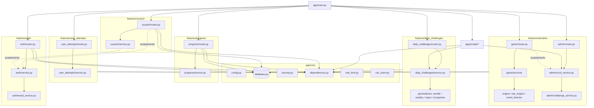
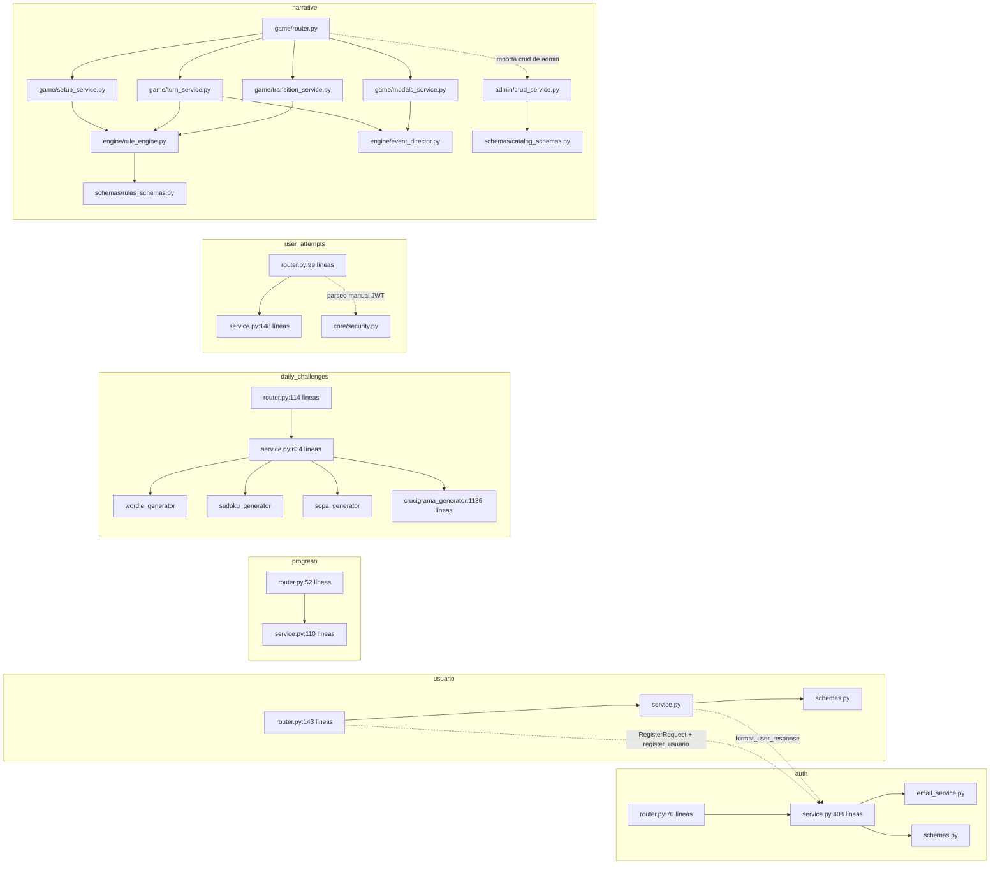
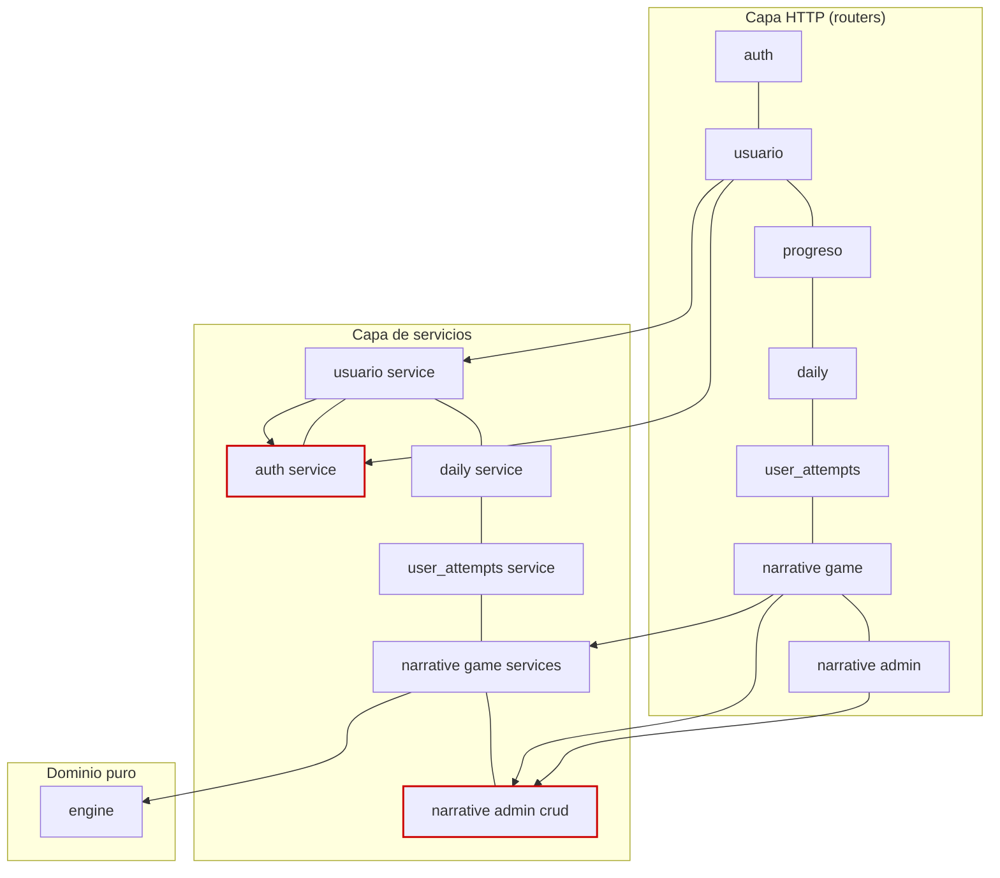
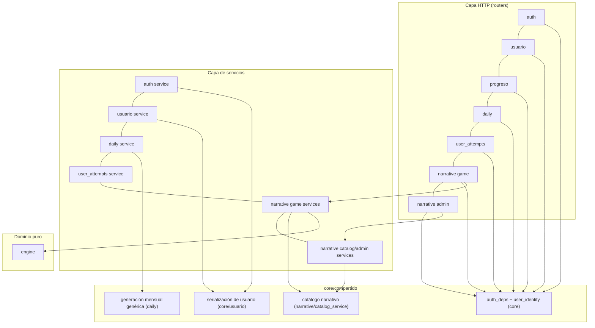
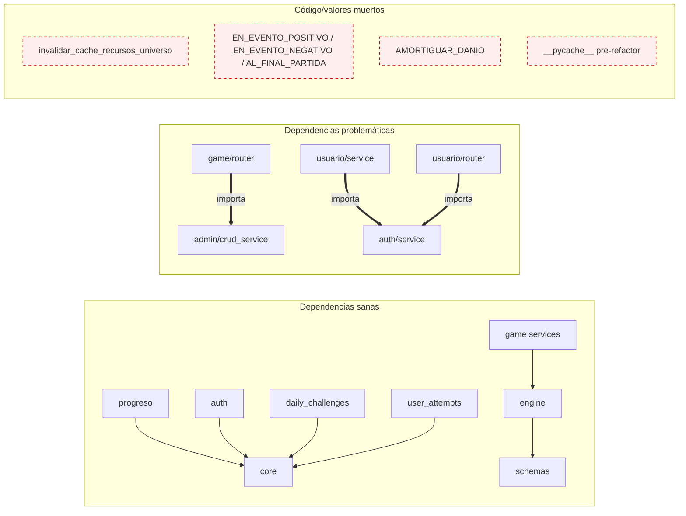

# Auditoría 01 — Arquitectura y Modularidad

| Campo | Valor |
| :--- | :--- |
| **Proyecto** | Mayores Actualizaciones — SIPI-BACK (FastAPI + Motor/MongoDB) |
| **Ruta auditada** | `C:\Users\nmonti\Desktop\proyectos\backend\mayores_actualizacionesSIPI-BACK` |
| **Fecha** | 2026-10-19 |
| **Tipo** | Auditoría de arquitectura/modularidad — **solo lectura** (no se modificó ningún archivo existente) |
| **Único artefacto generado** | Este documento (`auditorias\01-arquitectura-y-modularidad.md`) |
| **Método** | Lectura estática completa de `app/`, `tests/`, infraestructura y documentación; verificación cruzada doc-vs-código con `grep`/`glob`/listados; **no** se ejecutó la aplicación, tests, ni se tocó la base de datos |

**Definición de severidades usada**

| Severidad | Criterio |
| :--- | :--- |
| **Crítico** | Exposición directa de datos/operaciones a terceros no autenticados, o secreto efectivamente utilizable en producción. |
| **Alto** | Acoplamiento o duplicación que ya causa (o puede causar) comportamiento divergente, IDOR, reglas que no se ejecutan silenciosamente, o deuda estructural con riesgo operativo concreto. |
| **Medio** | Mantenibilidad, consistencia o documentación con impacto real pero sin explotación directa. |
| **Bajo** | Higiene técnica, residuos, convenciones. |

---

## 1. Resumen ejecutivo

El backend está organizado como un **monolito modular por features** (`app/features/{auth, usuario, progreso, daily_challenges, user_attempts, narrative}`) con un núcleo común (`app/core/`) razonablemente limpio: dependencias de autenticación canónicas (`core/dependencies.py`), generación atómica de IDs (`core/database.py`), rate limiting (`core/rate_limit.py`) y RLS anti-IDOR bien aplicada en `progreso` y en la lectura de `usuario`. La separación `narrative/engine` (puro) vs `narrative/game` (servicios) vs `narrative/admin` (CRUD) es el mejor intento de capas del repo.

Sin embargo, la auditoría confirma que **el módulo narrativo y los desafíos diarios tienen "puertas traseras" funcionales**: la Torre de Control narrativa completa (`/api/narrative/admin/*`) y los endpoints de administración/upsert de `daily_challenges` **no tienen ninguna autenticación**. Además, el motor ECA **anuncia disparadores y acciones que nunca se ejecutan** (el admin puede configurarlos y el juego los ignora en silencio), la caché de recursos de universo **nunca se invalida**, y hay duplicación estructural seria (generadores mensuales, Sopa de Letras duplicada en dos archivos con datos ya divergentes, router de jugador importando servicios de admin).

**¿Es hoy una "caja negra"?** — Parcialmente, pero no en el buen sentido: los contratos externos documentados (README promete "100% de compatibilidad") se corresponden *en general* con el código, pero existe **comportamiento oculto no intencional** (endpoints de escritura sin auth, disparadores ECA que no disparan, documentación que describe una estructura de archivos y endpoints que ya no existen). Un consumidor que confíe en la documentación o en el catálogo de reglas del admin obtendrá respuestas distintas de las esperadas.

### 1.1 Tabla de hallazgos

| ID | Severidad | Hallazgo | Evidencia principal |
| :--- | :--- | :--- | :--- |
| C-01 | **Crítico** | Torre de Control narrativa sin autenticación (CRUD, uploads, borrados, generación masiva y sembrado) | `app/features/narrative/admin/router.py:64-320` (sin `Depends` en todo el archivo) |
| C-02 | **Crítico** | `daily_challenges`: upsert arbitrario y endpoints admin sin autenticación | `app/features/daily_challenges/router.py:77-113` |
| C-03 | **Crítico** | CORS efectivamente abierto a cualquier origen con credenciales | `app/main.py:91-98` (`allow_origin_regex=r"^https?://.*$"` línea 94 + `allow_credentials=True` línea 95) |
| C-04 | **Crítico** | Secretos por defecto hardcodeados y utilizables (JWT, admin, MySQL) | `app/core/config.py:14,28,38`; `.env.example:10,24,31` |
| A-01 | Alto | El router de jugador importa servicios de admin (capa invertida) y expone consultas de catálogo sin auth | `app/features/narrative/game/router.py:60-62,185-211` |
| A-02 | Alto | `usuario` acoplado a `auth`: importa `format_user_response`, duplica magic-link inline y hace doble `update_one` | `app/features/usuario/service.py:6,91-107`; `app/features/usuario/router.py:18-19,115-143` |
| A-03 | Alto | Tres parsers manuales de token divergentes (y la dependencia canónica ya existe) | `user_attempts/router.py:17-28`; `narrative/game/router.py:64-76`; `core/rate_limit.py:41-46` vs `core/dependencies.py:9-74` |
| A-04 | Alto | `user_attempts`: identidad tomada del body/query y `or 1` → IDOR sobre el usuario 1 / invitado | `user_attempts/router.py:40,59-60,82-83`; `user_attempts/service.py:46` |
| A-05 | Alto | ECA: 3 disparadores y 1 acción anunciados en el catálogo que nunca se despachan/ejecutan | `admin/rules_catalog.py:24-26,47`; `engine/rule_engine.py:89-142,144-159`; sitios de dispatch: `game/setup_service.py:210,214`, `turn_service.py:92,207`, `transition_service.py:112,116` |
| A-06 | Alto | Caché de recursos de universo sin invalidación (nunca se llama `invalidar_cache_recursos_universo`) | `game/setup_service.py:51-71`; `game/__init__.py:8,45` (único otro lugar donde aparece) |
| A-07 | Alto | Sopa de Letras duplicada: datos y `generate_word_search` en 2 archivos, ya con temas divergentes + `random.seed` global | `daily_challenges/sopa_generator.py:16-169` vs `scripts/seed_sopa_letras.py:8-166` |
| A-08 | Alto | ~400 líneas casi idénticas en las 4 generaciones mensuales + dispatch duplicado | `daily_challenges/service.py:189-588` (funciones en 189, 314, 422, 506); `daily_challenges/router.py:105-113` vs `service.py:624-631` |
| A-09 | Alto | `.env` real termina dentro de la imagen Docker (`COPY . .` y `.dockerignore` no lo excluye) | `Dockerfile:15`; `.dockerignore` (excluye `.env.example`, no `.env`) |
| M-01 | Medio | God files: seed narrativo monolítico, plantillas de crucigrama embebidas, servicio/servicio auth gigantes | `scripts/seed_narrative.py` (1824 líneas, función única desde 56); `crucigrama_generator.py` (1136; datos 31-806, código 810-1136); `daily_challenges/service.py` (634); `auth/service.py` (408) |
| M-02 | Medio | Tests únicamente de integración contra MongoDB real, con seed desde test y usuario invitado 0 | `tests/test_narrative_game.py:9-104`; `tests/test_narrative_v2_game.py:9-134` |
| M-03 | Medio | Documentación interna desactualizada (colecciones, archivos, endpoints y fases inexistentes) | ver §3.3 |
| M-04 | Medio | `datetime.now()` naive mezclado con `timezone.utc` | `daily_challenges/service.py:28,57,79,104,140,598` |
| M-05 | Medio | Seeds con fechas hardcodeadas (Ago–Oct / Ago–Dic 2026); el estilo de contenido cambiará al agotarse | `scripts/seed_challenges.py:8-106,115`; `scripts/seed_sudoku.py:18`; `scripts/seed_sopa_letras.py:8-106` |
| M-06 | Medio | Invitados comparten la partida `user_id = 0` (estado global) | `narrative/game/router.py:64-76`; tests lo confirman (`test_narrative_v2_game.py:42,56`) |
| M-07 | Medio | `Caddyfile` no enruta `/admin` ni `/assets/narrative`, y `./dist` no existe | `Caddyfile:33,39-43`; `docker-compose.yml:13` |
| B-01 | Bajo | `.pyc` residuales de módulos eliminados (estructura pre-refactor) | `app/features/narrative/__pycache__/` (`admin_router`, `router_v2`, `service`, `schemas`) |
| B-02 | Bajo | `.gitignore` con residuos de proyecto Java/Spring | `.gitignore:1-30` |
| B-03 | Bajo | Dependencias sin pin exacto (`>=`) | `requirements.txt:1-15` |
| B-04 | Bajo | Rate limiting en memoria por proceso y solo aplicado en endpoints de auth | `core/rate_limit.py:7-32`; `auth/router.py:20,28,50,59,67,75` |
| B-05 | Bajo | Schemas narrativos con aliases mixtos (`_id`↔`id`) y mapeo manual disperso | `narrative/schemas/catalog_schemas.py:27,37,55…`; `game_schemas.py:55,82` |

---

## 2. Arquitectura actual

### 2.1 Punto de entrada y orquestación

`app/main.py` monta 8 routers (`main.py:117-124`), ejecuta 6 siembras al arranque (`main.py:36-48`, incluida `sembrar_finalizaciones_default` envuelta en try/except) y un loop de autogeneración cada 12 h (`main.py:50-62`). Monta estáticos de la Torre de Control SPA en `/admin` (`main.py:139-165`) y assets narrativos en `/assets/narrative` (`main.py:168-170`).

### 2.2 Grafo de dependencias — visión general



Líneas punteadas = dependencias cruzadas entre features (detalladas en §3). Los scripts (`app/scripts/seed_narrative.py:13-22`) dependen de servicios internos de `narrative/admin`.

### 2.3 Grafo de dependencias por feature



### 2.4 Consistencia de capas por feature

| Feature | Patrón | Auth | Observación |
| :--- | :--- | :--- | :--- |
| `auth` | router → service → email_service | Rate limit + `get_current_admin` en 1 endpoint | Correcto |
| `usuario` | router → service | `get_current_admin` / `get_current_user` | **Importa de `auth`**; lógica de negocio inline (magic-link) |
| `progreso` | router → service | `get_current_user` + RLS explícita | Correcto (mejor ejemplo del repo) |
| `daily_challenges` | router → service → generadores | **Sin auth en ningún endpoint** | Upsert y admin sin protección |
| `user_attempts` | router → service | **Parseo manual de header** | Fallbacks de identidad inseguros |
| `narrative game` | router → game services → engine | **Parseo manual de header** (invitado 0) | Importa capa admin |
| `narrative admin` | router → crud/challenge services | **Sin auth** | Capa invertida además |
| `engine` | puro (sin DB) | N/A | Bien aislado; incompleto vs catálogo |
| `scripts` | funciones de siembra | N/A | Dependen de features; god files |

### 2.5 Mapa de capas: actual vs propuesto

**Actual**



**Propuesto (no-breaking, ver §5)**



---

## 3. Hallazgos detallados

### 3.1 Críticos

---

#### C-01 — Torre de Control narrativa sin autenticación (Crítico)

**Evidencia**
- `app/features/narrative/admin/router.py:64` declara `router = APIRouter(prefix="/api/narrative/admin", ...)` y **ningún endpoint usa `Depends`, `get_current_admin` ni ningún mecanismo de auth** (verificado con grep: 0 coincidencias de `Depends|get_current_admin|get_current_user` en el archivo).
- Endpoints mutantes expuestos: subida de archivos `POST /upload-imagen` (`router.py:82-91`), CRUD completo con `POST`/`DELETE` de universos (`108-117`), personajes (`138-147`), cartas (`168-177`), resultados (`198-207`), eventos (`228-237`), conversaciones (`258-267`), finalizaciones (`288-297`), sembrado masivo `POST /universos/{id}/sembrar-finalizaciones` (`299-305`) y generación de meses `POST /generar-mes` (`311-320`).
- El router se monta siempre en `app/main.py:24,124`.
- Los propios tests consumen estos endpoints **sin token** (`tests/test_narrative_game.py:37,46`), lo que demuestra que funcionan sin autenticación.

**Impacto**
Cualquier tercero puede leer y **destruir o alterar todo el contenido del juego narrativo** (borrar universos/personajes/eventos), subir archivos (WebP procesados con Pillow, superficie adicional), sembrar finalizaciones y regenerar meses enteros. Es un panel de administración completo expuesto como API pública.

**Recomendación (no-breaking)**
- Agregar `dependencies=[Depends(get_current_admin)]` a nivel router (`APIRouter(..., dependencies=[...])`) o por endpoint, reutilizando `app/core/dependencies.py:63-74`.
- Antes de desplegar: confirmar que la SPA de Torre de Control ya envía `Authorization: Bearer` (hoy no es necesario, por eso puede no hacerlo). Mitigación segura: primero instrumentar/verificar con el equipo front; luego activar la dependencia (mismo status code 401/403 ya estandarizado).
- Endurecer además CORS (C-03) para reducir la superficie mientras se confirma la migración.

**Esfuerzo**: S (unas 30 líneas). **Riesgo de ruptura**: bajo si el front admin ya autentica; nulo en caso contrario (requiere coordinar).

---

#### C-02 — `daily_challenges`: upsert arbitrario y admin sin autenticación (Crítico)

**Evidencia**
- `app/features/daily_challenges/router.py:77-83`: `POST /api/challenges` (crear/actualizar cualquier desafío) sin dependencia de auth.
- `router.py:85-93`: `GET /api/challenges/admin/status` sin auth.
- `router.py:95-113`: `POST /api/challenges/admin/generate-month` permite regenerar meses completos con `force=true` por defecto (`router.py:103`).
- El router no importa ninguna dependencia de `app/core/dependencies.py`.

**Impacto**
Alteración arbitraria del contenido diario jugado por todos los usuarios (inyección de configs maliciosas o corruptas), regeneración destructiva de meses, y lectura de cobertura de contenido. Impacta directamente los contratos de `get_today_challenge` (`service.py:74-80`).

**Recomendación (no-breaking)**
- `dependencies=[Depends(get_current_admin)]` en el router o al menos en `77-113`.
- Validar además que `req.game_id` esté en un catálogo (`wordle|sudoku|sopa_letras|crucigrama|narrativo`) y que `date` esté dentro de un rango razonable (aunque Pydantic ya valida formato vía schemas).

**Esfuerzo**: S. **Riesgo**: bajo (mismos status codes).

---

#### C-03 — CORS abierto a cualquier origen con credenciales (Crítico)

**Evidencia**
- `app/main.py:91-98`:
  - `allow_origins=origins` (lista acotada, `81-89`),
  - **`allow_origin_regex=r"^https?://.*$"` (línea 94)** — que anula en la práctica la lista anterior al aceptar *cualquier* origen http(s),
  - `allow_credentials=True` (línea 95),
  - `allow_methods=["*"]`, `allow_headers=["*"]`.
- Comentario en `main.py:80`: "Configuración de CORS amplia para desarrollo y producción" — parece una decisión de conveniencia que quedó en el código de producción.

**Impacto**
La política de mismo-origen deja de aportar defensa en profundidad: cualquier sitio puede leer respuestas de la API en nombre de una sesión de la víctima (Bearer token en JS) y, combinado con C-01/C-02, amplía la superficie de los endpoints sin auth. Con credenciales basadas en header no hay CSRF clásico, pero el riesgo es real para XSS de terceros y para datos de usuario.

**Recomendación**
- Configurar orígenes por entorno: `CORS_ORIGINS` (lista separada por comas) en `core/config.py`, con default local; quitar el regex abierto o restringirlo a `^https?://(localhost|127\.0\.0\.1)(:\d+)?$` en desarrollo.
- Mantener `FRONTEND_URL` y los orígenes de `main.py:81-89` como allowlist productiva.

**Esfuerzo**: S. **Riesgo**: bajo (requiere conocer el dominio real del front en producción).

---

#### C-04 — Secretos por defecto hardcodeados y utilizables (Crítico)

**Evidencia**
- `app/core/config.py:14`: `JWT_SECRET` con valor real base64 hardcodeado (no placeholder).
- `app/core/config.py:28`: `ADMIN_DEFAULT_PASSWORD = "admin123"`; idem `.env.example:24`.
- `app/core/config.py:38`: `MYSQL_PASSWORD = "root"`; idem `.env.example:31`.
- `.env.example:10`: `JWT_SECRET` con **el mismo valor** del default del código.
- `app/scripts/init_db.py:64-93`: siembra el admin con esas credenciales en cada arranque si no existe; `init_db.py:80` fija además `codigo_acceso="999999"` para el admin.
- `README.md:76` publica `admin@sistemas.com / admin123`.

**Impacto**
Cualquiera que conozca el repo puede **firmar JWTs válidos** si el despliegue no sobreescribe `JWT_SECRET` (el default funciona: no hay fail-fast), e ingresar con credenciales conocidas si el admin no fue cambiado. El código de acceso `999999` permite login por PIN.

**Recomendación**
- `JWT_SECRET: str` **sin default** (o default vacío) + validación en `Settings` que falle al arrancar si está vacío en producción (`model_validator`).
- Rotar el secreto y la contraseña del admin en el despliegue actual; exigir cambio de `codigo_acceso` del admin.
- Retirar credenciales reales de `.env.example` (placeholders) y de README.
- Complementar con A-09 (`.env` fuera de la imagen).

**Esfuerzo**: S-M (requiere rotación coordinada). **Riesgo**: bajo en código; operacional en despliegue.

---

### 3.2 Altos

---

#### A-01 — Capa invertida: el router de jugador importa servicios de administración (Alto)

**Evidencia**
- `app/features/narrative/game/router.py:60-62`:
  ```python
  from app.features.narrative.admin.crud_service import (
      obtener_conversaciones_posibles_por_personajes
  )
  ```
  usado por los endpoints de jugador `POST/GET /conversaciones-posibles` (`game/router.py:185-211`).
- Dirección de dependencia incorrecta: `game` → `admin`. El resto de `game` depende de `engine` y `schemas`, no de `admin`.

**Impacto**
Un cambio en la capa de administración (o su futura protección con auth) puede romper el juego del jugador. Además, esas consultas de catálogo (`conversaciones-posibles`) quedan **sin autenticación** porque el router de jugador resuelve identidad con `_get_current_user_id` que devuelve 0 para anónimos (`game/router.py:64-76`) y estos dos endpoints ni siquiera lo usan (`185-211`).

**Recomendación (no-breaking)**
- Extraer `obtener_conversaciones_posibles_por_personajes` a un servicio de catálogo neutral (`narrative/catalog_service.py` o `game/catalog_service.py`) que consuma `catalog_schemas`/constantes, sin pasar por `admin`.
- Dejar en `admin/crud_service.py` un re-export temporal (`from ...catalog_service import obtener_conversaciones_posibles_por_personajes`) para no romper imports existentes.

**Esfuerzo**: M. **Riesgo**: bajo (el comportamiento debe ser idéntico; cubrir con los tests existentes).

---

#### A-02 — `usuario` acoplado a `auth`: serialización, magic-link inline y doble update (Alto)

**Evidencia**
- `app/features/usuario/service.py:6`: `from app.features.auth.service import format_user_response` — la "forma canónica de usuario" vive en `auth` y `usuario` la importa.
- `app/features/usuario/router.py:18-19`: importa `RegisterRequest` y `register_usuario` de `auth` para crear usuarios desde la torre de control (`router.py:108-113` con `is_admin_creation=True`).
- `app/features/usuario/router.py:115-117`: imports al final del archivo (anti-patrón que evidencia extracción incompleta).
- `app/features/usuario/router.py:119-143`: el endpoint `magic-link` implementa **lógica de negocio inline** (consulta DB, `create_access_token`, armado de URL) duplicando conceptualmente `auth/service.py:165-202` (`enviar_acceso_correo`) sin reutilizarla.
- `app/features/usuario/service.py:91-107`: `toggle_activo` ejecuta **dos `update_one` consecutivos** sobre el mismo documento (primero `activo`, luego `activo+estado_id+estado_codigo`), con una escritura intermedia inconsistente si el segundo update falla.

**Impacto**
- `format_user_response` es el contrato JSON (`dateStart`, `codigoAcceso`, `tipoUsuario`…) usado por auth y usuario; su ubicación en `auth` crea un ciclo conceptual de features y duplica la propiedad del contrato.
- La lógica de magic-link inline no aplica validaciones de `enviar_acceso_correo` (cuenta inactiva) y diverge en formato de URL (`/acceso?token=` vs `/{redirectPath}?token=`).
- El doble update deja ventanas de inconsistencia (`activo` cambiado, estado no).

**Recomendación (no-breaking)**
- Mover `format_user_response` a `app/core/user_serialization.py` (o `usuario/schemas.py`) y re-exportarla desde `auth/service.py` para compatibilidad.
- Extraer el magic-link del router a `usuario/service.py` (o mejor: reutilizar un helper de `auth`) manteniendo **exactamente** la misma respuesta JSON.
- Unificar `toggle_activo` en un único `update_one` con `$set` de los 3 campos.

**Esfuerzo**: M. **Riesgo**: bajo-medio (el contrato JSON no cambia; el flujo de magic-link a revisar con front).

---

#### A-03 — Tres parsers manuales de token divergentes (Alto)

**Evidencia**
- `app/features/user_attempts/router.py:17-28` — `_extract_user_id_from_header`.
- `app/features/narrative/game/router.py:64-76` — `_get_current_user_id` (devuelve 0 si no hay header).
- `app/core/rate_limit.py:41-46` — parseo inline del header.
- La dependencia canónica existe y ya resuelve todo esto: `app/core/dependencies.py:9-74` (`HTTPBearer`, validación de expiración/firma, check de `activo`, y `get_current_admin`).

**Impacto**
Comportamientos diferentes ante el mismo insumo (token vencido/inválido/anónimo): el canónico devuelve 401; `user_attempts` devuelve `None` y cae a fuentes no confiables (A-04); narrativo degrada a invitado 0 (M-06). Tres lugares que mantener ante cualquier cambio de claims (p. ej. migrar `id` a `sub`).

**Recomendación**
- Crear en `core/dependencies.py` variantes reutilizables:
  - `get_optional_user()` (anónimo → `None`, sin lanzar),
  - `get_current_user_id()` (int, fallback opcional 0 si el contrato lo exige).
- Migrar los 3 puntos a esas dependencias manteniendo los mismos códigos de respuesta actuales.

**Esfuerzo**: S-M. **Riesgo**: bajo; incluir tests de tokens inválidos/ausentes.

---

#### A-04 — `user_attempts`: identidad desde body/query y `or 1` → IDOR (Alto)

**Evidencia**
- `app/features/user_attempts/router.py:39-40`:
  ```python
  user_id_from_token = _extract_user_id_from_header(authorization)
  effective_user_id = user_id_from_token or req.user_id
  ```
  si no hay token válido, **el body decide** el `user_id`.
- `app/features/user_attempts/service.py:46`: `effective_user_id = authenticated_user_id or req.user_id or 1` — último fallback al usuario 1.
- Lecturas: `router.py:59-60` (`effective_user_id = user_id or token_user_id`) y `router.py:82-83` — el query param anónimo también permite leer datos de **cualquier** usuario.
- Efecto colateral: `service.py:85-95` incrementa puntos del usuario afectado (`db["usuarios"].update_one`), por lo que el fallback puede **sumar puntos a otro usuario**.

**Impacto**
IDOR clásico: sin token (o con token inválido), cualquiera puede escribir/leer progreso de otro usuario y alterar su contador de puntos. El fallback `or 1` convierte el error de identidad en escritura sobre un usuario real.

**Recomendación**
- Fase 1 (sin romper front): mantener lectura de `user_id` en body/query **solo** si no hay comportamiento de escritura cruzada → exigir token para `POST` y para `GET` cuando el `user_id` solicitado no sea el del token (o deshabilitar el query público).
- Fase 2: eliminar `or 1`; reemplazar por 401/404 explícito.
- Confirmar con frontend si los flujos invitados guardan en la nube (si sí, definir identidad de invitado real, no id 1).

**Esfuerzo**: M (requiere alineación de contrato). **Riesgo**: medio (puede romper clientes que dependan del fallback; ver preguntas abiertas §6).

---

#### A-05 — ECA: disparadores y acciones anunciados que nunca se ejecutan (Alto)

**Evidencia**
- El catálogo del admin (`app/features/narrative/admin/rules_catalog.py:21-27`) ofrece 5 disparadores: `AL_OBTENER`, `CADA_MES`, `EN_EVENTO_POSITIVO`, `EN_EVENTO_NEGATIVO`, `AL_FINAL_PARTIDA`.
- La acción anunciada en `rules_catalog.py:47` es `AMORTIGUAR_DANIO` ("Amortiguar pérdida de un recurso"), incluida en `TipoAccionEnum` (`enums.py:29`).
- El motor solo ejecuta: `MODIFICAR_RECURSO`, `MODIFICAR_AFINIDAD`, `OTORGAR_TAG` (`rule_engine.py:104-142`); **`AMORTIGUAR_DANIO` no tiene rama en `ejecutar_accion`** y se ignora silenciosamente.
- Los únicos disparadores despachados en todo el código son `AL_OBTENER` y `CADA_MES`:
  - `game/setup_service.py:210,214`
  - `game/turn_service.py:92,207`
  - `game/transition_service.py:112,116`
  - `EN_EVENTO_POSITIVO`, `EN_EVENTO_NEGATIVO`, `AL_FINAL_PARTIDA` **nunca** se pasan a `despachar_efectos` (`rule_engine.py:144-159` filtra por igualdad; todo efecto con esos disparadores se descarta).
- El seed narrativo ya usa efectos `AL_OBTENER`/`CADA_MES` (`seed_narrative.py:89-496`), por lo que la divergencia afecta a contenido administrativo futuro, no solo teórico.

**Impacto**
Un administrador configura reglas ECA desde la UI que el motor **acepta, persiste y jamás ejecuta**; no hay error ni advertencia. Es un apagón silencioso de mecánicas de juego (`EN_EVENTO_*` es la más "natural" para eventos, y `AL_FINAL_PARTIDA` para endings). RIESGO de incidencias de diseño difíciles de diagnosticar.

**Recomendación (dos caminos, decisión de producto)**
- **Implementar**: despachar `EN_EVENTO_POSITIVO/NEGATIVO` en `turn_service.py` (tras `sortear_resultado_opcion`, donde hoy se maneja multiplicador de afinidad) y `AL_FINAL_PARTIDA` en `endings_service.py`/`transition_service.py` al cerrar la partida; implementar `AMORTIGUAR_DANIO` en `rule_engine.py:89` (estado de "escudo" por recurso en `run_data`).
- **O remover**: retirar del catálogo (`rules_catalog.py:24-26,47`) y del enum lo no soportado, para que la UI no ofrezca opciones muertas.
- Cualquiera de las dos es compatible con el frontend (no cambia esquemas); la primera cambia *comportamiento* de juego, la segunda *opciones del admin*.

**Esfuerzo**: M (implementar) / S (remover). **Riesgo**: implementar = cambio funcional (requiere QA de balance); remover = cambio de UI admin.

---

#### A-06 — Caché de recursos de universo sin invalidación (Alto)

**Evidencia**
- `app/features/narrative/game/setup_service.py:51-71`: `_RECURSOS_MAPA_CACHE` se puebla en `_obtener_mapa_recursos_universo` (líneas 60-71) y se lee en cada turno (`turn_service.py:90,205`; `transition_service.py:105`; `setup_service.py:164`).
- `invalidar_cache_recursos_universo` está definida (`setup_service.py:53-58`) y exportada (`game/__init__.py:8,45`), pero **no se importa ni se llama desde ningún otro módulo** (grep global: solo definición y export).
- La modificación de universos ocurre en `admin/crud_service.py` (`crear_o_actualizar_universo`), que no toca la caché.

**Impacto**
Si un administrador cambia los límites (`min`/`max`) o recursos de un universo, las partidas seguirán clipeando contra los valores viejos **hasta reiniciar el proceso**. Con múltiples workers, peor: cada worker mantiene su propia copia y el estado queda divergente indefinidamente.

**Recomendación**
- Llamar a `invalidar_cache_recursos_universo(universo_id)` al final de la creación/actualización/eliminación de universo en `crud_service` (import desde `game.setup_service` es direccionalmente aceptable en este caso controvertido; alternativa limpia: mover la caché a `admin` o a un módulo neutral).
- Alternativa complementaria: TTL corto (30-60 s) para autocuración, sin cambiar contratos.

**Esfuerzo**: S. **Riesgo**: bajo.

---

#### A-07 — Sopa de Letras duplicada en dos archivos, con datos ya divergentes (Alto)

**Evidencia**
- Copia A (runtime): `app/features/daily_challenges/sopa_generator.py`
  - catálogo `SOPA_THEMES_CATALOG` en `16-109` (93 temas),
  - `generate_word_search` en `111-169`,
  - `random.seed(seed)` global en `117-118`.
- Copia B (seed): `app/scripts/seed_sopa_letras.py`
  - catálogo `SOPA_LETRAS_RAW_DATA` en `8-106` (92 temas, con fechas Ago–Oct 2026),
  - `generate_word_search` re-implementada en `108-166`,
  - `random.seed(seed)` global en `114-115`,
  - siembra en `168-208`.
- Divergencia ya presente en los títulos: `'Peces del Parana'` (seed:45) vs `'Peces de Rio'` (generador:50); `'Llego la Primavera'` (seed:63) vs `'Primavera Serena'` (generador:68); `'Deportes y Juegos'` (seed:59) vs `'Deportes Nobles'` (generador:64); `'Cielos de Tormenta'` (seed:69) vs `'Tormenta de Verano'` (generador:74).

**Impacto**
Doble mantenimiento del mismo generador y del mismo banco de contenido; los usuarios jugarán temas con nombres distintos según si el challenge vino del seed o de la autogeneración. `random.seed()` global es un efecto colateral de proceso compartido (cualquier otro consumidor de `random` queda sesgado; con la siembra determinística convive, pero es frágil).

**Recomendación**
- Fuente única: `sopa_generator.SOPA_THEMES_CATALOG` (o un JSON en `app/data/`), y que `seed_sopa_letras.py` importe `generate_sopa_challenge_for_date`/catálogo en lugar de duplicar.
- Reemplazar `random.seed` global por `random.Random(seed)` local en ambos (el generador ya recibe `seed`; usar `rng` inyectado).
- Migración sin romper datos: los challenges ya guardados en DB no cambian; solo unifica el código que genera los futuros.

**Esfuerzo**: M. **Riesgo**: bajo (verificar que la grilla generada por `Random` local sea idéntica a la del `seed` global — si no, *no* regenerar meses existentes).

---

#### A-08 — Cuatro generaciones mensuales casi idénticas + dispatch duplicado (Alto)

**Evidencia**
- `app/features/daily_challenges/service.py`: `generate_and_save_sudoku_month` (`189-272`), `get_challenges_monthly_status` (`274-312`), `generate_and_save_wordle_month` (`314-420`), `generate_and_save_sopa_month` (`422-504`), `generate_and_save_crucigrama_month` (`506-588`). Las 4 funciones comparten: validación de mes, `calendar.monthrange`, `count_documents` de completitud, loop por día, `find_one`/`update_one` con `$setOnInsert`, sleep (`0.2/0.15/0.1`), logging y shape de respuesta (≈340-400 líneas duplicadas).
- `ensure_current_and_next_month_generated` (`590-631`) repite el mismo patrón y despacha con `if/elif` (`624-631`), replicado en el router: `daily_challenges/router.py:105-113`.
- Diferencias reales entre funciones: solo el generador, el predicado de existencia (`solution`/`grid`/`cells`) y el `sleep`.

**Impacto**
Cada corrección (p. ej. idempotencia, manejo del `force`, sleeps, índice) debe hacerse 4 veces + 2 puntos de dispatch. Ya hay diferencias sutiles (wordle refresca pistas incluso con `force=False` cuando existe, `service.py:373-382`; las otras no).

**Recomendación (no-breaking)**
- Extraer helper `_generar_mes(juego, year, month, force, generador, existe_fn, sleep_s)` y registrar los 4 juegos en un diccionario (`GENERADORES = {...}`); router y `ensure_*` usan el mismo registro.
- Mantener exactamente los mismos `game_id`, campos y respuestas JSON (los contratos no cambian).

**Esfuerzo**: M. **Riesgo**: bajo-medio (cubrir con comparación de outputs de un mes ya seedeado).

---

#### A-09 — `.env` real dentro de la imagen Docker (Alto)

**Evidencia**
- `Dockerfile:15`: `COPY . .` copia todo el contexto.
- `.dockerignore` excluye `.venv/`, `__pycache__/`, `.git/`, `dist/`, **`.env.example`**… pero **no `.env`**.
- `.env` existe en la raíz del repo (1311 bytes; confirmado en el listado) y `docker-compose.yml:43-44` lo carga con `env_file` (que no elimina la copia horneada).
- Nota: `.gitignore:38-42,51` sí excluye `.env` para git, por lo que el riesgo es la **imagen**, no el repositorio.

**Impacto**
Credenciales SMTP, MySQL, secreto JWT y contraseña de admin reales (si están seteadas) quedan dentro de la imagen, extraíbles por cualquiera con acceso a la imagen (registry interno, capas, `docker save`). Viola el principio de "el `.env` no viaja en artefactos".

**Recomendación**
- Agregar `.env` (y `*.env`) a `.dockerignore`.
- Mantener la inyección por `env_file`/`environment` del compose.
- Rotar secretos una vez remediado (asumir exposición si la imagen se distribuyó).

**Esfuerzo**: S. **Riesgo**: bajo.

---

### 3.3 Medios

---

#### M-01 — God files (Medio)

**Evidencia**
- `app/scripts/seed_narrative.py`: 1824 líneas; **una única función** `seed_narrative_game()` desde la línea 56 hasta ~1818 (verificado por grep de definiciones: solo `UNIVERSO_ID` en 54 y la función en 56) conteniendo todo el dataset (personajes, cartas, eventos, resultados, conversaciones, finalizaciones) inline.
- `app/features/daily_challenges/crucigrama_generator.py`: 1136 líneas; datos `CURATED_CLUES` (`31-120`) y `CRUCIGRAMA_TEMPLATES` (`121-806`, alias `807`), motor desde `810`.
- `app/features/daily_challenges/service.py`: 634 líneas (4 generadores duplicados, ver A-08).
- `app/features/auth/service.py`: 408 líneas con 10 responsabilidades (login, registro, verificación, reenvíos, email).

**Impacto**
Alto costo de navegación y de revisión de PRs; riesgo de conflictos de merge; imposibilidad de hacer tests unitarios de datos sin importar Mongo.

**Recomendación (no-breaking)**
- Extraer datos narrativos a JSON (`app/data/narrative/corte_medieval/*.json`) y dejar `seed_narrative_game()` como orquestadora de ~50 líneas que itera catálogos. Cargar con `json.load` en tiempo de siembra.
- Mover `CRUCIGRAMA_TEMPLATES` a JSON (`app/data/crucigrama_templates.json`) cargado al importar (mismo contrato interno).
- Reutilizar los patrones de extracción de A-08 para acortar el service.
- No partir `auth/service.py` sin tests de contrato previos (es el módulo más sensible); si se hace, por casos de uso (`login_service`, `registro_service`).

**Esfuerzo**: L (datos) / M (código). **Riesgo**: bajo si se respetan los IDs y contenidos exactos (los seeds son idempotentes por `_id`/fecha).

---

#### M-02 — Estrategia de tests insuficiente y acoplada a la DB real (Medio)

**Evidencia**
- Solo existen 2 tests, ambos de integración extrema: `tests/test_narrative_game.py` (87 líneas) y `tests/test_narrative_v2_game.py` (115 líneas).
- Ambos abren Mongo real (`connect_to_mongo`, líneas 20 / 24), siembran contenido (`seed_narrative_game()` en 25 / 29), usan el **usuario invitado 0** (55 / 42 y `headers={"Authorization": "Bearer fake_token"}` en 56) y uno de ellos llama endpoints admin **sin auth** (`test_narrative_game.py:37,46`), fijando ese comportamiento inseguro implícitamente.
- No hay tests para `auth`, `usuario`, `progreso`, `daily_challenges`, `user_attempts`.
- Se usan fechas del día real (`datetime.now()`, líneas 27/52 y 31), lo que las vuelve dependientes del calendario y del contenido seedeado (hoy 2026-10-19 está al límite del seed de wordle/sopa, ver M-05).

**Impacto**
- No hay red de seguridad para los refactors propuestos en §5 (especialmente usuarios/auth).
- Los tests no son ejecutables en CI aislada (requieren Mongo + seeds + mes en curso).
- El test "fija" la falta de auth del admin narrativo (regresión contractual ante C-01).

**Recomendación**
- Mantener los actuales como "integración" (marcador `@pytest.mark.integration`).
- Agregar tests unitarios de servicios con un fake de `get_database` (sin instalar nada nuevo: monkeypatch de `app.core.database.get_database` con un doble en memoria; o evaluar `mongomock` como dependencia de test, decisión aparte).
- Tests de contrato HTTP mínimos con `TestClient` para auth/usuario/progreso (incluido el 401/403 tras C-01/C-02).
- Al corregir C-01/C-02, actualizar los tests que hoy llaman admin sin token.

**Esfuerzo**: M-L (progresivo). **Riesgo**: bajo.

---

#### M-03 — Documentación interna desactualizada (Medio)

**Evidencia (doc vs código)**

| Documento | Afirma | Realidad (código) |
| :--- | :--- | :--- |
| `docs_interna/DIAGRAMAS_ARQUITECTURA_NARRATIVO.md:26,31,75` | Colecciones `narrative_universes` y `narrative_finalizations` | Son `narrative_settings` y `narrative_endings` (`narrative/constants.py:5,11`) |
| `docs_interna/DIAGRAMAS_ARQUITECTURA_NARRATIVO.md:81` | Link a `app/features/narrative/router_v2.py` | Ese archivo no existe; es `game/router.py` (`router_v2` en `game/router.py:82`) |
| `docs_interna/DIAGRAMAS_ARQUITECTURA_NARRATIVO.md:100,109,133…` | Fases `DRAFT_CARTA`, `EVENTO`, `FIN` | El enum real es `RunPhaseEnum` = `DRAFT_MENSUAL`, `TOMA_DECISION_EVENTO`, `RESOLVER_CONVERSACION`, `BALANCE_MES`, `FINALIZADA` (`narrative/enums.py:35-42`) |
| `docs_interna/DIAGRAMAS_ARQUITECTURA_NARRATIVO.md:96,159` | "3-4 opciones" / "2 personajes y 2 cartas" | El código ofrece 5 personajes y 5 cartas (`setup_service.py:94-100`; tests lo verifican `test_narrative_game.py:60-61`) |
| `docs_interna/ARQUITECTURA_JUEGOS_Y_NARRATIVO.md:187-188` | "Endpoints Legacy V1 (Ocultos de Swagger con `include_in_schema=False`)" `POST /iniciar`, `GET /activa`, `POST /turno`… | **No existen** en `game/router.py` (grep global: 0 coincidencias de `/activa`, `/turno`, `EstadoPartidaActivaResponse`) |
| `docs_interna/ARQUITECTURA_JUEGOS_Y_NARRATIVO.md:142` | Respuesta `EstadoPartidaActivaResponse` | Inexistente; el estado del turno es `EstadoTurnoResponse` (`schemas/game_schemas.py`) |
| `docs_interna/ARQUITECTURA_JUEGOS_Y_NARRATIVO.md:199-203` | Router `admin_router.py` con endpoints | Es `admin/router.py`; "sembrar-finalizaciones" existe (`admin/router.py:299-305`), "generar-mes" existe (`311-320`) |
| `docs_interna/ARQUITECTURA_JUEGOS_Y_NARRATIVO.md:236` | Vite proxy a `http://localhost:8080` | El backend corre en `8082` (`config.py:6`, `Dockerfile:18-21`, `Caddyfile:1`) |
| `README.md:33-36` | Estructura de features: auth/usuario/progreso | Faltan `daily_challenges`, `user_attempts`, `narrative` y toda la carpeta `static/`; faltan los seeds de challenges (`scripts/seed_challenges.py`, `seed_sudoku.py`, `seed_sopa_letras.py`, `seed_narrative.py`) |
| `README.md:88,92` | `uvicorn --port 8080` y docs en `localhost:8080` | El puerto de la app es 8082 (`main.py:175` usa `settings.PORT`) |
| `README.md:12` | "Cero Breaking Changes… contratos coinciden exactamente" | Cierto para auth/usuario/progreso, pero el README no documenta que narrativo/daily no tienen auth ni distingue V1/V2 |
| `app/features/narrative/docs/DOSSIER_REFACTOR_NARRATIVE.md:34-36,122,162-169` | Estructura pre-refactor: `router_v2.py`, `admin_router.py` en la raíz del feature, `service.py` monolítico | El refactor ya ocurrió: los archivos descritos no existen (solo quedan `.pyc`, ver B-01) |
| `app/features/narrative/docs/DEFINICIONES_POST_JUEGO_NARRATIVO.md:9,492` | Base `localhost:8080` y `EstadoPartidaActivaResponse` | Idem: puerto y schema inexistentes |

**Impacto**
Los propios documentos internos (que la auditoría debe tratar como posiblemente obsoletos) **describen un sistema que ya no existe**, con colecciones y contratos que un nuevo desarrollador buscará en vano, y ocultan la ausencia de auth. La promesa de compatibilidad 100% solo es verificable contra el código real.

**Recomendación**
- Actualizar README (estructura real, puertos, features faltantes, y una sección "Autenticación por feature").
- Regenerar DIAGRAMAS/ARQUITECTURA contra el código actual (colecciones `narrative_settings`/`narrative_endings`, fases reales, rutas reales).
- Mover DOSSIER a `docs_interna/historico/` o marcarlo como histórico.
- Regla de proceso: los diagramas deben citar `file:línea` y actualizarse en el mismo PR que los cambia.

**Esfuerzo**: M. **Riesgo**: nulo (solo docs).

---

#### M-04 — Zona horaria: `datetime.now()` naive mezclado con UTC (Medio)

**Evidencia**
- Uso naive (hora local del servidor) para el "hoy" lógico: `daily_challenges/service.py:28,57,79,104,140,598` (`is_today`, `date_to_query`, generación de mes objetivo).
- Uso correcto UTC en escrituras: `daily_challenges/service.py:139` (`now_utc`), `user_attempts/service.py:47`, `auth/service.py:266`, y el loop de `main.py:54`.
- El mismo patrón aparece en `narrative/challenge_service.py` (`datetime.now(timezone.utc)` en `182`, pero `calendar`-based targets en `main`).
- `tests/*.py:27,31` también usan `datetime.datetime.now()`.

**Impacto**
En un contenedor (UTC) la diferencia es 0, pero en desarrollo Windows (UTC-3) "hoy" cambia a las 21:00 local: el desafío del día, `is_today`, y el mes en curso de la autogeneración pueden diferir del día calendario del usuario. Dependencia del entorno = bugs intermitentes.

**Recomendación**
- Centralizar `today_str()`/`now_utc()` en `app/core/utils.py` con zona configurable (`APP_TIMEZONE`, default UTC-3 o el que corresponda al producto), y reemplazar los usos de `datetime.now()`.
- Documentar la decisión (¿el "día" del juego es el día local del usuario argentino o UTC?).

**Esfuerzo**: M. **Riesgo**: medio (cambiar el "hoy" mueve datos; acordar TZ primero).

---

#### M-05 — Seeds con fechas hardcodeadas y contenido a punto de agotarse (Medio)

**Evidencia**
- `scripts/seed_challenges.py:8-106,115`: dataset Wordle **Ago–Oct 2026** (92 días).
- `scripts/seed_sopa_letras.py:8-106`: dataset Sopa **Ago–Oct 2026**.
- `scripts/seed_sudoku.py:18`: meses `[8,9,10,11,12]` de **2026** (Ago–Dic).
- El loop de arranque cubre mes actual+próximo vía autogeneración (`main.py:42,50-62`; `service.py:590-631`), por lo que desde **noviembre 2026** el contenido Wordle/Sopa será 100% autogenerado (otro estilo/reserva), y el narrativo solo se genera vía admin (`admin/challenge_service.py:126-204`) o test.
- Hoy (2026-10-19) el seed de Wordle/Sopa termina el 31-oct: quedan ~12 días de contenido "curado".

**Impacto**
Riesgo de calidad/UX: el contenido curado (pistas escritas a mano) se agota y nadie lo notará hasta que el estilo cambie. Para el juego narrativo: si nadie llama `POST /api/narrative/admin/generar-mes`, no hay challenges narrativos nuevos (los tests los generan al vuelo, `test_narrative_game.py:29-32`).

**Recomendación**
- Convertir los datasets a archivos de datos versionados (`app/data/wordle_2026.json`, etc.) y extender el horizonte de contenido curado al menos +6 meses.
- Añadir en el panel admin la vista de cobertura por juego (ya existe `/api/challenges/admin/status`) **con alerta** cuando el mes siguiente tiene huecos; y un chequeo/anuncio en logs al arranque.
- Definir si la Sopa runtime debe tomar de `SOPA_THEMES_CATALOG` (93 temas) para no limitarse al dataset fechado (relacionado con A-07).

**Esfuerzo**: M (contenido) + S (alertas). **Riesgo**: bajo.

---

#### M-06 — Invitados comparten la partida `user_id = 0` (Medio)

**Evidencia**
- `narrative/game/router.py:64-76`: `_get_current_user_id` devuelve `0` cuando no hay header o el token es inválido.
- `game/setup_service.py:103`: la run se busca por `{"user_id": user_id, "date": date, "game_id": "narrativo"}`.
- El índice único de runs es `(user_id, date, game_id)` (`core/database.py:90-93`), por lo que **todos los invitados del mismo día comparten una única run**: quien juega primero condiciona el estado de los demás.
- Los tests lo usan como contrato (`test_narrative_v2_game.py:42,56`).

**Impacto**
Comportamiento incorrecto para múltiples invitados concurrentes (los drafts, corte, eventos y finalización se pisan). Riesgo de fuga de información menor (estado de partida de otro anónimo) y de flakiness de tests.

**Recomendación**
- Si el producto exige login para el narrativo: devolver 401 cuando no hay token (contrato a confirmar).
- Si se quiere permitir invitados: generar un identificador anónimo por cliente (cookie/header firmado) en lugar de `0`; o persistir solo en cliente para invitados.
- Mientras tanto, documentar explícitamente el "single-player demo" en README para no confundir.

**Esfuerzo**: M. **Riesgo**: alto de contrato si se exige login (rompería invitados); bajo si se adopta identidad anónima nueva.

---

#### M-07 — Infra de despliegue: `/admin` y `/assets/narrative` no pasan por Caddy; `./dist` inexistente (Medio)

**Evidencia**
- `Caddyfile:33`: el proxy solo enruta `@backend path /api* /usuario* /progreso* /cursos* /payment* /health* /actuator*`. **No incluye `/admin*` ni `/assets/narrative*`**, que `main.py:139-170` monta del lado FastAPI.
- `Caddyfile:39-43`: todo lo demás se sirve desde `/srv` (el frontend React), con fallback SPA. Con `dist/` presente, `/admin` devolvería **el index del frontend de alumnos**, no la Torre de Control.
- `docker-compose.yml:13`: monta `./dist:/srv:ro`, pero `dist/` **no existe** en el repo (verificado con `Test-Path` → `False`), por lo que hoy el contenedor Caddy sirve 404 en `/` hasta que alguien compile el frontend.
- `docs_interna/README_SEGURIDAD.md:30,82` describe coherentemente el filtrado del Caddyfile ("solo prefijos declarados") pero ignora que la app monta rutas fuera de ese filtro.

**Impacto**
La Torre de Control SPA (empaquetada en `app/static/admin`, `main.py:139-165`) y las imágenes narrativas (`main.py:168-170`) no son alcanzables a través del proxy tal como está configurado el despliegue documentado. Puede ser intencional (el frontend las sirve aparte) o un olvido, pero es una contradicción entre infra, app y docs.

**Recomendación**
- Decidir el origen de `/admin` y `/assets/narrative` en producción:
  - Opción A: agregarlos al `@backend` de Caddy (`/admin* /assets/narrative*`) para servirlos desde FastAPI (más simple, coherente con `main.py`).
  - Opción B: servirlos desde el frontend y eliminar los mounts de `main.py` (más limpio físicamente, pero requiere build del admin).
- Corregir el volumen de compose o documentar el build previo de `dist/`.

**Esfuerzo**: S. **Riesgo**: bajo (solo infra; validar con despliegue real).

---

### 3.4 Bajos

---

#### B-01 — `.pyc` residuales de la estructura pre-refactor (Bajo)

**Evidencia**: `app/features/narrative/__pycache__/` conserva `admin_router`, `router_v2`, `service`, `schemas`, `rule_engine`, `event_director` (dos versiones de Python, 3.12 y 3.13) para archivos que **ya no existen** como fuente. Ningún módulo actual los importa (los imports reales apuntan a `game/`, `engine/`, `admin/`).

**Impacto**: ruido, confusión (¿existen dos routers?), y evidencia de que se ejecutó código con dos intérpretes distintos. Sin impacto funcional.

**Recomendación**: limpiar `__pycache__` (fuera de auditoría) y añadir a la checklist de despliegue (`PYTHONDONTWRITEBYTECODE=1` ya está en el Dockerfile:7).

---

#### B-02 — `.gitignore` con residuos de stack Java (Bajo)

**Evidencia**: `.gitignore:1-30` (`HELP.md`, `target/`, `!.mvn/wrapper/maven-wrapper.jar`, `.factorypath`, `.project`, `.settings`, `.springBeans`, `.sts4-cache`, configs IntelliJ/NetBeans) — herencia del backend Spring Boot original. Curiosamente sí excluye bien `.env` (`38-42,51`).

**Impacto**: ninguno funcional; señal de deuda de migración.

**Recomendación**: reemplazar por un `.gitignore` Python/Mongo/Node mínimo.

---

#### B-03 — Dependencias sin pin (Bajo)

**Evidencia**: `requirements.txt:1-15` usa `>=` en las 15 dependencias clave (fastapi, motor, pyjwt, bcrypt, Pillow…). No hay lockfile.

**Impacto**: builds no reproducibles; una minor de FastAPI/Pillow puede cambiar comportamiento (p. ej. validaciones Pydantic) sin que el repo cambie.

**Recomendación**: fijar versiones (`==`) o introducir `pip-tools`/`uv lock`. Fuera de esta auditoría (no se instala nada).

---

#### B-04 — Rate limiting en memoria y limitado a endpoints de auth (Bajo)

**Evidencia**: `core/rate_limit.py:7-32` (deque por proceso, `Lock`); se aplica solo en `auth/router.py:20,28,50,59,67,75`. El bypass por admin (`rate_limit.py:41-46`) parsea el token manualmente (ver A-03). Con múltiples workers de Uvicorn el cupo se multiplica.

**Impacto**: correcto para el despliegue actual (1 worker), insuficiente si se escala horizontalmente; endpoints sensibles no-auth (p. ej. upload narrativo, si quedara público) no tienen límite.

**Recomendación**: al corregir A-03, unificar el parseo; documentar la limitación por-proceso; considerar rate limiting en Caddy como complemento (no en esta fase).

---

#### B-05 — Aliases mixtos `_id`/`id` en schemas narrativos (Bajo)

**Evidencia**: `narrative/schemas/catalog_schemas.py:27,37,55,78,101,137,170,188` usan `Field(..., alias="_id")` + `populate_by_name`; `game_schemas.py:55,82` igual. La convención es consistente *por clase*, pero convive con modelos snake_case puros y serialización manual en varios puntos.

**Impacto**: DX; riesgo de error al construir/leer modelos (ya se maneja). No romper: es exactamente lo que el front espera.

**Recomendación**: no tocar salvo que se aborde un refactor de schemas; si se hace, fijar contrato con un test de serialización por modelo.

---

## 4. Evaluación de modularidad y duplicación — síntesis

### 4.1 Mapa de calor de acoplamiento



### 4.2 Duplicación cuantificada (aproximada, archivos del repo)

| Duplicación | Líneas afectadas | Riesgo |
| :--- | :--- | :--- |
| Sopa: datos + generador (2 archivos) | ~150 + ~93 temas | Datos divergentes ya detectados |
| Generación mensual x4 + dispatch x2 | ~400 | Correcciones cuádruples |
| `format_user_response` como contrato en `auth` usado por `usuario` | ~40 | Propiedad difusa del contrato |
| Magic-link (inline en `usuario/router` vs `auth/service`) | ~25 | Divergencia funcional |
| Parsers de token (3) vs dependencia canónica (1) | ~35 | Comportamiento inconsistente |
| Doc vs código (DIAGRAMAS/ARQUITECTURA/DOSSIER/README) | ~5 documentos | Desinformación activa |

### 4.3 Fortalezas (conservar)

1. `core/dependencies.py` como dependencia única de auth (una vez migrados los 3 parsers).
2. RLS explícita y comentada en `progreso/router.py:18-51` y `usuario/router.py:85-90` (modelo a replicar).
3. `engine/` puro, sin DB, con `rule_engine`/`event_director` testeables por diseño.
4. Índices MongoDB centralizados y únicos por contrato (`database.py:55-104`).
5. IDs secuenciales atómicos (`get_next_sequence_value`, `database.py:32-44`).
6. Respuesta de error unificada (`main.py:104-114`).
7. Endpoints V2 del narrativo delgados (deltas < 1 KB), bien pensados para el front.

---

## 5. Plan de modularización ordenado (no-breaking)

Principio rector: **ningún cambio de rutas, payloads ni campos JSON**. Todo lo propuesto es refactor interno, extracción a módulos nuevos, o endurecimiento que preserva status codes ya existentes (FastAPI devuelve 401/403 estándar).

| Orden | Fase | Cambio | Beneficio | Riesgo | Esfuerzo |
| :--- | :--- | :--- | :--- | :--- | :--- |
| 1 | C-01/C-02 | `Depends(get_current_admin)` en routers narrativo-admin y daily-admin/upsert | Cierra la superficie crítica | Bajo si front admin ya autentica (verificar primero) | S |
| 2 | C-04 + A-09 | `.env` a `.dockerignore`; `JWT_SECRET` sin default + fail-fast; rotar secretos y credenciales; placeholders en `.env.example` | Secretos fuera de imagen y de defaults | Operacional (rotación) | S-M |
| 3 | C-03 | CORS por allowlist (`CORS_ORIGINS`), regex solo dev | Defensa en profundidad | Bajo | S |
| 4 | A-03 | `get_current_user_id` / `get_optional_user` en `core/dependencies.py`; migrar los 3 parsers | Consistencia de identidad | Bajo | S-M |
| 5 | A-04 | Endurecer `user_attempts`: token obligatorio para escritura; quitar `or 1`; acordar contrato de lectura | Elimina IDOR | Medio (contrato con front) | M |
| 6 | A-06 | Invalidar caché de recursos al mutar universos (+ TTL opcional) | Admin y juego consistentes | Bajo | S |
| 7 | A-02 | Mover `format_user_response` a `core/user_serialization.py` (re-export en auth); extraer magic-link a servicio; unificar `update_one` | Desacopla usuario↔auth | Bajo-medio | M |
| 8 | A-01 | Extraer `obtener_conversaciones_posibles_por_personajes` a `narrative/catalog_service.py` con re-export en admin | Quita capa invertida | Bajo | M |
| 9 | A-08 | Helper genérico `_generar_mes(...)` + registro de juegos; router/ensure usan el registro | −~350 líneas, 1 solo punto de dispatch | Bajo-medio | M |
| 10 | A-07 | Sopa: fuente única de datos/generador; eliminar `random.seed` global (usar `Random` local) | Unifica contenido y saca estado global | Bajo (no regenerar meses existentes) | M |
| 11 | M-04 | Utilidad `today_str`/TZ configurable; reemplazar `datetime.now()` naive | Fechas deterministas | Medio (decidir TZ) | M |
| 12 | M-01 (datos) | Extraer datos de `seed_narrative.py` y templates de crucigrama a JSON | Archivos chicos, datos editables sin riesgo | Bajo | L |
| 13 | M-02 | Tests unitarios con doble de DB + marcadores de integración; actualizar tests admin con auth | Red de seguridad | Bajo | M-L |
| 14 | M-03/M-07 | Actualizar docs + decidir enrutado de `/admin` y `/assets/narrative` en Caddy + `dist` | Alineación doc-infra-realidad | Nulo | S-M |
| 15 | A-05 | Decisión de producto: implementar los 3 disparadores + AMORTIGUAR_DANIO **o** removarlos del catálogo | Elimina promesa falsa | Funcional (si se implementa) | S/M |
| 16 | B-01/B-02/B-03 | Limpieza `__pycache__`, `.gitignore`, pins de dependencias | Higiene | Nulo | S |

**Criterio de verificación transversal por fase**: ejecutar los 2 tests de integración existentes (con Mongo de prueba) + smoke manual del endpoint afectado. Al terminar fases 1-6, correr además los tests de contrato nuevos de la fase 13.

---

## 6. Riesgos, supuestos y preguntas abiertas

### 6.1 Riesgos de ejecutar el plan

| Riesgo | Mitigación |
| :--- | :--- |
| La SPA de admin no envía token hoy (nunca lo necesitó) y C-01/C-02 la rompería | Fase previa de verificación con el front; si no envía, coordinar deploy conjunto o degradar temporalmente a log-only |
| El frontend usa los fallbacks de `user_attempts` (sin token) para invitados | Confirmar flujos; si existe, definir identidad anónima real (M-06) antes de tocar A-04 |
| Cambiar el "hoy" (M-04) mueve la noción de día/mes con datos ya generados | Acordar TZ primero; migración de datos no requerida (solo afecta consultas futuras) |
| Unificar Sopa (A-07) altera grillas si el `Random` local difiere del `random.seed` global | Verificación binaria del output para una fecha de muestra antes de mergear |
| Mover `format_user_response` (A-02) rompe algún import externo | Re-export inmediato en `auth/service.py`; grep de imports antes |
| Implementar ECA (A-05) desbalancea el juego | Feature flag o decisión de producto; QA de balance con los seeds actuales |

### 6.2 Supuestos de esta auditoría

1. No se ejecutó nada: los hallazgos de comportamiento (p. ej. ECA no despachado, caché) derivan de análisis estático exhaustivo de llamadas y son altamente confiables, pero no se validaron en runtime.
2. Se asume que `settings` toma `.env` real en despliegue (`config.py:41-45`) y que el compose inyecta ese `.env` (`docker-compose.yml:43-44`).
3. Se asume despliegue con un solo worker Uvicorn (los límites de rate limiting y la caché en memoria lo sugieren; no hay `--workers` en `Dockerfile:21` ni `deploy.replicas`).
4. Los `.pyc` en `__pycache__` corresponden a versiones previas del proyecto eliminadas del árbol fuente (no hay módulos con esos nombres).
5. No se verificó si la carpeta es un repositorio git activo (el entorno indica que el directorio actual no lo es; la carpeta del backend puede serlo o ser una copia).

### 6.3 Preguntas abiertas (para el equipo)

1. **¿La Torre de Control (SPA en `app/static/admin`) envía `Authorization: Bearer` hoy?** Determina si C-01/C-02 se pueden cerrar sin coordinación.
2. **¿El frontend de alumnos usa los fallbacks sin token de `user_attempts` y del narrativo (invitado 0)?** Si sí, ¿cuál es el contrato de invitado deseado?
3. **¿Se puede rotar `JWT_SECRET`, la contraseña del admin y el `codigo_acceso` 999999 en el despliegue actual?** ¿Quién los conoce?
4. **Los tres disparadores ECA (`EN_EVENTO_*`, `AL_FINAL_PARTIDA`) y `AMORTIGUAR_DANIO`**: ¿son roadmap del producto (implementar) o quedaron de una idea descartada (remover)?
5. **¿Cuál es el origen de la Sopa de Letras runtime?** ¿Debería usar el catálogo temático de 93 entradas en vez del dataset fechado Ago–Oct?
6. **¿Qué dominio(s) de frontend deben permitirse en CORS en producción** además de `FRONTEND_URL`?
7. **En el despliegue real, ¿`/admin` y `/assets/narrative` deben servirse por Caddy/frontend o por FastAPI?** (M-07)

### 6.4 Cobertura de la auditoría

- **Revisado**: `app/` completo (main, core x7, 6 features, scripts x8, schemas narrativos x4, static x2), `tests/` completo, `Dockerfile`, `docker-compose.yml`, `Caddyfile`, `requirements.txt`, `.env.example`, `.dockerignore`, `.gitignore`, `README.md`, `docs_interna/` completo, `app/features/narrative/docs/` (DOSSIER, DEFINICIONES), datasets `app/data/`.
- **No revisado en profundidad**: contenido binario de `app/static/**` (SPA compilada y 15+ assets WebP), `.env` real (fuera de alcance), historia de git (no disponible), frontend (fuera de alcance).
- **Herramientas**: solo lectura (`read`, `grep`, `glob`, listados). Ninguna modificación fuera de este informe.

---

*Anexo de trazabilidad: los números de línea citados corresponden a los archivos tal como están en la fecha de esta auditoría. Verificación complementaria sugerida: `grep -rn "Depends" app/features/narrative/admin/router.py` (debe devolver vacío hoy) y `grep -rn "invalidar_cache_recursos_universo" app/` (debe devolver solo definición + export hoy).*
