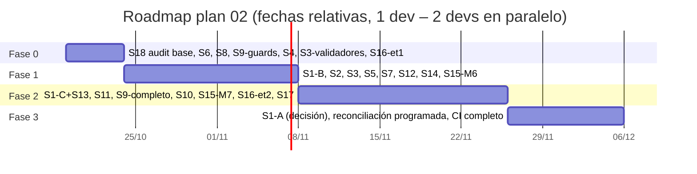
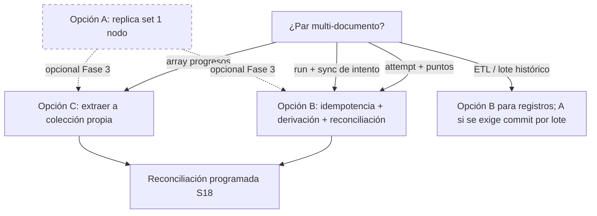
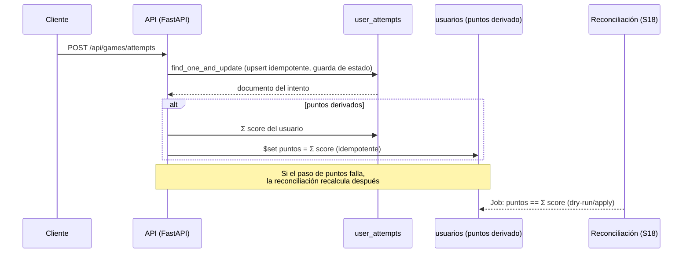
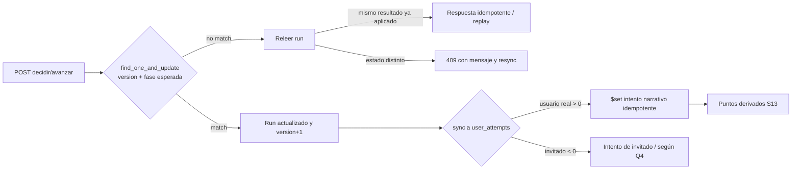
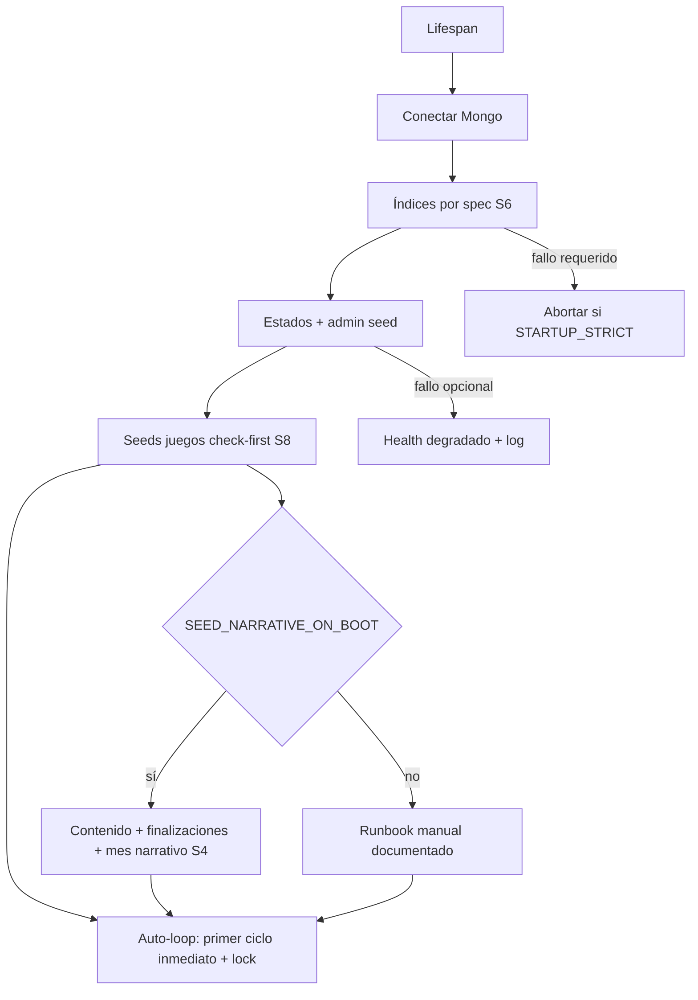

# Auditoría 02 — Plan de Soluciones: Persistencia y Flujo de Datos

| | |
|---|---|
| **Proyecto** | `mayores_actualizacionesSIPI-BACK` (FastAPI + MongoDB) |
| **Ruta** | `C:\Users\nmonti\Desktop\proyectos\backend\mayores_actualizacionesSIPI-BACK` |
| **Basado en** | `auditorias/02-persistencia-y-flujo-de-datos.md` (informe original del 19/10/2026) |
| **Insumos secundarios** | `auditorias/00-informe-consolidado.md`; lectura de solo lectura del código real (`app/core/database.py`, `app/scripts/*`, `app/features/*`) |
| **Fecha del plan** | 19/10/2026 |
| **Estado** | **PLANIFICACIÓN — NADA IMPLEMENTADO**. Ninguna solución descripta aquí fue aplicada. No se modificó código, tests, configuración ni base de datos; no se ejecutó la app, pytest ni MongoDB. Este documento es una propuesta accionable, con decisiones pendientes marcadas en la sección 6. |

> **Nota de alcance.** Este plan cubre los 20 hallazgos del informe 02 (identificados en detalle como C1–C3, A1–A8, M1–M10 y B1–B5). Cuando un hallazgo tiene su cierre principal en otro plan de la serie (03-seguridad, 04-microservicios, 01-arquitectura, 05-eficiencia, 06-testing) se indica explícitamente como **dependencia externa** y aquí solo se cubre la porción de datos/persistencia que no rompe la compatibilidad.

### Convenciones

- **Solución (S#):** unidad de trabajo de este plan.
- **Prioridad:** P0 = contención urgente (días), P1 = alto impacto (semanas), P2 = consolidación, P3 = mejora continua/opcional.
- **Esfuerzo:** S ≤ 1–2 días; M = 3–5 días; L = 1–2 semanas (dev backend con familiaridad en el código; no incluye pruebas de frontend).
- **Riesgo de implementación:** probabilidad de romper algo existente, con la mitigación indicada.
- **Dependencias externas:** `P-03` (seguridad), `P-04` (microservicios), `P-05` (eficiencia), `P-06` (testing), `P-01` (arquitectura).

---

## 1. Resumen ejecutivo del plan y estrategia

El backend funciona en el camino feliz pero sufre tres problemas estructurales de datos:

1. **Escrituras no atómicas ni idempotentes** en flujos multi-documento (`user_attempts` + `usuarios.puntos`; `narrative_runs` + sync de intento; array `usuarios.progresos`), agravadas por secuencias de arranque que **pisan contenido** y por una **generación mensual concurrente** (admin sin auth + auto-loop + seeds).
2. **Dos o tres fuentes de verdad en paralelo** (`usuarios.progresos` vs `user_attempts`; `puntos` escrito y nunca leído; `narrative_runs` vs intento narrativo), con contratos muertos (`mode`, `remaining_attempts`, `difficulty`) e IDs de invitado compartidos (`user_id=0`).
3. **Operación frágil**: MongoDB standalone (sin transacciones), índices que se inicializan "a medias y en silencio", arranque sin manejo de errores, uploads de imágenes en filesystem efímero, fechas naive con contenedor en UTC (el día de negocio cambia a las 21:00 ART).

**Estrategia general:** tres olas incrementales, sin big-bang y compatibles con el frontend actual:

1. **Ola 0 — Visibilizar y contener (sin cambiar infraestructura).** Scripts de auditoría de consistencia + dry-runs (S18), seeds idempotentes que no pisan (S8), `init_indexes` que falla fuerte pero ordenado (S6), guards de "desafío no generado" (S9), `force=false` por defecto y lock de generación (S4), recorte inmediato de exposición del PIN (S16).
2. **Ola 1 — Escrituras seguras (idempotencia y concurrencia).** Comparación de opciones transaccionales y elección (S1): **primero patrón de idempotencia + orden de escritura + reconciliación (Opción B)**, sin tocar infra; optimistic locking en `narrative_runs` (S2) y en intentos (S3); registro atómico (S7); counters y race de estados (S5); helper único de TZ y validación de fechas del cliente (S12); volumen para imágenes (S14); RNG local y RAE async (S15).
3. **Ola 2 — Unificar modelo y bootstrap.** Extraer `progresos` del hub `usuarios` a colección propia (Opción C de S1, solución definitiva del hotspot), unificar progreso/puntos/contrato (S13) con migración one-shot validable, invitados con identidad propia por dispositivo (S11), narrativo auto-sembrable (S9), ETL re-diseñado con dry-run y upsert por email (S10), documentación viva (S17).
4. **Ola 3 — Infra transaccional opcional y operación continua.** Replica set de 1 nodo en compose (Opción A de S1) **solo si se decide** tras la Ola 1/2; transacciones en los pares que aún las necesiten (ETL por lote), reconciliación programada, backups y purgas.

**Decisión central recomendada (con trade-offs en S1):** *B ahora, C para el hotspot de progresos, A opcional al final*. Motivos: (a) la Opción B no cambia infraestructura ni el contrato del frontend y se puede desplegar por partes; (b) la Opción C elimina la contención multi-escritor sobre `usuarios` (hub escrito por 6 rutas); (c) la Opción A aporta transacciones reales pero no elimina la necesidad de idempotencia/reintentos (las transacciones en Mongo requieren que la app maneje `TransientTransactionError` e `UnknownTransactionCommitResult`); aun así se documenta completa porque es el único camino a garantías ACID multi-documento.

**Resultado esperado al cerrar el plan (Fase 2):** arranque idempotente y sin pérdida de contenido; ninguna escritura multi-documento inconsistentemente visible (o reconciliable en minutos); una fuente de verdad por dominio; partidas de invitados aisladas por dispositivo; día de negocio ART coherente; ETL repetible con dry-run; `puntos` visible y consistente; e imágenes persistentes.

---

## 2. Principios y restricciones

1. **Compatibilidad total con el frontend actual.** Los 82 endpoints y sus rutas no cambian. Los cambios de respuesta son **aditivos** (campos nuevos) o acordados con el frontend (p. ej. manejo de `409` en dobles taps, cookie/header de invitado). Prohibido renombrar/eliminar campos consumidos sin ventana de deprecación.
2. **Incremental y reversible.** Cada solución se despliega con feature flag o en pasos independientes; ninguna requiere detener la plataforma más de una ventana corta (el cambio de replica set es la única ventana con reinicio de Mongo, y también es reversible).
3. **No perder datos existentes.** Toda migración sigue el mismo patrón: *snapshot/dump → dry-run con informe → apply con checkpoint → validación post → rollback documentado*. Nada borra campos históricos sin dejarlos renombrados/backupeados (`*_legacy`) y las escrituras nuevas nunca degradan datos leídos por el frontend.
4. **Una fuente de verdad por dominio.** Juegos diarios → `user_attempts`; cursos → nueva colección derivada de `usuarios.progresos`; partidas → `narrative_runs`; agregados (`puntos`) → derivados/recalculables, nunca incrementos ciegos.
5. **Idempotencia primero, transacciones después.** Todo flujo que hoy hace `$inc`/`replace_one`/`$set` de arrays debe poder repetirse sin efecto adicional. Las transacciones (S1-A) son un refuerzo, no un sustituto de la idempotencia.
6. **Fail loud en invariantes, degradación controlada en lo opcional.** Índices requeridos y consistencia: fallar el arranque/health si no se cumplen (configurable). Seeds y auto-chequeos: registrar y continuar.
7. **Sin cambios de infraestructura no decididos.** El plan documenta la alternativa de replica set completo (compose diff incluido) pero no la asume; cualquier cambio de infraestructura requiere aprobación explícita (sección 6).
8. **Observabilidad mínima.** Cada solución deja un script o endpoint verificable (S18) para demostrar su criterio de aceptación en pre y post deploy.

---

## 3. Tabla resumen (20 hallazgos → soluciones)

> Mapeo directo con la tabla del resumen ejecutivo del informe 02. "IDs detalle" remite a las secciones C/A/M/B del informe original.

| # | Hallazgo (resumen) | IDs detalle | Solución(es) | Prioridad | Esfuerzo | Riesgo si no se hace | Fase |
|---|---|---|---|---|---|---|---|
| 1 | Admin narrativo/desafíos sin autenticación (CRUD, uploads, `generate-month` con `force=true`) | C1 | **S4** (force=false + lock + rate limit de generación) + dependencia **P-03** (auth/rol) | P0 | S | Cualquiera regenera/pisa contenido jugado | 0–1 |
| 2 | IDOR y fraude de puntos en `user_attempts` (user_id del body, score del cliente) | C2 | **S3** (idempotencia + caps server-side) + **S13** (puntos derivados) + dependencia **P-03** (token manda) | P0 | S–M | Farmeo de puntos, calendarios falsos | 0–1 |
| 3 | ETL con upsert por `id` (contradice comentario), aborta por colisión de email, counters retroceden | C3 | **S10** (upsert por email + dry-run + `$max` + checkpoint) | P1 | M | Pérdida/mezcla de credenciales y progresos | 2 |
| 4 | Sin transacciones en flujos multi-documento (Mongo standalone) | A1 | **S1** (Opción B ahora; C; A opcional) + **S18** (reconciliación) | P1 | L | Estados divergentes sin reparación | 1–3 |
| 5 | Read-modify-write sin control de concurrencia (`replace_one` en runs; `$set` del array `progresos`) | A2 | **S2** (optimistic locking en runs) + **S13** (extraer progresos) + fix intermedio posicional | P0 | M | Partidas corruptas; progreso perdido | 1–2 |
| 6 | Invitados comparten `user_id=0`; sync descartado por `0` falsy | A3 | **S11** (identidad de invitado por dispositivo + limpieza) | P1 | M | Fuga de estado entre anónimos; modo invitado inconsistente | 2 |
| 7 | Narrativo 500 con BD fresca (assets/pools no sembrados; `challenge.get` sobre `None`) | A4, M5 | **S9** (bootstrap idempotente + guards 404/409) | P0 | M | Juego inutilizable en instalación nueva | 0–1 |
| 8 | Imágenes subidas no persisten (sin volumen en backend) | A5 | **S14** (volumen nombrado + verificación de referencias) | P1 | S | Pérdida de assets en cada deploy | 1 |
| 9 | Seeds de arranque pisan Wordle/Sopa (~185 docs) con `$set`; Sopa duplicada | A6 | **S8** (check-first/`$setOnInsert` + unificar generador) + **S4** (lock) | P0 | M | Ediciones y regeneraciones admin destruidas | 0 |
| 10 | `usuarios.puntos` se escribe y nunca se lee; narrativo no acredita | A7 | **S13** (fuente de verdad + exponer + recálculo idempotente) | P1 | M | Puntaje invisible e inconsistente; sin ranking | 2 |
| 11 | Fechas naive (UTC) vs Argentina; `date` del cliente sin validar | M1 | **S12** (helper TZ único + validadores + `TZ` en compose) | P1 | M | Bugs "de un día"; intentos fechados a mano | 1 |
| 12 | Dos sistemas de progreso en paralelo sin sincronización | M3 | **S13** (colección propia + vista agregada + semántica documentada) | P2 | L | Calendario y cursos no se ven entre sí | 2 |
| 13 | Contrato muerto: `mode` fuera del índice, `remaining_attempts` no serializado, `difficulty` fija | M4 | **S6** (índice) + **S13** (decisión y limpieza de contrato) | P2 | S–M | Colapsos daily/campaign; campos basura | 2 |
| 14 | RNG global contaminado por `random.seed()` de Sopa | M6 | **S15** (`random.Random(seed)` local; unificación con S8) | P1 | S | Sorteos narrativos alterados por generación de Sopa | 1 |
| 15 | `rae_client` bloquea el event loop y cachea en archivo efímero | M7 | **S15** (httpx async + caché Mongo + background) + dependencia **P-05** | P2 | M | Arranque/request path congelado; caché perdida | 2 |
| 16 | Documentación interna desactualizada (Java/MySQL, campos inexistentes) | M2, M8 | **S17** (docs vivas + marcar obsoletas + snapshot OpenAPI) | P2 | S | Contratos falsos para el equipo | 2 |
| 17 | PIN: aceptado del cliente en registro, en claro y expuesto; admin con `"999999"` fijo | B1, B3, B4 | **S16** (etapa 1: no aceptar/no exponer/rotar; etapa 2: hash con lookup) + **P-03** | P1 | M | Suplantación; credencial pública conocida | 0–2 |
| 18 | `estados_usuario`: `max(id)+1` no atómico (race con índice único) | M9 | **S5** (counter dedicado `estado_usuario_id`) | P1 | S | Colisión 500 en creaciones concurrentes | 1 |
| 19 | `init_indexes` silencia fallos y puede quedar parcial | M10 | **S6** (try/except por índice + estado verificable + fail loud configurable) | P0 | S–M | Estado de índices no confiable; uniques ausentes | 0 |
| 20 | Arranque frágil: seeds y generación sin manejo de error; auto-loop duerme primero | A8 | **S9** (registro de pasos, modo estricto/continuar, loop con primer ciclo inmediato) | P0 | M | Deploy roto por un fallo de red; sin reintento 12h | 0–1 |

**Totales estimados:** 18 soluciones, ≈ **45–60 días-persona** (≈ 9–12 semanas con 1 desarrollador full-time; ≈ 5–7 semanas con 2 en paralelo, respetando dependencias de la sección 5).

---

## 4. Soluciones detalladas

### S1 — Transaccionalidad: opciones reales y recomendación (A1)

**Cubre:** A1 (flujos multi-documento sin transacciones) · **Prioridad:** P1 · **Esfuerzo:** L (≈5–8 días) · **Fase:** 1–3

**Objetivo.** Definir y aplicar una política de consistencia para los pares multi-documento: `user_attempts` + `usuarios.puntos`, `narrative_runs` + `user_attempts` (cierre), array `usuarios.progresos`, y escrituras masivas (ETL/generación mensual).

**Enfoque (opciones evaluadas, sin aplicar).**

**Opción A — MongoDB replica set de 1 nodo en compose (transacciones con `session`).**
- *Qué implica:* `command: mongod --replSet rs0`, `rs.initiate()` en el primer arranque, URI `mongodb://mongodb:27017/?replicaSet=rs0`, y uso de `client.start_session()` + `session.start_transaction()` en Motor (motor ≥3.6/pymongo ≥4.9 ya presentes en `requirements.txt`).
- *Pros:* transacciones multi-documento reales; simplifica el razonamiento en los pares críticos; pymongo reintenta `TransientTransactionError` con `with_transaction`; habilita change streams a futuro (reconciliación reactiva).
- *Contras:* cambio de infraestructura (requiere ventana de reinicio de Mongo); sin HA real (1 nodo); mayor latencia por `writeConcern: majority` (mitigable con `w:1` si se acepta el trade-off); todas las operaciones que participen deben pasar `session=` a Motor (fácil de olvidar → pruebas); el oplog agrega disco.
- *Impacto en compose (diff previsto):*
  ```yaml
  mongodb:
    image: mongo:7.0
    command: ["mongod", "--replSet", "rs0", "--bind_ip_all"]
    healthcheck:
      test: ["CMD-SHELL", "mongosh --quiet --eval 'try { rs.status().ok } catch (e) { rs.initiate({_id:\"rs0\",members:[{_id:0,host:\"mongodb:27017\"}]}).ok }'"]
      interval: 15s
      timeout: 10s
      retries: 10
      start_period: 20s
  ```
  y en `backend.environment`: `MONGODB_URL=mongodb://mongodb:27017/?replicaSet=rs0`.
- *Pasos de migración:* backup (`mongodump`) → bajar stack → editar compose (arriba) → `docker compose up -d mongodb` (inicia el set) → verificar `rs.status().ok` → levantar backend con la URI nueva → smoke tests (login, intento, narrativo) → activar flag de código `TRANSACTIONS_ENABLED=true` para que los servicios usen sesión.
- *Rollback:* quitar `command` y el parámetro `replicaSet` de la URI, reiniciar Mongo (los datos sobreviven; quedan archivos de oplog inofensivos) y volver al patrón B.

**Opción B — Idempotencia + compensación + orden de escritura (recomendada para empezar).**
- *Qué implica:* cada par crítico se reescribe como: (1) operación idempotente con guardas de estado y claves naturales; (2) orden de escritura que deje el sistema "recuperable" si se corta a la mitad; (3) tarea de reconciliación que repare divergencias.
- *Orden de escrituras objetivo:*
  - *Intento + puntos:* 1) upsert condicional del intento (clave `(user_id, game_id, date[, mode])`, guarda `status != completed` para no recalcular transiciones), marcando `points_applied=false/true`; 2) marcar `points_applied=true` de forma condicional; 3) **no** `$inc` de puntos: `puntos` pasa a ser derivado (`Σ score` de `user_attempts`, ver S13) y se recalcula en lectura/escritura; si el paso 2 falla, la reconciliación recalcula sin doble conteo. Ventana inconsistente: minutos (reconciliación), no permanente.
  - *Cierre narrativo:* 1) `find_one_and_update` con CAS/máquina de estados en `narrative_runs` (S2); 2) sync idempotente a `user_attempts` (`$set` por clave natural, repetible); si (2) falla, el run queda finalizado y la tarea "runs FINALIZADA sin intento" (S18) lo re-sincroniza.
  - *Invariante:* nunca se acredita algo que no esté confirmado en la colección fuente; los derivados se recalculan, no se incrementan.
- *Pros:* cero infraestructura; desplegable ya; también mejora el futuro; multi-instancia seguro; la reconciliación queda como red de seguridad permanente.
- *Contras:* más lógica y pruebas; consistencia eventual acotada; requiere jobs/scripts de reconciliación y métricas; no sirve para ETL que necesite commit por lote (allí el ETL hace upserts idempotentes por registro, S10).

**Opción C — Mover datos embebidos (quitar el hotspot de `usuarios`).**
- *Qué implica:* extraer `usuarios.progresos` (array) a una colección `progresos_usuario` con índice único `(usuarioId, cursoId)`; cada actualización pasa a ser una operación de un solo documento (upsert atómico), eliminando el read-modify-write del array. Opcionalmente extraer `puntos` a un ledger (`puntos_movimientos`) si se quiere auditoría (ver S13).
- *Pros:* resuelve el lost-update de raíz; alinea con la futura separación del micro de Cursos (P-04); consultas por curso más eficientes; reduce el tamaño del documento hub `usuarios` (hoy también afecta a `get_current_user` sin proyección, P-05).
- *Contras:* migración one-shot del array; un endpoint debe componer la respuesta (la API ya devuelve `progresos` como lista, el contrato no cambia); más de una colección que mantener.
- *Nota:* los pares `attempt+puntos` y `run+attempt` son single-document en cada lado; C no los resuelve por sí sola, por eso B sigue siendo la base.

**Recomendación (con trade-offs).** Adoptar **B ahora** (Fase 1) para los pares críticos, **C en Fase 2** para `progresos` (es la única "transacción" que necesita el hotspot), y **A como decisión de Fase 3** si el equipo confirma multi-instancia, ETL transaccional por lote o necesidad de change streams. Aun implementando A, se conservan los guards idempotentes de B (las transacciones pueden reintentarse). Matriz resumida:

| Criterio | A (replica set) | B (idempotencia) | C (extraer embebidos) |
|---|---|---|---|
| Cambia infraestructura | Sí | No | No |
| Resuelve attempt+puntos | Sí | Sí (eventual, con reconciliación) | No (parcial) |
| Resuelve run+sync | Sí | Sí | No |
| Resuelve array progresos | Parcial (igual hay RMW) | No | Sí |
| Soporta multi-instancia | Sí | Sí | Sí |
| Esfuerzo | L + ventana de deploy | M–L por flujo | M + migración |
| Reversible | Sí (quitar replSet) | Sí (flag) | Sí (backup `*_legacy`) |

**Cambios por archivo (previstos, cualquiera de las tres opciones).**
- `docker-compose.yml` — solo Opción A (comando, healthcheck, URI).
- `app/core/database.py` — helpers: `get_client_session()` (A) y constantes de colecciones; en B, helper `apply_attempt_and_refresh_points`.
- `app/features/user_attempts/service.py` — reescritura de `save_user_attempt` según B (guardas + marcador de puntos + derivación).
- `app/features/narrative/game/turn_service.py`, `transition_service.py`, `setup_service.py`, `endings_service.py` — orden de escritura y llamadas idempotentes.
- `app/scripts/reconciliar_consistencia.py` — nuevo (B): repara puntos, syncs pendientes y contadores (se especifica en S18).
- `app/core/config.py` — flags `TRANSACTIONS_ENABLED`, `RECONCILE_ON_STARTUP` (default false).

**Pasos.**
1. Aprobar la recomendación (sección 6, Q1).
2. Implementar y testear B en `user_attempts` con flag `POINTS_DERIVED_ENABLED=false→true` y prueba de doble submit.
3. Aplicar B al cierre narrativo (S2/S3 dan las primitivas).
4. Crear `reconciliar_consistencia.py` con dry-run y programarlo (manual o cron del host; en Fase 3 evaluar task del lifespan).
5. Solo si se aprueba A: ejecutar la migración de compose en ventana, activar sesiones en los servicios del par ETL/regeneración, correr reconciliación post.

**Verificación (criterios de aceptación).**
- Test de corte simulado: interrumpir entre paso 1 y 2 del intento → `reconciliar` deja `puntos == Σ score` y el intento presente; 0 documentos duplicados.
- Test de doble submit (dos POST concurrentes) → un solo documento de intento y puntos contados una sola vez.
- Cierre narrativo con `user_id` válido → intento con score 1000..250 y `puntos` actualizado; con corte simulado tras el run → la reconciliación lo repara.
- Con Opción A: transacción abortada a mitad no deja escrituras parciales (test con error inyectado).

**Riesgos y mitigación.**
- *Cambio de semántica de `puntos` (de `$inc` a derivado)* → doble lectura: mantener el campo actualizado por recálculo; nunca restarlo; migración con dry-run (S13); si el frontend dependía del valor "instantáneo", el recálculo post-escritura lo mantiene equivalente.
- *Olvidar pasar `session=` en alguna operación* (solo A) → checklist + test de integración con transacción fallida a propósito.
- *Reconciliación agresiva que pise datos buenos* → dry-run por defecto, `--fix` explícito, log de cada reparación con valores antes/después.

**Rollback.**
- B: flag de vuelta al comportamiento anterior por flujo; los campos nuevos (`points_applied`) son inocuos si se ignoran.
- C: restaurar lectura desde `progresos_legacy` con flag (los datos originales no se borran hasta validar en producción durante ≥1 semana).
- A: quitar `--replSet` y el parámetro de URI (ver arriba).

**Dependencias.** P-05 (background tasks y proyecciones se benefician del modelo); P-04 (C alinea con micro de Cursos); P-06 (tests de concurrencia e integración).

---

### S2 — Concurrencia en `narrative_runs`: adiós al read-modify-write (A2)

**Cubre:** A2 (parte narrativa), B5 (tipos mixtos de `updated_at`) · **Prioridad:** P0 · **Esfuerzo:** M (≈3–4 días) · **Fase:** 1

**Objetivo.** Que dos requests concurrentes sobre la misma partida (doble toque típico en tablets) no puedan: resolver dos veces la misma fase, perder una mutación ni dejar el run en un estado imposible; estandarizar `updated_at`.

**Enfoque (sin aplicar).** Reemplazar `find_one` + mutación en memoria + `replace_one({"_id": ...})` por **`find_one_and_update` con filtro de estado esperado + versión optimista**:
- Agregar `version: int` al documento del run (los documentos existentes arrancan con `version: 0` al primer update).
- Cada operación declara su **estado esperado** y solo aplica si coincide, mutando solo las rutas que correspondan:
  ```python
  res = await db[COLL_RUNS].find_one_and_update(
      {"_id": run_id, "version": run["version"], "fase_actual": "DRAFT_MENSUAL"},
      {"$set": {...solo rutas cambiadas...}, "$inc": {"version": 1},
       "$set": {"updated_at": datetime.now(timezone.utc)}},
      return_document=ReturnDocument.AFTER)
  ```
- Si `res is None`: releer el run y decidir: (a) si ya está en la fase siguiente y la acción coincide con la ya aplicada → respuesta idempotente (replay benigno del doble tap), o (b) `409 Conflict` con `detail` claro para que el frontend recargue el estado (`GET .../estado`). Recomendación: **409** para transiciones mutantes ambiguas y **replay idempotente** para las que se pueden reconocer (p. ej. misma `carta_id` ya elegida).
- `updated_at` siempre `datetime` UTC (se corrige el `isoformat()` de `transition_service.py:87,121,151`); la serialización a string queda en la capa de respuesta (donde hoy no hay un serializer del run, se agrega `_serialize_run` si hiciera falta).
- Los documentos nuevos (`iniciar_partida_v2`) se crean con `version: 0` y la creación usa `replace_one(..., upsert=True)` con filtro `_id` **solo** cuando no existe (el `find_one` previo ya lo garantiza; se puede mantener para el caso carrera de creación → `DuplicateKeyError` si dos `iniciar` concurrentes: tratar como replay devolviendo el run existente).

**Cambios por archivo.**
- `app/features/narrative/game/turn_service.py` — 4 puntos de escritura (`elegir_carta_mes_v2`, colapso, `decidir_evento_v2`, `responder_conversacion_v2`).
- `app/features/narrative/game/transition_service.py` — 3 puntos (`avanzar_mes_v2` final, derrota, avance normal).
- `app/features/narrative/game/setup_service.py` — creación (upsert) y reinicio (delete) sin cambios de contrato.
- `app/features/narrative/game/endings_service.py` — `sincronizar_intento_usuario` deja de depender del dict mutado.
- Nuevo `app/features/narrative/game/run_repo.py` — helper único `update_run_cas(run_id, expected_version, expected_phase, set_fields) → (run | None)` y `get_run(...)` para no repetir el patrón en 7 sitios (también facilita P-01).
- `app/features/narrative/game/modals_service.py` — sin cambios funcionales; si lee `updated_at` string, normalizar.

**Pasos.**
1. Crear `run_repo.py` con CAS y tests unitarios del helper (aceptar/409/replay).
2. Migrar un endpoint (p. ej. `responder_conversacion_v2`) y validar con test de concurrencia (`asyncio.gather` de dos POST iguales).
3. Migrar el resto de los puntos uno por uno (los 7 listados), con test por fase.
4. Normalizar `updated_at` a datetime UTC en todos los puntos; ajustar lo que lo serialice.
5. Documentar en `docs_interna/DIAGRAMAS_ARQUITECTURA_NARRATIVO.md` el manejo de 409 y el resync.

**Verificación.**
- Dos `decidir-evento` concurrentes con el mismo `opcion_id` → exactamente uno 200 y uno 409 (o replay idempotente si se optó por ello); el run final tiene `version` +1 y recursos aplicados una sola vez.
- Doble `avanzar-mes` → un solo avance de mes; la segunda respuesta no puede "saltear" un mes.
- Test de regresión: ciclo V2 completo (los 12 meses del test actual) sigue en 200.
- `grep` sin `replace_one` sobre runs mutados en los servicios de juego (solo creación/reinicio).

**Riesgos y mitigación.**
- *El frontend no maneja 409* → responder 409 con `detail` que el SPA admin/juego pueda mostrar; ventana de coordinación; opción intermedia: responder 200 con el estado actual del run (replay) para transiciones deterministas y 409 solo donde el replay no es seguro.
- *Migración de runs en curso* → `version` ausente se trata como 0; no requiere migración masiva.
- *Documentos con `updated_at` string* → al escribir siempre datetime; al leer tolerar ambos (el serializer debe parsear) hasta que el tiempo purgue.

**Rollback.** Revertir el helper a `replace_one` (los runs siguen siendo compatibles; `version` puede quedar ignorado).

**Dependencias.** S1 (orden e idempotencia), S3 (sync de intento), S13 (puntos derivados), P-06 (tests de concurrencia).

---

### S3 — Concurrencia e idempotencia en intentos: doble submit y replay (A2 parte, C2 parcial)

**Cubre:** A2 (parte intentos), C2 (mitigación de fraude del lado de datos) · **Prioridad:** P0 · **Esfuerzo:** S–M (≈2–3 días) · **Fase:** 0–1

**Objetivo.** Un doble POST (reintento de red, doble tap) no puede duplicar puntos ni impedir una transición legítima; los `score`/`stars` que lleguen fuera de rango no se persisten sin validación de forma.

**Enfoque (sin aplicar).**
- La clave `(user_id, game_id, date)` ya es única; el problema es la detección de "ya completado" **fuera** de la operación (`was_already_completed = pre-read` + `$inc` posterior) → carrera.
- Reemplazar por un único `find_one_and_update` con guarda dentro del filtro y marcador:
  - `points_applied` (bool) en el documento del intento; el acreditado de puntos (o el recálculo derivado, S13) usa `{"points_applied": {"$ne": True}}`.
  - Transiciones de estado: no permitir volver de `completed` a otro estado vía update incondicional; si llega un segundo `completed` para la misma clave, es **replay** → devolver el documento existente (200 idempotente).
  - `attempts`/`remaining_attempts`: si llegan como 0/None, conservar el valor previo (`$setOnInsert` + `$max`/condicional) en lugar de pisar.
- Validación de forma en `schemas.py` (sin decidir aún el cálculo server-side completo, que depende de P-03): `score` entero acotado por juego (Wordle ≤ 600; Sopa/Sudoku/Crucigrama: definir tope; Narrativo: 1000), `stars` ∈ 1..3, `date` formato ISO (ver S12), `status` ∈ {in_progress, completed, failed}. Nota: la validación semántica real (score calculado desde la solución) es **P-03**; aquí se cierra la duplicación y los valores absurdos.
- `mode`: se resuelve en S13 (decisión); mientras tanto, no duplicar intentos por `mode`.

**Cambios por archivo.**
- `app/features/user_attempts/service.py` — `save_user_attempt` con guarda, replay y `points_applied`.
- `app/features/user_attempts/schemas.py` — validadores de rango/formato.
- `app/features/user_attempts/router.py` — sin cambios de contrato (posible nota: precedencia de token es P-03).
- `tests/` — nuevo test de doble submit concurrente.

**Pasos.**
1. Agregar validadores Pydantic (compatibles: los valores válidos actuales no cambian).
2. Reescribir el upsert con guarda y replay.
3. Ajustar el acreditado de puntos al esquema de S1-B (derivación + marcador).
4. Tests: double-submit; replay de completed; scores fuera de rango → 422; intento legítimo in_progress→completed.

**Verificación.**
- `asyncio.gather` de dos POST `completed` idénticos → ambas 200 (o 200 + 409, a decisión) y **un** intento, puntos sumados exactamente una vez.
- POST con `score` negativo o 10^9 → 422.
- Calendario (`GET month`) no muestra duplicados.

**Riesgos y mitigación.**
- *Cambio de comportamiento en replays* (hoy respondía 200 pisando) → mantener 200 idempotente; no romper al frontend.
- *La guarda con `points_applied` deja de acreditar si el doc quedó a medias* → reconciliación S18 recalcula.
- *Caps mal calibrados que rechacen partidas legítimas* → los caps salen de los generadores actuales (scores 100..600 y narrativo 250..1000); dejar config por juego y log de rechazos.

**Rollback.** Quitar validadores y volver al upsert anterior (el campo `points_applied` es inocuo).

**Dependencias.** S1 (derivación), S13, P-03 (precedencia de token/score server-side), P-06.

---

### S4 — Doble generación mensual y regeneración destructiva (C1 parcial, A6 parcial)

**Cubre:** C1 (parte de integridad: `force=true` público y regeneración), A6 (carrera seeds/auto-loop/admin), issue de arranque (parte de A8) · **Prioridad:** P0 · **Esfuerzo:** S (≈1–2 días) · **Fase:** 0

**Objetivo.** Que dos generadores (auto-loop del lifespan, `generate-month`, seeds) no puedan pisarse ni pisar días ya jugados; que regenerar sea una decisión explícita.

**Enfoque (sin aplicar).**
- **Lock por (game_id, año-mes)** en una colección `generation_locks` con lease: `find_one_and_update({"_id": key, "expires_at": {"$lte": now}}, {"$set": {"owner": uuid, "expires_at": now+20min}}, upsert=True)`; si no se obtiene, responder `202/409` "generación en curso" (idempotente, no error 500). TTL opcional sobre `expires_at`.
- **`force=false` por defecto** en `POST /api/challenges/admin/generate-month` (hoy `Query(True)` en `daily_challenges/router.py:103`).
- **Semántica de `force=true` saneada:** antes de regenerar un mes, contar `user_attempts` por fecha del mes (cualquier juego del lote); si hay intentos, **conservar** esos días y regenerar solo los faltantes, salvo parámetro explícito `allow_played=true` (que además debe auditarse). Implementar en `generate_and_save_*` como política común (hoy Wordle ya preserva la solución, pero Sopa/Sudoku/Crucigrama no; los usos del endpoint son P-03).
- **Auto-loop:** primer ciclo inmediato (no `sleep(43200)` primero; ver S9) y siempre detrás del lock.
- **Rate limit** del endpoint de generación (P-03 hace la auth; aquí el lock evita la carrera aunque haya N llamadas).
- **Narrativo:** `generar_mes_narrativo` usa `replace_one(..., upsert=True)` que hoy actualiza `created_at` y puede pisar configuraciones; cambiar a `$setOnInsert` para los campos de configuración estable + `$set` solo de `updated_at`, o preservar si ya hay runs iniciados ese día (consistencia con intentos).

**Cambios por archivo.**
- `app/features/daily_challenges/router.py` — default `force=False`; parámetro nuevo `allow_played: bool = False` (aditivo).
- `app/features/daily_challenges/service.py` — helper `_acquire_generation_lock`/`_release`; política "no tocar días con intentos"; dedupe de generación por día.
- `app/features/narrative/admin/challenge_service.py` — `generar_mes_narrativo` con `$setOnInsert`/preservación.
- `app/core/database.py` — helper de lock reutilizable (o `app/core/locks.py` nuevo).
- `app/main.py` — loop usa lock (S9 lo reorganiza).

**Pasos.**
1. Implementar lock y aplicarlo a `ensure_current_and_next_month_generated` y a los `generate_and_save_*`.
2. Cambiar el default de `force` y agregar `allow_played` (solo admin; el contrato actual sigue funcionando).
3. Regla "día con intentos no se regenera" común a los 4 juegos + test.
4. Ajustar narrativo a preservación por día.
5. Rate limit al endpoint (si P-03 no lo trae primero).

**Verificación.**
- Dos `generate-month` concurrentes (mismo juego/mes) → uno genera, el otro responde "en curso"; sin excepciones ni escrituras entrelazadas (comparar `updated_at`/conteos).
- `generate-month?force=true` sobre un mes con intentos → no cambia los días jugados (snapshot antes/después).
- Seeds de arranque + auto-loop en simultáneo → sin pisadas (los seeds ya no pisan, S8).

**Riesgos y mitigación.**
- *Regeneración legítima de un día jugado que ahora se bloquea* → `allow_played=true` con log de auditoría y confirmación explícita en la Torre de Control (queda como decisión Q6).
- *Lock huérfano por crash* → lease con `expires_at` (auto-recuperable).

**Rollback.** Quitar uso del lock y volver el default de `force` (sin migración de datos; `generation_locks` es efímera).

**Dependencias.** S8, S9, P-03 (auth/rate limit), P-05 (generación pesada fuera del request path).

---

### S5 — IDs secuenciales y counters: colisiones, media escritura y unicidad por colección (B2, M9, C3 parcial)

**Cubre:** B2 (secuencia consumida antes del insert), M9 (`max(id)+1` en estados), C3 (counters que retroceden con ETL) · **Prioridad:** P1 · **Esfuerzo:** S (≈1 día) · **Fase:** 1

**Objetivo.** Que los IDs numéricos sean únicos y monótonos por colección, que un fallo a mitad de flujo deje a lo sumo *gaps* (aceptables) y nunca reutilización, y que la creación de estados no dependa de `max()+1`.

**Análisis (sin aplicar).**
- `get_next_sequence_value` (`database.py:32-44`) ya es atómico (`find_one_and_update` + `$inc` + upsert) — correcto. Los problemas reales: (a) **quién lo usa y cuándo**: en `register_usuario` se reserva el ID antes de validar/insertar (`auth/service.py:232`), lo que deja gaps (aceptable) pero hoy combinado con ETL puede derivar en reutilización; (b) `set_sequence_value` pisa con `$set` y el ETL puede **bajar** la secuencia (C3/S10); (c) `estados_usuario` no usa counters: `max(id)+1` con race (`usuario/service.py:237-239`).
- Unicidad de secuencias por colección: hoy los nombres `usuario_id` y `progreso_id` existen; falta `estado_usuario_id` (y el que se defina para propuestas/otros). Convención: `_id` del counter == nombre lógico de la secuencia.

**Enfoque (sin aplicar).**
- Nuevo helper `bump_sequence_at_least(name, value)` con `{"$max": {"seq": value}}` para migraciones/ETL (nunca baja).
- `estados_usuario`: reemplazar `max(id)+1` por `get_next_sequence_value("estado_usuario_id")`; seed inicial de la secuencia en `init_db` a `max(id)` existente (idempotente, `$max`).
- Registro: mover la reserva de `usuario_id` lo más cerca posible del insert (después de validaciones y de la decisión de upsert de S7); documentar que los gaps son esperados (`AUTO_INCREMENT`-like).
- `set_sequence_value` se mantiene para compatibilidad pero se agrega el helper `$max` y un deprecation note; el ETL (S10) usa `$max`.
- Verificación de arranque: chequear `counters[usuario_id].seq >= max(usuarios.id)` y `>=` para `progreso_id`/`estado_usuario_id` (parte de S18); si no, `$max` automático o alerta según config.

**Cambios por archivo.**
- `app/core/database.py` — `bump_sequence_at_least`, constantes `SEQ_USUARIO_ID`, etc.
- `app/features/usuario/service.py` — counter en `crear_estado`.
- `app/scripts/init_db.py` — inicializar `estado_usuario_id` con `$max`.
- `app/features/auth/service.py` — orden de reserva (junto con S7).
- `app/scripts/reconciliar_consistencia.py` (S18) — chequeo de counters.

**Pasos.**
1. Agregar helper `$max` + constantes.
2. Migrar `estados_usuario` a counter; test de dos creaciones concurrentes.
3. Ajustar orden en registro (coordinado con S7).
4. Chequeo de counters en el health/script.

**Verificación.**
- Dos `POST estado` concurrentes → IDs consecutivos, sin 500 por `DuplicateKeyError`.
- Tras correr el ETL de prueba (S10), `counter.seq` nunca menor que el máximo de IDs.
- Registro con fallo simulado post-validación → gap documentado, sin reutilización.

**Riesgos y mitigación.**
- *Colisión de `id` si existiera una secuencia desincronizada* → chequeo S18 + `$max` en el arranque; dry-run del fix.
- *Estados existentes con IDs manuales* → el seed con `$max` no pisa; solo sube el contador.

**Rollback.** Trivial (volver a `max+1` es peor, pero no hay migración de datos que revertir).

**Dependencias.** S7 (registro), S10 (ETL), S6/S18 (verificación).

---

### S6 — Índices y constraints: creación verificable y fail loud (M10, M4 parcial, C2 soporte)

**Cubre:** M10 (`init_indexes` traga errores), indexación real de filtros, parte de M4 (`mode` fuera del índice) · **Prioridad:** P0 · **Esfuerzo:** S–M (≈2 días) · **Fase:** 0–2

**Objetivo.** Que el arranque garantice (o reporte con precisión) los índices requeridos; que un índice faltante no pase silencioso; que los filtros reales tengan índice.

**Enfoque (sin aplicar).**
- Reescribir `init_indexes` como una **lista declarativa** de especificaciones: `(colección, keys, opciones, requerido: bool)`; `try/except` **por** índice con log `OK/FALLO` y acumulación de fallos. Si hay fallos en índices `requerido` y `settings.STRICT_INDEXES=true` (default en prod) → lanzar excepción en el arranque (el healthcheck del compose queda unhealthy y Caddy no arranca → visible, no silencioso). Si `STRICT_INDEXES=false` (default deseado solo en dev/primera migración), continuar con `logger.error` y marcar `db_health.degraded=true`.
- Exponer `GET /health/db` con: índice por índice (`present`, `unique`, `build_state`), counters vs máximos, y resultado de la última reconciliación; `/health` sigue respondiendo `UP` solo si `db_health.ok`.
- **Índices requeridos (revisión del set actual y faltantes):**

  | Colección | Índice | Único | Notas |
  |---|---|---|---|
  | `usuarios` | `email` ↑ | Sí | ya existe |
  | `usuarios` | `id` ↑ | Sí | ya existe |
  | `usuarios` | `codigo_acceso` ↑ | Sí sparse | ya existe; limpiar `""`/`null` (sparse no protege strings vacíos) |
  | `user_attempts` | `(user_id, game_id, date[, mode])` | Sí | decidir `mode` en S13; **cambiarlo requiere dedup previo** |
  | `user_attempts` | `(user_id, date ↓)` | No | ya existe |
  | `user_attempts` | `(game_id, date)` | No | nuevo: filtros por juego/fecha del calendario y reportes |
  | `narrative_runs` | `(user_id, date, game_id)` unique partial `user_id>0` | Sí | para invitados, ver S11 (segundo índice por `guest_id`) |
  | `narrative_runs` | `(user_id, date ↓)` | No | ya existe; ajustar a partial si aplica |
  | `daily_challenges` | `(game_id, date, difficulty)` | Sí | ya existe |
  | `daily_challenges` | `(date)` | No | ya existe |
  | `estados_usuario` | `id`, `codigo` | Sí | ya existen |
  | `narrative_endings` | `(universo_id, recurso_clave)` | No | ya existe |
  | `narrative_*` | `(universo_id)` | No | ya existe |
  | `counters` | `_id` (implícito) | — | no requiere |
  | `generation_locks` | `_id` + TTL `expires_at` | — | S4 |
  | `guest_sessions` | `_id` + TTL | — | S11 |
  | `etl_checkpoints` | `_id` | — | S10 |

- **Dedup previo obligatorio** antes de crear uniques nuevos (p. ej. cambiar el unique de intentos incluyendo `mode`): script de S18 detecta duplicados por clave nueva y exige resolverlos (`--fix` solo mueve a `*_duplicated_backup` con log, nunca borra sin confirmación).

**Cambios por archivo.**
- `app/core/database.py` — reescritura de `init_indexes` + estructura de specs + `verify_indexes()`.
- `app/core/config.py` — `STRICT_INDEXES: bool = True`.
- `app/main.py` — health enriquecido.
- `app/scripts/reconciliar_consistencia.py` — detección/dedup (S18).

**Pasos.**
1. Declarativa + try/except individual + log por índice.
2. `verify_indexes()` y `/health/db`.
3. Correr en el entorno real (solo lectura de la spec, sin ejecutar aquí) para saber el estado actual; planificar dedups.
4. Agregar los índices nuevos por colección, con el unique de intentos condicionado a la decisión `mode` (S13).
5. Activar `STRICT_INDEXES=true` en prod.

**Verificación.**
- Con un índice imposible de crear (duplicados inyectados en una DB de prueba), el arranque falla explícitamente y `/health/db` dice cuál.
- `verify_indexes()` reporta todos los requeridos presentes con sus opciones.
- Los filtros reales (`user_attempts` por user/date, calendario por game/date) usan `IXSCAN` (explicar plan en la verificación, no en runtime).

**Riesgos y mitigación.**
- *Arranque bloqueado por datos históricos duplicados* → `STRICT_INDEXES=false` como escape hatch documentado + dedup guiado por S18; nunca borrar datos automáticamente.
- *Índices parciales de runs/invitados mal definidos* → definir junto con S11 y probar con `mongosh` en una copia.

**Rollback.** `drop_index` de los índices nuevos; revertir el flag `STRICT_INDEXES` a `false`.

**Dependencias.** S11 (índices de invitado), S13 (`mode`), S18 (dedup/dry-run), P-06.

---

### S7 — Registro de usuario: de check-then-insert a upsert atómico (race + DuplicateKeyError)

**Cubre:** race de alta (informe 00 consolidado / 06), B1 parcial (PIN provisto por cliente) · **Prioridad:** P1 · **Esfuerzo:** S (≈1 día) · **Fase:** 1

**Objetivo.** Dos registros concurrentes con el mismo email (o con el mismo PIN generado) no deben producir 500 ni usuarios duplicados; el flujo "pendiente → reenviar código" debe seguir funcionando.

**Enfoque (sin aplicar).**
- Reemplazar `find_one` + `insert_one` por `find_one_and_update({"email": email}, {"$setOnInsert": doc}, upsert=True, return_document=AFTER)`. Detectar si insertó con `result.upserted_id is not None` (o comparar `created_at`).
- Si ya existía: replicar la lógica actual: estado 1 → actualizar `name` y reenviar; otro estado → 400 con el mismo mensaje actual.
- **`DuplicateKeyError`:** capturar y reintentar (a) si el choque es por `email` en carrera → releer y tratar como "ya existe"; (b) si es por `codigo_acceso` (p. ej. dos procesos generaron el mismo PIN, o un PIN provisto colisiona) → regenerar el código y reintentar hasta 3 veces (acotado), porque hoy `camino` tiene un loop de unicidad *también* fuera de la operación atómica.
- Ignorar el `codigoAcceso` entrante en el registro **público** (B1 → S16), lo que reduce colisiones maliciosas.
- El ID secuencial se reserva dentro del camino de inserción (coordinado con S5) — si el upsert resulta en "ya existía", el ID reservado queda como gap (documentado).

**Cambios por archivo.**
- `app/features/auth/service.py` — `register_usuario` (upsert + manejo de errores + reenvío).
- `app/features/auth/schemas.py` — opcional: marcar `codigoAcceso` como ignorado en público (si no lo hace S16).
- `tests/` — test de 10 registros concurrentes con el mismo email.

**Pasos.**
1. Implementar upsert con `$setOnInsert` y detección de insert/existing.
2. Envolver en retry acotado ante `DuplicateKeyError` por PIN.
3. Tests de carrera (asyncio.gather) y de "ya pendiente reenvía".
4. Coordinar con S16 (no aceptar PIN del cliente) y S5 (orden del counter).

**Verificación.**
- 10 `POST /api/auth/register` concurrentes, mismo email → exactamente 1 documento, 0 respuestas 500, mensajes coherentes (1 alta + 9 "ya existe/pendiente").
- Fallo inyectado de email (SMTP) → el usuario igual queda consistente (reenviar reingresa por el camino existente).
- PIN colisión simulada → retry y éxito.

**Riesgos y mitigación.**
- *El upsert puede "revivir" un usuario existente sin querer* → el filtro es solo email y `$setOnInsert` no toca el documento existente; la lógica posterior decide según estado (idéntica a hoy).
- *Mensajes de error distintos al frontend* → conservar strings actuales.

**Rollback.** Revertir a check-then-insert (los datos no cambian).

**Dependencias.** S5, S16, P-03 (validaciones de registro).

---

### S8 — Seeds idempotentes y no destructivos (A6)

**Cubre:** A6 (Wordle/Sopa pisan contenido en cada arranque; Sopa duplicada) · **Prioridad:** P0 · **Esfuerzo:** M (≈2–3 días) · **Fase:** 0

**Objetivo.** Que reiniciar la aplicación no modifique ni un documento de `daily_challenges` ya existente; que el seed de Sopa use la misma fuente de datos y la misma lógica de grilla que la generación admin/auto (eliminar la implementación duplicada).

**Enfoque (sin aplicar).**
- **Check-first** en vez de `$set`: por cada fecha, `find_one` con proyección mínima (`game_id`, `date`, `config.solution`/`config.grid`); si existe → `continue` con contador de "ya presentes"; si no → insert con `created_at`/`updated_at`. Alternativa equivalente: `$setOnInsert` con el documento completo (menos lecturas); se recomienda `$setOnInsert` para Wordle/Sopa porque evita el round-trip adicional por día.
- Flag global `SEED_OVERWRITE=false` (env/config). Con `true` (solo dev explícito) se mantiene el comportamiento viejo para quien lo necesite.
- El conteo "sincronizados" del log pasa a "existentes/creados" para visibilidad.
- **Unificar Sopa:** eliminar de `seed_sopa_letras.py` la lista `SOPA_LETRAS_RAW_DATA` propia y su `generate_word_search` (líneas ~108-166 y 168-206); mover la lista única a un módulo de datos (`app/data/sopa_letras_data.py`) importado por `sopa_generator.py` y por el seed; el seed llama a `generate_sopa_challenge_for_date(date_str)` (el mismo camino de admin/auto) con RNG local (S15). Nota de compatibilidad: las grillas **ya sembradas no se tocan** (check-first); solo las fechas nuevas usan el generador unificado, por lo que la divergencia histórica queda congelada y documentada (opcional: script one-shot `normalizar_sopa.py` para alinear histórico, fuera del alcance mínimo).
- Wordle: mismo tratamiento; las listas hardcodeadas Ago–Dic 2026 se mueven a `app/data/wordle_seed_data.py` (sacar fechas del código es parte de A6; el generador `generate_wordle_challenge` sigue siendo el camino para meses sin lista).
- Sudoku: ya es check-first (`generate_and_save_sudoku_month` sin `force`); se documenta la política común (seeds = solo faltantes; corrección de contenido = acción admin explícita).
- Narrativo: no se siembra en este script; ver S9.

**Cambios por archivo.**
- `app/scripts/seed_challenges.py` — `$setOnInsert`/check-first; importar datos desde `app/data/`.
- `app/scripts/seed_sopa_letras.py` — eliminar duplicación; delegar en el generador.
- `app/features/daily_challenges/sopa_generator.py` — recibir/usar la lista única; RNG local (S15).
- `app/data/wordle_seed_data.py`, `app/data/sopa_letras_data.py` — nuevos (datos).
- `app/main.py` — logging de resultado por seed (parte de S9).
- `app/core/config.py` — `SEED_OVERWRITE: bool = False`.

**Pasos.**
1. Convertir Wordle y Sopa a `$setOnInsert` + contadores de resultado.
2. Mover listas a `app/data/` y unificar Sopa en el generador.
3. Agregar el flag `SEED_OVERWRITE` y documentarlo.
4. Verificar en un clon de la DB que dos arranques seguidos no escriben (comparar `updated_at` y hashes de documentos).
5. Medir tiempo de arranque antes/después (insumo para P-05).

**Verificación.**
- Dos arranques consecutivos → `modified_count == 0` sobre documentos existentes (instrumentar el seed o comparar snapshots).
- Borrar un challenge de prueba → el siguiente arranque lo recrea.
- Para una fecha nueva (sin doc), la grilla generada por seed y por `generate-month` es **idéntica** (misma función, mismo seed).
- `grep -c "random.seed"` → 0.

**Riesgos y mitigación.**
- *Equipos que dependían de que el seed "corrigiera" contenido* → flag `SEED_OVERWRITE=true` documentado y usado solo manualmente; la corrección de contenido pasa a ser una acción admin (S4) con `allow_played`.
- *Cambios de datos históricos de Sopa* → no se tocan por diseño; la divergencia queda documentada en `docs/DATOS.md` (S17).

**Rollback.** `SEED_OVERWRITE=true` restaura el comportamiento viejo sin cambiar código.

**Dependencias.** S15 (RNG local), S4 (lock de generación), P-05 (arranque), P-01 (duplicación general).

---

### S9 — Arranque resiliente y bootstrap narrativo con guards (A4, M5, A8)

**Cubre:** A4 (narrativo no se auto-siembra → 500 en BD fresca), M5 (`challenge.get` sobre `None` en 5 sitios), A8 (arranque frágil; auto-loop duerme primero) · **Prioridad:** P0 · **Esfuerzo:** M (≈3–4 días) · **Fase:** 0–1

**Objetivo.** (1) Una instalación nueva queda jugable de punta a punta sin scripts manuales (o, si se decide modo runbook, falla con un mensaje claro y un health degradado explícito); (2) ningún faltante de contenido produce 500 opaco; (3) un fallo de un paso de arranque no impide el arranque completo sin dejar rastro.

**Enfoque (sin aplicar).**
- **Registro de pasos de arranque:** lista ordenada `(nombre, función, criticidad {requerido|opcional}, timeout)`; se ejecutan en el lifespan con try/except individual, log de resultado por paso y acumulación en `app.state.startup_report`; `/health/db` y `/health` lo exponen. Modo `STARTUP_STRICT` (config, default true en prod): si falla un paso requerido (conexión, índices —S6—) → abortar el arranque; pasos opcionales (seeds, generación) → registrar degradado y continuar. Esto reemplaza el bloque actual `main.py:36-48` donde solo el seed narrativo está protegido.
- **Narrativo auto-sembrable (idempotente):** el contenido de `seed_narrative.py` (universo + personajes + cartas + eventos + resultados + conversaciones) se expone como función reutilizable `bootstrap_narrative_content()` (extraída del script; el god-file queda íntegro para P-01, solo se agrega un wrapper). El arranque ejecuta, con flag `SEED_NARRATIVE_ON_BOOT` (decisión Q6):
  1. si `narrative_settings` está vacía → sembrar contenido;
  2. `sembrar_finalizaciones_default()` (ya existe, condicional);
  3. generar el mes narrativo actual (y siguiente) con la política de S4 (`$setOnInsert`/preservación por día). *Hoy `ensure_current_and_next_month_generated` no incluye `narrativo` y `generar_mes_narrativo` requiere universo existente — el orden de pasos importa.*
  - Los `crear_o_actualizar_*` actuales ya son upsert; se ejecutan solo si la colección está vacía para evitar sobreescrituras accidentales (doble seguridad con S8).
- **Guards de contenido (M5):** en los 5 puntos citados (`setup_service.py:80,87,142,146`; `turn_service.py:111-112,231-232`; `transition_service.py:135-136`), reemplazar `challenge.get(...)` por:
  ```python
  if not challenge:
      raise HTTPException(status_code=409, detail="El desafío narrativo no está generado para la fecha solicitada.")
  ```
  (409 en juego en curso / 404 en lecturas; mensaje accionable "mes narrativo no generado"). Idem si `config.pool_*` viene vacío → 409 "contenido del universo incompleto" en lugar de 500.
- **Auto-loop:** primer ciclo **inmediato** al arrancar (hoy duerme 12 h primero, `main.py:51-62`), luego cada 12 h; backoff exponencial acotado (1 h → 6 h) ante error; el loop corre detrás del lock de S4 y usa el helper de TZ (S12). Si P-05 mueve la generación a background task, este loop se apoya en ella.
- **Seeds separados por criticidad:** `seed_estados_usuario` + `seed_default_admin` requeridos (la app sin admin no es operable → requerido pero con mensaje claro); seeds de juegos y generación opcionales con reporte.

**Cambios por archivo.**
- `app/main.py` — registro de pasos, flags, health enriquecido, loop.
- `app/scripts/seed_narrative.py` — wrapper `bootstrap_narrative_content()`.
- `app/features/narrative/admin/challenge_service.py` — generación narrativa preservando días (S4).
- `app/features/narrative/game/setup_service.py`, `turn_service.py`, `transition_service.py` — guards.
- `app/core/config.py` — `STARTUP_STRICT`, `SEED_NARRATIVE_ON_BOOT`.
- `docs_interna/DIAGRAMAS_ARQUITECTURA_NARRATIVO.md` — runbook actualizado (S17).

**Pasos.**
1. Registrar pasos y health (sin cambiar lógica todavía).
2. Guards en los 5 sitios + test con challenge ausente (espera 409, no 500).
3. Envolver el bootstrap narrativo con el flag y probar contra una DB **vacía** en un entorno de prueba (no productiva).
4. Reordenar el loop (primer ciclo inmediato) y backoff.
5. Documentar el runbook (quién/qué si `SEED_NARRATIVE_ON_BOOT=false`).

**Verificación.**
- DB vacía + arranque (con flag activo) → `GET /api/narrative/v2/partida/setup` y ciclo completo funcionan sin scripts manuales.
- Challenge de una fecha sin generar → 409 con mensaje claro (no 500) en los 5 endpoints.
- Fallo simulado de `sembrar_finalizaciones_default` → la app arranca y el health lo reporta como degradado.
- Loop: primer `ensure_...` ocurre inmediatamente tras el arranque (log), no 12 h después.

**Riesgos y mitigación.**
- *Bootstrap pesado que retrasa el arranque (P-05)* → timeout por paso, flag para desactivarlo en prod y log de duración; la generación de meses pesados puede delegarse al loop/background.
- *Sembrar narrativo en prod con datos existentes* → condicional "solo si vacío" + check-first.
- *Cambio de códigos de estado (409/404) que el frontend no esperaba* → mejor que un 500 opaco; mensajes en `detail`/`message` (el handler global ya los replica a `message`).

**Rollback.** Desactivar `SEED_NARRATIVE_ON_BOOT`; los guards son aditivos (revertir el mensaje no afecta datos).

**Dependencias.** S4, S6, S8, S12, S17, P-05 (generación en background), Q6 (runbook).

---

### S10 — ETL `migrate_from_mysql` rediseñado: dry-run, upsert por email y reanudable (C3)

**Cubre:** C3 y los 8 riesgos de la sección 6 del informe 02 · **Prioridad:** P1 · **Esfuerzo:** M (≈3–5 días) · **Fase:** 2

**Objetivo.** Una migración repetible, auditable y que no pise datos: upsert por email (no por id), sin abortos por email duplicado, counters que nunca retroceden, y un modo dry-run que permita ver el plan antes de escribir.

**Enfoque (sin aplicar).**
- **Modo seguro por defecto:** sin `--apply`, el script es *dry-run* (solo lee MySQL y Mongo y emite informe); `--apply` ejecuta. (Hoy, correrlo escribe directamente.)
- **Informe del dry-run:** totales por tabla; emails duplicados en MySQL (lower/trim) con conteo; colisiones con Mongo (email existente con otro `id`); ids de MySQL ya ocupados en Mongo; usuarios nuevos a insertar vs existentes a saltar; valores de counters resultantes; fechas con tipo inconsistente; PINs colisionando con el admin; muestra de 10 filas planificadas.
- **Upsert por email:** `update_one({"email": email}, {"$setOnInsert": doc_cred}, upsert=True)`; para existentes, política `--on-conflict=skip|merge` (default **skip** + reporte). `merge` (opt-in) solo actualiza campos seguros de perfil (nunca password/PIN/roles sin flag dedicado `--allow-credentials`). El upsert por email elimina el aborto por `DuplicateKeyError` de email.
- **IDs:** si el `id` de MySQL está libre en Mongo → usarlo (preserva referencias históricas); si está ocupado → reservar `usuario_id` de `counters` y guardar `legacy_mysql_id` para trazabilidad. Nunca `$set` por `id` a ciegas.
- **Counters:** usar `bump_sequence_at_least` (`$max`, S5) para `usuario_id` y `progreso_id`: la secuencia nunca baja aunque Mongo tenga IDs mayores. Se elimina el `set_sequence_value` actual (L113-120).
- **Reanudable por lotes:** `etl_checkpoints` (`_id`: run-id+lote, `last_mysql_id`, contadores, `updated_at`); ante excepción, el script puede retomarse desde el último lote confirmado; además es idempotente (re-ejecutar no duplica).
- **Fechas y tipos:** `date_end` se normaliza a `datetime` UTC-aware (hoy queda string, L89); `updatedAt`/`date_start` aware (S12); nunca `datetime.now()` naive.
- **Progresos:** se migran al array actual como hoy, con flag `--write-progresos-collection=false` hasta que S13 habilite la colección nueva; documentar que los usuarios históricos no tendrán calendario `user_attempts` (no se fabrican intentos) — decisión Q11.
- **Roles/PIN:** `tipo_usuario` solo se migra si `--allow-credentials` (si no, se conserva el criterio de P-03); `codigo_acceso` colisionando con otro usuario → se reporta y el usuario se salta (no abortar).
- **Verificación post:** script de comparación (conteo origen vs destino, emails únicos, hashes BCrypt de muestra idénticos, counters ≥ máximo, `legacy_mysql_id` para reasignados).

**Cambios por archivo.**
- `app/scripts/migrate_from_mysql.py` — reescritura completa (argparse para `--dry-run/--apply/--on-conflict/--allow-credentials/--batch-size`).
- `app/core/database.py` — `bump_sequence_at_least` (S5).
- `etl_checkpoints` (colección nueva) — sin índice adicional.
- `docs/runbook-etl.md` (S17) — procedimiento y criterios de aborto/rollback.
- `app/scripts/audit_consistencia.py` (S18) — chequeos post-migración.

**Pasos.**
1. argparse + dry-run con informe completo (sin escrituras).
2. Upsert por email + política de conflicto + manejo de PIN.
3. IDs legado + counters `$max` + checkpoints.
4. Normalización de fechas.
5. Ensayo en staging con copia de la DB real: dry-run → revisar informe → apply → validación → segundo apply (debe reportar 0 cambios).
6. Runbook y aprobación para prod.

**Verificación.**
- Dry-run: snapshot de `counters` y colecciones antes/después → 0 escrituras.
- Apply en staging: conteos cuadran; 0 abortos; emails duplicados reportados y salteados; counters no bajan (`after.seq >= before.seq`).
- Segundo apply: 0 inserts, 0 updates (idempotencia).
- Muestra de 5 hashes BCrypt idénticos al origen; `code` de admin no pisado.

**Riesgos y mitigación.**
- *Política de conflicto equivocada pisa credenciales* → default skip; `merge`/`--allow-credentials` explícitos y log de cada campo tocado; dry-run obligatorio en el runbook.
- *Migración a mitad por fallo de red* → checkpoint + idempotencia; re-ejecutar.
- *Reasignación de IDs rompe referencias externas* → `legacy_mysql_id` + informe; si hay referencias externas duras, decisión Q11 (offset de IDs).

**Rollback.** El ETL no borra: restaurar un dump si un `merge` indebido tocó datos (siempre tomar dump antes del apply); los `legacy_mysql_id` permiten identificar los insertados por el ETL para revisión manual.

**Dependencias.** S5, S13, S18, S12, P-03 (roles), Q11.

---

### S11 — Invitados con identidad propia (A3)

**Cubre:** A3 (todos los invitados comparten `user_id=0`; sync descartado por `0` falsy) · **Prioridad:** P1 · **Esfuerzo:** M (≈3–5 días) · **Fase:** 2

**Objetivo.** Que cada dispositivo invitado tenga su propia partida narrativa, sin fuga de estado entre anónimos, sin romper el flujo sin-login actual y sin cambiar los contratos de respuesta que el frontend ya consume.

**Enfoque (sin aplicar).**
- **Propuesta recomendada: IDs negativos + sesión de invitado.** El backend emite una cookie opaca firmada `sipi_guest` (UUID) en la primera petición narrativa sin token; `guest_sessions` mapea `_id` (UUID) → `user_id` numérico negativo obtenido de un counter `guest_id` (`$inc: -1` → -1, -2, …). Se guarda también `guest_id` (UUID) en el run para auditoría. Ventajas: el tipo `user_id` sigue siendo `int`; el índice único `(user_id,date,game_id)` de `narrative_runs` **no necesita cambios** (los negativos no colisionan con usuarios reales, que son > 0); los `user_id=0` quedan reservados como "legado" y no se vuelven a usar.
- **Fallback por header:** aceptar también `X-Guest-Id` (mismo UUID) para el frontend en dev cross-origin (5173 → 8082) donde la cookie no viaje; el backend responde el `guest_id` asignado en un header de respuesta (`X-Guest-Id`) para que el cliente lo persista y lo reenvíe — **aditivo**, el frontend actual sigue funcionando (y en producción same-origin vía Caddy la cookie viaja sola).
- **Código:** `_get_current_user_id` (`narrative/game/router.py:64-76`) deja de devolver `0`: resuelve token → cookie/header → sesión invitada (crea si no existe) → último recurso: comportamiento actual (0) solo durante la transición (flag `GUEST_SESSION_ENABLED`). `endings_service.py:136` corrige el `if not user_id`: pasa a distinguir `None`/`0` (legado) de negativos (invitado válido). Decisión Q4: si el intento del invitado se persiste con `user_id` negativo (recomendado: sí, así el cierre es coherente y el calendario del alumno real no lo ve porque se consulta por su ID positivo) o se omite.
- **Limpieza:** TTL en `guest_sessions` por `last_seen` (decisión Q4: 90–180 días) y job/script opcional que purga runs y attempts de invitados inactivos (nunca toca usuarios reales); los `narrative_runs` con `user_id=0` existentes se reasignan a un namespace `guest_legacy` (o se purgan por antigüedad, decisión Q4) con script dry-run (S18).
- **Frontend:** sin cambios obligatorios; mejora opcional (credentials/header) coordinada para que la partida sobreviva a recargas en dev. Aviso: si el navegador bloquea cookies, el invitado sigue funcionando por header o con 0 (transición).
- **Tests:** los actuales usan `Authorization: Bearer fake_token` esperando 0 (`tests/test_narrative_v2_game.py:56`); se actualizan para simular cookie (cliente httpx con cookies) y se agrega un test de dos invitados paralelos.

**Cambios por archivo.**
- `app/features/narrative/game/router.py` — dependencia de identidad de invitado.
- `app/features/narrative/game/endings_service.py` — condición de sync.
- `app/core/guest.py` — nuevo (cookie/firma, sesiones, counter).
- `app/core/database.py` — constantes `guest_sessions`, `guest_id`.
- `app/core/config.py` — `GUEST_SESSION_ENABLED`, secreto de firma (reusa JWT_SECRET o `GUEST_COOKIE_SECRET`).
- `tests/` — actualización + nuevos casos.
- `app/scripts/migrar_guests_legacy.py` (S18) — reasignación/purga dry-run.

**Pasos.**
1. Implementar `guest_sessions` + counter negativo + cookie/header (flag off).
2. Cambiar `_get_current_user_id` con prioridad token > cookie > header; compatibilidad 0 solo si flag off.
3. Corregir la condición de sync; decidir persistencia del intento invitado (Q4).
4. Tests de aislamiento (dos clientes, mismo día) y de continuidad (mismo cliente).
5. Script de migración de los `0` existentes y limpieza TTL.
6. Activar flag en staging; medir volumen de invitados; activar en prod con runbook.

**Verificación.**
- Dos clientes sin token → dos runs distintos (antes: uno solo); cada uno retoma el suyo con su cookie.
- Invitado completa partida → run FINALIZADA y (según Q4) intento con user_id negativo; nunca visible en el calendario de un usuario real.
- Usuario logueado y luego sin token en el mismo navegador → no hereda la partida del invitado ni viceversa (prioridad del token).
- Tests actualizados verdes; suite de narrativo existente sin regresiones.

**Riesgos y mitigación.**
- *Pérdida de partidas invitadas al purgar* → TTL amplio + aviso + purga solo de inactivos; dry-run del script.
- *Cookies bloqueadas/third-party* → fallback header y transición con 0.
- *Crecimiento de `guest_sessions`* → TTL y counter barato.
- *Confusión de IDs negativos en reportes* → `user_id < 0` documentado como invitado en `docs/DATOS.md`.

**Rollback.** Desactivar `GUEST_SESSION_ENABLED` → vuelve a 0 (los runs negativos quedan huérfanos y se limpian con script).

**Dependencias.** S2 (runs), S6 (índices si se cambiara), S18 (migración/limpieza), P-04 (identidad de anónimos en microservicios), P-06 (tests), Q3/Q4/Q9.

---

### S12 — Fechas, zona horaria y validación del cliente (M1, B5 parcial)

**Cubre:** M1 (naive vs UTC, `date` del cliente sin validar), B5 (tipos mixtos en `updated_at`) · **Prioridad:** P1 · **Esfuerzo:** M (≈2–3 días) · **Fase:** 1

**Objetivo.** Un único helper de tiempo para todo el backend; el "hoy" de negocio es el día ART (no el del contenedor UTC); ninguna fecha de cliente se acepta sin validar forma y rango; los timestamps técnicos son UTC-aware y consistentes.

**Enfoque (sin aplicar).**
- Nuevo `app/core/timeutil.py`:
  - `BUSINESS_TZ = ZoneInfo(settings.BUSINESS_TZ)` (default `"America/Argentina/Buenos_Aires"`).
  - `today_business() -> str` (ISO `YYYY-MM-DD` del día ART).
  - `now_utc() -> datetime` aware.
  - `parse_business_date(value: str, *, allow_future: bool = False, max_past_days: int | None = 31) -> str`: valida regex + `date.fromisoformat`, rechaza formas raras (p. ej. `2026-2-3`), rechaza futuro (salvo generación admin) y antigüedad excesiva en escrituras; lanza 422 con mensaje claro.
  - `as_utc_datetime(value)` para normalizar lo que llegue string/datetime.
- Regla documentada: **timestamps técnicos** (`created_at`, `updated_at`, `date_start`) en UTC aware; **fechas de negocio** (`date` de challenges/attempts/runs) como string ISO en calendario ART. `updated_at` de runs pasa a `datetime` (hoy `transition_service.py:121` escribe `isoformat()` string — B5); la serialización a string queda en la capa de respuesta.
- Reemplazos concretos: `daily_challenges/service.py:28,57,79,104,140,598`; `user_attempts/service.py:52` (fecha del cliente); `narrative/game/router.py` y schemas de requests (`req.date`); `seed_narrative.py:1814`; `migrate_from_mysql.py` (S10). El helper es el único lugar con `datetime.now()` de negocio (los `now_utc` técnicos usan `datetime.now(timezone.utc)`).
- Validaciones de entrada en schemas Pydantic (`field_validator`) para `date` de attempts y narrativos, y en query params de lecturas (`?date`, `?fecha`): formato, rango y (en escrituras) ventana. Mensaje 422 con formato esperado.
- Docker: agregar `TZ=America/Argentina/Buenos_Aires` al servicio `backend` en compose (higiene; el código no depende de eso) y documentarlo.
- Transición de negocio: el cambio de límite de día (21:00 → 00:00 ART) es visible para usuarios; comunicarlo; no re-fechar datos históricos. S18 reporta fechas futuras/raras preexistentes (solo informe).

**Cambios por archivo.**
- `app/core/timeutil.py` — nuevo.
- `app/core/config.py` — `BUSINESS_TZ: str = "America/Argentina/Buenos_Aires"`.
- `app/features/daily_challenges/service.py` — usar helper.
- `app/features/user_attempts/{service,schemas,router}.py` — validación + helper.
- `app/features/narrative/schemas/game_schemas.py` — validadores `date`.
- `app/features/narrative/game/transition_service.py`, `turn_service.py`, `setup_service.py` — `updated_at` datetime.
- `docker-compose.yml` — `TZ` en backend.
- `app/scripts/audit_consistencia.py` (S18) — reporte de fechas anómalas.
- `docs/DATOS.md` (S17) — regla de tiempos.

**Pasos.**
1. Crear helper + tests unitarios (incluye DST — Argentina no aplica DST hoy, pero el helper queda correcto).
2. Migrar `daily_challenges` (lecturas/escrituras/generación).
3. Migrar attempts y narrativo; validadores de entrada.
4. Normalizar `updated_at` de runs.
5. Agregar `TZ` al compose y actualizar docs.
6. Test de reloj congelado en ambos lados del límite de día.

**Verificación.**
- Reloj congelado a 2026-10-19 23:30 ART (= 2026-10-20 02:30 UTC) → `today_business()` = `2026-10-19`; a 00:30 ART del 20 → `2026-10-20`.
- `POST attempts` con `date` futura o mal formada → 422; con formato válido en ventana → 200.
- `GET /api/challenges/date/{date}` con fecha inválida → 422 (hoy el path regex ya valida forma; se agrega rango donde aplique).
- `grep "datetime.now()"` fuera de `timeutil.py` y del ETL de scripts → solo usos técnicos justificados.

**Riesgos y mitigación.**
- *Cambio de comportamiento visible en el borde del día* → comunicación + flag `BUSINESS_TZ` (cambiar a UTC revierte el efecto sin despliegue de código).
- *Tests flaky dependientes del reloj real* → freezegun/monkeypatch (P-06) y helper inyectable.

**Rollback.** `BUSINESS_TZ=UTC` como mitigación inmediata; revertir validadores si algo bloqueara de más (log de rechazos para ajustar ventanas).

**Dependencias.** S10 (ETL), S18 (reporte), P-06, Q5.

---

### S13 — Progreso, puntos y contrato: una fuente de verdad por dominio (M3, A7, M4, M2 parcial)

**Cubre:** M3 (dos sistemas de progreso), A7 (`puntos` write-only; narrativo no acredita), M4 (`mode`/`remaining_attempts`/`difficulty`), M2 parcial (racha derivable) · **Prioridad:** P2 · **Esfuerzo:** L (≈5–8 días) · **Fase:** 2

**Objetivo.** Terminar con una sola fuente de verdad por dominio, un puntaje visible y consistente, y un contrato de intentos sin campos zombis; todo con migración one-shot validable y sin cambiar el JSON que el frontend ya consume.

**Enfoque (sin aplicar).**
- **Semántica acordada (documentar en S17):**
  - `user_attempts` = progreso de **juegos diarios y narrativo** (calendario, score, stars). Es la fuente de verdad del juego.
  - `progresos_usuario` (nueva colección) = progreso de **cursos** (extraída de `usuarios.progresos`, ver S1-C). Es la fuente de verdad de cursos.
  - `usuarios.puntos` = **agregado derivado** de `user_attempts` (Σ score). Nunca más un `$inc` ciego; se recalcula/revalida (S1-B).
- **Extracción de progresos:**
  - Nueva colección `progresos_usuario` con `id` secuencial (`progreso_id`), índice único `(usuarioId, cursoId)`; campos idénticos al array actual (`cursoId`, `progreso`, `completado`, `examenPuntos`, `updatedAt`) para que el serializer devuelva el mismo shape.
  - `crear_progreso`/`actualizar_progreso` pasan de read-modify-write (`$set` del array completo, `progreso/service.py:37-46,85-88`) a una sola operación atómica: `find_one_and_update({"usuarioId": uid, "cursoId": cid}, {"$set": {...}, "$setOnInsert": {...}}, upsert=True)`; el `id` se reserva del counter solo en el insert (si colisiona, retry).
  - `obtener_progreso_por_usuario` lee la colección nueva (mismo shape de items).
  - **Migración one-shot** `scripts/migrar_progresos.py`: lee `usuarios.progresos` por lotes → dry-run (conteos, duplicados por `cursoId`, items sin `id`) → apply con checkpoint → validación (∑ items por usuario, campos) → el array original se renombra a `progresos_legacy` (no se borra hasta validar ≥1 semana). Doble lectura por flag `READ_PROGRESOS_FROM_LEGACY` para rollback inmediato.
- **Puntos:**
  - Al escribir un intento (S3), tras el upsert, recalcular `puntos = Σ score` de `user_attempts` del usuario (agregación) y `$set` en `usuarios`. Costo: una query agregada por intento (usuarios chicos; si P-05 lo exige, pasar a job incremental). **Alternativa recomendada a futuro (P-04):** ledger `puntos_movimientos` idempotente.
  - `scripts/recalcular_puntos.py` con `--dry-run`/`--apply` para backfill y reconciliación (S18).
  - Exponer `puntos` en `format_user_response` (aditivo; si el frontend no lo usa, no rompe). Ranking/rachas quedan como endpoints futuros (documentados); la racha se puede derivar de fechas consecutive completed sin persistir (M2).
  - **Narrativo:** con la derivación, el cierre (`endings_service.sincronizar_intento_usuario`) ya escribe el intento con score 1000..250 → queda acreditado; se retira cualquier expectativa de `$inc` y se asegura que el sync use la misma clave única y no se descarte (S11).
- **Contrato (M4) — decisión Q7:**
  - *Opción conservar:* `mode` entra al índice único `(user_id, game_id, date, mode)` (requiere dedup previo de `mode`, S6/S18) y los endpoints filtran por `mode` con default `"daily"`; `remaining_attempts` se serializa (aditivo) o se deja de escribir; `difficulty` sigue `"standard"` (documentado) y se mantiene en la clave de challenges.
  - *Opción limpiar:* si `campaign` no existe, se deja de escribir/serializar `mode` (con ventana de compat: serializer lo devuelve `"daily"` si falta) y no se toca el índice; `remaining_attempts` se retira del doc y del serializer (hoy no se serializa, así que el riesgo de frontend es nulo) o se mantiene solo si la UI lo mostrará.
  - Recomendación: **limpiar** `remaining_attempts` (nunca leído) y **conservar** `mode` con default `"daily"` pero **sin** agregarlo al índice hasta que exista un caso `campaign` real (evita migración de índice y dedup); documentar el contrato en S17.
- **Compatibilidad:** los endpoints `GET /api/progreso/...` y `GET /api/games/attempts...` devuelven los mismos campos que hoy (aditivos permitidos); la Torre de Control de cursos no cambia de URLs.

**Cambios por archivo.**
- `app/features/progreso/service.py`, `router.py` — colección nueva + operaciones atómicas.
- `app/features/user_attempts/service.py` — decisión `mode`/`remaining_attempts` + hook de recálculo de puntos.
- `app/features/auth/service.py` — `format_user_response` + `puntos`.
- `app/scripts/migrar_progresos.py`, `app/scripts/recalcular_puntos.py` — nuevos (S18).
- `app/core/database.py` — constante `progresos_usuario`.
- `docs/DATOS.md` (S17) — semántica.
- `tests/` — regresión de shape + concurrencia de progreso.

**Pasos.**
1. Crear colección + servicio nuevo detrás de flag `PROGRESOS_COLLECTION_ENABLED=false` (lectura dual).
2. Script de migración con dry-run; ensayo en staging.
3. Cambiar lecturas; validar paridad byte a byte del JSON (comparar con la respuesta anterior en una muestra).
4. Activar escrituras nuevas (doble escritura temporal opcional) → retirar `$set` del array.
5. Implementar recálculo de puntos + exponerlos + script de backfill.
6. Limpieza de contrato (decisión Q7) y docs.

**Verificación.**
- Migración: ∑ items por usuario origen == destino; 0 duplicados `(usuarioId,cursoId)`; `GET /api/progreso/usuario/{id}` idéntico antes/después en una muestra.
- Concurrencia: dos `POST/PUT progreso` simultáneos de cursos distintos → ambos persisten (antes se perdía uno).
- Puntos: en muestra de N usuarios, `puntos == Σ score`; tras el recálculo y tras nuevos intentos; doble submit no altera (S3).
- Narrativo: completar partida (usuario real) → intento con score y `puntos` actualizados; invitado → según S11/Q4.
- Contrato: los serializers siguen devolviendo todos los campos consumidos; `remaining_attempts` retirado del doc no rompe ninguna respuesta (verificado por tests de shape).

**Riesgos y mitigación.**
- *Pérdida del array al migrar* → renombre a `progresos_legacy` + doble lectura + dump previo.
- *Recálculo de puntos costoso o con race* → agregación por usuario (no global); si hay carrera de dos recálculos concurrentes, ambos escriben el mismo valor derivado (idempotente por definición); job de reconciliación.
- *Frontend admin de cursos que espere el array en el documento* → el endpoint es el contrato; verificar con el equipo antes de retirar el array (Q12).

**Rollback.** Flag `READ_PROGRESOS_FROM_LEGACY=true` y desactivar la colección nueva; `puntos` siempre recalculable; el array no se borra.

**Dependencias.** S1-C, S2, S3, S6, S18, P-04 (micro de Cursos), P-05 (proyecciones), Q2/Q7/Q12.

---

### S14 — Persistencia de imágenes narrativas (A5)

**Cubre:** A5 (uploads en filesystem efímero) · **Prioridad:** P1 · **Esfuerzo:** S (≈1 día) · **Fase:** 1

**Objetivo.** Que las imágenes subidas desde la Torre de Control sobrevivan a rebuilds/redeploys; que se pueda verificar que cada referencia en Mongo tiene su archivo.

**Enfoque (sin aplicar).**
- Volumen nombrado en compose montado exactamente donde escribe el servicio: `image_service.py:74-75` construye `app/static/narrative/<categoría>` relativo a `app/features/narrative/admin/` → con `WORKDIR /app` (Dockerfile:4) la ruta absoluta en el contenedor es `/app/app/static/narrative`. `main.py:168-170` monta el estático desde la misma carpeta.
  ```yaml
  backend:
    volumes:
      - narrative_assets:/app/app/static/narrative
  volumes:
    mongo_data:
    narrative_assets:
  ```
- **Rescate previo obligatorio:** las imágenes subidas que hoy estén solo dentro del contenedor deben copiarse al volumen **antes** del primer rebuild (`docker cp <container>:/app/app/static/narrative/. ./rescate/` y luego `docker cp` al volumen o `docker run --rm -v narrative_assets:... cp`); documentar. Si no hay imágenes aún en producción, saltar.
- Alternativa futura (P-04): storage externo (S3/MinIO) con URLs estables; el contrato (`/assets/narrative/...`) se mantiene por reverse proxy o campo `imagen` actualizado por migración.
- **Verificación de referencias** (S18): escanear `narrative_settings`, `narrative_characters`, `narrative_cards`, `narrative_events`, `narrative_results`, `narrative_conversations`, `narrative_endings` por campos `imagen`/imágenes y comparar contra archivos en disco; reportar faltantes (doc sin archivo) y huérfanos (archivo sin doc); `--fix` solo para eliminar huérfanos con confirmación.
- Política de backup: incluir el volumen en el runbook de backups (junto con `mongo_data`), decisión Q4.

**Cambios por archivo.**
- `docker-compose.yml` — volumen + `volumes:`.
- `app/scripts/verificar_assets_narrative.py` (S18) — nuevo.
- `docs/runbook-deploy.md` (S17) — rescate previo y backup.

**Pasos.**
1. Rescatar imágenes existentes (si las hay) — **antes** de tocar compose.
2. Agregar el volumen y recrear el servicio; verificar que el contenido previo visible sigue servido.
3. Subir una imagen desde la Torre de Control, hacer `down`/`up --build`, verificar la URL 200.
4. Script de referencias y reporte inicial.
5. Documentar backup del volumen.

**Verificación.**
- Rebuild completo → las 3 muestras de imágenes siguen accesibles (`GET /assets/narrative/...` 200).
- El script de referencias reporta 0 faltantes tras el montaje (y los huérfanos conocidos).
- El health/diagnóstico no se degrada.

**Riesgos y mitigación.**
- *Permisos del volumen (contenedor corre como root por defecto)* → verificar `docker exec` escritura; si se endurece el usuario, `chown` en build/entrypoint.
- *Pérdida en el primer deploy por no rescatar* → paso 1 obligatorio en el runbook y en el checklist del deploy.

**Rollback.** Quitar el montaje (vuelve al filesystem efímero); los archivos del volumen no se pierden.

**Dependencias.** S18, S17, P-04 (storage externo), Q4 (backups).

---

### S15 — RNG local y `rae_client` no bloqueante (M6, M7)

**Cubre:** M6 (`random.seed()` global contamina el narrativo), M7 (RAE bloquea el event loop y cachea en archivo efímero) · **Prioridad:** P1 (M6) / P2 (M7) · **Esfuerzo:** M (≈2–3 días) · **Fase:** 1–2

**Objetivo.** Que generar una Sopa no altere ningún sorteo narrativo (ni entre requests concurrentes); que la consulta RAE no congele el proceso y su caché sobreviva reinicios.

**Enfoque (sin aplicar).**
- **M6:** en `sopa_generator.generate_word_search` (L117-118) y en la copia del seed (que se elimina en S8) usar una instancia local: `rng = random.Random(seed)`; reemplazar `random.shuffle`/`random.choice` por `rng.shuffle`/`rng.choice`. `grep "random.seed"` en todo `app/` debe dar 0. El motor narrativo puede seguir usando el módulo global (nadie lo reseedea); opcional (P-01): inyectar `rng` en el engine.
- **M7:** reescribir `app/core/rae_client.py` sobre `httpx.AsyncClient` (agregar `httpx` a requirements) con timeout, retry acotado y degradación con log; caché primaria en Mongo: colección `rae_cache` (`_id`: término normalizado en mayúsculas sin tildes, `payload`, `fetched_at`, `source`); el archivo JSON local deja de ser fuente de verdad (se puede conservar como warm-up semilla). La generación de crucigramas (y cualquier llamada RAE) deja de correr en el request path del lifespan cuando S4/S9 permitan background tasks; quick win si no: envolver en `asyncio.to_thread` (P-05).
- Contrato de generadores sin cambios (mismas firmas y shapes); los consumidores (`daily_challenges/service.py`) pasan a `await` donde corresponda.

**Cambios por archivo.**
- `app/features/daily_challenges/sopa_generator.py` — RNG local.
- `app/scripts/seed_sopa_letras.py` — eliminado el duplicado (S8).
- `app/core/rae_client.py` — httpx async + caché Mongo + retry.
- `requirements.txt` — `httpx` (si P-06 ya no lo agregó para tests).
- `app/features/daily_challenges/crucigrama_generator.py` / `service.py` — uso async y background.
- `app/core/database.py` — colección `rae_cache` + índice `_id`.
- `tests/` — mocks httpx + test de RNG.

**Pasos.**
1. RNG local + test de no-contaminación (generar Sopa y luego verificar que `random.getstate()` no fue alterado / que un `random.Random(42)` posterior produce la secuencia esperada).
2. Cliente RAE async con caché Mongo y fallback; tests con httpx mock (éxito, timeout, error 500).
3. Mover la generación pesada a background/lock (coordinado con S4).
4. Migración de la caché en archivo → Mongo (one-shot simple, opcional).

**Verificación.**
- Test: `random.seed(123); s1 = random.random()` → generar un mes de Sopa → `s2 = random.random()` con el módulo re-seedeado produce el mismo patrón que sin la generación intermedia (o directamente `getstate()` no cambia).
- RAE: llamada simulación con latencia 3 s no bloquea otro endpoint concurrente (test con `asyncio.gather` y un `GET /health`).
- Caché: segunda consulta del mismo término no golpea la red; reinicio conserva la caché (Mongo).
- Generación de crucigrama sin red → fallback documentado, sin 500 en el arranque (S9).

**Riesgos y mitigación.**
- *Cambio de comportamiento de grillas* → con seed fijo el `random.Random(seed)` reproduce la misma secuencia que `random.seed(seed)` (mismo algoritmo Mersenne Twister), por lo que las fechas generadas por el camino del seed son idénticas; la lógica del seed script se elimina igual (S8) y las grillas ya almacenadas no se tocan.
- *RAE sin API key o caída* → caché Mongo + fallback a pistas locales; nunca bloquear el arranque (S9).

**Rollback.** Revertir `rae_client.py` (la caché Mongo es aditiva); el RNG local no tiene rollback necesario (los determinismos se preservan).

**Dependencias.** S8, S4, S9, P-05 (async/threads), P-06 (mocks).

---

### S16 — PIN: no exponer, no aceptar del cliente y rotar el admin (B1, B3, B4; etapa 2 con P-03)

**Cubre:** B1 (`codigoAcceso` a elección del usuario), B3 (PIN fijo `"999999"` del admin), B4 (PIN en claro y expuesto en respuestas) · **Prioridad:** P1 · **Esfuerzo:** M (≈2–3 días; etapa 2 depende de P-03) · **Fase:** 0–2

**Objetivo.** Reducir al mínimo la superficie del PIN como credencial sin romper el flujo "Tengo mi código": dejar de aceptarlo del cliente en el registro público, dejar de exponerlo en respuestas generales, eliminar el PIN fijo del admin y (etapa 2) dejar de almacenarlo en claro.

**Enfoque por etapas (sin aplicar).**
- **Etapa 1 (rápida, sin migración):**
  1. `format_user_response` (`auth/service.py:40-52`) deja de devolver `codigoAcceso`. Si algún endpoint admin lo necesita (decisión Q10), se expone en un serializer administrativo explícito y solo tras P-03 (rol/permiso), no en las respuestas generales.
  2. Registro público: ignorar `req.codigoAcceso` (se mantiene el campo en el schema por compatibilidad, se documenta "ignorado"; siempre se genera PIN) — reduce colisiones maliciosas y evita ocupar el PIN del admin antes del seed (B1).
  3. `init_db.py`: el admin se crea con PIN desde `ADMIN_DEFAULT_PIN` (env) o aleatorio de 6 dígitos en el primer arranque; `requiere_cambio_pin=true`; nunca `"999999"` hardcodeado (B3). Nota: el usuario admin ya existente en bases actuales hay que rotarlo manualmente (script o endpoint de cambio de PIN, decisión Q10).
- **Etapa 2 (con P-03, decisión Q10):** almacenar el PIN como hash con *lookup determinista* para que `POST /api/auth/ingresar-codigo` siga funcionando sin texto plano: `codigo_acceso_lookup = HMAC-SHA256(pepper, pin)` (índice único, sin reversible) + `codigo_acceso_hash` (bcrypt/argon) para comparación constante. Migración one-shot `scripts/migrar_pines.py`: para cada usuario con `codigo_acceso` en claro → calcular lookup+hash, escribir campos nuevos, **conservar** `codigo_acceso` hasta validar (ventana de rollback), luego retirarlo con script aparte. Rate limiting/lockout del PIN es P-03.
- PIN en logs: revisar que no se loguee (grep `codigo_acceso` en logs) — higiene.

**Cambios por archivo.**
- `app/features/auth/service.py` — serializer, registro (ignorar código), login por PIN (etapa 2).
- `app/features/usuario/router.py`/`service.py` — si el panel admin devuelve usuarios con PIN (mover a serializer admin).
- `app/scripts/init_db.py` — PIN por env/aleatorio + flag de cambio.
- `app/core/config.py` — `ADMIN_DEFAULT_PIN`, `PIN_PEPPER` (etapa 2).
- `app/scripts/migrar_pines.py` (S18) — etapa 2.
- `docs_interna/README_SEGURIDAD.md` — actualizar lo que hoy documenta de más (P-03).

**Pasos.**
1. Etapa 1: quitar `codigoAcceso` de respuestas generales + ignorar el del cliente + PIN del admin por env/aleatorio; tests de registro/login.
2. Verificar con el frontend/equipo si algo mostraba el PIN (Q10) y, si sí, cubrirlo con endpoint admin auditado (P-03).
3. Etapa 2 (tras P-03): esquema lookup+hash, migración dry-run, login nuevo, retiro del texto plano.

**Verificación.**
- `grep -r "codigoAcceso" app/features/auth app/features/usuario` → solo endpoint admin explícito (o ninguno) y el schema de entrada.
- Registro con `codigoAcceso: "AAAAAA"` → el user queda con PIN generado (log "ignorado"), nunca con el provisto; registro exitoso.
- Admin recién sembrado → PIN no es `999999`; `requiere_cambio_pin=true`.
- Etapa 2: `ingresar-codigo` funciona con el PIN correcto y falla con otro; la DB no contiene el PIN en claro; script de migración idempotente (re-ejecutar 0 cambios).

**Riesgos y mitigación.**
- *Frontend admin espera `codigoAcceso`* → confirmar antes (Q10); si lo usa, exponerlo solo en endpoint admin protegido (P-03) o eliminarlo de la UI.
- *Usuarios que memorizaron el PIN* → etapa 2 no cambia el PIN, solo su almacenamiento (lookup determinista permite la búsqueda).
- *Colisión de lookup HMAC* → índice único + retry acotado (probabilidad ínfima).

**Rollback.** Etapa 1: restaurar el campo en el serializer. Etapa 2: los campos en claro se conservan hasta validar; desactivar la verificación por hash con flag.

**Dependencias.** S5, S7, S18, P-03 (rate limit, rotación, pepper, auditoría), Q10.

---

### S17 — Documentación viva del modelo de datos (M2, M8)

**Cubre:** M2 (racha/métricas inexistentes en docs), M8 (docs internas desactualizadas) · **Prioridad:** P2 · **Esfuerzo:** S (≈1–2 días) · **Fase:** 2 (cierre)

**Objetivo.** Que la documentación describa el backend real (Mongo/FastAPI, colecciones, campos, endpoints y semánticas del plan) y que no vuelva a envejecer en silencio.

**Enfoque (sin aplicar).**
- Marcar `docs_interna/GUIA_PROGRESO_USUARIO.md` y `ARQUITECTURA_JUEGOS_Y_NARRATIVO.md` con banner de "obsoleto/no contractual" al inicio mientras se reescriben; eliminar de ellos la descripción Java/MySQL, campos `completed`, `duration_seconds`, flujo de racha viejo y endpoints no montados.
- Nuevo `docs/DATOS.md` (fuente central): inventario de colecciones e índices (tabla de S6), fuentes de verdad por dominio (S13), semántica de `puntos`/racha (derivadas), counters y gaps (S5), invitados negativos (S11), regla de tiempos/zonas (S12), política de seeds (S8), runbook narrativo (S9) y ETL (S10), convención `*_legacy`.
- Nuevo `docs/DEPLOY.md`/runbook: rescate de imágenes y volumen (S14), checklist de migraciones one-shot (S18), backup/restore.
- Regeneración de contrato: script `scripts/export_openapi.py` que hace dump de `app.openapi()` a `docs/openapi-snapshot.json`; en CI (P-06) se compara contra el snapshot y se exige actualización en el mismo PR que cambie endpoints.
- Corregir divergencias documentadas por la auditoría: auth de admin documentada como existente (hoy no — P-03), `?fecha` vs `?date`, 404 vs 401, "RLS anti-IDOR completo".

**Cambios por archivo.**
- `docs_interna/GUIA_PROGRESO_USUARIO.md`, `docs_interna/ARQUITECTURA_JUEGOS_Y_NARRATIVO.md`, `docs_interna/DIAGRAMAS_*.md`, `README.md` — banners + correcciones.
- `docs/DATOS.md`, `docs/DEPLOY.md`, `docs/runbook-etl.md`, `docs/openapi-snapshot.json` — nuevos.
- `app/scripts/export_openapi.py` (S18) — nuevo.
- CI (P-06) — diff del snapshot.

**Pasos.**
1. Banners de obsoletos + inventario de divergencias (usar el informe 02/01/03 como checklist).
2. Redactar `docs/DATOS.md` con lo que cada solución de este plan introduce (se puede escribir en paralelo; se publica al cerrar cada fase).
3. Export OpenAPI + snapshot.
4. Checklist de revisión cruzada docs vs código en la PR de cada fase.

**Verificación.**
- Revisión cruzada: cada endpoint del snapshot existe en `app/main.py` y routers; cada colección del inventario existe en el código; los campos documentados coinciden con los serializers.
- `grep "Java\|MySQL\|duration_seconds\|completed" docs_interna/` → solo en secciones marcadas históricas.
- El snapshot cambia únicamente cuando cambia el contrato (prueba en CI).

**Riesgos y mitigación.**
- *Documentación que vuelve a quedar vieja* → snapshot en CI + regla "toda PR que toca contrato actualiza su doc" (P-06).

**Rollback.** n/a (solo documentación).

**Dependencias.** Todas (cierre de fase); P-06 (CI); Q6 (runbooks).

---

### S18 — Verificación transversal: scripts de consistencia, dry-runs y patrón de migración validable

**Cubre:** el plan de verificación post-cambios pedido (huérfanos/duplicados, migración one-shot validable, dry-runs) y sirve de base de aceptación de S1–S17 · **Prioridad:** P0 (base) · **Esfuerzo:** M (≈3–5 días) · **Fase:** 0 (base) + continuo

**Objetivo.** Contar con un conjunto de herramientas de solo lectura (con `--fix` explícito) que permita auditar la consistencia antes y después de cada fase, ensayar migraciones sin escribir y validar que ningún cambio del plan dejó datos rotos.

**Enfoque (sin aplicar).**
- `app/scripts/audit_consistencia.py` — informe con exit codes (0 limpio, 1 hallazgos, 2 error) y `--json`:
  - **Usuarios:** emails duplicados (no debería haber con el unique), `id` duplicados, `codigo_acceso` vacíos/duplicados, coherencia `activo` vs `estado_id` vs `estado_codigo`.
  - **Counters:** `seq` < `max(id)` por colección (usuarios, progreso, estados, guest) → propuesta de `$max` (fix seguro con confirmación).
  - **Intentos:** duplicados por `(user_id, game_id, date)` (y por `mode` si Q7 lo conserva), huérfanos (usuario inexistente, excluyendo negativos de invitados), `date` futuras/mal formadas, `score` fuera de rango, `points_applied` inconsistente con `puntos`.
  - **Runs:** duplicados por `(user_id, date, game_id)`, huérfanos, `FINALIZADA` sin intento sincronizado, runs `user_id=0` legados, `updated_at` de tipo mixto (str vs datetime).
  - **Progresos:** `cursoId` duplicado por usuario (pre-migración), items sin `id`, divergencia array vs colección durante la migración.
  - **Puntos:** usuarios con `puntos != Σ score` (lista acotada + total).
  - **Assets:** referencias `/assets/narrative/...` sin archivo en disco; archivos sin referencia (huérfanos).
  - **Seeds/challenges:** docs sin `created_at` (señal de escritura vieja), fechas hardcodeadas Ago–Dic 2026 presentes, cobertura de meses narrativo vs días jugados.
  - **ETL:** colisiones de email MySQL→Mongo y estado de `etl_checkpoints` (si hay conectividad MySQL; si no, se saltea con aviso).
  - `--fix` limitado a reparaciones seguras e idempotentes: subir counters (`$max`), recalcular `puntos`, re-sincronizar runs finalizados sin intento. Todo con log "antes → después"; nunca borra documentos.
- `app/scripts/recalcular_puntos.py` — `--dry-run` (default) / `--apply`; por usuario o lote.
- `app/scripts/migrar_progresos.py` — one-shot validable (S13).
- `app/scripts/migrar_guests_legacy.py` — reasignación/purga dry-run de runs `user_id=0` (S11).
- `app/scripts/migrar_pines.py` — etapa 2 de S16.
- `app/scripts/export_openapi.py` — snapshot de contrato (S17).
- `migrate_from_mysql.py --dry-run` — informe ETL (S10).
- `/health/db` (S6) — índice por índice, counters, última reconciliación; `/health` depende de él para reportar `UP` solo si `ok`.
- **Patrón de migración one-shot validable (estándar para S10/S11/S13/S16):**
  1. Dump/snapshot del estado previo.
  2. Dry-run con conteos, muestra y plan (sin escrituras — verificado por conteos antes/después).
  3. Apply por lotes con checkpoint en colección `*_migrations` (`_id` = nombre+versión, `last_key`, `processed`, `updated_at`), reanudable e idempotente.
  4. Validación post: conteos origen/destino, invariantes (unicidad, sumas), muestra campo a campo.
  5. Ventana de doble lectura/escritura por flag.
  6. Retiro del campo viejo **después** de la ventana (script separado, con backup) y rollback documentado.
- **Integración con CI (P-06):** en cada PR, el audit corre contra una DB de prueba sembrada; los cambios de contrato fallan el diff de OpenAPI.

**Cambios por archivo.**
- `app/scripts/audit_consistencia.py`, `recalcular_puntos.py`, `migrar_progresos.py`, `migrar_guests_legacy.py`, `migrar_pines.py`, `export_openapi.py` — nuevos.
- `app/core/database.py` — helpers de verificación (counters, índices) reutilizados por los scripts.
- `app/main.py` — `/health/db`.
- `docs/DEPLOY.md`, `docs/runbook-etl.md` (S17) — uso de cada script.
- CI (P-06) — job del audit + snapshot.

**Pasos.**
1. Implementar el audit en modo lectura y correrlo sobre un clon/staging para tener la línea base (primer entregable de la Fase 0).
2. Implementar `--fix` de reparaciones seguras, una por una, con tests.
3. Estandarizar el patrón de migración en los scripts one-shot de S10/S11/S13/S16.
4. Endpoint `/health/db`.
5. Conectar a CI (P-06) y definir la cadencia (pre-deploy obligatorio; semanal en prod).

**Verificación.**
- Con una DB de prueba con inconsistencias inyectadas (contador bajo, intento duplicado, puntos desfasados, asset faltante, run finalizado sin intento) el audit las reporta **todas**; `--fix` repara las seguras; un segundo pase con `--fix` reporta 0.
- En DB limpia (staging tras Fase 1+2) → exit 0.
- Dry-runs: 0 escrituras comprobadas por conteos/`clusterTime` de colecciones afectadas.
- Migración one-shot interrumpida a la mitad → re-ejecutada tras checkpoint termina sin duplicar (probar con `migrar_progresos.py` en staging).

**Riesgos y mitigación.**
- *`--fix` que repare mal* → solo reparaciones derivables/seguras; todo con dry-run previo, log antes/después y backup; las reparaciones ambiguas quedan como informe manual.
- *Scripts que corran contra prod sin querer* → `--apply` obligatorio para escritura; banner de entorno; el audit de lectura es el único default "inofensivo" y aun así se documenta ejecutarlo contra una copia primero.
- *Falsos positivos que generen ruido* → umbrales/config por check y salida JSON para procesar.

**Rollback.** n/a para el audit; para `--fix`, restaurar dump (documentado) o revertir la reparación puntual (los logs antes→después lo permiten).

**Dependencias.** Todas; P-06 (CI); Q4/Q11/Q12 (políticas de limpieza).

---

## 5. Roadmap por fases

### Fase 0 — Visibilidad y contención (días 1–5)

| Acción | Solución | Entregable |
|---|---|---|
| Auditoría de consistencia en modo lectura (línea base) | S18 (base) | Informe de la DB actual: huérfanos, duplicados, counters, assets |
| Índices verificables + fallos por índice | S6 | `/health/db` + `STRICT_INDEXES` |
| Seeds no destructivos (Wordle/Sopa) | S8 | Dos arranques sin escrituras |
| Guards de narrativo + orden de bootstrap + loop inmediato | S9 | 409 claro en vez de 500; auto-recuperación de arranque |
| `force=false` + lock de generación + no pisar días jugados | S4 | Generación concurrente segura |
| Validadores de entrada (formato/rango) en intentos | S3 (parcial) | 422 en vez de datos basura |
| PIN: no exponer / no aceptar del cliente / admin sin `999999` | S16 (etapa 1) | Respuestas sin PIN; registro sin PIN provisto |

*Criterio de salida:* el audit da línea base reproducible; ningún arranque modifica contenido existente; los 500 del narrativo pasan a 409 con mensaje; generación concurrente sin pisadas.

### Fase 1 — Escrituras seguras (semanas 1–3)

| Acción | Solución |
|---|---|
| Idempotencia + orden de escritura + reconciliación (Opción B) | S1-B |
| Optimistic locking en `narrative_runs` + `updated_at` homogéneo | S2 |
| Doble submit/replay + caps de score | S3 |
| Counters (estados) + `$max` + chequeo de secuencias | S5 |
| Registro atómico con `DuplicateKeyError` | S7 |
| Helper de TZ + validación de fechas + `TZ` en compose | S12 |
| Volumen de imágenes + rescate previo | S14 |
| RNG local (Sopa) | S15-M6 |

*Criterio de salida:* tests de concurrencia (doble tap, doble submit, dos invitados locales si S11 no está) en verde; un fallo simulado a mitad de cada par crítico se repara con `reconciliar`; día de negocio ART validado con reloj congelado.

### Fase 2 — Modelo unificado y bootstrap (semanas 3–6)

| Acción | Solución |
|---|---|
| Extracción de `progresos` + operaciones atómicas + migración one-shot | S1-C, S13 |
| Puntos derivados + exposición + backfill | S13 |
| Invitados negativos con sesión/cookie + limpieza | S11 |
| Bootstrap narrativo completo + runbook | S9 (completo) |
| ETL rediseñado (dry-run, upsert email, checkpoints) | S10 |
| RAE async + caché Mongo | S15-M7 |
| PIN etapa 2 (hash + lookup) si P-03 está listo | S16 |
| Docs vivas + snapshot OpenAPI | S17 |

*Criterio de salida:* migración de progresos validada y ventana de doble lectura activa; `puntos == Σ score`; dos invitados aislados; ETL dry-run + apply idempotente; DB fresca jugable de punta a punta.

### Fase 3 — Infra transaccional opcional y operación continua (semanas 6–8+)

| Acción | Solución | Condición |
|---|---|---|
| Replica set de 1 nodo + sesiones en pares críticos | S1-A | Decisión Q1 y ventana aprobada |
| Reconciliación programada + backups + purgas (guests/runs) | S18, S11 | Q4 |
| CI completo (audit + snapshot + tests de concurrencia) | S18, P-06 | — |
| Retiro de `*_legacy` y limpieza final | S13, S16 | Ventana cumplida y validación |



---

## 6. Preguntas abiertas y decisiones necesarias

| # | Pregunta / decisión | Opciones | Impacto si no se decide |
|---|---|---|---|
| Q1 | **Opción transaccional:** ¿B (idempotencia) + C (extraer progresos) ahora y A (replica set) si hace falta, o A de entrada? | B+C → A opcional (recomendado) / A ya / solo B | Sin decisión, S1 no avanza: quedan flujos no atómicos y RMW en runs/progresos |
| Q2 | **Puntaje:** ¿`puntos` se expone y se rankea? ¿Fuente = Σ `user_attempts.score`? | Sí, derivado expuesto / solo interno / sin ranking | S13 no puede cerrar el contrato de perfil; narrativo sigue "sin acreditar" |
| Q3 | **Invitados:** ¿persisten y hasta cuándo? ¿cookie, header o ambos? ¿se adopta la partida al registrarse? | Cookie+fallback header (recomendado) / solo header / exigir login (rompe invitado) | S11 queda a medias; fuga de estado entre anónimos continúa |
| Q4 | **Limpieza/backups:** TTL de invitados y runs; ¿purga programada? ¿backups de `mongo_data` y del volumen de imágenes? | TTL 90–180 días + backup semanal / sin purga | Crecimiento y datos efímeros de invitados; recuperación ante desastres indefinida |
| Q5 | **Zona horaria oficial:** ¿`America/Argentina/Buenos_Aires` y cierre de día a las 00:00 ART? | Sí (recomendado) / UTC / otra | S12 no puede fijar el "hoy"; bugs de un día continúan |
| Q6 | **Narrativo en producción:** ¿se auto-siembra al arranque (`SEED_NARRATIVE_ON_BOOT=true`) o runbook manual/quién ejecuta? | Auto con flag (dev si/prod a decidir) / manual documentado | BD fresca sigue rota o el arranque se vuelve lento/sorpresivo |
| Q7 | **Contrato de intentos:** ¿`mode=campaign` existe? ¿se agrega al índice? ¿`remaining_attempts` se serializa o se elimina? | Limpiar `remaining_attempts`, conservar `mode` default daily sin índice (recomendado) / conservar y expandir índice | Índices y queries ambiguas; campos zombis persisten |
| Q8 | **Escalado:** ¿más de una instancia/worker de backend? | No / sí | Afecta locks (S4), sesiones, RNG y rate limiting; define si A es obligatoria |
| Q9 | **Frontend:** ¿puede enviar `credentials`/`X-Guest-Id` en dev y prod? | Sí / no | Sin cooperación, S11 queda en modo compat (0) por más tiempo |
| Q10 | **PIN:** ¿la Torre de Control necesita ver/mostrar el PIN? ¿se aprueba hash con lookup (etapa 2) y rotación del admin existente? | Solo plano transitorio (no exponer) / hash completo | S16 no puede retirar el texto plano |
| Q11 | **ETL:** política de conflicto (`skip`/`merge`), qué campos se preservan y si se reasignan IDs o se usa offset | skip por defecto; merge opt-in (recomendado) | Migración insegura o bloqueada |
| Q12 | **Progresos:** ¿algún consumidor lee el array del documento `usuarios` directamente (fuera de API)? ¿ventana de doble lectura aceptable? | API-only (recomendado) / hay consumidores directos | S13 no puede retirar el array |

---

## 7. Diagramas de referencia

### 7.1 Decisión transaccional (S1)



### 7.2 Orden de escrituras objetivo (S1-B / S3)



### 7.3 Cierre narrativo objetivo (S2 + S11)



### 7.4 Arranque objetivo (S9)



---

*Fin del plan — Auditoría 02 (documento de planificación; ninguna solución fue implementada. Próximo paso: resolver las decisiones de la sección 6 y arrancar la Fase 0).*
