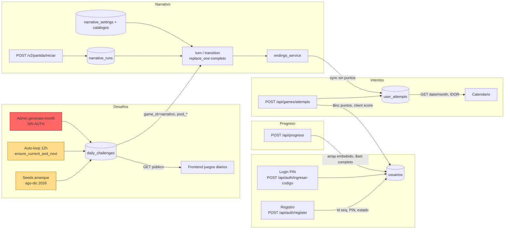
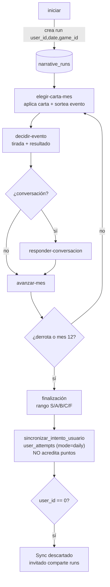
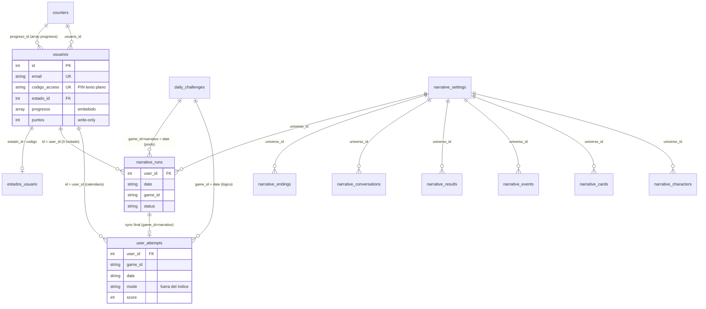

# Auditoría 02 — Persistencia y Flujo de Datos

- **Proyecto:** `mayores_actualizacionesSIPI-BACK` (FastAPI + MongoDB)
- **Fecha de auditoría:** 2026-10-19
- **Alcance:** backend completo (`app/`, `app/scripts/`, `tests/`, Docker/Caddy), con foco en persistencia, flujo de datos e intersecciones entre features.
- **Método:** análisis estático de solo lectura. No se ejecutó la aplicación, no se corrieron tests, no se accedió a MongoDB. Todas las referencias `archivo:línea` corresponden al estado del repositorio al momento de la auditoría.

---

## 1. Resumen ejecutivo

| # | Severidad | Hallazgo | Referencia |
|---|-----------|----------|------------|
| 1 | **Crítico** | Toda la Torre de Control narrativa (`/api/narrative/admin`) y los endpoints admin de desafíos están **sin autenticación**: CRUD de contenido, upload de archivos, generación mensual (`force=true` por defecto) y upsert público de desafíos. | `app/features/narrative/admin/router.py:64`; `app/features/daily_challenges/router.py:77-83,95-113` |
| 2 | **Crítico** | **IDOR y fraude de puntos** en `user_attempts`: el `user_id` del body/query pisa al del token; `usuarios.puntos` se incrementa con el `score` que envía el cliente, sin validación server-side. | `app/features/user_attempts/router.py:40,60,83`; `app/features/user_attempts/service.py:46,85-95` |
| 3 | **Crítico** | El **ETL** hace upsert con filtro `{"id": user_id}` mientras el comentario dice "por email": puede pisar usuarios existentes (admin, registros nuevos) y abortar a mitad por colisión de email único. | `app/scripts/migrate_from_mysql.py:105-110`; `app/core/database.py:61` |
| 4 | **Alto** | **Sin transacciones** (Mongo standalone) en flujos multi-documento: intento + `$inc puntos`, run narrativo + sync de intento, array `progresos`. Un fallo parcial deja estado inconsistente. | `docker-compose.yml:72-97`; `user_attempts/service.py:74-95`; `narrative/game/turn_service.py:100-101`; `transition_service.py:122-123` |
| 5 | **Alto** | **Read-modify-write sin control de concurrencia**: `find_one` + `replace_one` completo en `narrative_runs`, y `$set` del array completo `usuarios.progresos`. Doble toque en móvil puede perder o duplicar mutaciones. | `narrative/game/transition_service.py:122`; `app/features/progreso/service.py:37-46,85-88` |
| 6 | **Alto** | **Invitados comparten `user_id=0`**: todas las partidas narrativas anónimas del día caen en el mismo run; además el sync a `user_attempts` se descarta para invitados (`if not user_id` con 0). | `narrative/game/router.py:64-76`; `narrative/game/endings_service.py:136` |
| 7 | **Alto** | **Con BD fresca el narrativo no funciona**: al arranque solo se siembran finalizaciones; no hay universo/personajes/cartas/eventos, y `challenge.get(...)` sin chequeo de `None` produce 500. | `app/main.py:36-48`; `setup_service.py:80,87,142,146`; `turn_service.py:111-112,231-232`; `transition_service.py:135-136` |
| 8 | **Alto** | **Imágenes subidas no persisten**: se guardan en `app/static/narrative` dentro del contenedor backend, que no tiene volumen montado → se pierden en cada rebuild/redeploy. | `docker-compose.yml:37-69`; `app/main.py:168-170` |
| 9 | **Alto** | **Seeds de arranque sobreescriben contenido** de Wordle y Sopa con `$set` en cada reinicio (pisando ediciones manuales/regeneraciones). La data de Sopa del seed difiere del generador (dos listas y dos lógicas de grilla duplicadas). | `app/scripts/seed_challenges.py:132-143`; `app/scripts/seed_sopa_letras.py:168-204`; `app/features/daily_challenges/sopa_generator.py:111-118` |
| 10 | **Alto** | **`usuarios.puntos` se escribe y nunca se lee**: no aparece en `format_user_response` ni en ningún endpoint; el narrativo finaliza partidas *sin* sumar puntos (solo escribe `user_attempts`). | `user_attempts/service.py:85-95`; `auth/service.py:40-52`; `endings_service.py:148-170` |
| 11 | **Medio** | **Fechas naive vs UTC**: `datetime.now()` (TZ del contenedor = UTC) define el "hoy" de desafíos; el contenedor cambia de día a las 21:00 de Argentina. La `date` de los intentos la provee el cliente sin validar forma/rango. | `daily_challenges/service.py:28,57,79,104,140,598`; `user_attempts/service.py:52`; `narrative/game/router.py` (req.date) |
| 12 | **Medio** | **Dos sistemas de progreso en paralelo** (`usuarios.progresos` embebido vs `user_attempts`) sin sincronización entre sí; el narrativo solo impacta en `user_attempts`. | `app/features/progreso/service.py:7-90`; `endings_service.py:148-170` |
| 13 | **Medio** | **Contrato muerto/collisiones**: `mode` (daily/campaign) está fuera del índice único y nunca se usa para filtrar; `remaining_attempts` se guarda pero no se serializa. `difficulty` siempre es `"standard"`. | `app/core/database.py:77-80`; `user_attempts/service.py:59,67`; `user_attempts/router.py:94-99` |
| 14 | **Medio** | **RNG global contaminado**: `random.seed(seed)` de Sopa muta el estado del módulo `random` que usa el motor narrativo en el mismo proceso. | `sopa_generator.py:117-118`; `narrative/engine/*` (sorteos) |
| 15 | **Medio** | **`rae_client` bloquea el event loop** (urllib + sleeps en contexto async) durante la generación de crucigramas; cachea en archivo JSON local (efímero en contenedor). | `app/core/rae_client.py` |
| 16 | **Medio** | **Documentación interna desactualizada**: describe Java/MySQL, campos y endpoints que no existen en el backend real (`completed`, `duration_seconds`, flujo de racha). | `docs_interna/GUIA_PROGRESO.*`, `docs_interna/ARQUITECTURA.*` |
| 17 | **Bajo** | PIN de acceso: se acepta `codigoAcceso` provisto por el usuario en el registro; se almacena en claro y **se expone en las respuestas** de usuario (`codigoAcceso`). El admin sembrado usa PIN fijo `"999999"`. | `auth/service.py:44,234-241`; `app/scripts/init_db.py:80` |
| 18 | **Bajo** | `estados_usuario` asigna `max(id)+1` no atómico (race con índice único). | `app/features/usuario/service.py:237-239`; `database.py:85` |
| 19 | **Bajo** | `init_indexes` con un solo `try/except`: si falla un índice se saltean silenciosamente todos los restantes (estado de índices parcial). | `app/core/database.py:55-104` |
| 20 | **Bajo** | Arranque frágil: seeds de Wordle/Sopa/Sudoku y `ensure_current_and_next_month_generated` se ejecutan sin manejo de error; solo el seed narrativo está protegido con `try/except`. | `app/main.py:36-48` |

> Nota positiva: el login por PIN (`/api/auth/ingresar-codigo`) y el registro sí tienen rate limiting (5 req/min), y los hashes BCrypt de MySQL se preservan en la migración.

---

## 2. Inventario de colecciones

| Colección | Origen / "dueño" | Features que la tocan | Índices | Observaciones |
|---|---|---|---|---|
| `usuarios` | `auth` (registro/login) | `auth` (crear, login, verificar), `usuario` (CRUD admin), `progreso` (array `progresos` embebido), `user_attempts` (`$inc puntos`), `init_db` (seed admin), ETL | `email` unique; `codigo_acceso` unique sparse; `id` unique; `name`; `date_start` | Hub central del modelo. Contiene el PIN en claro, el array `progresos` y `puntos` (write-only). |
| `estados_usuario` | `init_db` (seed) | `usuario` (CRUD de estados), `auth` (validación `permite_login`), login/verificación | `id` unique; `codigo` unique | `activo`/`estado_id`/`estado_codigo` se duplican entre esta colección y el doc de usuario. |
| `counters` | `core/database.py` | `auth` (`usuario_id`), `progreso` (`progreso_id`), `init_db`, ETL (`set_sequence_value`) | `_id` implícito | Ver C3: el ETL puede "bajar" la secuencia y generar reutilización de IDs. |
| `daily_challenges` | `daily_challenges` (generación) | `daily_challenges` (lectura/escritura), seeds (`seed_challenges`, `seed_sopa_letras`, `seed_sudoku`), `narrative` (lee `game_id="narrativo"`), admin generate-month | `(game_id,date,difficulty)` unique; `date` | 5 productos en una colección (wordle, sopa_letras, sudoku, crucigrama, narrativo). `force=true` por defecto en el endpoint admin. |
| `user_attempts` | `user_attempts` | `user_attempts` (upsert/lectura), `narrative.endings_service` (sync final), tests | `(user_id,game_id,date)` unique; `(user_id,date desc)` | Escrita por dos features con contratos distintos (`word/guesses` vs `game_data` narrativo). `mode` fuera del índice. |
| `narrative_settings` | `seed_narrative` (manual) | `crud_service` (CRUD admin), `challenge_service`, `setup_service`, `transition_service`, `endings_service` (lectura) | *(sin índice explícito; acceso por `_id`)* | Documento "universo". **No se siembra al arranque** (ver A4). |
| `narrative_characters` | `seed_narrative` (manual) | `crud_service`, `challenge_service` (generación), juego (corte/afinidad) | `universo_id` | — |
| `narrative_cards` | `seed_narrative` (manual) | `crud_service`, `challenge_service`, juego (draft) | `universo_id` | — |
| `narrative_events` | `seed_narrative` (manual) | `crud_service`, `challenge_service`, juego (sorteo mensual) | `universo_id` | — |
| `narrative_results` | `seed_narrative` (manual) | `crud_service`, `challenge_service`, juego (resolución) | `universo_id` | — |
| `narrative_conversations` | `seed_narrative` (manual) | `crud_service`, `challenge_service`, juego (diálogos) | `universo_id` | — |
| `narrative_endings` | `challenge_service` (`sembrar_finalizaciones_default` al arranque, condicional) | admin CRUD, juego (finalización) | `(universo_id, recurso_clave)` | Único dato narrativo auto-sembrado; solo si la colección está globalmente vacía. |
| `narrative_runs` | `narrative.game` | `setup/turn/transition/endings/modals`, tests | `(user_id,date,game_id)` unique; `(user_id,date desc)` | `replace_one` completo (A2); invitados comparten `user_id=0` (A3). |

Colecciones huérfanas/residuales: no se detecta limpieza en cascada de `user_attempts`/`narrative_runs` al desactivar usuarios (los datos permanecen, aceptable) ni purgas de runs antiguos.

---

## 3. Hallazgos detallados

### CRÍTICOS

#### C1 — Superficie administrativa sin autenticación (narrativo + desafíos)
**Evidencia.**
- `app/features/narrative/admin/router.py:64`: `router = APIRouter(prefix="/api/narrative/admin", ...)` sin `dependencies=[...]` ni verificación de rol en ningún endpoint. Se expone CRUD completo: universos (L108-117), personajes (L138-144) y análogos de cartas/resultados/eventos/conversaciones/finalizaciones; **upload de archivos** (`/upload-imagen`, L82-91), catálogo de reglas (L70-76), seeding y generación mensual vía `challenge_service`.
- `app/features/daily_challenges/router.py:77-83`: `POST /api/challenges` (upsert de desafío) público. L85-93: `GET /api/challenges/admin/status`. L95-113: `POST /api/challenges/admin/generate-month` con `force: bool = Query(True)` (L103) → cualquiera puede regenerar/borrar el contenido de un mes completo.
- Contraste: el router de auth sí protege con `Depends(get_current_admin)` (`auth/router.py:44`) y con `rate_limit` (L20,28,50).

**Impacto.** Cualquier cliente en la red (Caddy expone solo 8082, pero sin auth interna) puede alterar el contenido pedagógico, subir archivos, pisar desafíos ya jugados (rompiendo coherencia de resultados fechados) y regenerar meses con `force=true`. Es compromiso de integridad de todo el dataset de juego.

**Recomendación.** `dependencies=[Depends(get_current_admin)]` a nivel de ambos routers admin; `force` explícito `false` por defecto; rate limiting; validar `game_id` contra lista blanca; auditar uploads (tipo/tamaño/categoría ya parcialmente validados en `image_service`).

#### C2 — IDOR y fraude de puntos en `user_attempts`
**Evidencia.**
- `app/features/user_attempts/router.py:40`: `effective_user_id = user_id_from_token or req.user_id` → sin token válido *o* con token de otro usuario, el `user_id` del body manda. L46 pasa ese ID a `save_user_attempt`.
- Lecturas: L60 y L83 `effective_user_id = user_id or token_user_id` → el query param pisa al token, permitiendo leer el historial/calendario de cualquier usuario (`GET /api/games/attempts/date/{date}` y `GET /api/games/attempts`).
- `service.py:46`: fallback mágico `... or req.user_id or 1` (usuario 1).
- `service.py:85-95`: si `status="completed"` y `score > 0`, hace `$inc: {"puntos": req.score}` — `score` viene del request sin validarse contra la solución/estado real del juego. Repetir el POST con scores altos acumula puntos arbitrarios. El error del `$inc` solo se loguea (`L94-95`).

**Impacto.** Manipulación de datos de terceros (integridad), farmeo de puntos y calendarios falsos. Combinado con C1 (generar desafíos a medida), el fraude es trivial.

**Recomendación.** Escrituras solo con token válido; ignorar `req.user_id`/`user_id` si hay token (el token siempre gana); calcular `score`/`stars` server-side a partir del estado del juego; limitar un attempt por (user, game, date, mode); rate limiting.

#### C3 — ETL: upsert por `id` contradice su comentario; riesgo de pisar datos y abortar
**Evidencia.** `app/scripts/migrate_from_mysql.py:105-110`: el comentario dice *"Upsert por email para no duplicar"* pero el filtro es `{"id": user_id}`. Si el MongoDB destino ya tiene usuarios con esos IDs (admin sembrado por `init_db`, registros nuevos que consumieron `counters.usuario_id`), el `$set` reemplaza password/hash, `codigo_acceso`, `progresos`, etc. Si el email migrado ya existe en otro doc → violación del índice único (`database.py:61`) → excepción que **aborta la migración a mitad de camino** (sin rollback). Al final (L113-120) se fijan los counters al máximo de MySQL: si Mongo tenía IDs mayores, la secuencia **retrocede** y los próximos registros reutilizan IDs (colisión unique `id`).

**Impacto.** Pérdida/mezcla de credenciales y progresos; estado parcial difícil de revertir; reutilización de IDs.

**Recomendación.** Dry-run previo; upsert por `email` (o por `(id,email)` consistente); verificar colisiones de email e informar en vez de abortar; `set_sequence_value` con `max(actual, migrado)`; migración transaccional o reanudable (checkpoint por lote).

### ALTOS

#### A1 — Sin transacciones en flujos multi-documento
**Evidencia.** MongoDB standalone (`docker-compose.yml:72-97`, sin replica set), por lo que no hay transacciones multi-documento disponibles. Flujos que escriben más de un documento: `user_attempts/service.py:74-95` (upsert del intento + `$inc puntos`, tolerante a fallo solo con warning); narrativo `turn_service.py:100-101` y `transition_service.py:122-123` (`replace_one` del run + `sincronizar_intento_usuario`); `endings_service.py:148-170` (escribe `user_attempts` pero **nunca** `usuarios.puntos` → inconsistencia funcional: el narrativo no acredita puntos).

**Impacto.** Estados divergentes: partida terminada sin intento registrado (o al revés), puntos perdidos, calendario del alumno desincronizado.

**Recomendación.** Replica set + transacciones para los pares críticos, o patrón de idempotencia con reintentos/outbox; definir el orden de escritura y una tarea de reconciliación; unificar la política de puntos (narrativo incluido) y exponerla.

#### A2 — Read-modify-write sin control de concurrencia
**Evidencia.**
- Narrativo: mutan el dict leído y hacen `replace_one({"_id": ...}, run)` completo (`transition_service.py:122`; mismo patrón en `turn_service.py:100` y setup/endings). Sin filtro de versión ni validación del estado esperado: dos POST concurrentes (doble toque típico en tablets) pueden resolver dos veces la misma fase o perder una mutación.
- Progreso: `progreso/service.py:29-46` y `59-88` leen `progresos`, mutan el array en memoria y hacen `$set` del array completo → lost update si el alumno avanza dos juegos a la vez (o el admin toca el mismo usuario).

**Impacto.** Partidas corruptas/no reproducibles; progreso de cursos perdido.

**Recomendación.** `find_one_and_update` con filtros de estado (p. ej. `"turno_actual.carta_elegida_id": None`) para transiciones idempotentes; `$set` de rutas puntuales (`progresos.$[elem]...`) en lugar del array completo; campo de versión (`_rev`) como salvaguarda.

#### A3 — Invitados comparten `user_id = 0`
**Evidencia.** `narrative/game/router.py:64-76`: `_get_current_user_id` retorna `0` sin token. Todos los invitados comparten `narrative_runs` del día (unique `(user_id,date,game_id)`, `database.py:90-93`): pueden ver/continuar la partida de otro invitado. `endings_service.py:136`: `if not user_id or not date_str: return` — `0` es falsy → el resultado del invitado **nunca** llega a `user_attempts`. Los tests dependen de este flujo (`tests/test_narrative_game.py:54`; `tests/test_narrative_v2_game.py:42,56`).

**Impacto.** Fuga de estado entre anónimos y "modo invitado" inconsistente (la UI puede mostrar la partida de un desconocido).

**Recomendación.** ID de invitado por dispositivo (cookie firmada/header) o exigir login para escrituras narrativas; separar datos de invitado en colección efímera o namespace (`guest_<device>`); no usar `0` como usuario real.

#### A4 — El narrativo no se auto-siembra al arranque → 500 en BD fresca
**Evidencia.** `app/main.py:36-42` conecta, indexa y siembra Wordle/Sopa/Sudoku + `ensure_current_and_next_month_generated`. L44-48 solo ejecuta `sembrar_finalizaciones_default` (condicional a `narrative_endings` vacía). No se siembran universos, personajes, cartas, eventos, resultados ni conversaciones (`seed_narrative.py` es manual) ni se generan challenges `game_id="narrativo"`. Sin embargo, el juego asume que existen: `setup_service.py:80,87` y `142,146`; `turn_service.py:111-112` y `231-232`; `transition_service.py:135-136` hacen `challenge = find_one(...)` + `challenge.get(...)` **sin chequeo de `None`** → `AttributeError` → 500 opaco.

**Impacto.** En una instalación nueva el juego narrativo es inutilizable hasta que un humano corra scripts; los errores que ve el usuario son 500 sin diagnóstico.

**Recomendación.** Sembrado idempotente al arranque (universos + assets + generación del mes narrativo) o migración explícita documentada; guardas `if not challenge: raise HTTPException(404/409, "...")` en los 5 puntos citados.

#### A5 — Imágenes subidas no persisten
**Evidencia.** `app/main.py:168-170` monta `app/static/narrative` como estático; el servicio de subida guarda los WebP allí. `docker-compose.yml:37-69`: el contenedor `backend` no monta volúmenes (solo `mongodb` tiene `mongo_data`, L78-79,99-100). Cada rebuild/redeploy descarta todas las imágenes subidas desde la Torre de Control; los documentos en Mongo quedan apuntando a rutas 404.

**Recomendación.** Volumen nombrado para `app/static/narrative` (o storage externo/S3) + tarea de verificación de referencias.

#### A6 — Seeds de arranque sobreescriben contenido (Wordle/Sopa)
**Evidencia.** `seed_challenges.py:132-143` y `seed_sopa_letras.py:194-204` hacen `update_one(..., {"$set": doc}, upsert=True)` sobre la clave `(game_id,date,difficulty)` **en cada arranque** → pisan ediciones manuales y resultados de una regeneración admin para esas fechas (Agosto–Diciembre 2026, hardcodeadas). El seed de Sudoku (`seed_sudoku.py:12-24`) en cambio llama a la generación sin `force` (solo cubre faltantes): policies distintas por juego. Además, la Sopa tiene **dos implementaciones duplicadas** (`seed_sopa_letras.py:120-166` con su propia lista `SOPA_LETRAS_RAW_DATA` y `sopa_generator.py`) que pueden producir grillas distintas para la misma fecha según el camino (seed vs generación admin/auto).

**Recomendación.** Seeds con `$setOnInsert` (no pisar) o flag `ALLOW_SEED_OVERWRITE`; unificar el generador de Sopa en un solo módulo y una sola fuente de datos; sacar las fechas hardcodeadas del código.

#### A7 — `usuarios.puntos`: escrito y nunca leído; el narrativo no suma
**Evidencia.** Único `$inc` del sistema en `user_attempts/service.py:90`. `format_user_response` (`auth/service.py:40-52`) no expone `puntos`; ningún endpoint lo lee (grep global). El cierre del narrativo (`endings_service.py:148-170`) escribe `user_attempts` pero no acredita puntos, así que dos "monedas" de actividad (juegos diarios vs narrativo) no son comparables.

**Impacto.** El puntaje del alumno es invisible e inconsistente entre features; imposible construir ranking/rachas sobre una base confiable.

**Recomendación.** Definir la fuente de verdad del puntaje (p. ej. derivarlo de `user_attempts`), exponerlo en el perfil, y acreditarlo también en el cierre narrativo; considerar recálculo idempotente en lugar de `$inc` (evita doble conteo si se repite el cierre).

#### A8 — Arranque frágil / manejo de errores de siembra
**Evidencia.** `app/main.py:36-42`: `connect_to_mongo`, `seed_estados_usuario`, `seed_default_admin`, seeds de juegos y `ensure_current_and_next_month_generated` sin `try/except`; cualquier excepción (p. ej. fallo de red del `rae_client` durante la generación de crucigramas del mes) **impide el arranque completo**. Solo el seed narrativo está protegido (L44-48). `seed_default_admin` y demás seeds son idempotentes en teoría, pero un fallo a mitad deja datos parciales.

**Recomendación.** Envolver cada paso con logging y continuar (degradación controlada), o fallar rápido de forma explícita con un estado de salud que lo refleje; reintentos para `ensure_...` en la tarea de 12 h.

### MEDIOS

#### M1 — Fechas naive, timezone del contenedor y `date` provista por el cliente
`daily_challenges/service.py:28,57,79,104,140,598` usa `datetime.now()` (naive). El contenedor corre en UTC (sin TZ configurada): el "hoy" de negocio cambia a las **21:00 ART**, no a medianoche local. La fecha de los intentos (`user_attempts`) y de las partidas narrativas la envía el cliente como string (`req.date`) sin validar formato/rango (router L52; `user_attempts/service.py:52`). Consecuencias: días de desafío desplazados por la tarde/noche, intentos fechados "a mano" (fraude/errores), zanjas entre `created_at` UTC y `date` local. **Recomendación:** helper único `today_business()` con `ZoneInfo("America/Argentina/...")`; validar `date` contra el calendario servidor; normalizar TZ en Docker (`TZ=...`).

#### M2 — Racha/streak y métricas inexistentes vs documentación
`docs_interna/GUIA_PROGRESO.*` describe un sistema Java/MySQL con `completed`, `duration_seconds`, `attempts_count` y racha que **no existen** en el código (grep sin resultados). La documentación induce contratos falsos. **Recomendación:** actualizar docs y definir si racha se calculará sobre `user_attempts` (base ya adecuada).

#### M3 — Dos sistemas de progreso sin sincronización
`usuarios.progresos` (array embebido, CRUD en `progreso/service.py`) vs `user_attempts` (calendario de juegos + narrativo). Ninguna feature escribe en el otro modelo: el calendario no ve "cursos" y el progreso de cursos no ve partidas. **Recomendación:** definir fuentes de verdad por dominio y una vista agregada; documentar la semántica de cada uno.

#### M4 — Contrato muerto del attempt: `mode`, `remaining_attempts`, `difficulty` fija
`mode` se guarda (`service.py:59`) pero está fuera del índice único (`database.py:77-80`) y ningún endpoint filtra por él; un run "campaign" y uno "daily" del mismo día colapsan en el mismo documento. `remaining_attempts` se persiste (`service.py:67`) pero no se serializa en `_serialize_attempt` (nunca se lee). `difficulty` siempre `"standard"` en todos los seeds/generadores, aunque forma parte de la clave única. **Recomendación:** decidir si campaign existe; si sí, incluir `mode` en el índice y en las queries; o eliminar los campos muertos.

#### M5 — `challenge.get(...)` sin chequeo de `None` (5 sitios)
`setup_service.py:80/87`, `142/146`; `turn_service.py:111/112`, `231/232`; `transition_service.py:135/136`. Cualquier fecha sin challenge `narrativo` (típico fuera del rango generado) produce 500. **Recomendación:** guarda + 404/409 con mensaje claro ("mes narrativo no generado").

#### M6 — `random.seed()` global contamina el narrativo
`sopa_generator.py:117-118`: usa el `random` global con `seed` (camino de siembra/generación). El motor narrativo (`rule_engine`, `event_director`) sortea con el mismo módulo: generar un mes de Sopa altera la secuencia de sorteos narrativos del proceso y, en concurrencia, el seed de una request afecta a otra. **Recomendación:** `random.Random(seed)` local por invocación.

#### M7 — `rae_client` bloqueante y cache en archivo local
`app/core/rae_client.py`: usa `urllib` + `time.sleep` en funciones invocadas desde flujo async (generación de crucigramas) → congela el event loop durante la generación; cachea resultados en un JSON local cuyo directorio puede ser efímero en contenedor. **Recomendación:** cliente async (`httpx`) con timeout/retry, cache en Mongo o volumen, y ejecutar generación en background task.

#### M8 — Documentación interna desactualizada
`docs_interna/GUIA_PROGRESO.*` (Java/MySQL, endpoints y campos inexistentes) y `docs_interna/ARQUITECTURA.*` (endpoints "ocultos" V1 que no están montados). **Recomendación:** regenerar desde OpenAPI real y marcar documentos históricos como obsoletos.

#### M9 — Race en `estados_usuario` (`max(id)+1`)
`usuario/service.py:237-239` calcula el próximo ID con `max + 1` (no atómico) sobre índice único `id` (`database.py:85`): dos creaciones concurrentes → colisión 500. **Recomendación:** `counters` dedicado o `find_one_and_update` sobre un contador embebido.

#### M10 — `init_indexes` silencia fallos y puede quedar parcial
`database.py:55-104`: un único `try/except` alrededor de todas las creaciones; el primer error (p. ej. datos duplicados que impiden un unique) saltea **todos** los índices restantes con un warning. Estado de índices no verificable al arranque. **Recomendación:** try/except por índice, log de resultado por índice, y health-check de índices requeridos.

### BAJOS

#### B1 — `codigoAcceso` a elección del usuario en el registro
`auth/service.py:234-241`: si el request trae `codigoAcceso`, se usa tal cual (sin validar formato ni unicidad previa; la colisión explota contra el índice único → 500 y, peor, permite ocupar valores como `"999999"`, el PIN del admin, si aún no fue sembrado). **Recomendación:** ignorar el código provisto en registro público; siempre generar; validar contra duplicados con reintento acotado.

#### B2 — Secuencia consumida antes del insert
`auth/service.py:232`: el `usuario_id` se reserva antes de validar/insertar; un fallo posterior deja gaps (aceptable) pero combinado con C3 puede derivar en reutilización de IDs. **Recomendación:** reservar al final del flujo o registrar la operación como reintentable.

#### B3 — PIN fijo `"999999"` para el admin sembrado
`init_db.py:80` hardcodea el PIN del superadmin; `seed_default_admin` checa solo por email (L69) y no rota credenciales si cambian las env. **Recomendación:** PIN por env/aleatorio en el primer arranque, rotación forzada, y marcar `cambiado=true`.

#### B4 — PIN en claro y expuesto en respuestas
`codigo_acceso` se guarda sin hash (necesario para "Ingresar con código", pero hoy es también credencial de login) y `format_user_response` lo devuelve en cada respuesta de usuario (`auth/service.py:44`). **Recomendación:** evaluar hash con pepper para el PIN, no exponerlo en listados (solo en endpoints explícitos de administración), y no loguearlo.

#### B5 — Tipos mixtos en `updated_at` de runs narrativos
`transition_service.py:121` escribe `isoformat()` (string) mientras otros puntos escriben `datetime` (`endings_service.py:166`) → mismo campo con dos tipos. **Recomendación:** estandarizar a `datetime` UTC, serializar en la capa de respuesta.

---

## 4. Recorrido end-to-end (journey)

### 4.1 Arranque e infraestructura
`main.py:36` conecta a Mongo (standalone, sin replica set) → `init_indexes` (puede quedar parcial, M10) → seeds de estados/admin → seeds Wordle/Sopa/Sudoku (Wordle y Sopa **sobreescriben**, A6) → `ensure_current_and_next_month_generated` (genera mes actual y siguiente de los 4 juegos, con `datetime.now()` naive, M1) → seed narrativo de finalizaciones (condicional). Tarea de auto-chequeo cada 12 h (`main.py:51-62`) que **duerme primero** (si algo falló en el arranque, no lo reintenta hasta dentro de 12 h; ante excepción duerme 1 h y vuelve al ciclo).

### 4.2 Registro → activación
`POST /api/auth/register` (rate-limited, `auth/router.py:48-55`) → secuencia `usuario_id` (B2) → PIN generado o provisto (B1) → usuario `PENDIENTE_VERIFICACION` / `activo=false` → verificación de código de email (`verificar-codigo-registro`) → alta efectiva. **Banderas:** `activo`, `estado_id`, `estado_codigo` duplican estado (este último depende de `estados_usuario`).

### 4.3 Login
PIN: `POST /api/auth/ingresar-codigo` (rate-limited, `auth/router.py:26-32`) valida `permite_login` del estado. Admin: `login-sistemas`. JWT con `id` numérico; contiene rol para `get_current_admin`. **Ruptura:** el PIN viaja y se persiste en claro (B4).

### 4.4 Desafíos diarios
Lecturas públicas: `GET /api/challenges/date/{date}`, `/range`. Generación por tres vías: seeds de arranque (fechas hardcodeadas ago–dic 2026), auto-loop (`ensure_...`, mes actual+siguiente, los 4 juegos) y **admin sin auth** (C1, `force=true`). Estado consistente solo si `(game_id,date,difficulty)` no se pisa (A6) y si la TZ coincide con la del cliente (M1). El contenido `narrativo` de esta colección **no** lo produce `ensure_...`: requiere generación por admin.

### 4.5 Intentos
`POST /api/games/attempts` → `user_attempts` upsert + `$inc usuarios.puntos` (C2: identidad y score del cliente; A1: sin transacción). Lecturas: por fecha y por mes (IDOR, C2). `mode`/`remaining_attempts` escritos sin uso (M4). **La `date` es la que envía el cliente** (fraude/errores de zona).

### 4.6 Progreso (cursos)
`progreso/*` escribe el array embebido `usuarios.progresos` (read-modify-write, A2). No interactúa con `user_attempts` (M3) ni lee `puntos` (A7).

### 4.7 Narrativo (V2)
`iniciar` (requiere challenge del día y universo, A4) → `elegir-carta-mes` → `decidir-evento` → `responder-conversacion` → `avanzar-mes` (hasta derrota/completar 12 meses) → finalización (`endings_service`) → sync a `user_attempts` (solo usuarios con `user_id ≠ 0`, A3; **sin puntos**, A7) + modales de lectura (`historial`, `inventario`, `corte`, `finalizacion`, etc.). Cada fase hace read-modify-write del run completo (A2). Invitados: `user_id=0` compartido (A3).

### 4.8 Síntesis de rupturas y banderas

| Tipo | Elemento | Dónde |
|---|---|---|
| Ruptura | Narrativo 500 en BD fresca (assets/pools ausentes) | A4, M5 |
| Ruptura | Sync invitado descartado (`0` falsy) | A3 (`endings_service.py:136`) |
| Ruptura | Puntos invisibles; narrativo no acredita | A7 |
| Escrito nunca leído | `usuarios.puntos`, `user_attempts.remaining_attempts`, `user_attempts.mode` (sin filtros), `user_attempts.created_at` | `service.py:59,67,90`; serialización `service.py:24-38` |
| Leído no garantizado | `challenge.config.pool_*` (narrativo) y docs de universo: se leen siempre, se escriben solo por seeds manuales/admin/auto-loop | A4 |
| Banderas duplicadas | `activo` vs `estado_id`; `black`; `run.status` vs `attempt.status`; `mode` | `auth/service.py:46-49`; `endings_service.py:139-140` |
| TODO funcionales | Racha/streak; leaderboard/puntos; campaign; seeding narrativo; purga de runs/backups; reconciliación post-fallos | M2, M4, A7, A4, A1 |

---

## 5. Intersecciones entre colecciones y features

**Entidades compartidas.**
- `usuarios` es el hub: lo escriben 6 rutas distintas (auth, usuario, progreso, user_attempts, init_db, ETL). Los campos `progresos`, `puntos` y `codigo_acceso` son focos de contención (A2, A7, B4).
- `daily_challenges` es multi-producto (5 `game_id`, incl. `narrativo`) con un único índice; la narrativa **compra** pools de eventos/cartas/conversaciones desde esta colección, acoplando el contenido narrativo a la generación de desafíos (C1/A4).
- `user_attempts` es escrita por dos features con contratos heterogéneos (`word/guesses` vs `game_data`) y leída por el calendario; no hay campo de origen (feature) más allá de `game_id`.

**Datos derivados/duplicados.**
- `puntos` (derivable de `user_attempts.score`) vs `score` por intento; riesgo de doble conteo en re-cierres (A1/A7).
- `user_attempts` narrativo duplica rango/recursos finales ya presentes en `narrative_runs.finalizacion` (doble verdad sincronizada solo al final, A1).
- `estado` de usuario duplicado en `usuarios.activo/estado_id/estado_codigo` y colección `estados_usuario`.
- Dos modelos de progreso (M3) y dos generadores de Sopa (A6).

**Timezone.**
- Mezcla de `datetime.now()` naive (challenges, `migrate`, `seed_narrative:1814`), `datetime.now(timezone.utc)` (seeds de challenges, attempts, narrative `updated_at`) y strings de fecha del cliente (`date`). Sin `TZ` en containers → UTC. El límite de día de negocio no coincide con la audiencia (M1).

**Doble escritura / concurrencia.**
- attempt + puntos (A1); run + attempt al cerrar (A1); `replace_one` de runs (A2); array `progresos` (A2); seeds vs ediciones admin (A6); auto-loop vs admin-generate del mismo mes (C1/A6) → last-write-wins.

---

## 6. Riesgos ETL (`app/scripts/migrate_from_mysql.py`)

1. **Clobbing por ID** (`L105-110`): filtro `{"id": user_id}` contradice el comentario; pisa usuarios de destino con igual ID (hash, PIN, progresos). Ver C3.
2. **Colisión de email**: `email` unique (`database.py:61`); un email ya presente aborta la migración a mitad, sin rollback ni reanudación. Recomendación: detectar colisiones y reportarlas; continuar en modo "saltar y registrar".
3. **Counters al final** (`L113-120`): se fijan al máximo de MySQL; si Mongo ya tenía IDs mayores, la secuencia retrocede → reutilización/colisión futura. Usar `max(actual, migrado)` o `$max`.
4. **Fechas**: `date_start` se normaliza a `datetime` (`L81-87`), `date_end` se guarda como **string** (`L89`), `updatedAt` naive (`L68`) → tipos mixtos versus el resto del backend (UTC-aware). Normalizar.
5. **Progresos**: solo se migra `usuarios.progresos` (array); no hay mapeo a `user_attempts` (M3), así que el calendario queda vacío para usuarios históricos.
6. **Sin idempotencia real**: re-ejecutar con IDs ocupados por nuevos registros puede volver a pisarlos; no hay marca de lote/versión de migración.
7. **PIN/roles**: `codigo_acceso` migrado tal cual puede chocar con `"999999"` (admin) → aborto (ver punto 2); `tipo_usuario` 2 migrado directamente (revisar que la escisión de privilegios se preserve correctamente).
8. **Recomendación general**: dry-run con informe de colisiones, migración por lotes reanudable, transaccionalidad (replica set) o compensación, y verificación post-migración (conteos + checksums de hashes).

---

## 7. Diagramas

### 7.1 Flujo end-to-end (features y colecciones)

### 7.2 Ciclo narrativo V2 (runs y sync)

### 7.3 Relaciones entre colecciones

---

## 8. Riesgos, supuestos y preguntas abiertas

**Riesgos de mayor impacto agregado.**
1. Integridad: C1+C2 permiten a cualquiera alterar contenido, desafíos, identidades y puntos → el dataset pierde valor probatorio/educativo.
2. Divergencia de datos por fallos parciales (A1) y concurrencia (A2) sin reconciliación.
3. Operación: uploads e imágenes efímeras (A5), arranques frágiles (A8), seeds que pisan (A6) → incidencias recurrentes tras cada deploy.
4. Zona horaria (M1) como fuente silenciosa de bugs "de un día" difíciles de reproducir.

**Supuestos del análisis.**
- Referencias de línea válidas para el commit actual; no se ejecutó el sistema (los hallazgos de runtime — p. ej. frecuencia real de carreras — son inferencias estáticas).
- El despliegue objetivo es el de `docker-compose.yml` (contenedor único backend, Mongo standalone). Si existiera otro entorno (p. ej. Mongo Atlas con replica set), A1 se atenúa.
- `docs_interna` se considera aspiracional, no contrato.

**Preguntas abiertas para el equipo.**
1. ¿Se usará `mode=campaign`? Si no, ¿se elimina del contrato y de los datos?
2. ¿El puntaje (`puntos`) debe exponerse/ranquearse? ¿Quién es la fuente de verdad: `user_attempts.score` o el `$inc`?
3. ¿El narrativo debe acreditar puntos al finalizar? ¿Con qué tabla de conversión? (hoy: 1000/850/700/500/250 según rango, sin `$inc`).
4. ¿Los invitados deben persistir? ¿Qué alcance (día/dispositivo)? ¿Se migrará su partida al registrarse?
5. ¿Cuál es la TZ oficial del negocio (Argentina) y cómo se definirán los cierres de día?
6. ¿Quién/qué ejecuta `seed_narrative.py` y la generación mensual narrativa en producción (runbook)?
7. ¿Hay backups de `mongo_data` y política de retención/purga de runs e intentos?
8. ¿El sitio se escalará a más de una instancia de backend? (rate limiting en memoria, RNG global y `replace_one` se comportan peor aún — M6, M10, A2).

---

*Fin del informe — Auditoría 02 (solo lectura, sin modificaciones al código relevado).*
