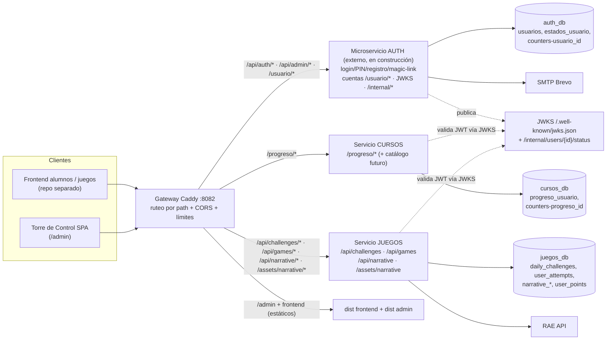
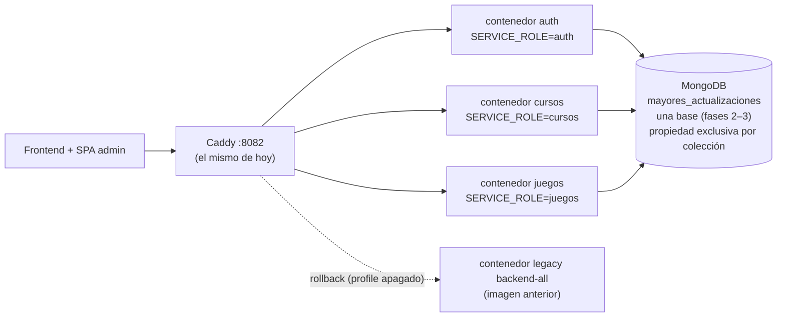

# Auditoría 04 — Soluciones: Plan de ejecución del desacoplamiento Cursos / Juegos / Auth

> **Documento base:** [04-desacoplamiento-microservicios.md](04-desacoplamiento-microservicios.md) — auditoría de solo lectura del repo `mayores_actualizacionesSIPI-BACK` (rama `feature/juego-narrativo`, commit `568c64d`), con inventario de 82 endpoints, matriz de acoplamiento, estrategia de identidad JWKS y plan Strangler en 6 fases.
> **Insumos secundarios:** [00-informe-consolidado.md](00-informe-consolidado.md) y consulta directa (solo lectura) del código real para concretar rutas, archivos y contratos.
> **Planes hermanos con los que se coordina:** `01-arquitectura-y-modularidad-soluciones.md` (refactor interno), `02-persistencia-y-flujo-de-datos-soluciones.md` (integridad, races, ETL), `03-auditoria-de-seguridad-soluciones.md` (P0 de seguridad, SPA admin) y `06-testing-y-calidad-soluciones.md` (infraestructura de tests).
> **Fecha del plan:** 19/10/2026.
> **Estado:** **PROPUESTA — nada de este plan está implementado.** Este documento es exclusivamente planificación: no se modificó código, no se ejecutó la app ni tests y no se tocó ninguna base de datos. Los work packages aquí descritos solo se ejecutan cuando el usuario apruebe el plan y las decisiones de la sección 6.
> **Regla de oro heredada del informe 04:** los **82 endpoints API + 4 de sistema + 2 mounts estáticos no cambian de método ni de ruta**; el gateway absorbe los rearquitectos y el frontend no debe notar nada.

---

## 0. Cómo leer este documento

| Convención | Significado |
|---|---|
| **WP-f.N** | Work package de la fase N. Unidad de entrega verificable, con PR propio y tests en verde |
| **Esfuerzo S** | ≤ 1 semana-persona |
| **Esfuerzo M** | 1–3 semanas-persona |
| **Esfuerzo L** | 3–6+ semanas-persona (o dependiente de terceros) |
| **"El FE no nota nada"** | La matriz de verificación del Anexo C pasa 100%: contrato de rutas intacto + shapes intactos + smoke de los 3 consumidores (FE alumnos, FE juegos, SPA admin) |
| **Flag** | Interruptor por variable de entorno para cortar/volver sin redeploy de código |

Orden de lectura sugerido: §1 (estrategia) → §2 (arquitectura y supuestos) → §3 (WPs por fase) → §4 (contrato Auth) → §5 (roadmap) → §6 (decisiones). Los anexos son de consulta operativa.

**Interfaz con los planes hermanos (no pisarse):**

- **Plan 01 (modularidad):** este plan **no** duplica sus refactors internos (god files, duplicación `rule_engine`/`event_director`, helpers de sopa). Plan 01 mejora la calidad *dentro* de las features; este plan mueve *fronteras* de servicio. Regla: nunca dos PRs simultáneos sobre los mismos archivos; el plan 01 entrega el mapa de módulos y este plan lo consume en la Fase 1.
- **Plan 02 (persistencia):** dueño de los fixes de atomicidad (`progresos` array read-modify-write, `narrative_runs`, duplicados de índice) y del ETL. La Fase 4 **depende** de que esos fixes estén mergeados: migrar datos corruptos sería migrar el bug.
- **Plan 03 (seguridad):** dueño de los P0 (auth en endpoints admin, fraude de `user_id` en attempts, CORS, rotación de secretos, cambio de la SPA admin para enviar Bearer). La Fase 5 de este plan **verifica y consolida** lo que el plan 03 ejecuta; el cierre de admin se hace conjuntamente.
- **Plan 06 (testing):** dueño de la infraestructura de tests (conftest, httpx, CI). Este plan aporta el nivel de tests de contrato (WP-0.2).

---

## 1. Resumen ejecutivo y recomendación de estrategia

### 1.1 El problema en una página

El monolito ya está cortado por carpetas (`features/auth|usuario|progreso|daily_challenges|user_attempts|narrative`), pero el acoplamiento real es triple:

1. **Datos compartidos:** una sola base (`mayores_actualizaciones`), `progreso` embebido en `usuarios.progresos[]`, `user_attempts` escribiendo `usuarios.puntos`, contadores globales en `counters`.
2. **Código compartido:** `core/security` (emisión + verificación mezcladas), `core/dependencies` (`get_current_user` golpea Mongo en cada request), `core/database.init_indexes`, seeds del lifespan.
3. **Despliegue compartido:** un único contenedor FastAPI; Caddy ya rutea por prefijos, lo que es una ventaja para el strangler.

### 1.2 Estrategia recomendada (3 decisiones estructurales)

1. **Strangler con gateway estable desde el día 1** (Fases 0–2): el Caddy actual es suficiente; ninguna URL pública cambia. Primero la red de seguridad (contratos + tests), después el refactor, después los contenedores.
2. **Identidad: gateway + JWKS + introspección selectiva** (opción C+A del informe, con B bajo demanda): Cursos y Juegos validan JWT asimétrico **localmente** con JWKS cacheado y usan consulta de estado (`/internal/users/{id}/status`, cache 30–60 s) **solo** en operaciones sensibles. Convivencia temporal con el auth local vía flag `AUTH_PROVIDER=local|remote` y doble validación HS256/RS256.
3. **Datos: un clúster Mongo con bases lógicas por servicio** (Fase 4): `auth_db`, `cursos_db`, `juegos_db`, usuarios MongoDB restringidos por base, `usuarioId` numérico como clave externa canónica. Sin transacciones distribuidas: upserts idempotentes, ventana de congelamiento corta, scripts de reconciliación y rollback.

### 1.3 Decisión estructural: monorepo modular primero, repos separados después

| Opción | Pros | Contras | Veredicto |
|---|---|---|---|
| **Monorepo con paquetes `services/auth|cursos|juegos` + `shared/` + `apps/`** | Un solo CI, contratos y shared evolucionan juntos; menos PRs cruzados mientras el diseño madura; split a repos es mecánico después | Riesgo de "monolito distribuido" si `shared/` crece de más | **Recomendado ahora** |
| **3 repos separados ya** | Aislamiento real de equipos y releases; cercano al objetivo final | Costo de coordinación alto sin equipos dedicados; versionado de `shared` prematuro; duplicación en la práctica | Recién cuando haya equipos por servicio |

**Criterios para pasar a repos separados (reevaluar post-Fase 5):** un equipo estable por servicio, releases independientes, permisos de repos diferentes, o necesidad de pipelines separados. `narrative` se mantiene como módulo interno de Juegos (decisión ya validada en el informe 04 §4.1) y su extracción futura se reevalúa con los mismos criterios.

### 1.4 Reglas de oro del plan

1. **Contrato público inmutable:** mismos métodos, rutas, shapes, códigos de error; el gateway absorbe rearquitecturas.
2. **Red antes que movimiento:** ningún WP de refactor arranca sin los tests de contrato de Fase 0 en verde.
3. **Propiedad exclusiva:** ningún servicio lee/escribe colecciones ajenas (a partir de Fase 4; en Fases 2–3 la regla se aplica por revisión).
4. **Seguridad en el dueño:** rate limit de credenciales y bloqueos en Auth; admin de Juegos validado con claim de rol; rate general en gateway.
5. **Feature flags en cada corte:** `SERVICE_ROLE`, `AUTH_PROVIDER`, `PROGRESO_SOURCE`, `DATA_SCOPE`, `ENFORCE_ADMIN_AUTH`.
6. **No transacciones distribuidas:** upserts idempotentes + reconciliación por conteo/checksum + snapshot previo.
7. **Nada de big bang:** cada fase termina con rollback probado en staging.

### 1.5 Resumen de fases

| Fase | Objetivo en una línea | Esfuerzo | Bloquea su salida |
|---|---|---|---|
| **0 — Habilitadores** | Congelar contratos (82+4+2), tests de contrato, decisiones iniciales | M | — |
| **1 — Código** | 3 módulos + AuthProvider abstracto + `create_app(role)`, **mismo deploy** | L | Fase 0 |
| **2 — Despliegues** | 3 contenedores + gateway con el mismo código, 1 base | M | Fase 1, autorización Caddyfile/compose |
| **3 — Identidad** | Auth externo por JWKS + introspección selectiva; retiro de emisión local | L | Contrato §4 + disponibilidad del micro Auth |
| **4 — Datos** | 3 bases lógicas, migración de embebidos y contadores | L | Fase 3 estable + fixes del plan 02 |
| **5 — Hardening** | Cierre de admin (con plan 03), limpieza de shims, observabilidad | M | SPA admin envía Bearer |

**Esfuerzo total aproximado: 18–30 semanas-persona** para 1–2 devs (calendario 3–6 meses), dominado por dependencias externas: contrato del micro Auth y ventana de la SPA admin. El detalle por WP está en §3 y §5.

## 2. Arquitectura objetivo y supuestos del micro de Auth

### 2.1 Arquitectura destino (fin de Fase 5)



### 2.2 Estado intermedio (Fase 2: mismo código, 3 contenedores, 1 base)



### 2.3 Supuestos explícitos sobre el micro de Auth (a validar; base §5.4 del informe)

1. **Emitirá JWT firmado**, preferentemente asimétrico (RS256/EdDSA) con JWKS público; si es HS256, secreto gestionado por infra y compartido solo con Cursos/Juegos para verificación.
2. **Claims compatibles** con los actuales (`id` numérico, `tipoUsuario`/`rol`, `black`, `name`, `email`, `activo`) + `tv` recomendado.
3. **Cubrirá los 8 endpoints de `/api/auth/*`** manteniendo payloads/response shapes (`{success, message, token, user}`, camelCase, errores `{success, detail, message}`) o el gateway/traductor los reescribirá.
4. **Cubrirá la Torre de Control `/usuario/*`** (11 endpoints) o se delegará formalmente a un BFF (decisión D-07).
5. **Mantendrá BCrypt `$2a$` y PIN de 6 dígitos**, sin romper la migración de `usuarios`.
6. **Expondrá introspección/estado** (`POST /introspect` o `GET /internal/users/{id}/status`) para revocación y llamadas internas.
7. **Definirá autenticación servicio-a-servicio** (mTLS, API key o red interna) y un prefijo `/internal/*` no expuesto por el gateway.
8. **`user_id` numérico se conserva** como clave externa canónica (lo referencian `progreso`, `user_attempts`, `narrative_runs` y el `localStorage` del FE).

Riesgo base: estos supuestos **pueden fallar**. Mitigación estructural: el `AuthProvider` es una **capa anticorrupción** (§4.7); si el contrato real difiere, se adapta el provider o se interpone un adapter, nunca el frontend ni los dominios.

### 2.4 Matriz de propiedad destino

| Recurso | Dueño | Regla de transición |
|---|---|---|
| Rutas `/api/auth/*`, `/api/admin/*`, `/usuario/*` | Auth | Fases 2–3: el gateway reparte; nada cambia de URL |
| Rutas `/progreso/*` | Cursos | idem |
| Rutas `/api/challenges/*`, `/api/games/*`, `/api/narrative/*`, `/assets/narrative/*` | Juegos | idem |
| Colección `usuarios`, `estados_usuario`, `counters.usuario_id` | Auth | Fases 2–3: base única compartida por lectura controlada; Fase 4: `auth_db` |
| Colección `progreso_usuario` (+ `counters.progreso_id`) | Cursos | Nace en Fase 4 desde `usuarios.progresos[]` |
| `daily_challenges`, `user_attempts`, `narrative_*`, gamificación (`user_points`) | Juegos | Fase 4: `juegos_db`; hasta entonces `usuarios.puntos` se congela como legacy |
| Rate limit de credenciales, bloqueos de cuenta, estados | Auth | El bypass de admin por JWT queda solo en Auth |
| Rate limit general, CORS, límites de body | Gateway | Fase 2 |
| Seeds de auth (`init_db`) | Auth | Solo su contenedor |
| Seeds/generadores de juegos y loop 12 h | Juegos | Solo su contenedor (evita duplicación multi-réplica) |
| SPA admin (`/admin`) y assets narrativos | Gateway (SPA) / Juegos (assets) | Decisión D-A2; assets con volumen persistente |
| ETL `migrate_from_mysql.py` | Herramienta one-shot (`tools/`) | No vive en ningún runtime |

### 2.5 Flujo de token objetivo (resumen operativo)

1. El FE llama `/api/auth/*` por el gateway → micro Auth. Auth responde `access_token` (JWT corto) + `refresh_token` + `user` (shape actual).
2. El FE usa `Authorization: Bearer` en Cursos y Juegos; el gateway solo enruta (no transforma).
3. Cursos/Juegos validan firma con JWKS cacheado y extraen claims; **no** consultan Mongo ni a Auth por request.
4. En operaciones sensibles (admin, validaciones de existencia) consultan `/internal/users/{id}/status` con cache 30–60 s o `tv` contra cache; ventana máxima de revocación acordada con negocio (propuesta ≤ 5 min).
5. Si `access` expira, el FE renueva contra Auth (refresh); Cursos/Juegos nunca emiten tokens.

## 3. Work packages por fase

Cada WP declara entregables, pasos, archivos/topología a tocar, criterios de aceptación, riesgos/mitigación, rollback, esfuerzo (S/M/L) y dependencias. Cada fase cierra con un criterio explícito de "el frontend no nota nada".

---

### Fase 0 — Habilitadores (esfuerzo global: **M**) — sin cambios de comportamiento

**Objetivo:** red de seguridad y mapa de compatibilidad antes de mover una línea de código.
**Criterio de salida:** snapshot de contrato + suite de tests de contrato en verde contra el monolito actual + ADRs firmados + propuesta de contrato de Auth enviada.

#### WP-0.1 — Inventario de rutas por servicio + snapshot OpenAPI (S)

- **Entregables:** (a) `auditorias/contratos/rutas-por-servicio.md|json` con las 82 rutas API + 4 de sistema + 2 mounts, cada una con método, ruta, servicio destino, consumidor y protección actual; (b) `openapi-baseline.json` generado desde la app actual; (c) script de volcado de rutas (recorre `app.routes` para capturar también lo oculto `include_in_schema=False`).
- **Pasos:** 1) volcar rutas en runtime local; 2) contrastar contra informe 04 §2 (diff = 0 esperado); 3) versionar ambos artefactos; 4) publicar la tabla de ruteo del Anexo B como contrato operativo.
- **Archivos/topología:** nuevos artefactos en `auditorias/`; script en `tools/` (solo lectura de la app). Nada de `app/**`.
- **Aceptación:** 82+4+2 filas con destino asignado; diff contra informe 04 = 0; mounts `/admin/*` y `/assets/narrative/*` (+ alias `characters`) listados.
- **Riesgos → mitigación:** rutas ocultas no detectadas → volcar `app.routes` además de OpenAPI.
- **Rollback:** N/A (solo documentación).
- **Dependencias:** ninguna.

#### WP-0.2 — Tests de contrato (M)

- **Entregables:** `tests/contract/routes_snapshot.json` + suite que (a) verifica existencia de cada método+ruta, (b) valida shapes de respuesta de flujos clave: login PIN, verificar-token (`user` completo), progreso CRUD, attempts POST/GET, `challenges/today`, narrative setup/estado, `challenges/admin/status`; (c) job de CI.
- **Pasos:** 1) acordar con el plan 06 la infraestructura (conftest, httpx AsyncClient, DB de prueba con mongomock o testcontainers); 2) snapshot inicial; 3) tests por grupo con fixtures mínimas; 4) CI obligatorio en PR.
- **Archivos/topología:** `tests/contract/**`, `pytest.ini`/CI; requirements de test (pytest, httpx) según plan 06.
- **Aceptación:** suite verde **antes** de Fase 1; falla si se elimina/renombra una ruta o cambia un shape acordado (falso positivo = actualización consciente del snapshot en PR revisado).
- **Riesgos → mitigación:** fragilidad por DB real → la infraestructura del plan 06 decide el doble (mongomock/testcontainers); tests que se "actualizan" para tapar roturas → snapshot versionado y revisado en PR.
- **Rollback:** N/A.
- **Dependencias:** plan 06 (si no arrancó, este WP crea la infra mínima).

#### WP-0.3 — Checklist de compatibilidad y matriz de consumidores (S)

- **Entregables:** checklist 82+4+2 con verificación por consumidor (FE alumnos, FE juegos, SPA admin, infra); matriz de orígenes CORS reales por ambiente; lista de shapes críticos (`{success,message,detail}`, camelCase, `user` en `verificar-token` con `codigoAcceso/estadoId/estadoCodigo`, `accessUrl` de magic-link).
- **Pasos:** 1) redactar checklist; 2) validar con referentes de frontend y operaciones; 3) congelarlo como anexo contractual.
- **Archivos/topología:** `auditorias/contratos/checklist-compatibilidad.md`.
- **Aceptación:** firmado por referente FE; cada ítem tiene "cómo se verifica".
- **Riesgos → mitigación:** consumidores desconocidos (integraciones externas) → revisar logs de acceso antes de cerrar; preguntar a operaciones.
- **Rollback:** N/A.
- **Dependencias:** WP-0.1.

#### WP-0.4 — Contrato tentativo con Auth + kick-off con el equipo del micro (M)

- **Entregables:** §4 de este documento enviado como propuesta v0.1; acta con respuestas a las decisiones D-01…D-20 (§6); plan de contingencia con adapter (§4.7).
- **Pasos:** 1) enviar §4; 2) reunión de negociación (formato de token, rutas, datos, S2S); 3) registrar respuestas y defaults temporales; 4) acordar dry-run de integración JWKS en staging (pre-Fase 3).
- **Archivos/topología:** `auditorias/04-...-soluciones.md` §4 + acta adjunta.
- **Aceptación:** D-01…D-05 y D-11…D-14 resueltas o con default firmado (bloquean Fase 3; **no** bloquean Fases 1–2).
- **Riesgos → mitigación:** equipo Auth no disponible → arrancar Fases 1–2 en paralelo (no dependen del contrato) y dejar Fase 3 en espera; registrar supuestos como deuda explícita.
- **Rollback:** N/A.
- **Dependencias:** ninguna.

#### WP-0.5 — ADRs y acuerdo de no-pisarse con planes 01/02/03/06 (S)

- **Entregables:** ADR-001 (monorepo), ADR-002 (ruteo gateway), ADR-003 (política de revocación), ADR-004 (bases lógicas); tabla de propiedad de archivos entre planes ("quién toca qué, en qué orden").
- **Pasos:** 1) redactar los 4 ADRs; 2) firmar con los dueños de los planes hermanos; 3) publicar calendario de PRs por archivo.
- **Aceptación:** ningún archivo aparece en dos planes en la misma ventana temporal.
- **Riesgos → mitigación:** solapamiento de refactors → regla "un archivo, un plan, un sprint".
- **Rollback:** N/A.
- **Dependencias:** plan 01 (mapa de módulos), plan 02 (fixes de atomicidad), plan 03 (cambios de SPA).

---

### Fase 1 — Separación lógica en un solo deploy (esfuerzo global: **L**)

**Objetivo:** el código pasa a 3 módulos de servicio + `shared/`; `AuthProvider` abstracto reemplaza `core/dependencies`; **mismo proceso, mismas rutas, misma base**.
**Criterio de salida:** suite de contrato verde; `SERVICE_ROLE=all` idéntico al monolito; `auth|cursos|juegos` arrancables de forma aislada (pre-check de Fase 2).

#### WP-1.1 — Estructura objetivo del monorepo (M)

- **Entregables:** estructura recomendada:

```
repo/
├─ services/
│  ├─ auth/      ← features/auth + features/usuario + email_service + rate_limit + init_db
│  ├─ cursos/    ← features/progreso (+ futuro catálogo de cursos)
│  └─ juegos/    ← features/daily_challenges + user_attempts + narrative + rae_client + data/ + seeds
├─ shared/       ← contratos AuthProvider/claims, config base, db factory, errores, logging/request-id
├─ apps/         ← factory create_app(role) + entrypoints (app/main.py como alias compat)
├─ tools/        ← ETL y migraciones one-shot (nunca dentro de un runtime)
├─ infra/        ← Caddyfile, docker-compose, Dockerfile (o raíz, si pesa la convención del repo)
└─ tests/        ← contrato + unit + integración
```

- **Pasos:** 1) crear esqueleto; 2) mover **por PR de dominio** (auth → cursos → juegos) dejando shims de import temporales; 3) contract tests por PR; 4) retirar shims en un PR final.
- **Archivos/topología:** movimientos masivos en `app/features/**`; `app/main.py`; `app/core/**` (parte a `shared/`, parte a servicios).
- **Aceptación:** contract tests verdes en cada PR; cero imports cruzados entre `services/*` (verificable con grep prohibido en CI).
- **Riesgos → mitigación:** refactor silencioso grande → PRs pequeños por dominio; imports rotos → CI + tests de arranque; dos planes tocando lo mismo → tabla WP-0.5.
- **Rollback:** revert del PR (no cambia runtime).
- **Dependencias:** WP-0.2, WP-0.5; plan 01 (mapa de módulos, sin simultaneidad sobre los mismos archivos).

#### WP-1.2 — `AuthProvider` abstracto + split de `security`/`dependencies` (M)

- **Entregables:** `shared/auth/contracts.py`, `shared/auth/local_provider.py`, `shared/auth/dependencies.py`; split de `core/security.py` en `issue` (solo Auth) y `verify` (usado por el provider); eliminación de `core/dependencies.py`.
- **Interfaz propuesta (conceptual, a ajustar en implementación):**

```python
# shared/auth/contracts.py
from dataclasses import dataclass, field
from typing import Optional, Protocol, Any

@dataclass(frozen=True)
class UserClaims:
    id: int                      # entero, clave externa canónica
    tipo_usuario: int            # 1 = alumno, 2 = admin/sistemas
    activo: bool
    black: bool
    name: str
    email: str
    tv: Optional[int] = None     # token version (None si el emisor no lo soporta)
    raw: dict[str, Any] = field(default_factory=dict)

class AuthError(Exception):
    """Error tipado que las deps mapean a 401/403/404 con el shape actual."""

class AuthProvider(Protocol):
    async def authenticate(self, authorization: Optional[str]) -> Optional[UserClaims]:
        """Auth opcional: devuelve claims o None. No lanza. (Juegos: invitados)."""

    async def require_user(self, authorization: Optional[str]) -> UserClaims:
        """Auth obligatoria: lanza 401/403 si falta, es inválido o la cuenta no puede operar."""

    async def require_admin(self, authorization: Optional[str]) -> UserClaims:
        """require_user + tipo_usuario == 2 (403 si no)."""

    async def get_user_if_needed(self, usuario_id: int) -> Optional[dict]:
        """Perfil puntual (display / validación de existencia) con cache corto."""

    async def get_status(self, usuario_id: int) -> "UserStatus":
        """activo / tipo_usuario / tv para decisiones sensibles (cache 30–60 s)."""
```

- **Uso típico (Cursos, RLS por claims):**

```python
@router.put("/actualizar/{usuario_id}/{curso_id}")
async def actualizar(usuario_id: int, curso_id: int, req: ProgresoUpdateRequest,
                     user: UserClaims = Depends(current_user)):
    if user.id != usuario_id and user.tipo_usuario != 2:
        raise HTTPException(403, "No tienes autorización para actualizar el progreso de otro usuario.")
    return await service.actualizar_progreso(usuario_id, curso_id, req)
```

- **Uso típico (Juegos, auth opcional con invitado):**

```python
async def current_user_id(user: Optional[UserClaims] = Depends(optional_user)) -> int:
    return user.id if user else 0     # política de invitado: decisión D-A3
```

- **Implementaciones:** `LocalJwtAuthProvider` = paridad exacta de hoy (HS256 + lectura de `usuarios` para activo y para conservar 404 "usuario no existe"); `RemoteJwtAuthProvider` (Fase 3). `rate_limit` conserva su bypass de admin pero pasa a depender del provider (vive en Auth).
- **Call sites a migrar (listado cerrado):** `features/auth/router.py`, `features/usuario/router.py`, `features/progreso/router.py`, `features/user_attempts/router.py::_extract_user_id_from_header`, `features/narrative/game/router.py::_get_current_user_id`, `core/rate_limit.py`.
- **Aceptación:** tests de paridad de autorización (401 sin token / 403 inactivo / 403 RLS / 404 existencia) verdes por endpoint; fuera de `services/auth` nadie importa `jwt` ni `bcrypt`.
- **Riesgos → mitigación:** cambios sutiles de semántica (invitado 0, 404) → tests por endpoint contra el comportamiento actual; imports residuales → grep en CI.
- **Rollback:** shim `core/dependencies.py` reenviando al provider por una release.
- **Dependencias:** WP-1.1.

#### WP-1.3 — Cursos: mover `progreso` y aislar acceso a datos (S)

- **Entregables:** `services/cursos/` con router/service/schemas de progreso; repositorio `progreso_repo.py` encapsulando el acceso (preparado para doble fuente embebida/colección de Fase 4).
- **Pasos:** 1) mover carpeta; 2) ajustar imports al provider; 3) encapsular `db["usuarios"]` detrás del repo (hoy service accede directo); 4) contract tests.
- **Archivos/topología:** `app/features/progreso/**` → `services/cursos/**`; `shared/`.
- **Aceptación:** los 3 endpoints `/progreso/*` idénticos; RLS intacta; único acceso a `usuarios` es vía `get_user_if_needed` del provider.
- **Riesgos → mitigación:** lógica de validación de existencia acoplada al service → moverla al provider.
- **Rollback:** revert.
- **Dependencias:** WP-1.2.

#### WP-1.4 — Juegos: consolidar challenges + attempts + narrativo (S)

- **Entregables:** `services/juegos/` con los 60 endpoints (7 + 3 + 18 + 32), `rae_client`, `app/data/**`, assets narrativos y seeds/generadores.
- **Pasos:** 1) mover features; 2) adaptar los tests existentes (`test_narrative_*.py`) a `create_app("juegos")`; 3) actualizar imports internos de narrative (admin ↔ game) sin cambiar contratos.
- **Archivos/topología:** `app/features/daily_challenges|user_attempts|narrative/**` → `services/juegos/**`; `app/core/rae_client.py`; `app/data/**`; `tests/test_narrative_*.py`.
- **Aceptación:** los 60 endpoints idénticos; tests narrativos adaptados verdes; `assets/narrative` servido por Juegos.
- **Riesgos → mitigación:** `seed_narrative` importa CRUD admin → dentro de Juegos no hay problema (verificado en informe 04).
- **Rollback:** revert.
- **Dependencias:** WP-1.2.

#### WP-1.5 — `create_app(role)` + `SERVICE_ROLE` + config por perfiles + índices/lifespan por dominio (M)

- **Entregables:** `apps/factory.py` con `create_app(role: Literal["all","auth","cursos","juegos"])`; `SERVICE_ROLE=all` por defecto (**sin cambio de comportamiento**); `Settings` partido en perfiles (`SharedSettings`, `AuthSettings`, `CursosSettings`, `JuegosSettings`); `init_indexes(role)` fragmentado por dominio; lifespan por rol (seeds de auth solo en auth; seeds/generadores y **loop de 12 h solo en juegos**); `app/main.py` queda como `app = create_app(settings.SERVICE_ROLE)` para que el `Dockerfile` actual (`app.main:app`) siga funcionando.
- **Pasos:** 1) factory; 2) config por perfiles con `.env` compatible con el actual; 3) índices por dominio; 4) lifespan condicional; 5) prueba de paridad `SERVICE_ROLE=all` vs monolito.
- **Archivos/topología:** `apps/**`, `shared/config.py`, `shared/database.py`, `app/main.py`, `services/*/seeds`.
- **Aceptación:** con `all`, contract tests verdes e idéntico comportamiento (incluido loop/seeds únicos); con cada rol, arranca solo su subconjunto (routers, seeds, índices, estáticos).
- **Riesgos → mitigación:** índices no creados al arrancar un rol → cada servicio valida sus propios índices y loguea error fatal si no puede; seeds duplicados con réplicas → loop/seeds solo en Juegos y upserts idempotentes.
- **Rollback:** default `all` (una variable de entorno).
- **Dependencias:** WP-1.1–1.4.

---

### Fase 2 — Despliegues separados con el mismo código (esfuerzo global: **M**)

**Objetivo:** 3 contenedores + gateway, 100% de rutas estables, **una sola base Mongo**.
**Criterio de salida:** matriz de rutas del Anexo B verificada una por una; smoke de los 3 consumidores verde; rollback al contenedor legacy probado.

#### WP-2.1 — Contenedores por rol (S)

- **Entregables:** `docker-compose.yml` con `auth`, `cursos`, `juegos` (mismo build/imagen, distinto `SERVICE_ROLE`), healthcheck por contenedor, límites de recursos, `backend-all` como profile apagado para rollback; `Dockerfile` sin cambios (o multi-stage si se decide imagen común por rol en el futuro).
- **Pasos:** 1) definir env por servicio (tabla Anexo B.2); 2) healthchecks propios; 3) `depends_on` mongo healthy + caddy depends_on de los 3; 4) validar arranque local.
- **Archivos/topología:** `docker-compose.yml`, `Dockerfile`, `.env.example` (nuevas variables documentadas).
- **Aceptación:** `docker compose up` levanta gateway + 3 servicios + Mongo; cada healthcheck verde; apagar cualquier servicio no tumba a los otros dos.
- **Riesgos → mitigación:** un solo Mongo compartido → regla de propiedad por revisión; recursos del host → límites explícitos.
- **Rollback:** levantar `backend-all` (profile) y re-apuntar Caddy (WP-2.2).
- **Dependencias:** WP-1.5.

#### WP-2.2 — Ruteo del gateway (Caddy) (S)

- **Entregables:** `Caddyfile` con matchers exclusivos por servicio y fallback estático; rutas legacy `/cursos*` y `/payment*` preservadas hacia su backend actual (fuera de este repo; verificar destino real); CORS y límites de borde; `respond` para `/health` y `/actuator/health` (o proxy a servicio designado, decisión D-A6).
- **Borrador concreto (a validar en implementación):**

```caddy
:8082 {
  encode zstd gzip
  header { -Server; X-Content-Type-Options "nosniff"; X-Frame-Options "DENY"
           Referrer-Policy "strict-origin-when-cross-origin"
           Permissions-Policy "camera=(), microphone=(), geolocation=()" }
  request_body { max_size 10MB }
  @hidden path */.*
  respond @hidden 404

  # API por servicio (orden importa: matchers exclusivos)
  @auth   path /api/auth/* /api/admin/* /usuario*
  handle @auth   { reverse_proxy auth:8082 }
  @cursos path /progreso/*
  handle @cursos { reverse_proxy cursos:8082 }
  @juegos path /api/challenges/* /api/games/* /api/narrative/* /assets/narrative/*
  handle @juegos { reverse_proxy juegos:8082 }

  # Compatibilidad existente (fuera de este repo): /cursos* y /payment* siguen a su backend
  @externo path /cursos* /payment*
  handle @externo { reverse_proxy {$EXTERNAL_COURSES_UPSTREAM} }

  # Sistema
  respond /health 200 `{"status":"UP"}`
  respond /actuator/health 200 `{"status":"UP"}`
  # Docs: cada servicio expone los suyos (ver WP-2.5)
  redir /docs /docs/juegos 302
  handle_path /docs/* { reverse_proxy juegos:8082 }   # ajustar por decisión D-18

  # Estáticos
  handle /admin/* { root * /srv-admin; try_files {path} /index.html; file_server }  # decisión D-A2
  handle { root * /srv; try_files {path} /index.html; file_server }
}
```

- **Pasos:** 1) escribir Caddyfile nuevo; 2) `caddy validate`; 3) cutover en staging; 4) verificación ruta por ruta (Anexo B).
- **Archivos/topología:** `Caddyfile`, `docker-compose.yml`.
- **Aceptación:** Anexo B 100%; preflight CORS OK; 404 de archivos ocultos; body >10MB rechazado; `/health` responde `{"status":"UP"}`.
- **Riesgos → mitigación:** matcher que se "come" rutas (p. ej. `/api/auth` sin `/*`) → matchers explícitos y verificación ruta por ruta; `/cursos*`/`/payment*` mal apuntados → verificar upstream actual antes del cutover.
- **Rollback:** revert del Caddyfile + reload (Caddy recarga en caliente).
- **Dependencias:** WP-2.1; autorización explícita para tocar Caddyfile/compose (regla del repo).

#### WP-2.3 — CORS y rate limit de borde (S)

- **Entregables:** CORS centralizado en gateway (recomendado) o por servicio con lista explícita de orígenes reales (plan 03 define los orígenes); eliminar `allow_origin_regex` universal de los servicios al migrar tráfico; decisión sobre rate limit general (plugin Caddy vs nginx/WAF delante; D-16).
- **Pasos:** 1) relevar orígenes reales (FE dev/prod, SPA admin); 2) configurar CORS en gateway; 3) retirar CORS del código de servicios (una release después); 4) documentar.
- **Aceptación:** FE real sin errores CORS; orígenes desconocidos sin `Access-Control-Allow-Origin`; login sigue con su rate limit de credenciales en Auth.
- **Riesgos → mitigación:** doble CORS (gateway + app) duplicando headers → retirar del app; orígenes olvidados → relevamiento con logs.
- **Rollback:** re-activar CORS de app por flag.
- **Dependencias:** plan 03 (política CORS), WP-2.2.

#### WP-2.4 — Estáticos: frontend, SPA admin y assets narrativos (S)

- **Entregables:** frontend igual que hoy (volumen `/srv`); **SPA admin** servida como estático del gateway (volumen `./admin-dist:/srv-admin:ro`) manteniendo `/admin` — o replicar el comportamiento actual si en producción se sirve de otra forma (verificar; hoy el `@backend` de Caddy **no** incluye `/admin`, o sea que el backend no la está sirviendo por gateway); **assets narrativos** `/assets/narrative/*` (incluye alias `characters`) ruteados a Juegos con volumen persistente para `upload-imagen`.
- **Pasos:** 1) verificar en producción cómo se sirven hoy `/admin` y `/assets/narrative` (Caddy actual no los matchea: van al fallback estático); 2) decidir según D-A2/D-A7; 3) volumen persistente para juegos; 4) smoke de operadores.
- **Archivos/topología:** `Caddyfile`, `docker-compose.yml` (volúmenes `./dist`, `./admin-dist`, `narrative_data`), `services/juegos` (mount `/assets/narrative`).
- **Aceptación:** `/admin` carga la Torre de Control (o el comportamiento actual, si se decide replicar); imágenes narrativas cargan y persisten tras restart.
- **Riesgos → mitigación:** cambiar el comportamiento de `/admin` sin coordinar → tratarlo como mejora separada, validada con operadores; imágenes en camino de escritura del contenedor → volumen nombrado.
- **Rollback:** revert de volúmenes/ruteo de estáticos.
- **Dependencias:** decisión D-A2.

#### WP-2.5 — Sistema: `/`, health, docs (S)

- **Entregables:** `/health` y `/actuator/health` responden `{"status":"UP"}` en el gateway (lo consumen el healthcheck de Caddy y el docker-compose; shape intacto); `/` mantiene el comportamiento actual (fallback estático del frontend vía gateway); `/docs`, `/redoc`, `/openapi.json` expuestos por servicio con un esquema acordado (recomendado: `/docs/auth|cursos|juegos` + `/docs` legacy redirigido a juegos); health por servicio enriquecido (`{"status":"UP","service":"cursos","version":"..."}`) para monitoreo (extra keys son backward-compatible).
- **Pasos:** 1) implementar rutas; 2) actualizar healthchecks de compose; 3) documentar en Anexo B.
- **Aceptación:** los 4 de sistema verificados desde el gateway; healthchecks de todos los contenedores verdes.
- **Riesgos → mitigación:** romper el healthcheck de Caddy/Docker → conservar shape y path exactos.
- **Rollback:** revert Caddyfile.
- **Dependencias:** WP-2.2.

---

### Fase 3 — Enchufar el micro Auth externo (esfuerzo global: **L**)

**Objetivo:** Cursos y Juegos dejan de importar código de identidad; validan contra el micro Auth (JWKS + introspección selectiva). El auth local queda como respaldo temporal.
**Criterio de salida:** los 19 endpoints de auth/usuario pasan por el micro con shapes idénticos; Cursos/Juegos sin lecturas de `usuarios` para identidad; rollback a `local` probado.

#### WP-3.1 — `RemoteJwtAuthProvider` con JWKS (M)

- **Entregables:** `shared/auth/remote_provider.py`: validación RS256/EdDSA con JWKS cacheado (cache por `kid`, TTL, refetch ante `kid` desconocido, rechazo de `alg` fuera de whitelist), mapeo de claims → `UserClaims`, **doble validación transitoria** HS256 legacy (mientras existan tokens de 180 días; flag + fecha de corte D-05), manejo de `aud`/`iss`; agregar `cryptography` a requirements (`pyjwt[crypto]`).
- **Pasos:** 1) implementar provider; 2) tests con JWKS mockeado: rotación de claves, expiración, kid desconocido, alg none/HS256 malicioso, claims faltantes; 3) flag `AUTH_PROVIDER=local|remote` por servicio; 4) dry-run contra el micro en staging.
- **Archivos/topología:** `shared/auth/**`, `requirements.txt`, `shared/config.py` (`AUTH_JWKS_URL`, `AUTH_PROVIDER`, `LEGACY_JWT_SECRET`).
- **Aceptación:** un token emitido por el Auth de staging valida en Cursos/Juegos sin consultar Mongo; tokens inválidos/vencidos → 401 con el shape actual.
- **Riesgos → mitigación:** contrato real distinto → capa anticorrupción §4.7; caída de Auth y JWKS no cacheado → última copia en memoria con TTL máximo + reintento; alg confusion → whitelist estricta.
- **Rollback:** `AUTH_PROVIDER=local`.
- **Dependencias:** WP-0.4 (contrato), disponibilidad del micro (staging).

#### WP-3.2 — Introspección selectiva y política de revocación (M)

- **Entregables:** `get_status()` con cache 30–60 s sobre `/internal/users/{id}/status`; lista **cerrada** de operaciones sensibles que la usan (propuesta inicial: endpoints admin de Juegos, validación de existencia en `progreso` para conservar el 404 actual, cualquier operación que hoy lee `usuarios`); mapeo de `tv` para invalidación por versión; política de ventana máxima de revocación (propuesta ≤ 5 min, decisión de negocio D-04).
- **Pasos:** 1) definir la lista con negocio/seguridad; 2) implementar cache (TTL + invalidación por error 401 del upstream); 3) presupuesto de rendimiento: ningún endpoint de lectura caliente llama introspección; 4) tests de cache/fallback.
- **Archivos/topología:** `shared/auth/remote_provider.py`, `shared/config.py` (`AUTH_STATUS_URL`, `AUTH_STATUS_TTL=45`).
- **Aceptación:** cuenta desactivada en Auth deja de operar en ≤ ventana definida (test E2E con staging); latencia de endpoints calientes sin cambio medible.
- **Riesgos → mitigación:** dependencia síncrona si se abusa → lista cerrada + cache + timeout corto (p. ej. 300 ms) con degradación a claims + `tv`; si Auth cae, Cursos/Juegos siguen operando con claims (trade-off documentado).
- **Rollback:** `AUTH_STATUS_CHECK=off` (claims puros) por configuración.
- **Dependencias:** WP-3.1.

#### WP-3.3 — Migrar `get_current_*` y RLS a claims (M)

- **Entregables:** Cursos y Juegos sin lecturas a `usuarios` para identidad ni autorización; RLS calculada con claims (`id`, `tipo_usuario`); documento de **cambios de semántica aprobados**: (a) `POST/PUT /progreso` ya no puede devolver 404 "usuario no existe" salvo que se conserve vía `get_status` (recomendado: conservarlo para no alterar contrato); (b) invitado narrativo (`user_id=0` con token ausente/inválido) se mantiene por flag hasta decisión D-A3; (c) bypass de rate limit por admin queda solo en Auth.
- **Pasos:** 1) reemplazar dependencias; 2) tests de autorización por endpoint (matriz 401/403/404 actual vs nueva); 3) retirar imports de `app.core.security` en Cursos/Juegos; 4) verificación con FE juegos (invitados) y FE alumnos.
- **Archivos/topología:** `services/cursos/**`, `services/juegos/**`, `shared/auth/dependencies.py`.
- **Aceptación:** grep sin referencias a `core/security` ni `core/dependencies` fuera de `services/auth`; matriz authz verde con cambios aprobados y documentados.
- **Riesgos → mitigación:** sutil diferencia de comportamiento visible (mensajes de error) → mapeo exacto de códigos y mensajes actuales; regresión con invitados → tests dedicados.
- **Rollback:** `AUTH_PROVIDER=local` (una release).
- **Dependencias:** WP-3.1, WP-3.2.

#### WP-3.4 — Gateway: rewrite y convivencia con el auth actual (S)

- **Entregables:** Caddy apuntando `/api/auth/*`, `/api/admin/*`, `/usuario/*` al micro Auth (`AUTH_UPSTREAM` por variable de entorno); rewrites si el micro usa rutas internas distintas manteniendo la URL pública; **plan de convivencia**: el auth local queda arrancable (profile apagado, sin tráfico) durante N releases; doble validación de tokens (HS256 legacy + RS256 nuevo) hasta agotar tokens viejos o corte forzado (D-05).
- **Pasos:** 1) apuntar staging al micro; 2) correr contract tests de los 19 endpoints contra el micro (desde el FE / desde suite); 3) producción: cutover + monitoreo; 4) decidir corte de tokens legacy con UX acordada (el re-login por PIN es rápido).
- **Archivos/topología:** `Caddyfile`, `docker-compose.yml` (profile `auth-local` para rollback).
- **Aceptación:** los 19 endpoints responden con el mismo contrato; login PIN, verificar-token, magic-link y toggles end-to-end por gateway; errores con shape `{success, detail, message}`.
- **Riesgos → mitigación:** `verificar-token` devolvía `codigoAcceso` (PIN en claro) y el FE lo persiste → decisión de seguridad D-08 con plan 03 y FE (recomendación: eliminar el campo y ajustar FE); `enviar-acceso-correo` sin `accessUrl` vs docs → D-10; micro Auth sin `/usuario/*` → D-07 (adapter/BFF).
- **Rollback:** repuntar `AUTH_UPSTREAM` al auth local (profile) — sin tocar datos si la colección `usuarios` es compartida en esta etapa.
- **Dependencias:** WP-3.1 (consumido por servicios), WP-0.4.

#### WP-3.5 — Retiro de la emisión local (S)

- **Entregables:** eliminar `create_access_token` de `usuario/magic-link` (lo implementa Auth); apagar seeds de admin/estados locales si Auth los gestiona; actualizar `docs_interna/GUIA_INTEGRACION_FRONTEND_AUTH.md` y `README` con el contrato real; retirar `JWT_SECRET` de la emisión en Cursos/Juegos (queda solo verificación legacy transitoria).
- **Pasos:** 1) verificar magic-link contra el micro; 2) retirar código de emisión; 3) limpiar secretos de los servicios que ya no emiten.
- **Archivos/topología:** `services/auth/**` (si aún local), `services/usuario` → micro, `docs_interna/**`.
- **Aceptación:** ningún endpoint del monolito emite tokens; login y magic-link funcionan solo vía micro.
- **Riesgos → mitigación:** endpoints de Auth que el micro no cubra → fallback selectivo en gateway (mantener local solo para esos paths, documentado).
- **Rollback:** reactivar emisión local por flag una release más.
- **Dependencias:** WP-3.4.

---

### Fase 4 — Separación de datos: bases lógicas por servicio (esfuerzo global: **L**)

**Objetivo:** un clúster Mongo, 3 bases lógicas (`auth_db`, `cursos_db`, `juegos_db`), migración de embebidos y contadores, usuarios de base restringidos.
**Criterio de salida:** cada servicio conectado solo a su base; reconciliación 100%; rollback probado en staging con snapshot.

#### WP-4.1 — Blueprint de bases, permisos y reglas de integridad (S)

- **Entregables:** documento de topología (`colección → base → dueño → índices → permisos`); scripts de creación de usuarios Mongo por servicio (`auth_svc`, `cursos_svc`, `juegos_svc` con RW solo en su base); reglas de integridad sin transacciones (upserts idempotentes, `usuarioId` inmutable, IDs nunca reutilizados, migraciones verificables por conteo/checksum).
- **Pasos:** 1) validar el inventario contra informe 02 (13 colecciones con dueño); 2) crear usuarios/roles; 3) actualizar `MONGODB_DB_NAME` por servicio (fase 4) manteniendo `MONGODB_URL` común.
- **Archivos/topología:** `shared/config.py`, `.env.example`, scripts en `tools/`.
- **Aceptación:** ningún servicio puede escribir fuera de su base (test de permisos); blueprint firmado.
- **Riesgos → mitigación:** credenciales nuevas mal propagadas → checklist de despliegue por servicio.
- **Rollback:** volver a credenciales únicas temporales.
- **Dependencias:** plan 02 (inventario y fixes de índices).

#### WP-4.2 — Migración de `usuarios.progresos[]` → `cursos_db.progreso_usuario` (M)

- **Entregables:** colección destino + índices (`unique {usuarioId, cursoId}`, `{usuarioId}`); script `tools/migrate_progresos.py` (dry-run, idempotente, preserva el `id` embebido y actualiza `counters.progreso_id` a max(id)); doble lectura temporal en Cursos (`PROGRESO_SOURCE=dual|collection|embedded`); script inverso `tools/rollback_progresos.py`; reporte de reconciliación.
- **Documento destino propuesto:**

```
progreso_usuario {
  id: int (counter progreso_id),
  usuarioId: int,            # clave externa canónica (sin FK)
  cursoId: int,              # referencia opaca (catálogo fuera de este repo)
  progreso: number,
  completado: bool,
  examenPuntos: number,
  updatedAt: datetime
}
```

- **Pasos:** 1) snapshot `mongodump`; 2) crear colección/índices; 3) migración en dry-run y luego real con **freeze corto de escrituras** (≤ 15–30 min, coordinado) o doble escritura con flag de rollback; 4) `PROGRESO_SOURCE=dual` (lee colección, cae a embebido si falta); 5) reconciliación: conteo total y por usuario, suma/checksum de ids, max id vs contador; 6) una release después: leer solo colección; 7) `$unset` de `usuarios.progresos` recién en Fase 5 con aprobación explícita (mantener rollback barato).
- **Archivos/topología:** `services/cursos/repositories/progreso_repo.py`, `tools/migrate_progresos.py`, `tools/rollback_progresos.py`.
- **Aceptación:** 0 diferencias de conteo/checksum; los 3 endpoints `/progreso/*` idénticos (contract tests + smoke FE); RLS intacta.
- **Riesgos → mitigación:** carrera durante el corte (updates concurrentes) → freeze corto coordinado o doble escritura; ids duplicados → upsert por `{usuarioId, cursoId}` y preservación de ids originales; lecturas residuales a embebido → flag de doble lectura una release más.
- **Rollback:** `PROGRESO_SOURCE=embedded` + script inverso desde snapshot (documentado paso a paso).
- **Dependencias:** plan 02 (**fix atómico del array `progresos` mergeado antes de migrar**), Fase 3 estable.

#### WP-4.3 — Juegos: puntos, referencias y política de invitados (S/M)

- **Entregables:** `juegos_db.user_points` (`{user_id, points, updated_at}`, upsert atómico) con backfill desde `usuarios.puntos`; `user_attempts` deja de hacer `$inc usuarios.puntos` (los puntos se acreditan en Juegos); columna congelada `usuarios.puntos` sin escrituras (purga opcional en Fase 5); decisión de puntos en perfil: recomendación **Juegos** (si negocio exige "puntos del alumno" en el perfil: read-model o endpoint interno `POST /internal/users/{id}/points` — D-14); política de invitados `user_id=0` (D-A3: aceptar colisión controlada o identidad anónima local).
- **Pasos:** 1) backfill suma; 2) escribir en Juegos; 3) verificar que nada lee `usuarios.puntos` (verificado en informe 04: nadie); 4) smoke wordle/sopa/sudoku/crucigrama/narrativo.
- **Archivos/topología:** `services/juegos/**` (service de attempts, narrative/endings_service), `tools/backfill_puntos.py`.
- **Aceptación:** historial de intentos intacto; puntos nuevos correctos; ningún servicio escribe `usuarios` desde Juegos.
- **Riesgos → mitigación:** doble conteo durante transición → flag `POINTS_WRITE=usuarios|juegos` con corte único; invitados compartidos → D-A3.
- **Rollback:** flag a `usuarios` una release.
- **Dependencias:** plan 03 (fix del fraude de score antes de mover puntos, para no migrar valores inflados), WP-4.1.

#### WP-4.4 — Contadores y ETL (M)

- **Entregables:** `counters` partido: `auth_db.counters` (`usuario_id`) y `cursos_db.counters` (`progreso_id`), copiado con freeze corto y verificación `next > max usado`; ETL `migrate_from_mysql.py` adaptado (usuarios → Auth; progresos → Cursos) con las correcciones del plan 02 (upsert por email, manejo de colisiones), ejecutable como herramienta one-shot en `tools/`.
- **Pasos:** 1) copiar contadores; 2) verificar contra máximos reales por colección; 3) adaptar ETL y dry-run contra copia; 4) documentar procedimiento.
- **Archivos/topología:** `tools/migrate_from_mysql.py`, `tools/copy_counters.py`.
- **Aceptación:** ids nuevos no colisionan; ETL dry-run sin errores ni pérdidas.
- **Riesgos → mitigación:** contador desfasado tras migración → verificación obligatoria max(id)+1; ETL pisando datos → fixes plan 02 primero.
- **Rollback:** restaurar contador desde snapshot.
- **Dependencias:** WP-4.2, plan 02.

#### WP-4.5 — Ventana de corte, reconciliación y retiro del modo base única (M)

- **Entregables:** runbook `auditorias/runbook-fase4.md` con checklist de ventana: pre-snapshot, freeze, migraciones (progresos, puntos, counters), verificaciones de reconciliación, smoke de los 3 consumidores, unfreeze, monitoreo 48 h; flags de rollback vigentes 1–2 releases; retiro de accesos del código a la base única restante (`DATA_SCOPE=logical`, código de doble lectura legacy retirado en Fase 5).
- **Pasos:** 1) ensayo en staging completo (con datos sintéticos representativos); 2) ventana productiva (~1 h con freeze corto); 3) monitoreo y reconciliación post; 4) cierre formal.
- **Archivos/topología:** `tools/**`, `shared/config.py`, runbook en `auditorias/`.
- **Aceptación:** reconciliación 100% + cero incidentes críticos en 48 h; runbook probado al menos una vez en staging.
- **Riesgos → mitigación:** imprevisto en ventana → rollback paso a paso ya probado; diferencias post-migración → scripts de reconciliación repetibles.
- **Rollback:** snapshot + flags (documentado).
- **Dependencias:** WP-4.1–4.4.

---

### Fase 5 — Hardening y limpieza (esfuerzo global: **M**)

**Objetivo:** cerrar la deuda de seguridad preexistente (coordinando con plan 03), retirar shims y dar observabilidad mínima.
**Criterio de salida:** endpoints admin exigen rol; FB juegos sigue operando con Bearer; `role=all` retirado; trazabilidad end-to-end por request-id.

#### WP-5.1 — Cerrar endpoints admin (M) — coordinación con plan 03 y SPA

- **Entregables:** `/api/narrative/admin/*` (32), `/api/challenges/admin/*` (2) y `POST /api/challenges` exigen rol admin (claims `tipo_usuario=2`); orden seguro de activación: (1) la SPA admin despliega el header `Authorization` en esas llamadas (cambio en SPA, dueño: plan 03); (2) verificar en logs que el 100% de las llamadas llegan con token; (3) activar validación con flag `ENFORCE_ADMIN_AUTH`; (4) retirar el flag una release después. Aprovechar la misma ventana para `GET /usuario/estados` (hoy público; decisión D-A8) y para `POST /api/challenges`.
- **Pasos:** 1) coordinar ventana con operaciones y frontend; 2) desplegar SPA (inocuo con backend permisivo); 3) activar flag en staging y verificar; 4) producción; 5) retiro del flag.
- **Archivos/topología:** `services/juegos/**` (routers admin), `Caddyfile` (nada), SPA admin (repo aparte).
- **Aceptación:** requests sin token a admin → 401/403; Torre de Control completa operando (CRUD narrativo, uploads, generate-month, status); ningún 401 legítimo en logs 48 h.
- **Riesgos → mitigación:** activar antes de que la SPA envíe Bearer rompe la Torre de Control (verificado en informe 04) → orden seguro + flag de reversa + monitoreo de logs previo.
- **Rollback:** `ENFORCE_ADMIN_AUTH=off` (temporal, documentado como no recomendado).
- **Dependencias:** plan 03 (SPA admin + política), despliegue de la SPA fuera de este repo.

#### WP-5.2 — Eliminar fallbacks de identidad (S)

- **Entregables:** attempts ignora `user_id` de body/query (solo token; 401 si no hay); eliminar el fallback `user_id=1`; definir y aplicar política de invitados narrativos (D-A3); `optional_user` deja de existir donde correspondía ser obligatorio (revisión endpoint por endpoint del inventario: los públicos verdaderos quedan públicos).
- **Pasos:** 1) listar los endpoints con auth opcional y decidir intrínsecamente cada uno; 2) aplicar; 3) pruebas de que el FE juegos autenticado no nota nada; 4) actualizar documentación.
- **Archivos/topología:** `services/juegos/**`.
- **Aceptación:** no se pueden escribir intentos/partidas a nombre de terceros; FE juegos funcionando con token; invitados según política.
- **Riesgos → mitigación:** FE que no envía token en algún flujo → monitoreo de 401 previo y ajuste FE primero (mismo patrón que WP-5.1).
- **Rollback:** flag de compatibilidad una release.
- **Dependencias:** plan 03 (el cálculo de score server-side es de su alcance), Fase 3.

#### WP-5.3 — Limpieza de código, shims y flags agotados (S)

- **Entregables:** retiro de `role=all` y de los entrypoints legacy; retiro de la doble validación HS256 (tras expirar/cortar tokens legacy); retiro de ramas de flags agotadas (`PROGRESO_SOURCE` legacy, CORS de app, etc.); eliminación de código muerto listado por plan 01 (`.pyc` viejos, helpers duplicados, docs desactualizadas); actualización de `README` y `docs_interna/**`.
- **Pasos:** 1) listado de shims/flags vivos; 2) retiro por PR con contract tests; 3) limpieza de assets de código; 4) verificación final.
- **Archivos/topología:** todo el repo.
- **Aceptación:** grep de flags retirados = 0; CI verde; cada servicio arranca por su rol; OpenAPI final = contrato público sin cambios.
- **Riesgos → mitigación:** retirar un shim antes de tiempo → regla "una release estable después del último uso"; reviewer cruzado.
- **Rollback:** revert por PR.
- **Dependencias:** Fases 3 y 4 estables; plan 01 (listado de código muerto).

#### WP-5.4 — Observabilidad mínima y operación (M)

- **Entregables:** middleware de request-id propagado gateway → servicios → llamadas internas (Auth en introspección); logs estructurados con `service`, `request_id`, latencia y status; health enriquecido por servicio (`status`, `service`, `version`); retención de logs; alertas mínimas (healthcheck caído, tasa de 5xx, errores de introspección); decisión de stack de métricas (D-19; mínimo viable: logs + health, sin OpenTelemetry todavía).
- **Pasos:** 1) middleware compartido; 2) formato de log por servicio; 3) health enriquecido; 4) alertas en la infra existente (docker/compose); 5) runbook de incidentes básico.
- **Archivos/topología:** `shared/middleware.py`, `docker-compose.yml`, `Caddyfile` (header X-Request-Id si se decide generar en gateway).
- **Aceptación:** un request del FE es trazable por `request_id` en ≥ 2 servicios; alerta de health probada; logs sin PII sensible (revisar con plan 03).
- **Riesgos → mitigación:** logs con datos personales → filtros de campos (email/token nunca); overhead → muestreo si hace falta.
- **Rollback:** el middleware es aditivo; revert simple.
- **Dependencias:** Fase 2 (topología) y política del plan 03 (qué no loguear).

---

## 4. Contrato tentativo con el micro de Auth (propuesta a negociar)

> **Estado:** borrador v0.1 para la reunión del WP-0.4. Base: §5 y §8 del informe 04. Todo lo no acordado tiene un **default propuesto** en §6, para no bloquear Fases 1–2.

### 4.1 Token y claims

| Claim | Tipo | ¿Requerido? | Consumidor | Notas |
|---|---|---|---|---|
| `sub` | str | Sí | todos | `str(id)` (compatibilidad Java) |
| `id` | **int** | Sí | Cursos, Juegos, FE | **Clave externa canónica; debe seguir siendo numérico** |
| `tipoUsuario` | int (1 alumno, 2 admin) | Sí | RLS Cursos, admin Juegos, SPA | Compatible con el claim actual |
| `rol` | int | Recomendado (alias) | Juegos | Hoy también existe; aceptar ambos durante transición |
| `activo` | bool | Sí | todos | Señal primaria de bloqueo |
| `black` | bool | Sí | Cursos (gating), FE | Premium/suscripción |
| `name` | str | Sí | displays (saludos, certificados futuros) | |
| `email` | str | Sí | admin, soporte, magic-link | |
| `tv` | int | **Recomendado** | Cursos, Juegos | token version: revocación barata contra cache |
| `iss`, `aud`, `exp`, `iat`, `jti` | estándar | Sí | todos | `aud` por servicio (`cursos`, `juegos`) o único (D-02) |
| `codigoAcceso` | — | **Prohibido** | — | PIN en claro: nunca en claims |

**Formato:** JWT asimétrico **RS256** (alternativa EdDSA) + JWKS público en `/.well-known/jwks.json` con `kid`; rotación de claves ≤ 90 días con solape. Si el micro solo puede HS256: secreto por infra + verificación compartida, documentando la deuda.

**Sesión:** `access_token` TTL 15–60 min + `refresh_token` TTL 7–30 días (hoy: 180 días sin refresh). La ventana máxima de sesión tras desactivar una cuenta se define en D-04 (propuesta ≤ 5 min con `tv`/status cache).

### 4.2 Endpoints públicos — compatibilidad obligatoria (o rewrite en gateway)

| Grupo | Endpoints | Contrato a preservar |
|---|---|---|
| Login/registro | `POST /api/auth/login-sistemas`, `/ingresar-codigo`, `/register`, `/verificar-codigo-registro`, `/reenviar-codigo-registro`, `/modificar-email-registro` | Request/response actuales; camelCase; `{success, message, ...}` |
| Sesión | `POST /api/auth/verificar-token` | Devuelve `user` completo (con `codigoAcceso`/`estadoId`/`estadoCodigo`: D-08, con plan 03) |
| Admin | `POST /api/admin/enviar-acceso-correo` | `{success, message}`; `accessUrl` no viene hoy (D-10) |
| Torre de Control | 11 endpoints `/usuario/*` (listado con filtros, estados, toggles, alta, magic-link) | ¿Los implementa el micro, un BFF o quedan en Cursos? (D-07) |

Notas de flujo verificadas en código que el micro debe respetar: registro devuelve `PENDIENTE_VERIFICACION` **sin token** (D-09); `verificar-token` es público y valida del body; la SPA admin usa además `ingresar-codigo` y `register`.

### 4.3 API interna servicio-a-servicio (S2S)

| Endpoint | Uso | Caché | Consumidor |
|---|---|---|---|
| `GET /internal/users/{id}` | Perfil mínimo (`id`, `name`, `black`, `activo`, `tipo_usuario`) | 30–60 s | Cursos (display), Juegos (futuro leaderboard) |
| `GET /internal/users/{id}/status` | `{activo, tipo_usuario, tv, black}` | 30–60 s | Cursos/Juegos (operaciones sensibles) |
| `GET /internal/users?ids=a,b,c` | Batch (futuro) | — | Juegos (rankings) |
| `POST /internal/introspect` (RFC 7662) | Alternativa estándar a `/status` | — | cualquiera |
| `POST /internal/users/{id}/points` | **Condicional** (D-14) | — | Solo si negocio exige puntos en el perfil de Auth |

**Autenticación S2S:** red interna Docker + API key rotativa (`X-Internal-Key`) o mTLS; `/internal/*` **nunca** expuesto por el gateway (bloquear explícitamente en Caddy).

### 4.4 Revocación y bloqueo de cuentas

- **Auth es dueño** del estado (`activo`, `estados_usuario`, `permite_login`), del rate limit de credenciales y del bloqueo/desbloqueo.
- Propagación: TTL corto + `tv` + consulta de estado con cache → ventana aceptable a definir (D-04).
- Opcional (D-15): eventos de ciclo de vida (`user.disabled`, `user.role_changed`) por webhook/stream; si no, consulta bajo demanda.
- Rate limit: credenciales en Auth (Redis si multi-réplica); bypass admin en Auth; rate general en gateway (D-16).

### 4.5 Errores y compatibilidad

- Shape obligatorio: `{success, detail, message}`; éxito `{success, message, ...}`; camelCase en payloads de negocio.
- Códigos: 401 sin token/inválido; 403 cuenta inactiva o sin permisos; 404 usuario inexistente; 409/400 según flujo actual.
- Cualquier divergencia del micro se mapea en el gateway (rewrite) o en el adapter (§4.7), **nunca** se le exige al frontend.

### 4.6 Migración de cuentas y datos de Auth

- Conservar: BCrypt `$2a$` (compatible), PIN de 6 dígitos, colección `usuarios`, catálogo `estados_usuario` con semántica `permite_login`, email único, `counters.usuario_id`, IDs enteros.
- Estrategia: Fases 2–3 el micro Auth apunta a la **misma base** (menor riesgo, rollback inmediato); Fase 4 migración a `auth_db` (los Cursos/Juegos ya no leen `usuarios`, así que el corte es del dominio Auth exclusivamente).
- Tokens pre-migración: doble validación HS256/RS256 con fecha de corte (D-05).

### 4.7 Plan B — capa anticorrupción (si el contrato real difiere)

1. **Rewrite en Caddy** para diferencias de rutas (barato, primer nivel).
2. **`auth-adapter`** (FastAPI pequeño) si difieren shapes/errores o faltan endpoints: traduce micro ↔ contrato público, mantiene la compatibilidad del FE y de la SPA; se despliega como cuarto contenedor.
3. **Fallback local selectivo**: mantener el auth actual para los paths no cubiertos por el micro (temporal, documentado).
Regla: el FE y los dominios nunca conocen el contrato interno del micro; solo el adapter/provider lo conocen.

---

## 5. Roadmap con hitos

### 5.1 Secuencia de referencia (semanas relativas; el calendario lo dominan las dependencias externas)

```mermaid
gantt
    title Desacoplamiento Cursos / Juegos / Auth — referencia
    dateFormat X
    axisFormat %s
    section Habilitadores
    Fase 0 - contratos y tests        :f0, 0, 3
    section Código
    Fase 1 - separación lógica        :f1, after f0, 5
    section Infra
    Fase 2 - 3 contenedores + gateway :f2, after f1, 3
    section Identidad
    Fase 3 - Auth externo             :f3, after f2, 6
    section Datos
    Fase 4 - bases lógicas            :f4, after f3, 5
    section Cierre
    Fase 5 - hardening y limpieza     :f5, after f4, 3
```



Nota: Fases 0–2 no dependen del equipo de Auth y pueden avanzar en paralelo a la negociación del contrato (§4). La Fase 3 arranca en cuanto haya ambiente del micro; la Fase 4 puede solaparse con la 3 solo si el contrato ya está estabilizado.

### 5.2 Hitos verificables

| Hito | Fase | Entregable que lo evidencia | Depende de |
|---|---|---|---|
| **H0 — Contratos congelados** | 0 | `openapi-baseline.json` + suite de contrato verde + ADRs + contrato §4 enviado | — |
| **H1 — Módulos + AuthProvider local** | 1 | Deploy único con `SERVICE_ROLE=all`; paridad total; `auth|cursos|juegos` arrancables | H0 |
| **H2 — 3 contenedores por gateway** | 2 | Anexo B verificado 100%; smoke de los 3 consumidores; rollback a `backend-all` probado | H1 + autorización de infra |
| **H3 — Auth externo en staging** | 3 | 19 endpoints de auth/usuario contra el micro con contract tests; JWKS validando en Cursos/Juegos | H2 + micro Auth disponible |
| **H4 — Auth externo en producción** | 3 | Tráfico real por el micro; emisión local retirada; doble validación con fecha de corte | H3 + decisiones D-01…D-10 |
| **H5 — Datos separados** | 4 | `progreso_usuario` migrado y reconciliado; puntos en Juegos; contadores partidos; runbook ejecutado | H4 + fixes plan 02 |
| **H6 — Admin cerrado + observabilidad** | 5 | Admin exige rol; SPA envía Bearer; request-id end-to-end | H5 + SPA admin (plan 03) |
| **H7 — Limpieza final** | 5 | `role=all` y shims retirados; cada servicio solo con su rol; docs actualizadas | H6 |

### 5.3 Coordinación con los planes hermanos (cadencia)

| Momento | Plan 01 (modularidad) | Plan 02 (persistencia) | Plan 03 (seguridad) | Plan 06 (tests) |
|---|---|---|---|---|
| Fase 0 | Entrega mapa de módulos y orden de refactors internos | Entrega inventario/colecciones y fixes de índices | Define política CORS/secretos y alcance SPA | Entrega infra mínima de tests (o la crea WP-0.2) |
| Fase 1 | Limpiezas internas de features **antes** del movimiento de cada dominio | Fixes de atomicidad de `progresos`/attempts | P0 de monolith (admin, fraude, secretos) en paralelo | Cubre contract + unit del código movido |
| Fase 2 | — | Fixes de ETL | Revisa CORS del borde | CI completo sobre compose |
| Fase 3 | — | — | Rotación de secretos y JWT alineada al micro | Suites de authz |
| Fase 4 | — | **Prerrequisito bloqueante**: atomicidad + ETL corregido | Sanitiza datos a migrar (score/puntos inflados) | Pruebas de migración (dry-run) |
| Fase 5 | Listado de código muerto a retirar | Limpieza post-migración (`$unset` embebidos) | **Dueño del cambio SPA Bearer**; log sin PII | Cobertura final por servicio |

**Regla de no-pisarse:** un archivo tiene un solo dueño por ventana; la tabla WP-0.5 publica el calendario y los PRs cruzados se prohíben en la misma sprint. Los puntos de sincronización son H0, H1, H4 y H5.

### 5.4 Esfuerzo consolidado

| Fase | Esfuerzo | Comentario |
|---|---|---|
| 0 | M | 2–3 semanas-persona |
| 1 | L | 4–6 semanas-persona (refactor concentrado, protegido por tests) |
| 2 | M | 2–3 (infra + verificación exhaustiva de rutas) |
| 3 | L | 3–6+ (dependiente del micro Auth y del contrato) |
| 4 | L | 4–6 (incluye ensayo de migración y ventana) |
| 5 | M | 2–3 (dependiente de la ventana SPA admin) |
| **Total** | **L (aprox. 18–30 semanas-persona)** | 3–6 meses calendario con 1–2 devs y acceso al equipo de Auth |

---

## 6. Checklist de decisiones pendientes

### 6.1 Las 20 preguntas del informe 04 como decisiones

| # | Decisión | Dueño sugerido | Bloquea | Default propuesto si no hay respuesta |
|---|---|---|---|---|
| **D-01** | Algoritmo de firma, JWKS y rotación de claves | Equipo Auth + infra | Fase 3 | RS256 + JWKS + rotación 90 días con solape |
| **D-02** | Nombres/tipos exactos de claims; `id` int; `aud` único o por servicio | Equipo Auth | Fase 3 | Los de §4.1 con `aud` único inicial |
| **D-03** | ¿Refresh token? TTL de access/refresh | Equipo Auth + negocio | Fase 3 | Access 30 min + refresh 30 días |
| **D-04** | `tv`/blacklist y ventana máxima de sesión tras desactivar | Negocio + seguridad | Fase 3/4 | `tv` + ventana ≤ 5 min |
| **D-05** | Tokens pre-migración (HS256 de 180 días): corte o convivencia | Negocio + FE | Fase 3 | Doble validación hasta expirar; corte forzado solo si se acuerda UX de re-login |
| **D-06** | Rutas exactas de Auth y shapes (`success/message/token/user`) | Equipo Auth | Fase 3 | Mantener las 8 actuales; rewrite en gateway si difieren |
| **D-07** | ¿Quién implementa `/usuario/*`? (micro, BFF o local) | Arquitectura + Auth | Fase 3 | Micro Auth; si no, adapter/BFF §4.7 |
| **D-08** | ¿`verificar-token` sigue devolviendo `codigoAcceso`/`estadoId`? | Seguridad + FE | Fase 3 | **No** devolver PIN; ajustar FE (coord. plan 03) |
| **D-09** | Registro público: `PENDIENTE_VERIFICACION` sin token (hoy) | Auth + negocio | Fase 3 | Mantener comportamiento actual |
| **D-10** | `magic-link`/`enviar-acceso-correo` y `accessUrl` para WhatsApp | Auth + operaciones | Fase 3 | Mantener como hoy (`magic-link` con `accessUrl`; el otro no) |
| **D-11** | ¿Auth usa la misma base `usuarios` en transición o migra ya a `auth_db`? | Arquitectura | Fase 3/4 | Misma base en 3; `auth_db` en 4 |
| **D-12** | ¿Se mantiene `counters`/`usuario_id` o cambia el esquema de IDs? | Arquitectura + Auth | Fase 4 | Mantener contador (plan 4.4) |
| **D-13** | Email único, estados personalizados y `permite_login` | Auth | Fase 3 | Preservar semántica actual |
| **D-14** | API interna de Auth: perfil/status/puntos | Arquitectura | Fase 3/4 | Perfil+status sí; **puntos en Juegos** (no crear `points` en Auth) |
| **D-15** | ¿Eventos de ciclo de vida (webhooks) o consulta bajo demanda? | Arquitectura | Fase 4+ | Consulta bajo demanda con cache (eventos más adelante) |
| **D-16** | Rate limit: ¿Redis en Auth? ¿Plugin de gateway o WAF delante? | Infra + Auth | Fase 2/3 | Credenciales en Auth (in-memory hoy); general diferido al borde/proxy actual |
| **D-17** | CORS: ¿gateway o por servicio? | Seguridad + infra | Fase 2 | Gateway, lista explícita; app retira el regex universal |
| **D-18** | `/internal/*` no expuesto; esquema de `/docs` por servicio | Arquitectura + infra | Fase 2 | Bloquear `/internal/*`; `/docs` → juegos + `/docs/{servicio}` |
| **D-19** | Métricas, logs y request-id compartido (stack) | Infra | Fase 5 | request-id + logs estructurados; métricas mínimas primero |
| **D-20** | Contrato de error `{success, detail, message}` | Equipo Auth + FE | Fase 3 | Obligatorio; divergencias se mapean en adapter |

### 6.2 Decisiones propias de este plan

| # | Decisión | Bloquea | Default propuesto |
|---|---|---|---|
| **D-A1** | Monorepo modular vs 3 repos ahora | Fase 1 | Monorepo (split post-H7 con criterios §1.3) |
| **D-A2** | Dónde se sirve la SPA admin (`/admin`) | Fase 2/5 | Estático del gateway con volumen; verificar producción primero |
| **D-A3** | Política de invitados narrativos (`user_id=0` compartido) | Fase 4/5 | No compartir 0: identidad anónima local o requerir token; decidir con producto |
| **D-A4** | ¿`narrative` servicio propio? | Post-H7 | No ahora; reevaluar con criterios del informe 04 (§4.1) |
| **D-A5** | Ventana de congelamiento para migración de datos | Fase 4 | ≤ 30 min de freeze para `progresos`; preferir doble escritura con flag |
| **D-A6** | `/health` y `/actuator/health`: respond del gateway vs proxy a servicio | Fase 2 | Respond estático en gateway + health por contenedor en compose |
| **D-A7** | ¿Se fixea el ruteo de `/assets/narrative/*` (hoy no matchea `@backend`)? | Fase 2 | Rutear a Juegos con volumen persistente; verificar el entorno productivo actual antes |
| **D-A8** | `GET /usuario/estados` público: cerrar o mantener | Fase 5 | Validar si el FE alumnos lo usa; si solo lo usa la SPA → cerrar con rol admin |

---

## Anexo A — Mapa de artefactos → servicio (referencia operativa)

| Artefacto actual | Servicio destino | Fase |
|---|---|---|
| `app/features/auth/**` (router, service, schemas, email_service) | Auth | 1 |
| `app/features/usuario/**` (Torre de Control) | Auth | 1 |
| `app/core/rate_limit.py` | Auth | 1 |
| `app/features/progreso/**` | Cursos | 1 |
| `app/features/daily_challenges/**` + generadores | Juegos | 1 |
| `app/features/user_attempts/**` | Juegos | 1 |
| `app/features/narrative/**` (game, admin, engine, schemas, docs) | Juegos (módulo interno) | 1 |
| `app/core/rae_client.py` + `app/data/**` | Juegos | 1 |
| `app/static/narrative/**` (assets) | Juegos (volumen) | 2 |
| `app/static/admin/**` (SPA) | Gateway/estáticos | 2 |
| `app/core/security.py` | Split: `issue` → Auth; `verify` → `shared/auth` | 1 |
| `app/core/dependencies.py` | Reemplazado por `shared/auth/dependencies.py` | 1 |
| `app/core/database.py` (`init_indexes`, contadores) | Fragmentado: `shared/database` + por dominio | 1 |
| `app/core/config.py` | Perfiles: `SharedSettings` + por servicio | 1 |
| `app/main.py` | `apps/factory.py::create_app(role)` + alias compat | 1 |
| `app/scripts/init_db.py` | Auth | 1 |
| `app/scripts/seed_challenges|seed_sudoku|seed_sopa_letras|seed_narrative.py` | Juegos | 1 |
| `app/scripts/migrate_from_mysql.py` | `tools/` (herramienta one-shot) | 4 |
| `tests/test_narrative_*.py` | Juegos (adaptados a `create_app("juegos")`) | 1 |
| `Caddyfile`, `docker-compose.yml`, `Dockerfile`, `.env.example` | Infra/gateway | 2–4 |

## Anexo B — Ruteo del gateway y variables de entorno

### B.1 Matriz de rutas (verificación obligatoria en Fase 2)

| Path público | Destino hoy (Caddy actual) | Destino Fase 2 | Destino Fase 3 |
|---|---|---|---|
| `/api/auth/*`, `/api/admin/*` | backend | auth (local) | micro Auth |
| `/usuario/*` | backend | auth (local) | micro Auth |
| `/progreso/*` | backend | cursos | cursos |
| `/api/challenges/*` | backend | juegos | juegos |
| `/api/games/*` | backend | juegos | juegos |
| `/api/narrative/*` | backend | juegos | juegos |
| `/assets/narrative/*` (+ alias `characters`) | **no matchea `@backend`** → estático `/srv` (verificar producción; D-A7) | juegos (volumen) | juegos |
| `/cursos*`, `/payment*` | backend (sin routers en este repo) | backend externo actual (sin cambios) | igual |
| `/health`, `/actuator/health` | backend | gateway (`respond` o proxy designado; D-A6) | igual |
| `/admin`, `/admin/*` | **no matchea `@backend`** → fallback estático del FE (verificar producción; D-A2) | estático admin SPA | igual |
| `/docs`, `/redoc`, `/openapi.json` | **no matchea `@backend`** → fallback estático del FE | por servicio (D-18) | igual |
| Resto | estático FE (`/srv`) | igual | igual |

### B.2 Variables de entorno por servicio

| Variable | auth | cursos | juegos | Notas |
|---|---|---|---|---|
| `SERVICE_ROLE` | `auth` | `cursos` | `juegos` | Fase 1 default `all` |
| `MONGODB_URL` | ✓ | ✓ | ✓ | Mismo clúster |
| `MONGODB_DB_NAME` | `auth_db` | `cursos_db` | `juegos_db` | Fases 2–3: `mayores_actualizaciones` |
| `AUTH_PROVIDER` | — (emite) | `local→remote` | `local→remote` | Fase 3 |
| `AUTH_JWKS_URL` | publica | ✓ | ✓ | Fase 3 |
| `AUTH_STATUS_URL` / `AUTH_STATUS_TTL` | — | ✓ | ✓ | Fase 3 (sensibles) |
| `AUTH_S2S_KEY` / mTLS | valida | envía | envía | Fase 3 |
| `LEGACY_JWT_SECRET` | emite (transitorio) | verifica | verifica | Corte D-05 |
| `JWT_SECRET` (emisión local) | ✓ | ✗ | ✗ | Se retira en Fase 3 |
| `SMTP_*`, `ADMIN_DEFAULT_*` | ✓ | ✗ | ✗ | Solo Auth |
| `RAE_API_KEY` | ✗ | ✗ | ✓ | Juegos |
| `NARRATIVE_ASSETS_DIR` | ✗ | ✗ | ✓ | Volumen persistente |
| `FRONTEND_URL`, `LOG_LEVEL` | ✓ | ✓ | ✓ | Común |

## Anexo C — Guion de verificación "el frontend no nota nada"

Se ejecuta en cada fase (staging idéntico a producción) y es condición de salida:

1. **Contrato automático:** suite de tests de contrato (WP-0.2) verde; `openapi-public-diff` = 0 rutas alteradas (solo adiciones justificadas).
2. **Smoke FE alumnos:** login con PIN → `verificar-token` (persistencia en localStorage) → `GET /usuario/{id}` → `POST/PUT/GET /progreso/*` → magic-link generado por admin → registro/verificación (ambiente de pruebas).
3. **Smoke FE juegos:** `GET /api/challenges/today`, `POST /api/games/attempts` + `GET /date/{date}` + `GET` historial mensual; narrativo V2: iniciar → elegir carta → evento → conversación → avanzar mes → `estado`; modales (historial, inventario, corte, finalización, draft).
4. **Smoke SPA admin:** login-sistemas, listado de usuarios con filtros, toggles, estados; `challenges/admin/status` y `generate-month`; CRUD narrativo + upload-imagen (permissivo hasta Fase 5; con Bearer después).
5. **Infra:** `/health` y `/actuator/health` 200; `/` igual que hoy; CORS preflight del FE real; 404 de archivos ocultos; límite 10MB; healthchecks de compose verdes.
6. **Regresión específica de fase:** Fase 2 → cada path del Anexo B verificado con `curl` (método + status); Fase 3 → cuenta desactivada deja de operar en ≤ ventana; Fase 4 → conteos/checksums reconciliados; Fase 5 → admin sin token rechazado.

## Anexo D — Riesgos consolidados (top 10)

| # | Riesgo | Prob. | Impacto | Fase | Mitigación |
|---|---|---|---|---|---|
| 1 | Contrato del micro Auth difiere de los supuestos | Alta | Alto | 3 | §4 como negociación; adapter §4.7; Fases 1–2 no dependen de él |
| 2 | SPA admin no envía Bearer → cerrar admin rompe la Torre de Control | Media | Alto | 5 | Orden seguro (SPA primero, flag después) + monitoreo de logs; WP-5.1 |
| 3 | Refactor Fase 1 rompe imports/comportamientos sutiles | Media | Alto | 1 | Contract tests + PRs por dominio + shims temporales |
| 4 | Migración de datos con pérdida/duplicados | Baja | Muy alto | 4 | Snapshot + dry-run + doble lectura + reconciliación + rollback probado |
| 5 | Revocación de cuentas con ventana mayor a la actual | Media | Medio | 3 | `tv` + status cache 30–60 s; definir ventana con negocio (D-04) |
| 6 | Doble validación de tokens se eterniza | Media | Medio | 3 | Fecha de corte explícita (D-05) + monitoreo de tokens legacy |
| 7 | Rate limit in-memory con múltiples réplicas | Alta | Medio | 2/3 | Redis o delegación al gateway (D-16) antes de escalar réplicas |
| 8 | Seeds/loop duplicados entre contenedores | Media | Medio | 2 | Seeds/lifespan por rol; loop solo en Juegos |
| 9 | Puntos/scores inflados pre-fix se migran como válidos | Media | Medio | 4 | Fix del plan 03 primero; opción de no migrar contadores sospechosos |
| 10 | Deriva de `shared/` hacia "monolito distribuido" | Media | Medio | 1+ | Regla: solo contratos/utilidades; prohibido lógica de dominio; revisión en PR |

## Anexo E — Fuera de alcance (no objetivos de este plan)

- Catálogo de cursos, pagos y sus backends (`/cursos*`, `/payment*`: ajenos a este repo; solo se preserva su ruteo).
- Reescritura del motor narrativo o su extracción a cuarto servicio (se reevalúa post-H7, D-A4).
- Clústeres Mongo separados por servicio (opción C del informe 04: futuro, solo si escala/seguridad lo exigen).
- Rediseño de la SPA admin más allá del header Bearer y el ruteo de `/admin` (WP-2.4/5.1).
- Nuevas features de producto: este plan mueve fronteras, no agrega funcionalidad.

---

> **Cierre:** este documento convierte el informe 04 en 20 work packages ejecutables con criterios de aceptación, rollback y dependencias explícitas. Requiere tres aprobaciones para arrancar: (1) la estrategia y el corte propuesto (§1), (2) las decisiones de la sección 6 (las que bloquean cada fase), y (3) la autorización para tocar `Caddyfile`/`docker-compose.yml`/`Dockerfile` y coordinar el cambio de la SPA admin con el plan 03.


