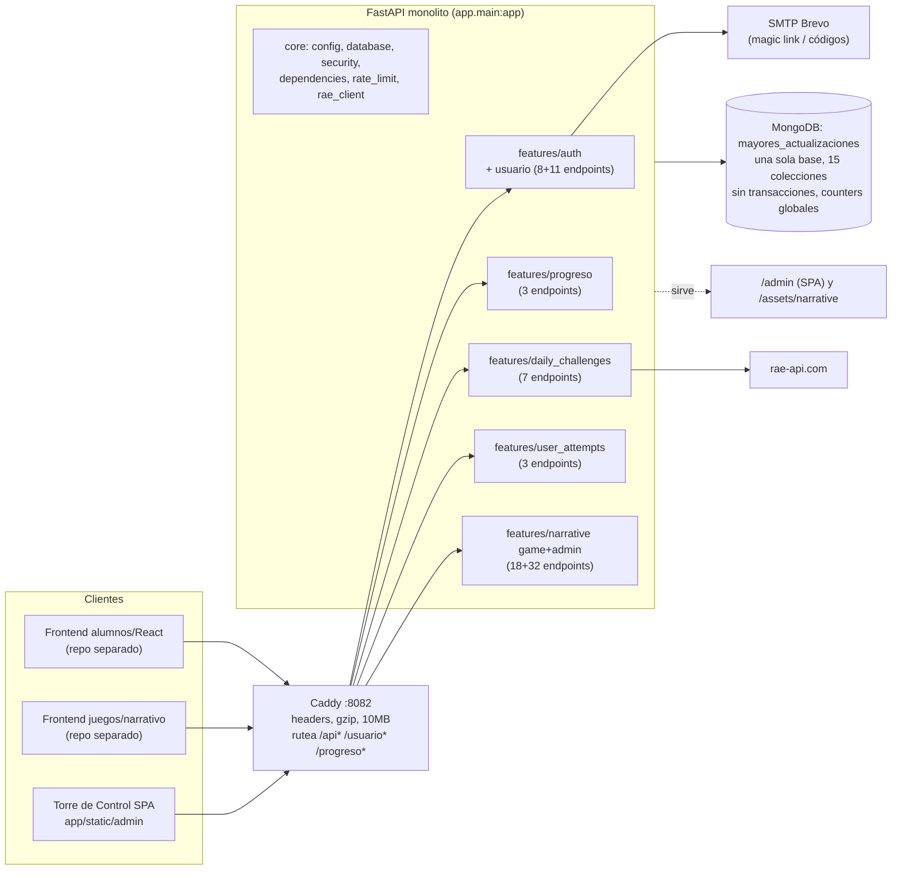
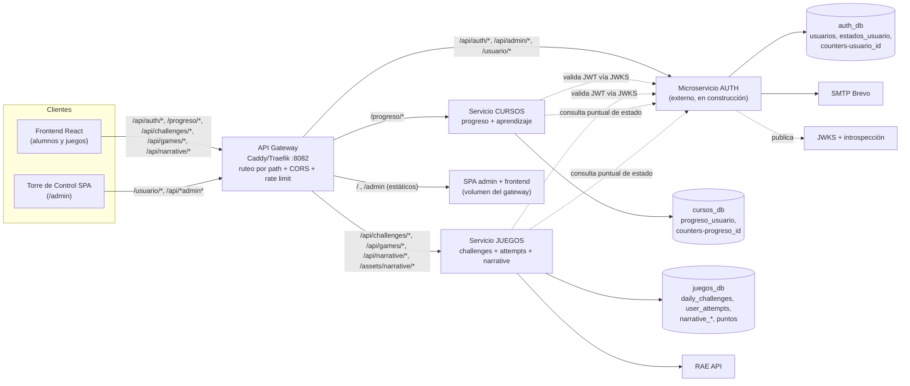
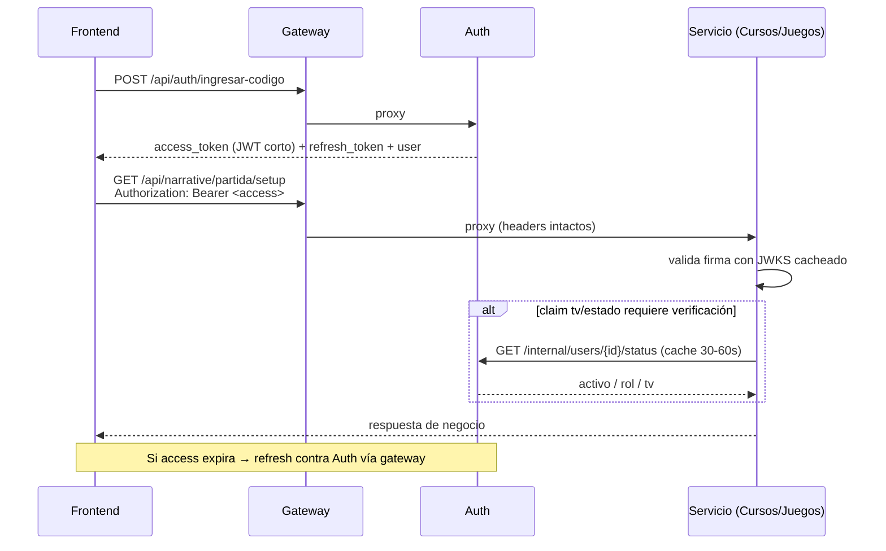

# Auditoría 04 — Plan de desacoplamiento Cursos / Juegos / Auth

> **Fecha:** 2026-10-19
> **Alcance:** análisis de solo lectura del repo `mayores_actualizacionesSIPI-BACK` (rama `feature/juego-narrativo`, commit `568c64d`).
> **Contexto de negocio (dado por el usuario, no documentado en el repo):** el sistema evolucionará a 3 microservicios: **AUTENTICACIÓN** (ya en construcción aparte, sin código disponible), **CURSOS** (usuario/progreso y aprendizaje) y **JUEGOS** (daily_challenges, user_attempts, narrative). Los servicios de Cursos y Juegos deben validar identidad contra el micro de Auth en vez de tener auth embebida.
> **Restricciones respetadas:** no se modificó ningún archivo del repo, no se ejecutó la app ni tests, no se instaló nada. Único artefacto escrito: este informe.

---

## 1. Resumen ejecutivo

1. **El monolito ya está bien "cortado" a nivel de carpetas** (`features/auth|usuario|progreso|daily_challenges|user_attempts|narrative`), pero el acoplamiento real es **por datos compartidos** (una sola base MongoDB `mayores_actualizaciones` con 15 colecciones) y **por código compartido** (`core/security`, `core/dependencies`, `core/database.init_indexes`, seeds del lifespan). Hay además un acoplamiento de **despliegue** (un único contenedor FastAPI + un único Caddy que hoy ya rutea por prefijos).
2. **Corte natural propuesto:** `auth` + `usuario` → **Auth**; `progreso` → **Cursos**; `daily_challenges` + `user_attempts` + `narrative` + `rae_client` + assets narrativos → **Juegos**. `narrative` **no** justifica servicio propio todavía: comparte `daily_challenges` (config del día, `game_id="narrativo"`) y `user_attempts` (sincronización al terminar) con Juegos; conviene mantenerlo como **módulo interno** aislado y reevaluar su extracción por ritmo de releases/equipo de contenido.
3. **La frontera más importante a resolver es datos, no routers:** hoy `progreso` vive **embebido en `usuarios.progresos`**, `user_attempts` escribe **`usuarios.puntos`**, y `dependencies.get_current_user` consulta la colección `usuarios` en **cada request**. Ese triple acoplamiento es el que impide separar bases y despliegues hoy.
4. **Estrategia de identidad recomendada:** API Gateway (Caddy o equivalente) para ruteo/estabilidad de rutas + **validación local de JWT asimétrico vía JWKS** en Cursos y Juegos + **introspección/consulta de estado** solo para operaciones sensibles a revocación (admin, baja de cuenta) + **tokens de acceso cortos + refresh** (hoy el JWT dura 180 días y la desactivación de cuenta se detecta porque cada request golpea Mongo).
5. **Estrategia de migración (Strangler Fig):** (0) congelar contratos, (1) separar el código en 3 módulos con un `AuthProvider` abstracto y un solo deploy, (2) partir despliegues con el mismo código y rol por variable de entorno, manteniendo **100% de rutas estables vía gateway** (el Caddyfile actual ya expone `/api*`, `/usuario*`, `/progreso*`, `/health*`), (3) enchufar el micro de Auth externo detrás de `/api/auth/*` y `/usuario/*`, (4) separar bases Mongo y migrar datos embebidos, (5) hardening y limpieza.
6. **Datos:** mantener **un solo clúster Mongo** con **bases lógicas por servicio** (auth/cursos/juegos) a partir de la fase 4. No hay transacciones hoy; no introducirlas cross-servicio: usar upserts idempotentes, claves externas (`usuarioId` numérico) y migraciones one-shot con congelamiento corto.
7. **Riesgos críticos detectados que condicionan el plan (preexistentes, no causados por el desacople):**
   - `/api/narrative/admin/*` y `/api/challenges/admin/*` y `POST /api/challenges` **no exigen ninguna autenticación** (el SPA admin las llama con `fetch` sin Bearer). En la arquitectura objetivo deben exigir rol admin; esto requiere un ajuste mínimo coordinado en la SPA admin (deuda de seguridad actual).
   - `POST /api/games/attempts` acepta `user_id` del body si no hay token (y el servicio cae a `user_id=1` como último recurso); permite escribir intentos/puntos de terceros.
   - El JWT es HS256 simétrico con secreto compartido y expiración de 180 días; `core/rate_limit` decodifica el token para bypass de admins (acoplamiento de rate limit con JWT local).
   - El proyecto de ID secuencial global (`counters`) es compartido entre auth (`usuario_id`), cursos (`progreso_id`) y scripts ETL.
8. **Contratos ya estables para el frontend:** 82 endpoints API + 4 de sistema + 2 mounts estáticos. El plan garantiza que ninguno cambie de método/ruta; el gateway absorbe los rearquitectos (`/api/auth/*` → micro Auth, `/progreso/*` → Cursos, resto → Juegos).

---

## 2. Inventario de endpoints

**Consumidores identificados:**
- `FE alumnos`: frontend principal (repo separado; documentado en `docs_interna/GUIA_INTEGRACION_FRONTEND_AUTH.md` y `GUIA_PROGRESO_USUARIO.md`).
- `FE juegos`: pantallas de juegos/narrativo del frontend (repo separado; contrato V1/V2 documentado en `docs_interna/ARQUITECTURA_JUEGOS_Y_NARRATIVO.md` y `app/features/narrative/docs/`).
- `SPA admin`: Torre de Control compilada en `app/static/admin` (verifiqué las URLs llamadas dentro del bundle `index-DKAfb-7N.js`).
- `Infra`: healthchecks de Caddy/Docker y monitoreo.

### 2.1 Auth (`app/features/auth/router.py`) — 8 endpoints → **Auth**

| Método | Ruta | Protección actual | Consume | Destino |
|---|---|---|---|---|
| POST | `/api/auth/login-sistemas` | rate limit 5/60s; público | SPA admin, FE alumnos (operadores) | Auth |
| POST | `/api/auth/ingresar-codigo` | rate limit 5/60s; público | FE alumnos (PIN 6 dígitos) | Auth |
| POST | `/api/auth/verificar-token` | público (valida JWT del body) | FE alumnos (`/acceso?token=`) | Auth |
| POST | `/api/admin/enviar-acceso-correo` | `get_current_admin` | SPA admin | Auth |
| POST | `/api/auth/register` | rate limit 5/60s; público | FE alumnos (registro) | Auth |
| POST | `/api/auth/verificar-codigo-registro` | rate limit 10/60s; público | FE alumnos | Auth |
| POST | `/api/auth/reenviar-codigo-registro` | rate limit 5/60s; público | FE alumnos, SPA admin | Auth |
| POST | `/api/auth/modificar-email-registro` | rate limit 5/60s; público | FE alumnos | Auth |

### 2.2 Usuario / Torre de Control (`app/features/usuario/router.py`, prefix `/usuario`) — 11 endpoints → **Auth**

| Método | Ruta | Protección actual | Consume | Destino |
|---|---|---|---|---|
| GET | `/usuario` | `get_current_admin` | SPA admin (listado, filtros, paginación) | Auth |
| GET | `/usuario/estados` | **público** (sin dependency) | SPA admin (dropdown estados) | Auth |
| POST | `/usuario/estados` | `get_current_admin` | SPA admin | Auth |
| PUT | `/usuario/estados/{estado_id}/toggle-habilitado` | `get_current_admin` | SPA admin | Auth |
| PUT | `/usuario/{user_id}/cambiar-estado` | `get_current_admin` | SPA admin | Auth |
| GET | `/usuario/{user_id}` | `get_current_user` + RLS (solo dueño o admin) | FE alumnos (perfil), SPA admin | Auth |
| PUT | `/usuario/{user_id}/toggle-activo` | `get_current_admin` | SPA admin | Auth |
| PUT | `/usuario/{user_id}/toggle-black` | `get_current_admin` | SPA admin | Auth |
| PUT | `/usuario/{user_id}/suscribirse` | alias del anterior; `get_current_admin` | FE alumnos/backoffice (doc histórica) | Auth |
| POST | `/usuario` | `get_current_admin` | SPA admin (alta de usuario) | Auth |
| POST | `/usuario/{user_id}/magic-link` | `get_current_admin` | SPA admin (generar enlace/WhatsApp) | Auth |

### 2.3 Progreso (`app/features/progreso/router.py`, prefix `/progreso`) — 3 endpoints → **Cursos**

| Método | Ruta | Protección actual | Consume | Destino |
|---|---|---|---|---|
| POST | `/progreso/crear` | `get_current_user` + RLS (dueño o admin) | FE alumnos | Cursos |
| PUT | `/progreso/actualizar/{usuario_id}/{curso_id}` | `get_current_user` + RLS (upsert) | FE alumnos | Cursos |
| GET | `/progreso/obtenerUsuario/{usuario_id}` | `get_current_user` + RLS | FE alumnos | Cursos |

### 2.4 Desafíos diarios (`app/features/daily_challenges/router.py`, prefix `/api/challenges`) — 7 endpoints → **Juegos**

| Método | Ruta | Protección actual | Consume | Destino |
|---|---|---|---|---|
| GET | `/api/challenges/today` | público | FE juegos | Juegos |
| GET | `/api/challenges/month` | público | FE juegos | Juegos |
| GET | `/api/challenges/range` | público | FE juegos | Juegos |
| GET | `/api/challenges/date/{date}` | público | FE juegos | Juegos |
| POST | `/api/challenges` | **sin auth** (upsert manual) | SPA admin / tools | Juegos |
| GET | `/api/challenges/admin/status` | **sin auth** | SPA admin (`/api/challenges/admin/status?...game_id=...`) | Juegos |
| POST | `/api/challenges/admin/generate-month` | **sin auth** | SPA admin (`generate-month?year&month&game_id`) | Juegos |

### 2.5 Intentos de usuario (`app/features/user_attempts/router.py`, prefix `/api/games/attempts`) — 3 endpoints → **Juegos**

| Método | Ruta | Protección actual | Consume | Destino |
|---|---|---|---|---|
| POST | `/api/games/attempts` | Bearer **opcional**; si no hay token usa `body.user_id`; 401 si no hay ninguno (servicio cae a 1 si ambos vacíos) | FE juegos (wordle/sopa/sudoku/crucigrama/narrativo) | Juegos |
| GET | `/api/games/attempts/date/{date}` | Bearer opcional o `user_id` query | FE juegos (restaurar partida del día) | Juegos |
| GET | `/api/games/attempts` | Bearer opcional o `user_id` query | FE juegos (historial mensual) | Juegos |

### 2.6 Juego narrativo — partidas y consultas (`app/features/narrative/game/router.py`) — 18 endpoints → **Juegos**

| Método | Ruta | Protección actual | Consume | Destino |
|---|---|---|---|---|
| POST | `/api/narrative/v2/partida/iniciar` | Bearer opcional (invitado `user_id=0`) | FE narrativo (V2) | Juegos |
| POST | `/api/narrative/v2/partida/elegir-carta-mes` | ídem | FE narrativo (V2) | Juegos |
| POST | `/api/narrative/v2/partida/decidir-evento` | ídem | FE narrativo (V2) | Juegos |
| POST | `/api/narrative/v2/partida/responder-conversacion` | ídem | FE narrativo (V2) | Juegos |
| POST | `/api/narrative/v2/partida/avanzar-mes` | ídem | FE narrativo (V2) | Juegos |
| GET | `/api/narrative/v2/partida/estado` | ídem | FE narrativo (restaurar tras F5) | Juegos |
| GET | `/api/narrative/partida/setup` | Bearer opcional | FE narrativo | Juegos |
| POST | `/api/narrative/partida/reiniciar` | Bearer opcional | FE narrativo | Juegos |
| POST | `/api/narrative/partida/conversaciones-posibles` | público | FE narrativo | Juegos |
| GET | `/api/narrative/partida/conversaciones-posibles` | público | FE narrativo | Juegos |
| GET | `/api/narrative/partida/historial` | Bearer opcional | FE narrativo (modal) | Juegos |
| GET | `/api/narrative/partida/inventario` | Bearer opcional | FE narrativo (modal) | Juegos |
| GET | `/api/narrative/partida/corte` | Bearer opcional | FE narrativo (modal) | Juegos |
| GET | `/api/narrative/partida/finalizacion` | Bearer opcional | FE narrativo (modal fin) | Juegos |
| GET | `/api/narrative/partida/evento-actual` | Bearer opcional | FE narrativo (modal) | Juegos |
| GET | `/api/narrative/partida/conversacion-actual` | Bearer opcional | FE narrativo (modal) | Juegos |
| GET | `/api/narrative/partida/resultado-actual` | Bearer opcional | FE narrativo (modal) | Juegos |
| GET | `/api/narrative/partida/draft-actual` | Bearer opcional | FE narrativo (modal) | Juegos |

> Nota: los endpoints legacy V1 (`/iniciar`, `/activa`, `/turno`, etc.) que menciona `docs_interna/ARQUITECTURA_JUEGOS_Y_NARRATIVO.md` **ya no existen** en el código actual (documento desactualizado).

### 2.7 Narrativo — Torre de Control (`app/features/narrative/admin/router.py`, prefix `/api/narrative/admin`) — 32 endpoints → **Juegos**

| Método | Ruta | Protección actual | Consume | Destino |
|---|---|---|---|---|
| GET | `/api/narrative/admin/catalogo-reglas` | **sin auth** | SPA admin | Juegos |
| POST | `/api/narrative/admin/upload-imagen` | **sin auth** | SPA admin (WebP) | Juegos |
| GET/POST/DELETE | `/api/narrative/admin/universos[/{id}]` | **sin auth** | SPA admin | Juegos |
| GET/POST/DELETE | `/api/narrative/admin/personajes[/{id}]` | **sin auth** | SPA admin | Juegos |
| GET/POST/DELETE | `/api/narrative/admin/cartas[/{id}]` | **sin auth** | SPA admin | Juegos |
| GET/POST/DELETE | `/api/narrative/admin/resultados[/{id}]` | **sin auth** | SPA admin | Juegos |
| GET/POST/DELETE | `/api/narrative/admin/eventos[/{id}]` | **sin auth** | SPA admin | Juegos |
| GET/POST/DELETE | `/api/narrative/admin/conversaciones[/{id}]` | **sin auth** | SPA admin | Juegos |
| GET/POST/DELETE | `/api/narrative/admin/finalizaciones[/{id}]` | **sin auth** | SPA admin | Juegos |
| POST | `/api/narrative/admin/universos/{id}/sembrar-finalizaciones` | **sin auth** | SPA admin | Juegos |
| POST | `/api/narrative/admin/generar-mes` | **sin auth** | SPA admin | Juegos |

(Cada bloque CRUD son 4 endpoints: GET lista, GET por id, POST upsert, DELETE. 7 bloques × 4 + 4 = 32.)

### 2.8 Sistema e infraestructura → **compartido / gateway**

| Método | Ruta | Protección | Consume | Destino |
|---|---|---|---|---|
| GET | `/` | público | navegador/monitoreo | Gateway o cualquier servicio |
| GET | `/health` y `/actuator/health` | público | healthcheck Caddy/Docker (`/actuator/health` legacy Spring) | cada servicio expone el suyo |
| GET | `/admin` (redirect) + mount `/admin/*` | público | operadores (SPA) | Gateway/estático (decisión §4) |
| Mount | `/assets/narrative/*` | público | FE narrativo (imágenes WebP) | Juegos |
| GET | `/docs`, `/redoc`, `/openapi.json` | público | desarrolladores | cada servicio |

**Totales:** Auth 8 + Usuario 11 + Cursos 3 + Juegos 60 (7 + 3 + 18 + 32) = **82 endpoints API** + 4 de sistema + 2 mounts.

---

## 3. Matriz de acoplamiento

Tipos: **D** = por datos (colección/índice compartido), **C** = por código (import/helper/dependencia), **X** = por despliegue (mismo proceso/contenedor/arranque/estáticos).

| Artefacto compartido | Quién escribe | Quién lee | Tipo | Impacto en el split | Mitigación propuesta |
|---|---|---|---|---|---|
| Colección `usuarios` | auth (`register`, verificación), usuario (toggles, estados, crear), scripts (`init_db`, ETL) | auth, usuario, `core/dependencies` (cada request), progreso (validar existencia + leer `progresos`), user_attempts (`$inc puntos`), SPA/FE (respuestas) | **D+C** | `progreso` y `user_attempts` dependen de auth para existir; `usuarios.progresos` y `usuarios.puntos` son datos de Cursos/Juegos dentro de la colección de Auth | Fase 1–3: misma base. Fase 4: `progresos` → colección `progreso_usuario` (Cursos); `puntos` → Juegos; `usuarioId` como referencia externa |
| `usuarios.progresos[]` (embebido) | progreso service | progreso service, ETL | **D** | Impide que Cursos tenga su propia base; lecturas/escrituras compiten con auth | Migrar a colección propia de Cursos en Fase 4 (script + doble lectura durante transición) |
| `usuarios.puntos` | user_attempts service (`$inc`) | nadie en este repo (no aparece en `format_user_response` ni en el bundle admin) | **D** | Escritura de Juegos sobre colección de Auth; riesgo de lost-update si se separa sin plan | Mover el contador de puntos a Juegos (gamificación es dominio de Juegos) o exponer API interna de incremento en Auth |
| `core/dependencies.get_current_user/get_current_admin` | — | auth (`get_current_admin`), usuario, progreso | **C** | Toda la validación de identidad de Usuario/Cursos pasa por módulo de Auth contra Mongo | Sustituir por `AuthProvider` (claims/JWKS) con implementación local y remota |
| `core/security` (`create_access_token`, `decode_access_token`, hash) | auth, usuario/magic-link | user_attempts, narrative (decode), `rate_limit` (decode, bypass admin) | **C** | Emisión y verificación mezcladas; 4 features dependen del mismo helper | Fase 1: separar `issue_token` (solo Auth) de `verify_token` (todos). Fase 3: JWKS asimétrico |
| Colección `estados_usuario` | usuario (catálogo) | usuario (CRUD, validación), auth (login por `estado_id`? no; login mira `activo`/`estado_id` en usuario) | **D** | Catálogo de estados es de Auth | Queda en Auth |
| `counters` (`usuario_id`, `progreso_id`) | auth, inicio scripts, ETL | auth, progreso, ETL | **D** | IDs secuenciales compartidos; si se separan bases hay que partir el contador | `usuario_id` → Auth; `progreso_id` → Cursos (mover valor en Fase 4) |
| `core/database.init_indexes()` | — | todos | **C+X** | Crea índices de colecciones de **todos** los dominios en el arranque del único contenedor | Cada servicio crea/valida solo sus índices |
| `main.py` lifespan | seeds de auth (`estados`, admin), seeds de juegos (wordle/sopa/sudoku), finalizaciones narrativas, loop de generación cada 12 h | — | **X** | Un solo arranque siembra datos de 2 dominios; con 3 réplicas se duplica el loop | Repartir por rol de servicio; loop solo en Juegos (upserts idempotentes ya) |
| `daily_challenges` | daily_challenges (generadores, upsert), narrative/admin (`generar-mes` `game_id=narrativo`), seeds | daily_challenges, narrative (setup/turno/draft), SPA admin (status) | **D+C** | Colección puente Juegos↔Narrativo | Ambos quedan en **Juegos**; no requiere split |
| `user_attempts` | user_attempts service (FE juegos), narrative `endings_service.sincronizar_intento_usuario` | user_attempts service (FE juegos) | **D+C** | Misma colección escrita por dos módulos de Juegos | Queda en Juegos |
| `counters`/IDs de `narrative_*` | narrative | narrative | — | Sin acoplamiento externo | Queda en Juegos |
| `core/rate_limit` (in-memory + decode JWT admin) | auth router solamente | — | **C** | Es un limitador de Auth; decodifica el token local | Queda en Auth; en producción multi-réplica pasar a Redis o al gateway |
| `core/rae_client` + `app/data/*` (palabras, acentos, cache definiciones) | daily_challenges generators (solo lecturas + cache local) | wordle/sopa/crucigrama | **C** | Dependencia externa (rae-api.com) + cache JSON escribible | Queda en Juegos; revisar `time.sleep` bloqueante en contexto async y persistencia del cache (volumen) |
| `auth/email_service` (SMTP Brevo) | auth | — | — | Solo Auth | Queda en Auth |
| `static/admin` (SPA Torre de Control) | compilación externa (`npm run build:admin`) | operadores; llama auth + usuario + challenges admin + narrative admin | **X** | UI cross-dominio servida por el backend, pero **no ruteada por Caddy** (`@backend` no incluye `/admin`) | Servir como estático del gateway (como el frontend); mantener URL `/admin` |
| `static/narrative` (`/assets/narrative`) | narrative/admin `upload-imagen` | FE narrativo | **X** | Assets de Juegos servidos por el mismo proceso; `imagen_service` escribe en disco del contenedor | Mount de volumen o storage compartido para Juegos |
| `settings` (`core/config`) | — | todos | **C** | Mezcla JWT_SECRET+SMTP (Auth), RAE (Juegos), MYSQL (ETL), FRONTEND_URL (todos) | Partir en perfiles por servicio con base común |
| `CORS` (en `main.py`, regex `^https?://.*$`) | — | todos | **X** | Configuración única muy permisiva | CORS en gateway (o por servicio con lista explícita) |
| Scripts: `init_db` (auth), `seed_challenges/sudoku/sopa/narrative` (juegos), `migrate_from_mysql` (usuarios+progresos) | — | — | **C+X** | Seeds de dos dominios en `app/scripts`; ETL escribe ambos | Repartir por servicio; ETL como herramienta one-shot de migración |
| Tests (`tests/test_narrative_*.py`) | — | — | **C** | Importan `app.main:app` y usan Mongo real; al partir servicios dejan de aplicar tal cual | Mover a Juegos y adaptar el arranque del app bajo test |
| `Dockerfile` / `docker-compose.yml` / `Caddyfile` | — | — | **X** | Un solo contenedor backend y una sola base | Evolucionan a 3 servicios + gateway + (Fase 4) bases lógicas |

**Lectura de la matriz:** el acoplamiento **por código** se resuelve con refactor interno y un `AuthProvider` (fases 1–3). El acoplamiento **por datos** es el más caro: 3 campos/colecciones de Auth (`progresos`, `puntos`) y el chequeo de usuario por request. El acoplamiento **por despliegue** es el más fácil de romper primero porque el ruteo por prefijos ya existe en Caddy.

---

## 4. Asignación propuesta feature → servicio

| Feature / archivo | Servicio | Justificación | Casos grises y decisión |
|---|---|---|---|
| `app/features/auth/**` (`router`, `service`, `schemas`, `email_service`) | **Auth** | Login (sistemas + PIN), registro con verificación por email, magic links, emisión de tokens. Es exactamente el dominio del micro en construcción. | — |
| `app/features/usuario/**` (Torre de Control) | **Auth** | CRUD y ciclo de vida de cuentas: listado con filtros, catálogo de estados, toggles activo/black, cambio de estado, alta administrativa, magic-link. Todo opera sobre `usuarios`/`estados_usuario` y requiere el mismo modelo de roles que login. | `black` (suscripción) es semánticamente comercial/Cursos. **Decisión:** por ahora queda en Auth (viaja en el JWT y el login la necesita para mostrar UI). Si aparece facturación, extraer "suscripciones" y dejar `black` como read-model. |
| `app/features/progreso/**` | **Cursos** | Es el núcleo actual del dominio Cursos (avance por curso con RLS). | Hoy vive embebido en `usuarios.progresos` y valida existencia de usuario contra `usuarios`. **Decisión:** en Fase 4 pasa a colección propia de Cursos con `usuarioId` como referencia externa; la validación de existencia se hace contra el token (o endpoint interno de Auth con cache). |
| `app/features/daily_challenges/**` (router, service, generadores wordle/sopa/sudoku/crucigrama) | **Juegos** | Generación/consulta de desafíos diarios; consume RAE; protegido/administrado desde la Torre de Control de juegos. | — |
| `app/features/user_attempts/**` | **Juegos** | Intentos/puntajes de partidas; dominio lúdico. | Escribe `usuarios.puntos`. **Decisión:** mover el acumulado de puntos a Juegos (colección propia) o exponer API interna en Auth si negocio exige el contador en el perfil. |
| `app/features/narrative/**` (`engine/`, `game/`, `admin/`, `constants`, `enums`, `schemas/`, `docs/`) | **Juegos (módulo interno)** | Comparte `daily_challenges` (config diaria `game_id="narrativo"`) y `user_attempts` (sincronización de resultado); mismo ciclo de release (`feature/juego-narrativo`); hoy es autocontenido salvo esas dos colecciones. | **Servicio propio:** no por ahora. Sería un 4.º servicio con dependencias de datos inmediatas sobre Juegos. Criterios para reevaluar: escalado/carga propia, equipo de contenido separado, releases desacoplados, o reuso del motor para otros fines. Dejar la carpeta lista como "bounded context" con su propia capa de acceso a datos. |
| `app/core/rae_client.py` + `app/data/**` (palabras, acentos, cache) | **Juegos** | Único consumidor: generadores de daily_challenges (wordle/sopa/crucigrama). | — |
| `app/core/config.py` | **Compartido** (split por perfiles) | Todos los servicios necesitan settings. | Separar: `JWT_SECRET/SMTP/ADMIN_*` → Auth; `RAE_API_KEY` → Juegos; `MYSQL_*` → herramienta ETL; `FRONTEND_URL/MONGODB_URL` → común. |
| `app/core/database.py` | **Compartido** (instancia por servicio) | Cliente Motor + helpers de secuencia. | `init_indexes` debe fragmentarse por dominio; `get_next_sequence_value` queda en Auth y Cursos (cada uno con su contador). |
| `app/core/security.py` | **Split** | `create_access_token`/hash → solo Auth; `decode_access_token` → verificación en Cursos/Juegos (evoluciona a JWKS). | Fase 1: partir el módulo en `issue.py` y `verify.py`. |
| `app/core/dependencies.py` | **Reemplazo** | `get_current_user` mezcla validación de token + lectura de Mongo. | Nueva capa `AuthProvider`: `claims(request)` + `get_user_if_needed(id)`. RLS se resuelve con claims (`id`, `tipo_usuario`). |
| `app/core/rate_limit.py` | **Auth** (+ gateway) | Solo lo usa el router de auth (login/PIN/registro). El bypass por JWT admin es acoplamiento con seguridad local. | Rate limit general de API en gateway; el anti-fuerza bruta del PIN queda en Auth (idealmente Redis para multi-réplica). |
| `app/main.py` | **Compartido** → 3 entrypoints | Hoy monta todo, CORS, lifespan con seeds de 2 dominios y estáticos. | Fase 1: `create_app(role)`; Fase 2: `auth_app.py` / `cursos_app.py` / `juegos_app.py`. |
| `app/scripts/init_db.py` (`seed_estados_usuario`, `seed_default_admin`) | **Auth** | Siembra catálogo de estados y admin inicial. | — |
| `app/scripts/seed_challenges.py`, `seed_sudoku.py`, `seed_sopa_letras.py`, `seed_narrative.py` | **Juegos** | Siembran colecciones de juegos. | `seed_narrative` importa CRUD admin y servicios de narrative → dentro de Juegos no hay problema. |
| `app/scripts/migrate_from_mysql.py` | **Herramienta ETL one-shot** (fuera de los servicios) | Migra `usuario` + `progreso_usuario` de MySQL a Mongo (hoy a `usuarios.progresos`). | En Fase 4 se parte en dos pasos (usuarios → Auth; progresos → Cursos) y se ejecuta con ambas conexiones; no debe vivir dentro de un runtime de servicio. |
| `app/static/admin/**` (SPA) | **Gateway / Backoffice** | UI de operadores que consume endpoints de los 3 dominios; no es código de ningún servicio en particular. | **Decisión recomendada:** servirla como estático del gateway (igual que el frontend, volumen `./dist`), manteniendo `/admin`. Provisional: dejarla montada en Auth (es la puerta de entrada de operadores) hasta definir pipeline. Importante: hoy Caddy **no** rutea `/admin` al backend; verificar dónde se sirve en producción. |
| `app/static/narrative/**` | **Juegos** | Imágenes del juego narrativo, gestionadas por `upload-imagen` (Juegos) y servidas al FE narrativo. | Necesita volumen persistente en el contenedor de Juegos. |
| `tests/**` | **Split** | `test_narrative_*.py` → Juegos. | Adaptar tests que importan `app.main:app`. |
| `Caddyfile`, `docker-compose.yml`, `Dockerfile`, `.env.example` | **Infra/Gateway** | Evolucionan a gateway + 3 servicios + Mongo. | Documentados como "intocables" por convención del repo; el cambio es parte explícita del plan. |

### 4.1 Respuestas directas a los casos grises planteados

| Caso gris | Decisión | Por qué |
|---|---|---|
| ¿`usuario` (Torre de Control) es Auth o Cursos? | **Auth** | Es gestión de cuentas y roles; los endpoints de Cursos solo dependen de `usuarioId` y del claim de rol. |
| ¿`progreso` es Cursos? | **Sí** | Es literalmente el dominio "avance de cursos"; el desacople también libera a Auth de cargar `progresos[]`. |
| ¿`user_attempts` es Juegos? | **Sí** | Intentos/puntajes son datos de juego; la única fuga (`usuarios.puntos`) se resuelve moviendo el acumulado a Juegos o vía API interna. |
| ¿`narrative` es Juegos o servicio propio? | **Juegos** (módulo aislado) | Comparte `daily_challenges` y `user_attempts`; separarlo hoy crea dependencias distribuidas sin beneficio operativo. Reevaluar con criterios explícitos. |
| ¿`rae_client` es Juegos? | **Sí** | Único consumidor: generadores de juegos de palabras. |
| ¿Dónde vive la SPA admin? | **Gateway/estáticos** | Consume 3 dominios; empaquetarla dentro de un servicio acopla el deploy del panel a ese servicio. Mantener `/admin` y sus llamadas por el gateway. |
| ¿Dónde viven seeds y scripts? | **Por dominio**: `init_db` → Auth; `seed_*` de juegos → Juegos; ETL → herramienta aparte | Cada servicio solo siembra lo que es dueño; el startup multi-réplica no debe duplicar seeds de otro dominio. |

---

## 5. Estrategia de identidad con el micro de Auth externo (sin su código)

### 5.1 Opciones evaluadas

| Opción | Cómo funciona | Pros | Contras | Veredicto |
|---|---|---|---|---|
| **A. Validación local de JWT con JWKS** | Auth firma tokens asimétricos (RS256/EdDSA) y publica `/.well-known/jwks.json`; Cursos/Juegos validan firma y claims localmente, cacheando las claves | Latencia cero, sin acoplamiento de disponibilidad en runtime, escala horizontal simple, compatible con app móvil | Revocación con retardo (la desactivación de cuenta no se ve hasta que expira el token); hay que gestionar rotación de claves y audiences | **Base recomendada** |
| **B. Introspección remota (RFC 7662)** | Cursos/Juegos llaman `POST /introspect` en Auth en cada request (o con cache corto) | Revocación instantánea, fuente única de verdad | Dependencia síncrona con Auth (si cae, cae todo); latencia por request; carga en Auth; se pierde el sellado stateless | Solo para operaciones sensibles (admin, baja de cuenta, cambios de plan) o como fallback |
| **C. API Gateway validando en el borde** | Caddy/Kong/Traefik valida el token y propaga identidad (headers `X-User-Id`, `X-Rol`, etc.) a los servicios internos | Centraliza auth y rate limit; simplifica servicios; oculta el micro Auth del exterior | Requiere confiar en la red interna (o firmar los headers); no elimina la necesidad de claims para lógica fina (RLS); complejidad del gateway | **Complemento**, no sustituto |

**Recomendación:** **C + A, con B bajo demanda** — Gateway para ruteo estable, CORS y rate limit; JWT asimétrico validado localmente (JWKS) en Cursos y Juegos; consulta de estado (introspección o `/users/{id}/status` con cache 30–60 s) para operaciones sensibles y para refrescar revocaciones; tokens de acceso cortos (15–60 min) + refresh de larga vida (hoy: 180 días sin refresh).

**Flujo objetivo del token:**
1. Frontend llama `/api/auth/*` a través del gateway → micro Auth (mismo contrato de payloads; si el micro usa rutas nuevas, el gateway reescribe).
2. Auth emite `access_token` (JWT asimétrico, TTL corto) + `refresh_token`.
3. Cursos/Juegos validan firma con JWKS cacheado y extraen claims; no consultan `usuarios` por request.
4. Para admin o ante `401/revocación`, el servicio consulta el estado de la cuenta (cache corto) o el gateway hace `forward_auth`.

### 5.2 Claims necesarios (y por qué)

| Claim | Ejemplo | Necesario para | Consumidores |
|---|---|---|---|
| `sub` / `id` / `uid` | `"123"` / `123` | Referencia de usuario en `progreso`, `user_attempts`, `narrative_runs` (**mantener numérico** por compatibilidad de datos y contratos) | Auth, Cursos, Juegos, FE |
| `rol` / `tipoUsuario` | `1` alumno, `2` admin | Bypass RLS en Cursos; acceso a endpoints admin de Juegos; panel Torre de Control | Cursos, Juegos, gateway |
| `activo` / `estado_codigo` | `true`/`"ACTIVO"` | Login y bloqueo de acceso; señal de revocación | Auth (login), Cursos/Juegos (si se decide chequear estado del token) |
| `black` | `true/false` | Gating de contenido premium (cursos y posiblemente desafíos); UI del FE | Cursos, Juegos (opcional), FE |
| `name` | `"Marta Gómez"` | Saludos en UI; si Cursos genera certificados/dashboards | Cursos (display) |
| `email` | `"..."` | Magic links, administración; soporte | Auth, SPA admin |
| `iss`, `aud`, `exp`, `iat`, `jti` | estándar | Seguridad y trazabilidad; `aud` por servicio permite limitar tokens | Todos |
| `tv` (token version) | `7` | Revocación barata: al desactivar/cambiar rol se incrementa y los servicios lo validan contra cache | Auth, Cursos, Juegos |
| ~~`codigoAcceso`~~ | — | Solo lo usa el panel admin vía API; **no** debe viajar en claims de sesión | — |

**Datos de usuario que hoy viven en `usuarios` y que Cursos/Juegos necesitan:**
- **Cursos:** solo `id` + `tipo_usuario` para RLS (ya en el token); valida "existe usuario" al crear progreso (hoy `404` si no existe). Con token validado, el usuario existía al emitirse; para el borde (alta/borrado entre emisión y uso) basta un reintento o un endpoint interno `GET /internal/users/{id}` con cache. **No requiere replicar la colección** en la primera etapa.
- **Juegos:** `user_id` como referencia externa (runs/attempts); `rol` para admin; `puntos` como escritura → **mover a Juegos** (recomendado). Nombre no es necesario salvo leaderboards futuros (si aparecen: read-model denormalizado o consulta puntual a Auth).
- **Ambos:** honorar `activo=false` (bloqueo de cuentas). Definir en el contrato si Cursos/Juegos deben re-validar por request (caro) o confiar en TTL corto + refresh + `tv`.

### 5.3 Responsabilidades de rate limit y bloqueo de cuentas

| Mecanismo | Dueño en destino | Notas |
|---|---|---|
| Anti-fuerza bruta de PIN (`/api/auth/ingresar-codigo`), login sistemas y registro | **Auth** | Hoy `InMemoryRateLimiter` (5/60s) por proceso. Con réplicas necesita Redis o límite en gateway. Ideal adicional: bloqueo por cuenta además de por IP (el PIN de 6 dígitos tiene 900k combinaciones). |
| Bloqueo/desbloqueo de cuentas (`activo`, catálogo `estados_usuario`) | **Auth** | Debe propagarse como revocación (TTL corto/`tv`/introspección); hoy se propaga porque cada request consulta `usuarios`. **Decisión pendiente:** ventana de gracia aceptable (p. ej. ≤5 min) definida con negocio. |
| Rate limit general de API (anti-abuso, DoS) | **Gateway** | Caddy actual limita `request_body` a 10MB pero no rate general; evaluar plugin/module o Traefik/Kong. |
| Bypass de rate limit para admins | **Auth** | Hoy `rate_limit` decodifica el JWT localmente; con JWKS el helper de verificación sobrevive, pero debe vivir en Auth. |

### 5.4 Supuestos asumidos sobre el micro de Auth externo (a validar)

1. Emitirá **JWT firmado**, preferentemente asimétrico, con JWKS público; claims compatibles con los actuales de `core/security.create_access_token` (`id` numérico, `tipoUsuario`/`rol`, `black`, `name`, `email`, `activo`).
2. Cubrirá los 8 endpoints actuales de `/api/auth/*` (o el gateway reescribirá hacia sus rutas) **manteniendo payloads/response shape** (`{success, message, token, user}` con camelCase y errores `{success, message, detail}`).
3. Mantendrá el modelo de PIN de 6 dígitos (`codigo_acceso`) y hashes BCrypt (`$2a$`), sin romper la migración de la colección `usuarios`.
4. Expondrá algún mecanismo de **introspección/estado** (`introspect` o `GET /users/{id}/status`) para consultas de servicios y revocación.
5. Resolverá la **gestión de usuarios de la Torre de Control** (`/usuario/*`: listado, estados, toggles, magic link) o delegará formalmente en un BFF.
6. Definirá autenticación **servicio-a-servicio** (mTLS, API key o red interna) para llamadas internas.
7. `user_id` numérico se mantiene como **clave externa canónica** (no UUID) al menos durante la migración.

---

## 6. Plan de migración incremental (Strangler Fig)

### Fase 0 — Preparación (sin cambios de comportamiento)

| Aspecto | Detalle |
|---|---|
| Acciones | Congelar contratos: snapshot OpenAPI de las 82 rutas + tests de contrato (método/ruta/status/forma de respuesta). Documentar consumidores (FE alumnos, FE juegos, SPA admin, healthchecks). Definir gateway definitivo (Caddy actual es suficiente para arrancar). Definir el contrato del micro Auth (§5.4). |
| Rutas frontend | Sin cambios. |
| Riesgos | Bajo: solo documentación/pruebas. El riesgo real es no congelar antes de refactorizar. |
| Rollback | N/A. |

### Fase 1 — Separación lógica en un solo deploy

| Aspecto | Detalle |
|---|---|
| Acciones | Reorganizar en `services/auth`, `services/cursos`, `services/juegos` + `shared/` (o `app/services/...`): mover cada feature con su router/service/schemas. Introducir `AuthProvider` (interfaz: `validate(token) → claims`, `get_user_if_needed(id)`) con implementación `LocalJwtProvider` (comportamiento actual). Partir `core/security` (emitir vs verificar), `core/config` (perfiles) y `init_indexes` (por dominio). Un único `create_app(role="all")` que monta todo igual que hoy. |
| Rutas frontend | Idénticas (mismo proceso). |
| Riesgos | Refactor grande silencioso (imports rotos, índices no creados). Mitigar con los tests de contrato de Fase 0 + tests de arranque. |
| Rollback | Revertir el commit de reorganización (no cambia runtime). |

### Fase 2 — Partir despliegues con el MISMO código (3 contenedores + gateway)

| Aspecto | Detalle |
|---|---|
| Acciones | `SERVICE_ROLE=auth|cursos|juegos` (o 3 entrypoints). Cada contenedor monta solo sus routers, seeds, estáticos y lifespan (healthcheck propio). Gateway (Caddy) rutea: `/api/auth/*`, `/api/admin/*`, `/usuario/*` → Auth; `/progreso/*` → Cursos; `/api/challenges/*`, `/api/games/*`, `/api/narrative/*`, `/assets/narrative/*` → Juegos; `/admin` → estático. Se mantiene **una sola base Mongo**. CORS centralizado en gateway. |
| Ya se puede hacer SIN tocar el frontend | **Sí**: las rutas públicas no cambian; el gateway replica los prefijos que Caddy ya rutea hoy (`/api*`, `/usuario*`, `/progreso*`). El FE sigue apuntando al mismo host/puerto. |
| Riesgos | Seeds/loop duplicados si más de un servicio arranca tareas globales (hoy el loop de generación vive en `main.py`): dejar el loop solo en Juegos. CORS doble (gateway + app): unificar. Healthchecks de Compose por servicio. Magic link/FRONTEND_URL compartido. |
| Rollback | Re-apuntar el gateway al contenedor "all-in-one" anterior (imagen única) sin tocar datos. |

### Fase 3 — Enchufar el micro de Auth externo

| Aspecto | Detalle |
|---|---|
| Acciones | Implementar `RemoteAuthProvider` (JWKS local validation + introspección/estado para casos sensibles). Gateway reescribe `/api/auth/*`, `/api/admin/enviar-acceso-correo`, `/usuario/*` hacia el micro externo (compatibilidad 100% de rutas). Migrar/compartir la colección `usuarios` (BCrypt `$2a` compatible) según lo que defina el contrato. Retirar la emisión local de tokens y el rate limit de credenciales local (si Auth lo implementa). Cursos y Juegos dejan de importar `app.core.dependencies`. |
| Rutas frontend | Idénticas (gateway). Si el micro Auth devuelve claims distintos, adaptar `AuthProvider`, no el FE. |
| Riesgos | **Contrato desconocido** del micro Auth (los supuestos de §5.4 pueden fallar): mitigar con un **BFF/adapter** en el gateway o en Cursos que traduzca; preguntas abiertas §8. Revocación de cuentas (ventana). Magic link y `codigoAcceso` en respuestas pueden cambiar de forma → tests de contrato. |
| Rollback | Feature flag `AUTH_PROVIDER=local|remote`; volver a `local` y re-rutear `/api/auth/*` al servicio local. |

### Fase 4 — Separar datos (bases lógicas por servicio)

| Aspecto | Detalle |
|---|---|
| Acciones | Migrar `usuarios.progresos[]` → colección `progreso_usuario` (Cursos). Mover `puntos` (hoy en `usuarios`) a Juegos. Partir `counters` (`usuario_id` → Auth; `progreso_id` → Cursos). Asignar bases: `auth_db` (`usuarios`, `estados_usuario`, `counters-usuario_id`), `cursos_db` (`progreso_usuario`, `counters-progreso_id`), `juegos_db` (`daily_challenges`, `user_attempts`, `narrative_*`, `puntos`). Migración one-shot con congelamiento corto + script ETL actualizado + verificación de conteos. |
| Rutas frontend | Idénticas. |
| Riesgos | Duplicados/perdidos en la migración de embebidos; secuencias de IDs; lecturas residuales a colecciones ajenas. Mitigar: doble lectura temporal, IDs como referencia externa, pruebas de reconciliación, snapshot previo. |
| Rollback | Restaurar snapshot Mongo y volver a modo base única con flag en configuración (mantener el código con "lectura legacy" una versión más). |

### Fase 5 — Hardening y limpieza

| Aspecto | Detalle |
|---|---|
| Acciones | Exigir rol admin en `/api/narrative/admin/*`, `/api/challenges/admin/*` y `POST /api/challenges` (**requiere actualizar la SPA admin para enviar Bearer en esas llamadas** — cambio mínimo, coordinar). Eliminar fallback `user_id` del body/`1` en attempts. CORS restringido por servicio. Rate limit distribuido. Observabilidad (request-id, logs por servicio). Retiro de shims legacy y del modo `role=all`. |
| Riesgos | La SPA admin actual **no envía token** a los endpoints admin de juegos (verificado en el bundle): si se activa la validación antes de actualizar la SPA, se rompe la Torre de Control de narrativo/desafíos. Coordinar ventana. |
| Rollback | Los endpoints protegidos pueden volver a modo permisivo temporalmente vía configuración (no recomendado). |

### 6.1 Orden recomendado y criterio

1. **Primero el gateway y el ruteo estable** (Fase 0–2): es el seguro que permite 100% compatibilidad sin tocar el FE.
2. **Segundo la identidad** (Fase 1–3): es el requisito de negocio explícito y el que más riesgo de contrato tiene; cuanto antes se pruebe contra el micro real, mejor.
3. **Tercero los datos** (Fase 4): es el paso más caro e irreversible; necesita que los servicios ya corran separados y estables.
4. **Último hardening** (Fase 5): incluye cerrar la deuda de seguridad preexistente (admin endpoints abiertos, fallback de attempts).

---

## 7. Estrategia de datos: ¿una base compartida o bases separadas?

### 7.1 Situación actual

- **1 base** (`mayores_actualizaciones`) con: `usuarios` (incluye `progresos[]` y `puntos`), `estados_usuario`, `counters`, `daily_challenges`, `user_attempts`, `narrative_settings`, `narrative_characters`, `narrative_cards`, `narrative_results`, `narrative_events`, `narrative_conversations`, `narrative_endings`, `narrative_runs`.
- **Sin transacciones** (nunca se usan sessions de Mongo en el código).
- **IDs secuenciales globales** por contador (`usuario_id`, `progreso_id`) en `counters`.
- **Referencias cruzadas débiles**: `user_attempts.user_id`, `narrative_runs.user_id` (numéricos, sin FK), `progreso.usuarioId`, `progreso.cursoId` (el catálogo de cursos **no vive en este repo**; Caddy rutea `/cursos*` y `/payment*` a backend pero no hay routers de cursos/pagos aquí).
- Único índice "cross": no hay. Las únicas colecciones compartidas entre dominios destino son `daily_challenges` y `user_attempts`, ambas dentro de Juegos.

### 7.2 Opciones

| Opción | Pros | Contras | Cuándo |
|---|---|---|---|
| **A. Base única compartida por los 3 servicios** (estado actual, fases 2–3) | Cero migración; consistencia inmediata; permite refactor de código sin tocar datos | Acoplamiento de esquema; cualquier servicio puede escribir cualquier colección (riesgo); imposible aislar backups/permisos; bloquea escalado independiente de datos | **Fases 2–3** (transición) con regla de "colecciones de propiedad exclusiva" |
| **B. Un clúster, N bases lógicas (auth/cursos/juegos)** | Aísla colecciones, permisos y backups; migración incremental factible; no exige clústeres distintos; mantiene latencias bajas | Sigue compartiendo recurso (CPU/RAM/IO); requiere partir contadores y migrar embebidos; cross-refs siguen siendo débiles | **Fase 4 → adelante (recomendado)** |
| **C. Clústeres Mongo separados por servicio** | Aislamiento total, escalado y HA independientes | Costo operativo; latencia de red para lookups; sin joins; migración más compleja | Futuro, si escala o seguridad lo exigen |

### 7.3 Recomendación

1. **Fases 2–3:** mantener el clúster y la base actual, pero con **propiedad exclusiva por colección** (Auth: `usuarios`, `estados_usuario`, `counters`; Cursos: nada propio todavía; Juegos: `daily_challenges`, `user_attempts`, `narrative_*`). Prohibir por revisión que un servicio escriba colecciones ajenas (hoy `user_attempts` escribe `usuarios.puntos` → permitido solo hasta Fase 4, con TODO).
2. **Fase 4:** separar en **bases lógicas en el mismo clúster** (opción B):
   - `auth_db`: `usuarios` (sin `progresos` ni `puntos`), `estados_usuario`, `counters` (solo `usuario_id`).
   - `cursos_db`: `progreso_usuario` (id propio, `usuarioId`, `cursoId`, progreso, completado, examenPuntos, updatedAt), `counters` (`progreso_id`).
   - `juegos_db`: `daily_challenges`, `user_attempts`, `narrative_*`, puntos de gamificación (colección o campo en perfil de juego).
3. **Reglas de integridad sin transacciones:** upserts idempotentes, `usuarioId` como clave externa inmutable, nunca reutilizar IDs, y migraciones verificables por conteo/checksum. No introducir transacciones distribuidas: si una operación toca dos servicios (p. ej. registrar usuario), que el dueño del dato haga su parte y el otro reaccione (lazy/backfill).
4. **Migración de embebidos:**
   - `usuarios.progresos[]` → `progreso_usuario`: script one-shot con congelamiento corto de escrituras (o doble lectura temporal), verificando totales por usuario.
   - `usuarios.puntos` → Juegos: decidir si el FE/negocio necesita "puntos del alumno" en el perfil; hoy **nada los lee** (verificado en backend y bundle admin), por lo que moverlos es de bajo riesgo.
5. **Catálogo de cursos:** no está en este repo. Si Cursos lo incorpora, debe vivir en `cursos_db`; `cursoId` se mantiene como referencia opaca para progreso. Coordinar con quien sea dueño de `/cursos*` y `/payment*` (rutas ya proxeadas por Caddy).
6. **Permisos de base:** usuarios Mongo distintos por servicio (read/write solo en su base) — barato de hacer en Fase 4 y evita el "cualquiera escribe todo".

---

## 8. Supuestos y preguntas abiertas para el contrato del micro de Auth

### 8.1 Supuestos que estamos tomando (explícitos)

1. El micro Auth **reemplazará funcionalmente** a `app/features/auth` + `app/features/usuario` (login sistemas, PIN, magic link, registro/verificación, gestión de cuentas/estados).
2. Emitirá **JWT** (idealmente asimétrico con JWKS; si es HS256 simétrico, secreto gestionado por infra) con claims compatibles: `id` numérico, `tipoUsuario`/`rol`, `black`, `name`, `email`, `activo`.
3. `user_id` numérico **se conserva** como clave externa (es referenciado por `progreso`, `user_attempts`, `narrative_runs`, localStorage del FE).
4. Los endpoints `/api/auth/*` seguirán existiendo con el mismo contrato (o el gateway hará rewrite de rutas sin cambiar la URL pública).
5. Existirá un mecanismo de consulta de estado/introspección para revocación y para llamadas internas.
6. La cuenta desactivada (`activo=false`) debe bloquear login **y** terminar sesiones en un plazo definido.
7. SMTP/Brevo y las plantillas de email quedan en Auth.
8. El catálogo de estados (`estados_usuario`) y su semántica (`permite_login`) se preservan.

### 8.2 Preguntas abiertas (a responder cuando esté el contrato)

**Formato de token y sesión**
1. ¿JWT firmado con qué algoritmo? ¿JWKS público disponible? ¿Rotación de claves?
2. ¿Claims exactos (nombres, tipos, `aud`/`iss`)? ¿`id` seguirá siendo int?
3. ¿Habrá `refresh_token`? ¿TTL de access/refresh? (hoy 180 días sin refresh)
4. ¿Habrá `token_version`/blacklist para revocación? ¿Ventana máxima aceptable de sesión tras desactivar una cuenta?
5. ¿Qué pasa con los tokens emitidos antes de la migración (clave compartida actual)?

**Endpoints y compatibilidad**
6. ¿El micro Auth expone exactamente `/api/auth/login-sistemas`, `/api/auth/ingresar-codigo`, `/api/auth/verificar-token`, `/api/auth/register`, `/api/auth/verificar-codigo-registro`, `/api/auth/reenviar-codigo-registro`, `/api/auth/modificar-email-registro`, `/api/admin/enviar-acceso-correo`? ¿Con los mismos shapes (`success/message/token/user`, errores `detail`)?
7. ¿Quién implementa `/usuario/*` (Torre de Control: listado, filtros, estados, toggles, alta, magic-link)? ¿El micro Auth, un BFF, o Auth + Cursos?
8. ¿`/api/auth/verificar-token` sigue devolviendo el objeto `user` completo (incluye `codigoAcceso`, `estadoId`, `estadoCodigo`)? El FE lo persiste en localStorage.
9. ¿El registro público devuelve `PENDIENTE_VERIFICACION` sin token (comportamiento actual) o token inmediato (como sugiere la doc vieja)? Nota: la doc `GUIA_INTEGRACION_FRONTEND_AUTH.md` está desactualizada en varios puntos (ver §10).
10. ¿`/usuario/{id}/magic-link` y `enviar-acceso-correo` devuelven `accessUrl` para WhatsApp (hoy el segundo **no** lo devuelve)?

**Datos y migración**
11. ¿Auth usará la misma colección `usuarios` de Mongo (base compartida temporal) o migra a su propia base? ¿Cómo migra los hashes BCrypt `$2a$10` y los PIN de 6 dígitos?
12. ¿Mantiene `counters`/`usuario_id` o cambia a otro esquema de IDs?
13. ¿Cómo maneja email único, estados personalizados y `permite_login`?
14. ¿Qué API interna expone para Cursos/Juegos: `GET /users/{id}` (perfil), `/users/{id}/status` (activo), `POST /users/{id}/points` (si los puntos quedan en Auth)? ¿Autenticación servicio-a-servicio?
15. ¿Emitirá eventos (webhooks/stream) de ciclo de vida (creado, activado, desactivado, black cambiado, email cambiado) o los servicios consultarán bajo demanda?

**Operación**
16. ¿Rate limit de credenciales lo implementa Auth con almacén compartido (Redis) o se delega al gateway?
17. ¿CORS: en el gateway o por servicio?
18. ¿Prefijos internos vs públicos (p. ej. `/internal/*` no expuesto por gateway)?
19. ¿Métricas/logs/trazabilidad con request-id compartido?
20. ¿El micro Auth conserva el contrato de error `{success, detail, message}` que el FE y la SPA esperan?

---

## 9. Diagramas mermaid

### 9.1 Arquitectura actual (monolito)

### 9.2 Arquitectura objetivo

### 9.3 Flujo de validación de identidad (opción recomendada)

---

## 10. Contraste con la documentación interna y hallazgos de compatibilidad

| Documento | Qué dice | Contraste con el código (verificado) | Impacto en el plan |
|---|---|---|---|
| `docs_interna/ARQUITECTURA_JUEGOS_Y_NARRATIVO.md` | Existencia de endpoints legacy V1 (`/iniciar`, `/activa`, `/turno`, …) ocultos con `include_in_schema=False` en el router del juego | **No existen** en el código actual (`game/router.py` solo tiene V2 + consultas) | El inventario §2.6 es la fuente válida; el gateway no necesita rutear esos paths |
| `docs_interna/ARQUITECTURA_JUEGOS_Y_NARRATIVO.md` | "No modificar Dockerfile/docker-compose/Caddyfile" | Son exactamente los artefactos que el plan debe tocar (fases 2–5) | Requiere autorización explícita del usuario para la fase de infra |
| `docs_interna/GUIA_INTEGRACION_FRONTEND_AUTH.md` | `/api/admin/enviar-acceso-correo` devuelve `data.accessUrl` y `data.codigoAcceso` | El código devuelve solo `{success, message}` (el `accessUrl` lo devuelve `/usuario/{id}/magic-link`) | Verificar qué endpoint usa realmente el FE antes de congelar el contrato de Auth (§8, pregunta 10) |
| `docs_interna/GUIA_INTEGRACION_FRONTEND_AUTH.md` | Registro devuelve `201` con token e inicia sesión | El código devuelve `200` con `PENDIENTE_VERIFICACION` **sin token** (salvo alta desde admin) | El contrato real de Auth debe respetar el flujo de verificación por email |
| `docs_interna/README_SEGURIDAD.md` | "Contraseñas: longitud mínima de 6" | `RegisterRequest.password` solo tiene `max_length=128` (sin mínimo) | Cosmético; documentar para el nuevo Auth |
| `docs_interna/README_SEGURIDAD.md` | Panel admin envía `Authorization` a `/usuario` | Correcto para `/usuario`; **no** para `/api/narrative/admin/*` ni `/api/challenges/admin/*` (fetches sin header, y el backend no valida) | Refuerza la Fase 5 (hardening) y la dependencia de actualizar la SPA admin |
| `app/features/narrative/docs/DOSSIER_REFACTOR_NARRATIVE.md` | Describe `service.py` monolítico de 1.593 líneas y routers planos en `narrative/` | El refactor ya se ejecutó: hoy hay `game/`, `admin/`, `engine/`, `schemas/` (solo quedan `.pyc` viejos) | El módulo narrative ya tiene límites internos útiles para aislarlo como bounded context de Juegos |
| `docs_interna/GUIA_PROGRESO_USUARIO.md` | Progreso en MySQL (`progreso_usuario`) con FK | Hoy vive embebido en `usuarios.progresos` (migrado por ETL) | Fase 4 re-plantea esa tabla como colección propia de Cursos |

**Hallazgos adicionales relevantes para el desacople (seguridad/compatibilidad):**
- `GET /usuario/estados` es público aunque el SPA lo use como catálogo admin.
- `POST /api/challenges` permite sobrescribir la solución de un desafío diario sin autenticación (riesgo alto de integridad del juego).
- `narrative/game/*` acepta `user_id=0` (invitado) para jugar; al separar Juegos de Auth hay que decidir si el invitado sigue existiendo y cómo se persisten sus runs.
- `core/rate_limit` omite el límite si el token (local) tiene rol 2; al pasar a JWKS, mantener esa lógica dentro de Auth.
- El lifespan de `main.py` corre seeds y un loop cada 12 h; al replicar servicios, moverlo solo a Juegos (ya es idempotente por upsert, pero evita trabajo duplicado y logs cruzados).
- `rae_client` usa `urllib` + `time.sleep` (bloqueante) dentro de flujos async y escribe cache JSON en disco: al extraer Juegos conviene migrarlo a `httpx` y volumen persistente.
- La SPA admin compilada referencia rutas `/api/auth/ingresar-codigo`, `/api/auth/register` (además de `login-sistemas`), por lo que Auth debe mantener esos contratos o el gateway los reescribe.

---

## 11. Checklist de decisiones para avanzar

- [ ] Aprobar el corte propuesto: Auth = `auth`+`usuario`; Cursos = `progreso`; Juegos = `daily_challenges`+`user_attempts`+`narrative` (+rae+assets).
- [ ] Convenir con el equipo del micro Auth los 8 supuestos de §5.4 (token, endpoints, datos, introspección, S2S).
- [ ] Definir si la SPA admin se sirve desde el gateway (recomendado) o desde un servicio, y su pipeline de build.
- [ ] Definir política de revocación (TTL + refresh + `tv`/introspección) y ventana aceptable de bloqueo.
- [ ] Aprobar la regla de "colección por dueño" durante la transición y la separación de bases en Fase 4.
- [ ] Autorizar (o no) la modificación coordinada de `Caddyfile`/`docker-compose.yml`/`Dockerfile` y de la SPA admin (header Bearer en llamadas admin de juegos).
- [ ] Congelar snapshot OpenAPI + tests de contrato antes de la Fase 1.
