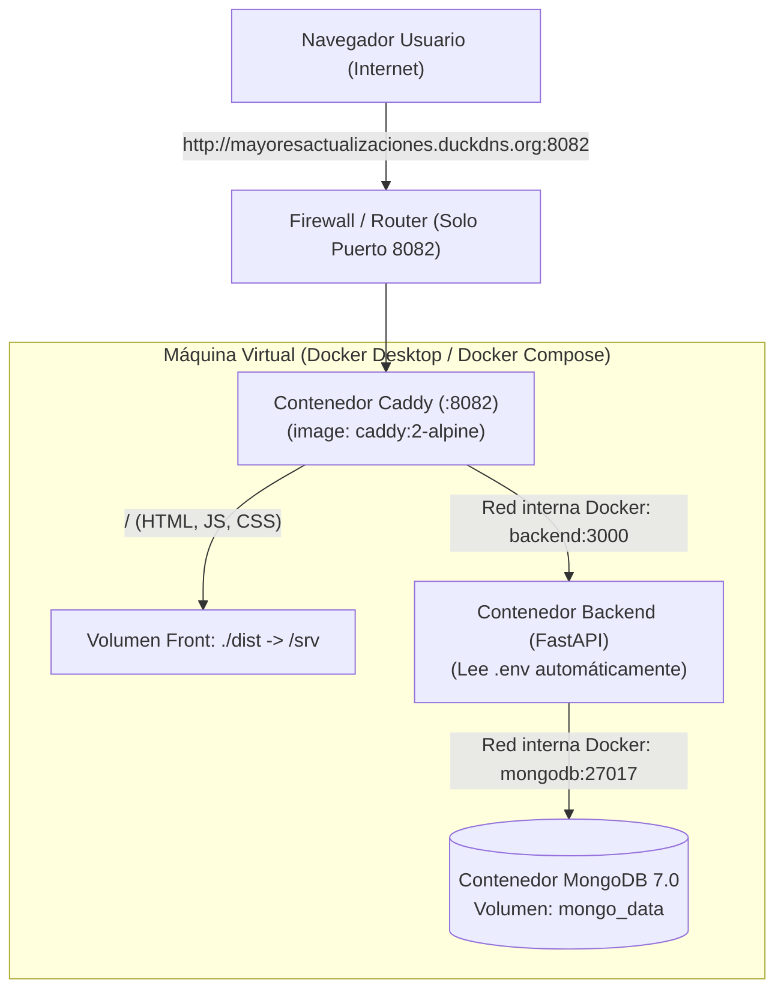

# Documento de Contexto y Estructura de Despliegue: SIPI (Full Docker)

Este documento consolida las decisiones técnicas, la arquitectura de red y la estructura oficial acordada para el despliegue del sistema **SIPI**:
- **Arquitectura 100% Contenedorizada con Docker Compose**:
  1. **Caddy (Web Server & Reverse Proxy):** Atiende el puerto público **`8082`**, sirve los archivos estáticos de React (`dist/`) y rutea las peticiones de API internamente.
  2. **Backend (Python / FastAPI):** Escucha en el puerto `3000` dentro de la red privada de Docker, leyendo todas las credenciales desde el archivo `.env`.
  3. **Base de Datos (MongoDB 7.0):** Persiste los datos en un volumen seguro (`mongo_data`).

---

## 1. Contexto y Objetivos del Proyecto

1. **Servidor Dedicado (Máquina virtual que no se apaga):**  
   Se definió una máquina virtual/servidor con Windows para hospedar todo el stack de forma ininterrumpida.
2. **Exposición al exterior con un único puerto (`8082`):**  
   Por políticas de red y seguridad perimetral, solo se expone el puerto **`8082`** en el router hacia la máquina virtual a través del dominio dinámico `http://mayoresactualizaciones.duckdns.org:8082`.
3. **Cero instalaciones de dependencias en Windows:**  
   Al correr todo en Docker:
   - **No** necesitas instalar Python ni librerías en Windows.
   - **No** necesitas instalar MongoDB en Windows.
   - **No** necesitas descargar `caddy.exe` ni configurar servicios de Windows con NSSM.
   - Docker Desktop gestiona el ciclo de vida y arranque automático (`restart: unless-stopped`).
4. **Lectura de Variables de Entorno (.env):**  
   Docker Compose inyecta automáticamente el archivo `.env` al contenedor del Backend mediante la directiva `env_file: - .env`.
5. **Solución definitiva a CORS:**  
   Al servirse la web de React y la API a través del mismo origen y puerto (`:8082`), los navegadores nunca bloquean peticiones por CORS.

---

## 2. Diagrama de Arquitectura y Red Docker



---

## 3. Estructura de Archivos en la Máquina Virtual

En el servidor Windows solo tienes una única carpeta principal:

```text
C:\
└── Users\
    └── pgurvicius\
        └── Documents\
            └── app\
                └── sipi-stack\                      <-- CARPETA COMPLETA DEL SISTEMA
                    ├── Caddyfile                    <-- Reglas de proxy y servidor web
                    ├── docker-compose.yml           <-- Orquestador de Caddy + Back + MongoDB
                    ├── Dockerfile                   <-- Construcción de la imagen FastAPI
                    ├── requirements.txt             <-- Dependencias de Python
                    ├── .env                         <-- Variables de entorno y secretos
                    ├── app\                         <-- Código fuente del Backend
                    │   ├── main.py
                    │   ├── core/
                    │   ├── features/
                    │   └── scripts/
                    └── dist\                        <-- AQUÍ PEGAS EL BUILD DEL FRONTEND
                        ├── index.html
                        ├── favicon.ico
                        └── assets\
                            ├── index-xxxx.js
                            └── index-xxxx.css
```

---

## 4. Archivos de Configuración Clave

### A. Archivo `Caddyfile`
Ubicación: `C:\Users\pgurvicius\Documents\app\sipi-stack\Caddyfile`

```caddy
http://mayoresactualizaciones.duckdns.org:8082, :8082 {
    # 1. Enrutar endpoints de la API hacia el contenedor del backend
    @backend path /api/* /usuario* /progreso* /cursos* /payment* /health* /actuator/* /docs* /openapi.json*
    handle @backend {
        reverse_proxy backend:3000
    }

    # 2. Servir los archivos estáticos de React y soporte de React Router (fallback a index.html)
    handle {
        root * /srv
        try_files {path} /index.html
        file_server
    }
}
```

### B. Archivo `docker-compose.yml`
Ubicación: `C:\Users\pgurvicius\Documents\app\sipi-stack\docker-compose.yml`

```yaml
services:
  # 1. Caddy: Sirve el Frontend y actúa de Reverse Proxy en el puerto 8082
  caddy:
    image: caddy:2-alpine
    container_name: mayores-actualizaciones-caddy
    restart: unless-stopped
    ports:
      - "8082:8082"                       # Único puerto expuesto hacia el exterior
    volumes:
      - ./Caddyfile:/etc/caddy/Caddyfile  # Configuración
      - ./dist:/srv                       # Archivos estáticos del Frontend
    depends_on:
      - backend

  # 2. Backend: API FastAPI en Python
  backend:
    build: .
    container_name: mayores-actualizaciones-backend
    restart: unless-stopped
    ports:
      - "3000:3000"                       # Opcional para pruebas directas en localhost
    env_file:
      - .env                              # Carga automática de todas las variables
    environment:
      - MONGODB_URL=mongodb://mongodb:27017
      - PORT=3000
      - HOST=0.0.0.0
    depends_on:
      - mongodb

  # 3. Base de Datos: MongoDB
  mongodb:
    image: mongo:7.0
    container_name: mayores-actualizaciones-mongodb
    restart: unless-stopped
    volumes:
      - mongo_data:/data/db               # Persistencia de datos

volumes:
  mongo_data:
```

### C. Variables de Entorno (`.env`)
Ubicación: `C:\Users\pgurvicius\Documents\app\sipi-stack\.env`

```env
# ==========================================
# CONFIGURACION DEL SERVIDOR (FASTAPI / UVICORN)
# ==========================================
PORT=3000
HOST=0.0.0.0

# ==========================================
# BASE DE DATOS MONGODB
# ==========================================
MONGODB_URL=mongodb://localhost:27017
MONGODB_DB_NAME=mayores_actualizaciones

# ==========================================
# JWT & SEGURIDAD
# ==========================================
JWT_SECRET=c2VjcmV0LWtleS1mb3ItbWF5b3Jlcy1hY3R1YWxpemFjaW9uZXMtYmFja2VuZC0yMDI2LXNpcGk=
JWT_EXPIRATION_DAYS=180

# ==========================================
# FRONTEND URL (CORS Y MAGIC LINKS)
# ==========================================
FRONTEND_URL=http://mayoresactualizaciones.duckdns.org:8082

# ==========================================
# CORREO ELECTRONICO (Brevo / SMTP Relay)
# ==========================================
SMTP_HOST=smtp-relay.brevo.com
SMTP_PORT=587
SMTP_USER=bac8ec001@smtp-brevo.com
SMTP_PASSWORD=tu_clave_smtp_aqui
MAIL_FROM=nfernandezcoopya@gmail.com
MAIL_FROM_NAME=Mayores Actualizaciones

# ==========================================
# ADMINISTRADOR POR DEFECTO
# ==========================================
ADMIN_DEFAULT_EMAIL=admin@sistemas.com
ADMIN_DEFAULT_PASSWORD=admin123
ADMIN_DEFAULT_NAME=Operador Sistemas
```

---

## 5. Preparación del Frontend antes del Build

Antes de compilar el Frontend en tu máquina de desarrollo:

1. **Variables de entorno del Frontend (`.env` en `mayores_actualizacionesSIPI-FRONT`):**  
   - Verifica que `VITE_API_URL` esté vacío (`VITE_API_URL=`) o no definido para producción.
   - En `src/config/api.js`, la configuración ya está programada para que en modo producción (`import.meta.env.PROD`) utilice una cadena vacía `''`.
   - **Efecto:** Todas las llamadas (`/api/auth/login`, `/usuario`, etc.) se hacen con rutas relativas hacia el mismo dominio y puerto desde el que cargó la web (`:8082`). No queda ninguna IP o `localhost` guardada en el código compilado.
2. **Ejecutar el Build:**  
   En la terminal del frontend:
   ```powershell
   npm run build
   ```
3. **Obtención de la carpeta:**  
   Esto generará la carpeta `dist/`. Es **esta carpeta `dist/`** la que copiarás a la máquina virtual dentro de la carpeta del proyecto.

---

## 6. Paso a Paso para Desplegar en la Máquina Virtual

### Paso 1: Instalar Docker Desktop
1. En la máquina virtual con Windows, instalar [Docker Desktop para Windows](https://www.docker.com/products/docker-desktop/).
2. Iniciar Docker Desktop y verificar que el ícono esté en verde ("Engine running").

### Paso 2: Copiar los Archivos al Servidor
Crear la carpeta `C:\Users\pgurvicius\Documents\app\sipi-stack\` y copiar dentro:
- Carpeta `app/`
- Carpeta `dist/` (generada por `npm run build` en el frontend)
- Archivo `Caddyfile`
- Archivo `docker-compose.yml`
- Archivo `Dockerfile`
- Archivo `requirements.txt`
- Archivo `.env`

### Paso 3: Levantar TODO con un solo comando
Abrir PowerShell en `C:\Users\pgurvicius\Documents\app\sipi-stack\` y ejecutar:

```powershell
docker compose up --build -d
```

### ¿Qué ocurre inmediatamente?
1. Docker descarga las imágenes ligeras de **Caddy** y **MongoDB 7.0**.
2. Construye la imagen de **FastAPI** instalando las librerías.
3. Inyecta automáticamente el archivo `.env` a FastAPI.
4. Caddy empieza a escuchar en el puerto **`8082`**.
5. Si la máquina se reinicia o se corta la luz, Docker vuelve a levantar los 3 contenedores automáticamente.

---

## 7. Comandos de Gestión y Mantenimiento

| Acción | Comando (en la carpeta `sipi-stack`) |
| :--- | :--- |
| **Ver estado de los 3 servicios** | `docker compose ps` |
| **Ver logs del Backend en vivo** | `docker compose logs -f backend` |
| **Ver logs de Caddy** | `docker compose logs -f caddy` |
| **Actualizar el Frontend** | Simplemente reemplazas los archivos de la carpeta `dist/` (Caddy los sirve al instante, no requiere reiniciar) |
| **Actualizar código del Backend** | Reemplazas los archivos en `app/` y corres: `docker compose up --build -d backend` |
| **Detener todo sin perder datos** | `docker compose stop` |
| **Iniciar todo de nuevo** | `docker compose start` |
