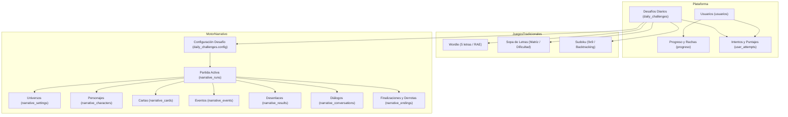
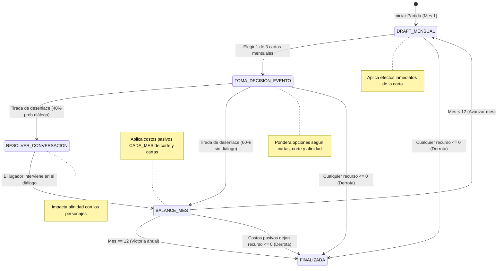

# Guía Integral de Arquitectura: Ecosistema de Juegos y Motor Narrativo Roguelite

> Documento de transferencia técnica y contexto de desarrollo para el equipo de ingeniería.  
> **Proyecto:** Mayores Actualizaciones (SIPI-BACK + Frontend)  
> **Rama activa:** `feature/juego-narrativo`

---

## 1. Visión General del Ecosistema

La plataforma tiene como objetivo estimular capacidades cognitivas en adultos mayores a través de desafíos diarios lúdicos. Cuenta con dos grandes subsistemas de juegos:

1. **Juegos Cognitivos Tradicionales Diarios:** Wordle, Sopa de Letras y Sudoku.
2. **Juego Narrativo de Gestión y Decisiones Roguelite:** *"Crónicas de la Corte Real"* (`game_id = "narrativo"`), una experiencia episódica anual donde el usuario toma decisiones para equilibrar los recursos de un reino a lo largo de 12 meses.

### Diagrama de Relación entre Módulos



---

## 2. Juegos Tradicionales (Wordle, Sopa, Sudoku)

### 2.1 Desafíos Diarios (`daily_challenges`)
- Cada juego tradicional genera automáticamente instancias fechadas (`YYYY-MM-DD`).
- **Servicio `ensure_current_and_next_month_generated()`:** Al arrancar FastAPI en `main.py` y en un loop en segundo plano cada 12 horas, garantiza que el mes en curso y el mes siguiente estén completamente sembrados.
- **Colección `daily_challenges`:**
  - `_id`: Auto-generado o `"{game_id}_{date}_{difficulty}"`.
  - `game_id`: `"wordle"` | `"sopa_letras"` | `"sudoku"` | `"narrativo"`.
  - `date`: Formato ISO `"YYYY-MM-DD"`.
  - `config`: Objeto JSON con el tablero, palabras o configuración inicial del desafío.

### 2.2 Intentos y Métricas (`user_attempts`)
- Cada vez que un usuario interactúa o completa un juego, se actualiza su intento diario:
  - `user_id` (int), `game_id` (str), `date` (str).
  - `completed` (bool): Si resolvió el desafío con éxito.
  - `score` (int): Puntaje normalizado.
  - `duration_seconds` (int): Tiempo de resolución.
  - `attempts_count` (int): Cantidad de intentos o jugadas realizadas.

---

## 3. El Motor Narrativo Roguelite (`Crónicas de la Corte Real`)

### 3.1 Filosofía de Diseño
El juego narrativo transporta al usuario a un arquetipo temático (inicialmente `corte_medieval`, pero completamente extensible a universos como granjas, ciencia ficción, etc.). 
- **Duración:** La partida consta de **12 Meses** (un año de gobierno).
- **Roguelite por gestión:** Las decisiones alteran recursos numéricos. Si algún recurso vital cae a $\le 0$, el reino colapsa y sobreviene la derrota inmediata.

### 3.2 Atributos Clave de la Partida (`narrative_runs`)

| Atributo | Tipo | Descripción |
| :--- | :--- | :--- |
| **`recursos`** | `Dict[str, int]` | Balances numéricos (0 a 100). En `corte_medieval`: `oro`, `pueblo`, `ejercito`, `fe`. Si alguno llega a $\le 0 \rightarrow$ **Game Over**. |
| **`afinidad`** | `Dict[str, int]` | Miembros de la corte activa y su afinidad (0 a 100), mapeado como `{id_personaje: afinidad}`. Las claves representan directamente los miembros de la corte activa (eliminando redundancia de `corte_activa`). |
| **`cartas_en_mano`** | `List[str]` | Inventario de cartas obtenidas (iniciales y del draft mensual). |
| **`tags_activos`** | `List[str]` | Etiquetas acumuladas (`comercio`, `militar`, `clero`, etc.) requeridas para desbloquear opciones secretas en eventos. |
| **`mes_actual`** | `int` | Mes en curso (1 al 12). |
| **`fase_actual`** | `RunPhaseEnum` | Estado de la máquina de turnos (`DRAFT_MENSUAL`, `TOMA_DECISION_EVENTO`, `RESOLVER_CONVERSACION`, `BALANCE_MES`, `FINALIZADA`). |
| **`status`** | `str` | `"in_progress"` \| `"completed"` (victoria o derrota). |
| **`finalizacion`** | `Optional[Dict]` | Desenlace unificado con lore, título, rango e ilustración WebP (tanto para victoria en mes 12 como para derrota por colapso de recurso). |

---

### 3.3 Ciclo de Turno Mensual (Máquina de Estados)



---

## 4. Sistema de Derrotas y Finalizaciones (`narrative_endings`)

### 4.1 Principio de Aislamiento Estricto por Universo
Un problema habitual en sistemas con atributos compartidos (ej: dos universos tienen un recurso llamado `"oro"`) es que no deben compartir el mismo texto de derrota:
- En **`corte_medieval`**, oro en 0 significa *"Bancarrota de la Corona y desertores del castillo"*.
- En **`granjero_medieval`**, oro en 0 significa *"Embargo de la Granja y confiscación del arado"*.

Por ello, la colección `narrative_endings` vincula obligatoriamente:
$$\text{Ending} = (\text{universo\_id}, \text{recurso\_clave})$$

### 4.2 Verificación de Colapso en `service.py`
En `verificar_colapso_recursos(run_doc)`:
1. Detecta si algún recurso de `run_doc["recursos"]` es $\le 0$.
2. Busca estrictamente:
   ```python
   fin_doc = await db["narrative_endings"].find_one({
       "universo_id": run_doc["universo_id"],
       "recurso_clave": recurso_agotado
   })
   ```
3. Si no existe una redacción manual para ese universo, consulta `COLL_SETTINGS` y genera un fallback dinámico contextualizado con el nombre del universo y del recurso, **sin asumir jamás temáticas medievales o coronas**.
4. Modifica `run_doc["status"] = "game_over"` y `run_doc["fase_actual"] = "FINALIZADA"`.

### 4.3 Diferenciación en el Frontend
El cliente web o móvil reconoce el estado de la partida mediante la respuesta `EstadoPartidaActivaResponse`:

```typescript
// Regla unívoca en el Frontend:
const esDerrota = data.run.status === 'game_over' || !!data.finalizacion;
const esVictoria = data.run.status === 'completed';
const estaEnJuego = data.run.status === 'in_progress';
```

---

## 5. Colecciones de MongoDB e Índices

| Colección | Propósito | Índices Clave |
| :--- | :--- | :--- |
| `daily_challenges` | Desafíos diarios fechados por juego. | `[("game_id", 1), ("date", 1), ("difficulty", 1)]` (Unique) |
| `user_attempts` | Intentos y resultados de alumnos. | `[("user_id", 1), ("game_id", 1), ("date", 1)]` (Unique), `[("user_id", 1), ("date", -1)]` |
| `narrative_runs` | Estado vivo de la partida narrativa del día. | `[("user_id", 1), ("date", 1), ("game_id", 1)]` (Unique), `[("user_id", 1), ("date", -1)]` |
| `narrative_settings` | Catálogo de universos y recursos válidos. | `[("_id", 1)]` |
| `narrative_characters` | Arquetipos de corte. | `[("universo_id", 1)]` |
| `narrative_cards` | Cartas de inventario y draft. | `[("universo_id", 1)]` |
| `narrative_events` | Eventos mensuales con opciones. | `[("universo_id", 1)]` |
| `narrative_results` | Desenlaces ponderados de las opciones. | `[("universo_id", 1)]` |
| `narrative_conversations`| Diálogos de corte entre personajes. | `[("universo_id", 1)]` |
| `narrative_endings` | Finalizaciones y derrotas por colapso. | `[("universo_id", 1), ("recurso_clave", 1)]` |

---

## 6. Endpoints Clave

### 6.1 Jugador / Cliente (`router.py` prefix: `/api/narrative/partida`)
- `GET /setup?date={date}`: Obtiene el setup inicial del día (universo, corte ofrecida, cartas iniciales).
- `POST /reiniciar`: Resetea la partida diaria para reintentar.
- `POST /conversaciones-posibles` / `GET /conversaciones-posibles`: Evalúa conversaciones habilitadas para una mano de personajes.

#### Endpoints de Consulta Especializados (Bajo Demanda en Swagger):
- `GET /draft-actual?date={date}`: Devuelve únicamente las 3 cartas ofrecidas en el draft del mes activo.
- `GET /evento-actual?date={date}`: Devuelve únicamente el evento del mes con sus opciones y probabilidades calculadas.
- `GET /resultado-actual?date={date}`: Devuelve únicamente el resultado del evento recién resuelto.
- `GET /conversacion-actual?date={date}`: Devuelve únicamente el diálogo de corte sorteado (o null si no hubo).
- `GET /historial?date={date}`: Bitácora mensual completa acumulada de los 12 meses (solo al finalizar o en modal de replay).
- `GET /inventario?date={date}`: Baraja de cartas obtenidas y tags activos del jugador.
- `GET /corte?date={date}`: Integrantes de la corte actual con sus afinidades (0 a 100).
- `GET /finalizacion?date={date}`: Objeto con título, texto, rango y motivo de finalización o derrota.

#### Endpoints Legacy V1 (Ocultos de Swagger con `include_in_schema=False`, activos por retrocompatibilidad):
- `POST /iniciar`, `GET /activa`, `POST /elegir-carta-mes`, `POST /decidir-evento`, `POST /responder-conversacion`, `POST /avanzar-mes`, `GET /turno` (reemplazados oficialmente en la documentación por el Motor V2).

### 6.2 Motor de Turnos V2 Ligero (`router_v2.py` prefix: `/api/narrative/v2/partida`)
Endpoints hermanos optimizados para transferencia ultra-ligera (< 1 KB por llamada):
- `POST /iniciar`: Devuelve solo recursos iniciales y las 3 cartas de draft del Mes 1 (`IniciarPartidaV2Response`).
- `POST /elegir-carta-mes`: Devuelve solo recursos y el evento sorteado con probabilidades (`ElegirCartaMesV2Response`).
- `POST /decidir-evento`: Devuelve solo recursos, el resultado obtenido y la conversación si hubo (`DecidirEventoV2Response`).
- `POST /responder-conversacion`: Devuelve afinidad actualizada y consecuencia del diálogo (`ResponderConversacionV2Response`).
- `POST /avanzar-mes`: Devuelve recursos post-pasivos y las 3 nuevas cartas de draft (`AvanzarMesV2Response`).
- `GET /estado`: Estado liviano reactivo para sincronización o recarga F5 (`EstadoTurnoResponse`).

### 6.3 Administración / Torre de Control (`admin_router.py` prefix: `/api/narrative/admin`)
- **CRUDs completos:** `/universos`, `/personajes`, `/cartas`, `/eventos`, `/resultados`, `/conversaciones`, `/finalizaciones`.
- **Generación masiva mensual:** `POST /generar-mes?year=YYYY&month=M&universo_id=...` (arma los 30 desafíos diarios combinando pools).
- **Sembrado de derrotas:** `POST /universos/{universo_id}/sembrar-finalizaciones` (autogenera borradores de derrota para cada recurso del universo).
- **Procesador de Imágenes:** `POST /upload-imagen?categoria={cat}` (JPG/PNG a WebP con redimensionado proporcional).

---

## 7. Sistema de Imágenes y Torre de Control (`admin_src`)

### 7.1 Pipeline WebP con Pillow
Para evitar saturación de ancho de banda y garantizar carga instantánea:
1. Endpoint `POST /api/narrative/admin/upload-imagen`.
2. Redimensiona proporcionalmente con filtro Lanczos según categoría:
   - `universos`: 1200x600 px
   - `personajes`: 600x750 px
   - `cartas`: 450x630 px
   - `eventos` / `resultados` / `conversaciones` / `finalizaciones`: 900x500 px
3. Comprime en formato **WebP calidad 82**.
4. Guarda en `backend/app/static/narrative/{categoria}/` y devuelve URL `/assets/narrative/{categoria}/{archivo}.webp`.

### 7.2 Componente Frontend `ImageUploadField.jsx`
- Ubicado en `frontend/admin_src/narrative/ImageUploadField.jsx`.
- Permite subir archivos mediante drag-and-drop o selector, o ingresar URLs manuales, mostrando preview en miniatura y tamaño en KB resultante.

---

## 8. Convenciones y Reglas del Proyecto

1. **Control de Versiones (`practicas-coopya-github`):**
   - **Nunca** commitear ni pushear sin instrucción expresa del usuario.
   - Trabajar siempre sobre ramas `feature/*` correspondientes.
2. **Archivos de Despliegue Intocables:**
   - No modificar `Dockerfile`, `docker-compose.yml` ni `Caddyfile`.
3. **Iconografía en Admin:**
   - Solo componentes SVG exportados desde `Icons.jsx`. No utilizar emojis en la interfaz administrativa.
4. **Proxy de Desarrollo en Vite:**
   - Las rutas `/usuario`, `/progreso`, `/api` y `/assets/narrative` se encuentran configuradas en `vite.config.ts` para redirigir a `http://localhost:8080`.
5. **Compilación del Admin:**
   - Para compilar el frontend administrativo en producción: `npm run build:admin` (genera los bundles en `backend/app/static/admin`).
