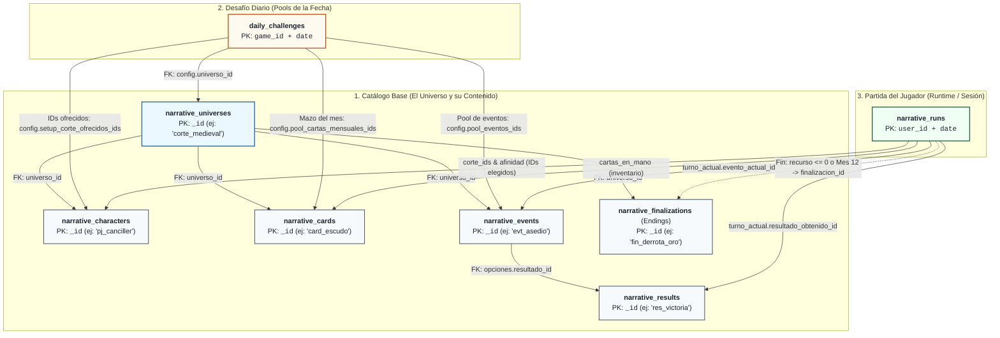
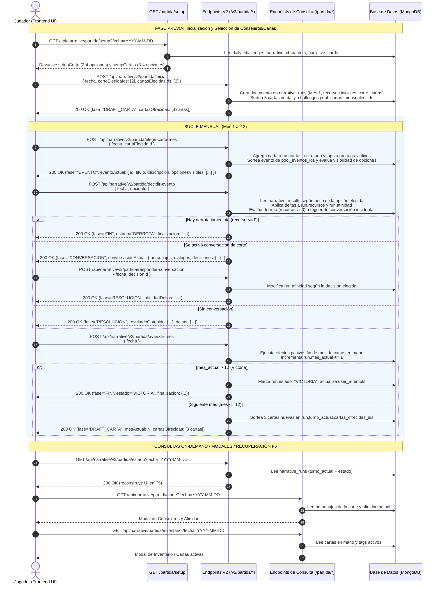

# Arquitectura de Datos y Ciclo de Vida: Juego Narrativo (KingsCourt)

Este documento contiene la especificación técnica y los diagramas explicativos del **Juego Narrativo**, diseñados para que cualquier desarrollador de Backend o Frontend entienda:
1. **Cómo se relacionan las colecciones en MongoDB** mediante IDs, claves de recursos, tags y diccionarios de afinidad.
2. **Qué endpoints intervienen en el flujo de juego**, en qué orden se consumen y qué entidades leen o mutan en cada paso.

---

## 1. Diagrama de Entidades y Relaciones (Modelo Simplificado)

Para entender el modelo de datos rápidamente, el sistema se divide en **3 niveles simples**:
1. **Catálogo Base:** Todo el contenido del juego agrupado por `universo_id`.
2. **Selección Diaria (`daily_challenges`):** Los pools de IDs que se juegan en una fecha determinada.
3. **Partida Activa (`narrative_runs`):** El estado vivo del jugador y los IDs que tiene seleccionados en su turno.

### Diagrama de Relaciones e Identificadores

> [!NOTE]
> **Conversaciones de corte (`narrative_conversations`):**
> Pertenecen a `universo_id` y se activan como evento incidental evaluando si los miembros de la corte coinciden con `requisitos[].personajeId`.

### Resumen de Claves de Unión (IDs clave)

* **`universo_id`**: Conecta todo el contenido base (personajes, cartas, eventos y endings) con su universo correspondiente.
* **`daily_challenges.config.*_ids`**: Listas de strings con los `_id` de personajes, cartas y eventos habilitados para ese día.
* **`narrative_runs.corte_ids`**: Array con los 2 `_id` de personajes elegidos para la partida.
* **`narrative_runs.cartas_en_mano`**: Array con los `_id` de cartas acumuladas en el inventario.
* **`narrative_runs.turno_actual.evento_actual_id`**: El `_id` del evento sorteado que el jugador debe resolver.
* **`narrative_events.opciones[].resultado_id`**: El `_id` del resultado que se aplica al elegir una opción.
* **`narrative_finalizations._id`**: El `_id` del ending (Victoria o Derrota por recurso) que se carga en la partida al finalizar.

---

## 2. Diagrama de Flujo de Endpoints V2 y Ciclo de Vida (Game Loop)

Este diagrama modela el viaje del usuario en el Frontend interactuando con los endpoints V2 ligeros del Backend ([`router_v2.py`](file:///c:/Users/nmonti/Desktop/proyectos/backend/mayores_actualizacionesSIPI-BACK/app/features/narrative/router_v2.py)).

---

## 3. Resumen Rápido para Desarrolladores Frontend

### 1. ¿Cómo inicializar y renderizar el juego?
1. Llamar a `GET /api/narrative/partida/setup?fecha=YYYY-MM-DD`.
2. Si `estadoExistente` es nulo, mostrar la pantalla de selección con `setupCorte` y `setupCartas`.
3. Al confirmar la selección (2 personajes y 2 cartas), disparar `POST /api/narrative/v2/partida/iniciar`.

### 2. ¿Cómo manejar el Game Loop mensual?
El backend responde en cada turno con un `fase` que indica qué vista renderizar:
* `"DRAFT_CARTA"`: Mostrar las 3 cartas de `cartasOfrecidas`. Al seleccionar una, llamar a `POST /api/narrative/v2/partida/elegir-carta-mes`.
* `"EVENTO"`: Mostrar `eventoActual` con sus `opcionesVisibles`. Al pulsar una opción, llamar a `POST /api/narrative/v2/partida/decidir-evento`.
* `"CONVERSACION"`: (Si ocurrió un dilema entre consejeros). Mostrar el diálogo y las opciones. Al elegir, llamar a `POST /api/narrative/v2/partida/responder-conversacion`.
* `"RESOLUCION"`: Mostrar el resultado del mes y los deltas obtenidos. Botón "Continuar al siguiente mes" llama a `POST /api/narrative/v2/partida/avanzar-mes`.
* `"FIN"`: Mostrar pantalla final con la victoria o derrota provista en `finalizacion`.

### 3. ¿Qué hacer en caso de recarga (F5)?
Llamar a `GET /api/narrative/v2/partida/estado?fecha=YYYY-MM-DD`. El backend devolverá el `NarrativeTurnoDeltaResponse` exacto del momento en que se quedó la partida, permitiendo restaurar la UI sin pérdida de datos.
